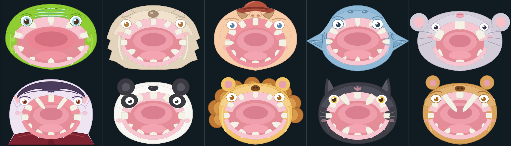

# Zahn Agent

Das Zahn-Zufallsspiel um das Krokodil — Spielprinzip des Spielzeugs *Crocodile Dentist*
(bekannt als *Kroko Doc*) als Webapp: Zahn für Zahn antippen — einer ist der falsche, dann schnappt das Maul zu.
Man schaut **von vorne oben in das offene Maul** und kann zwischen Gebissen wählen:
Krokodil, Wolf, Mensch, Hai, Maus und Vampir. Mit Ton, Herzschlag, einer Pause vor jeder Auflösung, Screen-Shake und
einer Statistikseite, die eure eigenen Runden auswertet.



**Warum es dieses Spiel gibt.** Ein Familienmitglied hat gefragt, ob man vorher berechnen
kann, welcher Zahn das Maul schließt. Antwort: nein — das Spielzeug ist ein mechanischer
Zufallsgenerator, und ein Teardown zeigt, dass sogar **1 bis 3 Zähne gleichzeitig** scharf
sind (make Magazin 1/2023). Also haben wir erst gerechnet (`../kroko-doc`, Python-Werkzeug
mit Chi²-Tests) und dann das Spiel mit dieser Rechnung im Bauch gebaut — inklusive der
Frage, ob das eigene Krokodil ehrlich zufällig ist.

---

## In fünf Minuten lokal starten

### Was du brauchst

| Voraussetzung | Prüfen mit | Nötig |
|---|---|---|
| Node.js **20.3 oder neuer** | `node -v` | ja (Astro 5 verlangt `18.20.8 \|\| ^20.3.0 \|\| >=22`) |
| pnpm **9 oder neuer** | `pnpm -v` | ja — oder ein Befehl: `corepack enable` |
| Internet | — | **nur einmal** für `git clone` und `pnpm install` |
| Datenbank, Server, Konto | — | nein. Alles läuft lokal im Browser, Daten bleiben im `localStorage` |

Getestet habe ich die Anleitung mit **Node 26.5.1 und pnpm 12.6.0** (frischer Klon, `dist/`
frei, 11.10.2026): `pnpm install` läuft durch, 206 Tests grün, Bau fertig in 2,12 s.

### Die drei Befehle

```bash
git clone git@github.com:shaunclaw07/zahn_agent.git   # ohne SSH-Schlüssel: https://github.com/shaunclaw07/zahn_agent.git
cd zahn_agent
pnpm install
pnpm dev
```

Dann im Browser öffnen: **<http://localhost:4321>**

> **Wichtig:** `localhost` verwenden, **nicht** `127.0.0.1`. Astro hört standardmäßig nur auf
> `localhost` (IPv6); über `127.0.0.1` bekommst du „Verbindung fehlgeschlagen". Wenn du
> lieber die IPv4-Adresse willst: `pnpm dev --host 127.0.0.1` (beides geprüft).

**Beenden:** `Strg + C` im Terminal. Der Entwicklungsserver lädt Änderungen an den Dateien
sofort neu — du kannst also direkt im Browser daneben probieren.

### Ohne Entwicklungsserver (so wie es ausgeliefert wird)

```bash
pnpm build      # statische Seite nach dist/  (fertig in ca. 2,5 s)
pnpm preview    # serviert dist/ auf http://localhost:4321
```

`dist/` ist eine reine statische Seite: du kannst sie zur Not auch mit
`python3 -m http.server` in `dist/` ausliefern. Es gibt keinen Server-Anteil.

### So probierst du es aus

Die Startseite zeigt **nur das Spiel**: das Tier, „Zähne übrig" und den Balken. Alles Einstellbare
liegt hinter dem **Zahnrad** oben rechts — beim Spielen lenkt nichts davon ab.

1. **Spielen:** auf einen Zahn im Maul tippen. Beim Tippen hörst du einen Klang, der
   Herzschlag wird schneller, gelegentlich zuckt das Maul (Fakeout), dann kommt entweder der
   nächste Zahn — erst nach einer Pause, die nichts über den Ausgang verrät — oder der **Biss** samt Screen-Shake und Vibration.
2. **Zahnrad** (Knopf oben rechts): 1–4 Spieler, welches Tier, wie viele Zähne, wie gefährlich
   („wie das Spielzeug" = 1–3 Zähne gleichzeitig gefährlich, „nur ein Zahn" = genau einer), Ton
   und Wackeln an/aus, „Neue Runde", die Regeln und der Weg zur Statistikseite.
3. **Tier wählen:** im Zahnrad auf die Tier-Zeile tippen — sechs **Bild-Kacheln** (Krokodil, Wolf,
   Mensch, Hai, Maus, Vampir) mit dem Kopf aus der eigenen Zeichnung. Ein Tipp zeigt die Kurzinfo
   zum Tier, „Damit spielen" übernimmt es. Die **Zahnzahl** stellst du mit `−` / `+` ein
   („Standard" nimmt wieder das tiergerechte Gebiss: Krokodil 10, Wolf 12, Mensch 12; erlaubt
   sind 4 bis 12).
4. **Nach dem Biss:** Ergebnis-Blatt mit Verlierer und Zahn, dazu „Noch eine Runde". „Neue Runde"
   im Zahnrad startet jederzeit eine frische Runde.
5. **Statistik für Große** (im Zahnrad): Häufigkeiten je Zahn, Chi²-Test gegen Gleichverteilung und
   gegen das Zugmodell, Wilson-Intervalle, Mustersuche (Autokorrelation), Rohdaten,
   CSV-Export/-Import und **„Protokoll löschen"** zum Zurücksetzen.
6. **Regeln** (im Zahnrad): zuerst die Kind-Regeln, darunter eingeklappt „Für Große: warum es keinen
   sicheren Zahn gibt" (und warum mehrere Lebewesen).

Zwei Eigenheiten, die normal sind: **Ton kommt erst nach dem ersten Tipp** (Browser erlauben
Audio erst nach einer Nutzeraktion) und **die Daten liegen in diesem einen Browser** — ein
anderer Browser oder ein privates Fenster hat seine eigene Statistik.

---

## Alle Befehle

| Befehl | Was er tut | Erwartetes Ergebnis |
|---|---|---|
| `pnpm install` | Abhängigkeiten holen (nur Entwicklungs-Werkzeuge, keine Laufzeit-Pakete) | `Done in …` ohne Fehler |
| `pnpm dev` | Entwicklungsserver mit Sofort-Aktualisierung | <http://localhost:4321> → HTTP 200 |
| `pnpm build` | statische Seite nach `dist/` bauen | „Complete!", `dist/` mit `index.html`, `statistik/` |
| `pnpm preview` | `dist/` lokal ausliefern | <http://localhost:4321> → HTTP 200 |
| `pnpm test` | Tests im Wachmodus | läuft weiter, bis du abbrichst |
| `pnpm test:run` | Tests einmalig | **206 Tests in 18 Dateien**, alle grün |
| `pnpm vitest run src/render-probe.test.ts` | schreibt je Lebewesen ein SVG zum Ansehen (danach `scripts/artwork-png.py`) |
| `pnpm typecheck` | TypeScript prüfen | keine Ausgabe = keine Fehler |
| `pnpm gate` | Typen **und** Tests — die Prüfung vor jedem Commit | beides grün |
| `bash scripts/doku-pruefen.sh …` | Doku prüfen: Code-Zäune, Fließtext im Block, alte Werte (`ALTE_WERTE="…"`) | „Zaeune: … (paarig)"; Exit 1 = es steht noch etwas drin |
| `python3 scripts/doku-pfade-pruefen.py . …` | halten, ob jede in Backticks genannte Pfadangabe existiert | „Alle genannten Pfade existieren." |

Ports: Entwicklungs- und Vorschauserver benutzen **4321**. Belegt? `pnpm dev --port 4322`.

---

## Was es kann

- **Spielen:** 1–4 Spieler im Hot-Seat, Maul schnappt zu, Verlierer wird benannt.
- **Für Kinder gebaut:** die Startseite zeigt Tier und Spielstand — sonst nichts. Alles Einstellbare
  liegt hinter dem Zahnrad; die Tier-Auswahl sind Bild-Kacheln aus der echten Zeichnung, und die
  Anzeigen sprechen in Worten („10 Zähne übrig", „Bissgefahr 20 %"). Die Technik-Erklärung
  (Bumerang, Rechenwerte) steht eingeklappt unter „Für Große".
- **Sechs Gebisse:** Krokodil (10 Zähne, 1–3 gleichzeitig scharf), Wolf (12, 1–2 — vier große
  Fangzähne), Mensch (12, 1–3), Hai (12, 1–2 — runde Raubtierzähne, Kiemenschlitze am Kopf),
  Maus (nur 6 Nagezähne — die kürzeste Runde), Vampir (12, 1–2 — zwei lange Eckzähne). Jedes
  Gebiss zeichnet sich selbst: Blick von vorne oben in den Rachen, eigenes Zahnprofil, eigene
  Kopfform, eigenes Zahnfleisch.
- **Zahnzahl einstellbar:** 4 bis 12 drückbare Zähne, standardmäßig so viele, wie das Tier
  vorsieht. Die Zähne sitzen auf einem Ring **um das ganze Maul** (obere und untere Reihe), damit
  jedem Zahn auf einem 358 px breiten Handy eine Trefferfläche von mindestens 44 × 44 Pixeln
  bleibt — bei 16 Zähnen wären es nur noch 38 px, deshalb ist bei 12 Schluss. Ein Test rechnet
  das für jedes Lebewesen nach. Mehr Zähne heißt mehr Drücke: der Wolf beißt später zu (bei 12
  Zähnen 5,42 erwartete Drücke statt 4,69).
- **Kindgerecht gezeichnet:** warme Farben, runde Zähne, große runde Augen mit Glanzpunkt und
  hellblauem Irisring (wie beim Original-Spielzeug), rosa Wangen und weiche Umrisse; der Rachen ist
  rosenrot statt schwarz, das Zahnfleisch die hellste Stufe. Das Krokodil trägt das satte Grün des
  Originals (und fällt damit bewusst aus der Reihe der fünf weichen Lebewesen), seine
  Schnauzenfalten sind Rillen mit Grat. Maul, Zähne und Gesicht werden auf den Kopfumriss
  beschnitten, damit beim Zuschnappen nichts daneben hängt. **Dieselbe Zeichnung trägt auch die
  Auswahl-Kacheln** (`portrait()`): der Kopf des Tieres als Bild, ohne Bedienteile — kein
  zusätzliches Asset.
- **Erweiterbar:** ein neues Lebewesen ist ein Katalogeintrag plus eine Zeichnungsdatei — ein
  Test erzwingt, dass Zahnzahl, Zahnformen und Ebenen zusammenpassen.
- **Zwei Zufallsmodelle:** `original` (1–3 Zähne gleichzeitig scharf, wie das echte Spielzeug —
  in der Oberfläche „wie das Spielzeug") und `classic` (genau ein scharfer Zahn — „nur ein Zahn").
- **Nervenkitzel:** synthetisierte Klänge (Web Audio, keine Dateien), Herzschlag, dessen Tempo
  mit der Spannung steigt (die Spannung ist die Biss-Wahrscheinlichkeit des nächsten Drucks), Knarren, Fakeout-Zucken des Mauls, eine Feder, die den Zahn in die Wurzel zieht, und die Pause vor jedem Urteil (ihre Länge sagt nichts über den Ausgang),
  Screen-Shake, Vibration bei jedem Zahndruck und beim Biss (wo der Browser sie kann), „Nur noch ein Zahn — der ist garantiert scharf!".
- **Der Balken sagt zwei Dinge:** die **Füllung** ist der Fortschritt („6 von 10 gedrückt"), die
  **Farbe** ist die Bissgefahr des nächsten Drucks („Bissgefahr 34 %") — er atmet im Takt des
  Herzschlags, glüht ab 30 % und wird ab 50 % rot — einen Druck vor dem letzten, sodass ein roter
  Druck auch gutgehen kann. Beim ersten Druck einer Sitzung
  erklärt er sich einmal selbst; nachlesen kann man ihn im Blatt „Regeln" (dort eingeklappt unter
  „Für Große") und auf der Statistikseite (dort steht die ganze Kurve).
- **Der Mut der Runde:** das Ergebnis nennt die höchste Bissgefahr, bei der ein Druck noch harmlos
  blieb („Dein mutigster Druck: 55 % Bissgefahr — und der Zahn war harmlos."). Das gibt dem Balken
  einen Zweck: die Gefahr, die man übersteht, ist das, was am Tisch erzählt wird.
- **Statistik:** jede Runde wird lokal protokolliert; die Statistikseite zeigt Häufigkeiten,
  die **mutigste Runde** („Mutigste Runde“, `bravestRound`),
  Chi²-Tests gegen Gleichverteilung **und** gegen das Zugmodell, Wilson-Intervalle,
  Autokorrelation (Mustersuche) und exportiert/importiert CSV im Format des Analyse-Werkzeugs.
- **Ehrlich:** unter 100 Runden gibt es keine Signifikanz-Aussage, sondern den Hinweis, dass
  die Daten zu dünn sind.
- **Kein Netz nötig:** keine externen Schriften, Bilder, CDNs; alles lokal, mobil zuerst.

---

## Zahlen, die belegt sind

| Größe | Wert | Herkunft |
|---|---|---|
| Tests | **212 in 18 Dateien**, alle grün | `pnpm test:run` |
| Vibration | Port mit `isSupported()`; 25 ms bei jedem Zahndruck, [120, 50, 220] beim Biss | `TAP_VIBRATION_MS`/`BITE_VIBRATION_PATTERN` in `presentation/game/gameController.ts`, Adapter mit eigenem Test |
| Typenprüfung | keine Fehler | `pnpm typecheck` |
| Produktionsbau | 2 Seiten, 2,1–2,5 s (Maschinenstreuung) | `pnpm build`, Arbeitsbaum und frischer Klon |
| Spannungsbalken | = Biss-Wahrscheinlichkeit des nächsten Drucks (Krokodil: 20,0 → 100 %) | `core/domain/tension.ts`, Kurve im Test festgenagelt |
| P(Biss beim 1. Druck) | 20,0 % | Rechnung `core/domain/probabilities.ts`, geprüft gegen Python |
| Erwartete Drücke bis zum Biss | 3,972222 (Krokodil, 10 Zähne) · 4,694444 (12 Zähne) | ebenda |
| 4 Spieler reihum | 33,9 % / 28,3 % / 20,7 % / 17,0 % | ebenda (Startspieler verliert am häufigsten) |
| Letzter Zahn | 3,333 % und dann garantiert scharf | ebenda |
| Schließweg des Oberkiefers | Krokodil 232,0 · Mensch 226,0 · Wolf 222,0 SVG-Einheiten | berechnet als `2·ry − Banddicke oben − Banddicke unten`, abgelesen im erzeugten SVG |
| Trefferfläche je Zahn | 51–63 px bei 12 Zähnen, 38 px bei 16 | Test in `creatureViews.test.ts` bei 358 px Bühnenbreite |

---

## Aufbau

```
src/core/domain/       Fachregeln: Zähne, Runde, Wahrscheinlichkeiten, Spannung, Statistik
src/core/ports/        Nähte: RandomSource, LiveTeethSelector, RoundLogPort, SoundPort, HapticsPort
src/core/use-cases/    playPress — ein Druck samt Dramaturgie
src/contract/          Außenvertrag (Rundenprotokoll, CSV-Format)
src/infrastructure/    crypto-Zufall, Web-Audio-Klänge, Vibration, localStorage, Testattrappen
src/presentation/      Spielsteuerung, Statistikansicht, Astro-Seiten
  game/creatures/      je Lebewesen ein Zeichnungsmodul + Fabrik + Registry
scripts/               artwork-png.py — Zeichnung ohne Browser rastern (Prüfhilfe)
                       doku-pruefen.sh, doku-pfade-pruefen.py — Doku prüfen (Zäune, alte Werte, Pfade)
```

Der Kern kennt weder Browser noch Uhr: Zufall kommt über einen Port herein, die Zeit über
eine injizierte Quelle. Das ist der Grund, warum die Fachlogik in jsdom und im Terminal
prüfbar ist.

Regeln für Arbeit am Baum: [`AGENTS.md`](AGENTS.md) und [`docs/`](docs/).
Nachweise der Prüfläufe: [`docs/e2e-nachweise.md`](docs/e2e-nachweise.md).
Sprachregel (Bezeichner englisch, Kommentare und Doku deutsch):
[`docs/language-guidelines.md`](docs/language-guidelines.md).

## Daten und Datenschutz

- Alle Runden liegen im **`localStorage`** des Browsers (`zahn_agent:rounds:v1`, `zahn_agent:settings:v1`) — kein Server, keine
  Konten, keine Telemetrie. Runden und Einstellungen aus Fassungen mit früherem Namen (`zahn-agent:…`,
  `kroko-doc-web:…`) werden beim ersten Laden einmalig übernommen.
- **Zurücksetzen:** Statistikseite → „Protokoll löschen" (löscht nur das Rundenprotokoll).
- **Sichern/umbenennen:** CSV exportieren; die Datei kannst du wieder importieren oder dem
  Python-Werkzeug `../kroko-doc/kroko_analyse.py` geben.
- CSV-Kopf (bewusst deutsch, weil es die Schnittstelle zum Analyse-Werkzeug ist):
  `runde;reihenfolge;verlierer_zahn;modus;zaehne;lebewesen;…`

## Auf GitHub Pages

Die Seite ist veröffentlicht: **<https://zahn-agent.schaflabs.com/>**

- [`.github/workflows/pages.yml`](.github/workflows/pages.yml) baut bei jedem Push auf `main` und
  liefert `dist/` aus. Dort läuft `pnpm gate` mit — eine rote Suite verhindert die Veröffentlichung.
- Die Domain gehört dem Repo über `public/CNAME`; der DNS-Eintrag liegt bei Cloudflare
  (`zahn-agent.schaflabs.com` als CNAME auf `shaunclaw07.github.io`). Weil die Seite damit auf
  der Wurzel liegt, baut der Workflow **ohne** `ASTRO_BASE` — Basis-Pfad `/`.
- Interne Verweise im Code gehen trotzdem über `import.meta.env.BASE_URL` und nie absolut mit
  `"/"` — das hält die Seite heil, falls sie je wieder unter einem Unterpfad laufen soll.
- Die alte Projektadresse `https://shaunclaw07.github.io/zahn_agent/` leitet mit `301` auf die
  Domain um (mit und ohne Schluss-Schrägstrich geprüft, 11.10.2026).
- `dist/` ist nicht im Repo; veröffentlicht wird nur, was der Workflow baut.

## Wenn etwas klemmt

| Symptom | Ursache | Lösung |
|---|---|---|
| `pnpm: command not found` | pnpm fehlt | `corepack enable` (kommt mit Node) oder `npm i -g pnpm` |
| `ERR_PNPM_IGNORED_BUILDS` bzw. „Ignored build scripts" | pnpm führt Installationsskripte nicht mehr ungefragt aus | `pnpm approve-builds --all` — erlaubt `esbuild` und `sharp`, schreibt es in `pnpm-workspace.yaml` |
| „Verbindung fehlgeschlagen" im Browser | Server hört nur auf `localhost` (IPv6) | `localhost` statt `127.0.0.1` verwenden, oder `pnpm dev --host 127.0.0.1` |
| Port 4321 belegt | anderer Server läuft | `pnpm dev --port 4322`, dann `http://localhost:4322` |
| Kein Ton | Browser erlaubt Audio erst nach einer Nutzeraktion | einmal ins Maul tippen; Ton in den Einstellungen muss an sein |
| **Handy vibriert nicht** | Auf Android kann es das Gerät unterdrücken: die Vibration braucht **keine** Berechtigung, Chrome hat deshalb **keine** Website-Einstellung dafür. Laut MDN halten Stumm-/Nicht-stören-Modus und eine abgeschaltete Systemvibration sie zurück; auf iOS/Safari gibt es die Schnittstelle gar nicht | Der Schalter ist dann **abgeblendet** und die Einstellungen sagen es im Klartext. Auf Android bleibt sonst nur die Systemseite zu prüfen: Einstellungen → Töne und Vibration (Intensität nicht auf 0), Stumm-Modus auf Vibrieren, Nicht stören aus. Belegte Ursachen laut [MDN, `Navigator.vibrate`](https://developer.mozilla.org/en-US/docs/Web/API/Navigator/vibrate): Stumm- bzw. Nicht-stören-Modus und eine abgeschaltete Systemvibration |
| Vibration sehr schwach | manche Geräte setzen kurze Stöße unter ~20 ms nicht um | die App nutzt 25 ms bei **jedem Zahndruck** und drei Stöße (120/50/220 ms) beim Biss |
| Node-Fehler beim Start („Unsupported engine") | Node zu alt | Node 20.3+ installieren (Astro 5: `18.20.8 \|\| ^20.3.0 \|\| >=22`) |
| `pnpm install` scheitert an einem Firmennetz/Proxy | Registry nicht erreichbar | `pnpm config set registry https://registry.npmjs.org/` |

## Herkunft und Grenzen

- Das Spielprinzip stammt vom Spielzeug *Crocodile Dentist* (Hasbro, 1990, hierzulande als
  *Kroko Doc* bekannt). Diese App ist eine eigenständige Umsetzung ohne Marken- oder
  Gestaltungsübernahme, und der Projektname **Zahn Agent** ist davon unabhängig gewählt (technisch `zahn_agent`); Zahlen und Mechanik beruhen
  auf öffentlich beschriebenen Analysen (make Magazin 1/2023, Wikipedia).
- **Am Gerät bestätigt, im Baum nur mittelbar:** Der Durchlauf am Handy des Nutzers hat die
  Vibration bestätigt (25 ms bei jedem Zahndruck, drei Stöße beim Biss) — im Baum steht kein
  Browser. Das übrige Verhalten ist in jsdom (Bedienungs- und Statistiksonde) und über gerenderte
  Standbilder der Zeichnung belegt (`pnpm vitest run src/render-probe.test.ts`, dann
  `scripts/artwork-png.py`); das Gefühl am Gerät in allen Feinheiten prüft nur ein Mensch.
- Veröffentlicht wird über GitHub Pages (siehe oben, ausgeliefert wird nur der gebaute Stand);
  einen eigenen Server gibt es nicht, und die Spieldaten bleiben im `localStorage` des Browsers.

## Änderungen selbst hochladen

```bash
git add <datei>            # nie `git add -A` — das löscht versehentlich Dateien mit
git commit -m "…"
git push                   # Hauptzweig ist `main`, direkte Commits
```

Vor jedem Commit: `pnpm gate` (Typen + Tests). Architekturtests
(`src/architecture.test.ts`) dürfen nie rot sein — sie erzwingen die Schichtentrennung.
