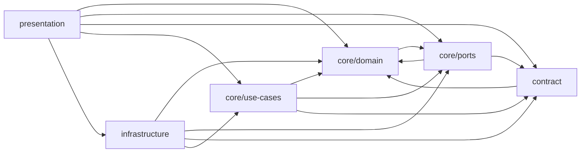

# Schichten, Ports und die Importregel (A1–A8)

Wer ein Modul anlegt, entscheidet mit dem **Ordner**, was es importieren darf. Der Ordner bestimmt
die Schicht (Tabelle `FOLDER_LAYER`), die Schicht bestimmt die erlaubten Importe (Tabelle
`ALLOWED`), und `src/architecture.test.ts` vollstreckt beides in drei Tests. **Dieser Test darf nie
rot sein** — er ist keine Stilprüfung, sondern der Grund, weshalb die Fachregeln ohne Browser, ohne
DOM und ohne Uhr prüfbar bleiben (`docs/fallen.md`: „Der Schichten-Wächter ist nie rot“).

## Die sechs Schichten und ihre Mappen

`FOLDER_LAYER` in `src/architecture.test.ts` ist die Wahrheit über die Mappen. Ein Eintrag ist eine
Mappe, keine Datei — auch eine Untermappe einer bekannten Schicht braucht eine eigene Zeile
(`presentation/game` und `presentation/game/creatures` stehen beide dort).

| Mappe | Schicht | Was dort liegt |
|---|---|---|
| `core/domain` | `domain` | Katalog der Lebewesen, Runde, Zähne und Zufallsmodell, Spannung, Statistik, Album und Freischaltung, `GameSettings`, Rundenprotokoll (`records`, `sessionLog`), `DomainError` |
| `core/ports` | `ports` | die sieben Naht-Typen: `RandomSource`, `LiveTeethSelector`, `RoundLogPort`, `RemoteLogPort`, `SoundPort`, `HapticsPort`, `SessionMarkPort` |
| `core/use-cases` | `use-cases` | die Abläufe: `playPress` (ein Druck samt Dramaturgie), `syncRoundLog` (Abgleich mit der Sicherung) |
| `contract` | `contract` | der Außenvertrag der Bedienung: `sessionLog.ts` reicht `RoundRecord` (Typ) und `CSV_HEADER` aus `core/domain/records` weiter |
| `infrastructure/audio`, `infrastructure/random`, `infrastructure/storage`, `infrastructure/haptics` | `infrastructure` | die Adapter: Web-Audio und Stimmen, crypto-Zufall, `localStorage`/`sessionStorage`/HTTP, Vibration, `navigator.storage` |
| `infrastructure/testing` | `infrastructure` | Attrappen und Werkzeuge für Tests: `SeededRandom`, `ScriptedRandom`, `RecordingSound`, `RecordingHaptics`, `FakeAudioContext`, `fairRounds` |
| `presentation/game`, `presentation/game/creatures`, `presentation/stats` | `presentation` | Bedienung: Verdrahtung der Spielseite, Spielsteuerung, Einstellungen, HUD, Zeichnung je Lebewesen, Statistikseite, Sicherungsanzeige |

Nicht in der Tabelle und nicht nötig: `src/pages/`, `src/layouts/` und `src/presentation/styles/`
enthalten keine `.ts`-Dateien (`.astro`, `.css`). Der Wächter läuft nur über `*.ts`, also braucht
keine dieser Mappen einen Eintrag. Die beiden Astro-Seiten bauen ausschließlich Adapter und rufen
**eine** Verdrahtungsfunktion der Bedienung (`wireGamePage`, `wireStatsPage`) — Details auf
[Spielseite verdrahten](../workflows/spielseite-verdrahtung.md).

## Die Importregel A1–A6

| ID | Regel (Kurzform) | Praktische Folge |
|---|---|---|
| A1 | `core/domain` darf nur `core/domain` und `core/ports` importieren | Die Fachregeln kennen weder Ablage noch DOM noch Netz; jede Umgebung kommt als Port herein |
| A2 | `core/ports` darf nur `core/ports`, `core/domain` und `contract` importieren | Ein Port beschreibt seine Vertragstypen mit Fachtypen (z. B. `RoundRecord`) und bringt keine Umsetzung mit |
| A3 | `core/use-cases` darf `core/*` und `contract` importieren | Abläufe kombinieren Regeln und Nähte, aber keine Adapter |
| A4 | `contract` darf `contract` und `core/domain` importieren | Der Außenvertrag ist nur eine Weiterreichung von Kern-Typen und -Formaten, keine eigene Schicht mit Logik |
| A5 | `infrastructure` darf alles **außer** `presentation` importieren | Adapter dürfen Kernregeln und -typen benutzen (etwa `isPlausibleRecord` zum Filtern gelesener Daten), aber nie die Bedienung |
| A6 | `presentation` darf alles importieren | Sie ist die Kompositionswurzel: sie baut die Adapter und nennt ihre Typen |

Erlaubte Importrichtungen: die Pfeilspitze zeigt auf das importierte Modul.

Jede Kante entspricht einem erlaubten Paar in `ALLOWED`; die Kante einer Schicht auf sich selbst
(gleiche Mappe) ist der Kürze halber weggelassen.

Zwei Eigenheiten, die man beim Lesen der Regel sonst für einen Fehler hält:

- **`domain` und `ports` zeigen aufeinander.** `core/domain/liveTeeth.ts` implementiert
  `LiveTeethSelector` aus `core/ports/liveTeeth.ts`, und der Port importiert `RandomMode` aus
  `core/domain/teeth.ts`. A1 und A2 schließen sich also gegenseitig ein: Kern und Nähte sind eine
  funktionale Einheit, die Naht liegt *zwischen* ihnen. Ein Zyklusverbot gibt es nicht — nur die
  Mengenprüfung. Zur Laufzeit entsteht trotzdem kein Ring: wegen `verbatimModuleSyntax` sind alle
  Importe zwischen `domain` und `ports` `import type` und im gebauten Code nicht vorhanden.
- **A6 wird ausgenutzt, nicht nur geduldet.** Die Bedienung importiert wirklich quer:
  `presentation/game/gamePage.ts` holt `STORAGE_KEY` aus `infrastructure/storage/localStorageLog` und
  baut dort die Adapter, `gameController.ts` nimmt die Standardauswahl `UniformLiveTeethSelector`
  direkt aus `core/domain/liveTeeth`. Erlaubt ist beides — aber genau deshalb bleibt die Bedienung der
  einzige Ort, an dem Schichten einander berühren.

## A7: `node:*` nur in der Infrastruktur

Der Wächter löst `node:*`-Spezifizierer gesondert auf: In jeder anderen Schicht als
`infrastructure` ist ein solcher Import ein Verstoß. Testdateien sind von der Prüfung ausgenommen
(`SOURCE_FILES` filtert `*.test.ts` heraus), dürfen also `node:fs` lesen — was sie reichlich tun
(`src/offline.test.ts`, `src/icon.test.ts`, `src/katalog-json.test.ts`, `src/regeln.test.ts`).

Bemerkenswert: **heute importiert keine Produktionsdatei `node:*`.** Die Erlaubnis für
`infrastructure` ist eine Reserve (etwa für einen Adapter, der Dateien liest), kein benutzter Weg —
die gebaute Seite läuft im Browser, und Testdateien sind der einzige Ort mit Dateisystemzugriff.

## A8: kein Browser, keine Uhr im Kern

A8 gilt nur für die Schichten `domain` und `use-cases` und ist eine **Textsuche** über den
Dateiinhalt — Kommentare zählen mit:

| Muster | Was es verhindert |
|---|---|
| `\bdocument\b` | DOM-Zugriff im Kern |
| `\bwindow\b` | Fenster- und globaler Zustand |
| `\blocalStorage\b` | Ablage (kommt als `RoundLogPort` bzw. `StorageLike` von außen) |
| `\bnavigator\b` | Vibrations- und Speicher-Schnittstellen des Browsers |
| `performance\.now` | Zeitmessung im Kern |
| `new Date\(` | die Uhr als versteckte Abhängigkeit |

**A8 konkret: die Uhr kommt als `playedAt` von der Bedienung.** Der Kern kennt Zeit nur als
Zeichenkette im Protokolleintrag: `RoundRecord.playedAt` (`core/domain/records.ts`) ist ein
ISO-8601-String, den `createRoundRecord` unverändert übernimmt. Gesetzt wird er in
`presentation/game/roundRecorder.ts`: die Fabrik hat die Abhängigkeit `clock?: () => Date`
(Standard `new Date()`) und schreibt `playedAt: clock().toISOString()`. Tests reichen eine eigene Uhr
herein und bekommen so feste Zeitstempel; der Kern vergleicht Zeit nur als Zeichenkette — etwa in
`mergeRoundLogs`, das dieselbe Runde über `playedAt|creature|teeth|mode|pressOrder` erkennt. Mehr
Zeit als diesen String kennt der Kern nicht: `statistics.ts` und `album.ts` zählen Runden und Drücke
und brauchen die Uhr gar nicht.

Browser-Schnittstellen kommen auf demselben Weg herein: als **schmale Interfaces** im Adapter, nicht
als globaler Zugriff. `StorageLike` (nur `getItem`/`setItem`/`removeItem`) ersetzt `localStorage` in
`LocalStorageRoundLog` und `loadSettings`; `FetchLike`, `VibrationCapable` und `PersistenceCapable`
umschließen `fetch`, `navigator.vibrate` und `navigator.storage`. Die echten Globals liest nur
`infrastructure` (`browserStorage()`, `safeStore()`, `new BrowserHaptics()`, `requestPersistence()`).

Zwei Konsequenzen für die Praxis:

- Ein Kommentar, der in `core/domain` oder `core/use-cases` das Wort `window` oder `localStorage`
  schreibt, färbt den Lauf rot. Umformulieren statt Ausnahme.
- Die Suche ist eine Textsuche, kein Typsystem: `Date.now()` fiele nicht auf, `new Date(` schon. Wer
  eine neue Zeitquelle in den Kern legt, muss sie also selbst als Verstoß begreifen — der geprüfte
  Weg ist ein Wert von außen.

## Die Ports als Nähte

Ein Port ist ein `interface` in `core/ports` (plus dessen Konstanten). Wer ihn erfüllt, steht in
`infrastructure` oder in einem Test. Die folgende Tabelle stellt Vertrag, Aufrufer, Adapter und
Attrappe gegenüber:

| Port | Vertrag in Kürze | Wer ruft ihn | Umsetzung in der Produktion | Attrappe / Vertreter im Test |
|---|---|---|---|---|
| `RandomSource` | `next()` in `[0,1)`, `uniformInt(maxExclusive)` | `core/domain` (`openRound`, `tension`), `core/use-cases` (`playPress`) | `CryptoRandom` (`infrastructure/random/cryptoRandom.ts`, `crypto.getRandomValues`, Rückfall `Math.random`) | `SeededRandom` (LCG, reproduzierbar), `ScriptedRandom` (feste Werteliste) — beide in `infrastructure/testing` |
| `LiveTeethSelector` | `select(request)` → scharfe Zähne der Runde | `core/domain` (`openRound`) | **kein Adapter nötig**: die Standardauswahl `UniformLiveTeethSelector` liegt in `core/domain/liveTeeth.ts` | `FixedLiveTeethSelector` je Test; `fairRounds` nutzt die Standardauswahl |
| `RoundLogPort` | `load()`, `save(records)`, `clear()` | `core/use-cases` (`syncRoundLog`), `presentation` (`roundRecorder`, Seiten) | `LocalStorageRoundLog` (`localStorage`, Rückfall Arbeitsspeicher, Übernahme alter Schlüssel) | `memoryLog()` in `syncRoundLog.test.ts` (zählt Schreibzugriffe) |
| `RemoteLogPort` | `pull()`, `push(records)` — beide dürfen werfen | `core/use-cases` (`syncRoundLog`), `presentation` (`backupSync`, `statsPage`) | `HttpRemoteLog` (`api/log/<code>` über `worker/backup.js`, `fetch` injizierbar) | `memoryRemote()` in Tests, das während des Abrufs eine Runde einspielt |
| `SoundPort` | `play(name, intensity?)`, `playVoice(creatureId)`, `setTension`, `setMuted`/`isMuted`, `stopAll`, `unlock` | **nur `presentation`** (der Kern ruft ihn nie) | `WebAudioEngine` (`infrastructure/audio/webAudioEngine.ts`) | `RecordingSound` |
| `HapticsPort` | `isSupported()`, `vibrate(pattern)` + Konstanten `TAP_VIBRATION_MS`, `BITE_VIBRATION_PATTERN`, `RELIEF_VIBRATION_MIN_MS` | **nur `presentation`** | `BrowserHaptics` (`navigator.vibrate`, gebunden aufgerufen) | `RecordingHaptics` (auch „nicht unterstützt“) |
| `SessionMarkPort` | `has(key)`, `mark(key)` + `METER_HINT_KEY` | **nur `presentation`** (`hudView` zeigt den Balken-Hinweis einmal) | `browserSessionMarks` (`sessionStorage`, Rückfall `Set` im Arbeitsspeicher) | `Set`-basierte Attrappe im Test |

Was die Tabelle sichtbar macht:

- **Drei Ports ruft der Kern nie.** `SoundPort`, `HapticsPort` und `SessionMarkPort` stehen in
  `core/ports`, damit die Bedienung gegen eine **vom Kern besessene** Schnittstelle programmiert
  statt gegen den Browser — die Kommentare in `sound.ts` und `haptics.ts` sagen das ausdrücklich
  („Der Kern ruft sie nie — die Bedienung steuert sie“).
- **Konstanten reisen mit dem Port.** Die Vibrationsmuster und `METER_HINT_KEY` stehen neben dem
  Vertrag, nicht in der Bedienung; `gameController.ts` reicht `TAP_VIBRATION_MS` und
  `BITE_VIBRATION_PATTERN` sogar weiter. So gibt es eine Zahl, nicht zwei.
- **Ein Port braucht nicht zwingend einen Adapter.** Die Standardauswahl der scharfen Zähne ist reine
  Rechnung und liegt deshalb in `core/domain/liveTeeth.ts`; der Port existiert, um sie im Test durch
  eine feste Auswahl zu ersetzen. `RandomSource` dagegen hat *keine* Kern-Implementierung — Zufall
  ist Umgebung.
- **Ein Port wird nur für eine neue Naht angelegt** (`docs/workflow.md`, Schritt 2). Ein Adapter ohne
  Port wäre eine zweite Wahrheit; eine Naht ohne zweiten Nutzer wäre Ballast.

Die Ports sind auch der Grund, weshalb die Adapter dieselben Datenprüfungen benutzen wie der Kern:
`LocalStorageRoundLog` und `HttpRemoteLog` filtern Gelesenes mit `isPlausibleRecord` aus
`core/domain/sessionLog` (A5 erlaubt das) — eine kaputte Ablage oder eine fremde Sicherung kann so
keine Runde in den Kern schmuggeln.

## Fehlerarten: `DomainError` mit englischem Code

Der Kern wirft genau einen Fehlertyp, `DomainError` aus `core/domain/errors.ts`, mit `code` und einer
**englischen** Meldung:

| Code | Auslöser |
|---|---|
| `tooth-out-of-range` | Zahn außerhalb 1..n oder keine ganze Zahl |
| `tooth-already-pressed` | derselbe Zahn zweimal in einer Runde |
| `round-finished` | Druck nach dem Zuschnappen |
| `invalid-tooth-count` | Zahnzahl außerhalb 1..12 (`MIN_TEETH`, `MAX_TEETH` in `core/domain/teeth.ts`) oder keine ganze Zahl |
| `invalid-player-count` | Spielerzahl außerhalb 1..4 (`MAX_PLAYERS`, geprüft in `isValidPlayerCount`) |
| `unknown-creature` | Gebiss-Kennung, die nicht im Katalog steht (`getCreature`) |

Der Code ist die Schnittstelle, die Meldung nur Beiwerk — und die Bedienung **übersetzt nicht**,
sondern verhindert. `GameController.canPress` prüft selbst, ob gedrückt werden darf
(`!busy && status === 'open' && !pressOrder.includes(tooth)`), `loadSettings` klemmt Spielerzahl und
Zahnzahl beim Lesen auf gültige Werte, und Import, Ablage und Sicherung laufen durch
`isPlausibleRecord`. Ein `DomainError` in der Bedienung ist damit ein Programmfehler, kein Bedienfall:
deshalb gibt es im Code keine `catch`-Stelle für ihn, und deshalb erscheint auf der Seite kein
englischer Satz. Deutsche Texte entstehen in der Bedienung (`resultText.ts`, `unlockNotice.ts`,
`backupNote`) — sie beschreiben den Zustand, nicht den Fehler.

## Der Vollstrecker: `src/architecture.test.ts`

Der Wächter liest den Quelltext mit `node:fs` ab `import.meta.dirname` (= `src`) — er ist selbst eine
Testdatei und darf deshalb `node:*` importieren. Drei `it`-Blöcke, drei Aussagen:

| Prüfung | Was sie feststellt | Wie sie scheitert |
|---|---|---|
| `kennt jede Mappe unter src/` | Sammelt alle Mappen, die Quelldateien enthalten (`USED_FOLDERS`), und vergleicht sie mit `FOLDER_LAYER` | Die Liste `unknown` ist nicht leer: eine neue Mappe hat keinen Eintrag |
| `hält jede Datei in einer erlaubten Schicht` | Löst für jede Nicht-Test-Datei jeden `from '…'`-Import zur Zielschicht auf und vergleicht mit `ALLOWED`; `node:*` nur in `infrastructure` | `violations` ist nicht leer, Meldung der Form `datei (schicht) -> spezifizierer (ziel)` |
| `lässt den Kern ohne Browser und ohne Uhr` | Textsuche der sechs A8-Muster in den Schichten `domain` und `use-cases` | `violations` ist nicht leer, Meldung `datei enthält /muster/` |

Weil der Test bei jedem `pnpm test:run` mitläuft, ist eine Schichtverletzung kein Review-Fund, sondern
ein roter Lauf. Deshalb gilt: **diesen Test nie lockern** — keine Ausnahme in `FOLDER_LAYER` für eine
Mappe, die eigentlich nicht hineinpasst, keine gelockerte Zusicherung. Eine Lockerung (wie ein
`git push --no-verify`) braucht das Ja des Auftraggebers (`AGENTS.md`, dritte Direktive).

## Eine neue Mappe oder ein neues Modul einhängen

1. **Mappe anlegen?** Dann zuerst der Eintrag in `FOLDER_LAYER`, in der Form
   `'presentation/game/foo': 'presentation'`. Fehlt er, scheitert „kennt jede Mappe unter src/“.
2. **Schicht wählen** nach der Aufgabe, nicht nach Bequemlichkeit: Regel oder Rechnung →
   `core/domain`; neue Naht → `core/ports`; Zusammenspiel mehrerer Regeln → `core/use-cases`;
   Browser, Ablage, Netz, Testattrappe → `infrastructure/<thema>`; DOM, Verdrahtung, Anzeige →
   `presentation/<bereich>` (`docs/workflow.md`, „Eine Fähigkeit ergänzen“).
3. **Port anlegen?** Interface nach `core/ports`, reine Standard-Implementierung nach
   `core/domain`, Adapter nach `infrastructure/`, Attrappe nach `infrastructure/testing/`.
4. **Neue Abhängigkeit in den Kern?** Sie wird ein Port, nicht ein Import. Alles, was `document`,
   `window`, `navigator`, eine Uhr oder `node:*` braucht, bleibt außerhalb der Schichten `domain` und
   `use-cases`.
5. **Seite anfassen?** Nur Adapter bauen und eine Verdrahtungsfunktion rufen. Das Skript einer
   `.astro`-Seite prüft **kein** Werkzeug des Gates (`tsc` liest `src/**/*.ts`, jsdom lädt es nicht) —
   nach dem Umstellen die gebaute Seite laden und nachsehen.
6. **Prüfen:** `pnpm vitest run src/architecture.test.ts` gezielt, im Ganzen `pnpm gate`
   (`typecheck` + `lint` + `test:run`). Siehe [Prüfen und Gate](../testing/pruefen-und-gate.md).

## Was der Wächter nicht sieht

Damit niemand den grünen Lauf für eine vollständige Bewachung hält:

- **Nur `*.ts` unter `src/`.** `.astro`-Seitenskripte (`src/pages/index.astro` importiert quer durch
  `infrastructure` und `presentation`) und CSS werden nicht geprüft; `worker/`, `scripts/` und
  `public/sw.js` liegen außerhalb von `src/` und gehören zu keiner Schicht.
- **Nur statische `from '…'`-Importe.** Der Ausdruck `/from\s+'([^']+)'/g` sieht keinen dynamischen
  `import(...)`; heute gibt es keinen.
- **Nur relative und `node:`-Spezifizierer.** Ein Paketimport (`from 'astro'`) liefert `null` und
  gilt als unbedenklich — das Projekt hat keine Laufzeit-Abhängigkeiten.
- **Dateien direkt in `src/`** haben die Mappe `''`, also keine Schicht; die Prüfung überspringt sie.
  Dort liegen heute ausschließlich `*.test.ts` (u. a. `architecture.test.ts` selbst).
- **Mappen mit ausschließlich Testdateien** erscheinen nicht in `USED_FOLDERS` und brauchen keinen
  Eintrag. Und Testdateien sind aus der Schichtprüfung ausgenommen — sie importieren bewusst quer:
  `core/domain/round.test.ts` holt `SeededRandom` aus `infrastructure/testing`, was für eine
  Quelldatei in `core/domain` ein A1-Verstoß wäre.
- **Die Richtung, nicht die Absicht.** Ob ein Import architektonisch sinnvoll ist, entscheidet die
  Review, nicht der Test: A6 erlaubt der Bedienung den Blick in einen Adapter.

## Verwandte Seiten

- [Überblick](ueberblick.md) — das Projekt in Schichten und Seiten.
- [Fachmodell der Runde](../concepts/fachmodell-runde.md) — was in `core/domain` gerechnet wird.
- [Prüfen und Gate](../testing/pruefen-und-gate.md) — wie der Wächter in den Gate-Lauf gehört.
- [Spielseite verdrahten](../workflows/spielseite-verdrahtung.md) — der Weg von der Astro-Seite in die
  Bedienung, inklusive Adapteraufbau.

Quellen der Regeln: `docs/architecture.md` (Schichten, A1–A8, Fehlerarten), `docs/fallen.md`
(„Der Schichten-Wächter ist nie rot“), `docs/workflow.md` (Reihenfolge beim Ergänzen einer Fähigkeit),
Vollstrecker: `src/architecture.test.ts`.
