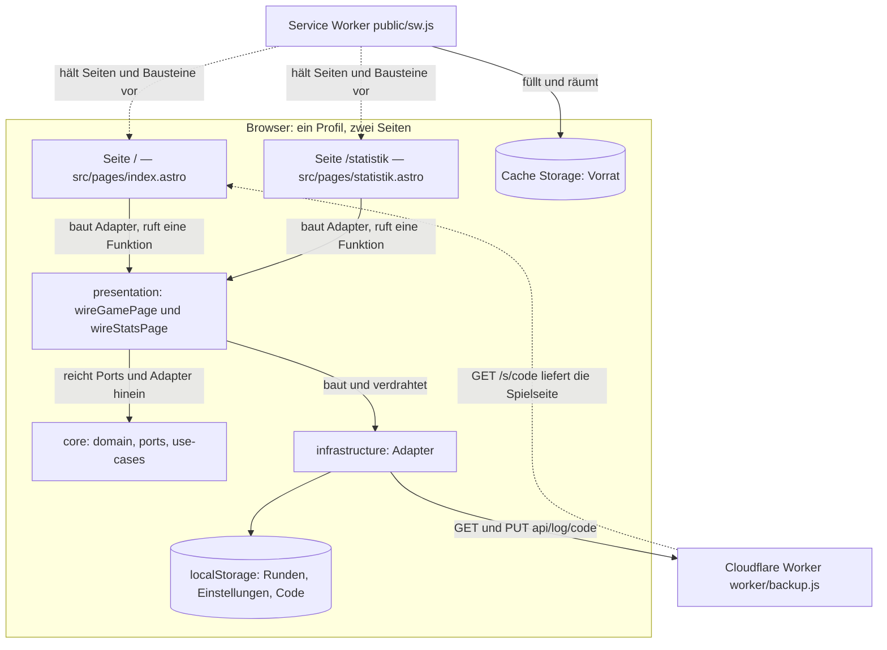
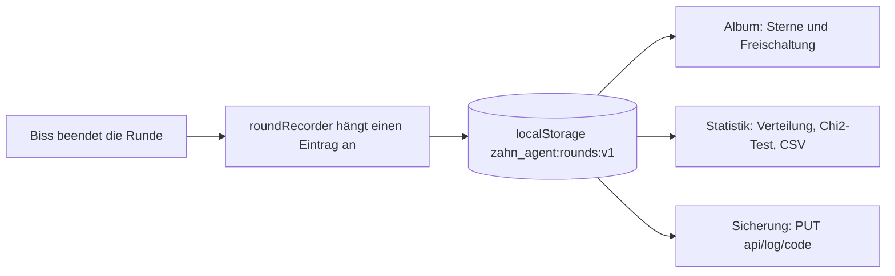

# Architektur-Überblick

Zahn Agent ist eine **statisch gebaute Web-App ohne Server-Anteil für das Spiel**. Alles, was
während einer Runde passiert — Zufall, Dramaturgie, Anzeige, Ton, Vibration, Protokoll — läuft im
Browser. Zwei Stellen liegen außerhalb dieser reinen Client-Welt, und beide sind Zusätze: ein
**Service Worker**, der die Seite ohne Netz startbar hält, und ein **Cloudflare Worker**, der auf
Wunsch das Rundenprotokoll sichert. Der Kern dazwischen — Gebiss, Runde, Spannung, Statistik,
Album — kennt weder Browser noch Uhr und ist deshalb im Terminal und in jsdom prüfbar.

## Laufzeit in einem Bild



Laufzeit: alles Spielerische im Browserprofil; der Service Worker ist der Vorrat, der Cloudflare
Worker der einzige Weg aus dem Gerät heraus.

Der Datenfluss daneben ist eine Einbahnstraße: **die Ablage ist die einzige Wahrheit**, Album und
Statistik rechnen daraus.



Ablage → Album und Statistik: beide lesen dasselbe Protokoll, keiner der beiden hält einen eigenen
Stand.

## Zwei Seiten, statisch gebaut

`astro.config.mjs` setzt `output: 'static'`; der Bau erzeugt `dist/index.html` und
`dist/statistik/index.html` und sonst nur Dateien aus `public/`. Ausgeliefert wird `dist/` über
GitHub Pages (`.github/workflows/pages.yml`: erst `pnpm gate`, dann `pnpm build`, dann
`actions/upload-pages-artifact` mit `path: dist`). Es gibt **keine** Funktion auf einem Server, die
eine Runde entgegennimmt, bewertet oder speichert — deshalb funktioniert `dist/` auch hinter
`python3 -m http.server`.

Zwei Folgen dieser Bauart sind im ganzen Baum zu spüren:

- **Verweise laufen über den Basis-Pfad.** Jede Adresse im Code entsteht aus
  `import.meta.env.BASE_URL` (`src/layouts/Base.astro`, beide Seitenskripte, `backupUrl`), nie
  absolut mit `"/"`. `ASTRO_BASE` ist der Notausgang für einen Unterpfad; der Wert wird in
  `astro.config.mjs` auf einen Schluss-Schrägstrich normalisiert und muss mit `/` beginnen, sonst
  bricht der Bau ab. Ohne den Schluss-Schrägstrich ergäbe `${BASE_URL}statistik` die falsche
  Adresse.
- **Was im Gerät liegt, bleibt im Gerät.** Runden (`zahn_agent:rounds:v1`), Einstellungen
  (`zahn_agent:settings:v1`) und der Sicherungscode (`zahn_agent:backup-code`) stehen im
  `localStorage`; es gibt keine Konten und keine Telemetrie. Ein anderes Profil hat seine eigene
  Statistik.

## Der Kern ohne DOM

Drei Mappen bilden den Kern, eine den Außenvertrag:

| Mappe | Rolle |
|---|---|
| `src/core/domain` | Fachregeln in Reinform: Katalog der Lebewesen, Zähne und Zufallsmodell, `round.ts`, `tension.ts`, `statistics.ts`, `album.ts`/`unlocks.ts`, `records.ts`/`sessionLog.ts`, `settings.ts`, `DomainError` |
| `src/core/ports` | die sieben Nähte: `RandomSource`, `LiveTeethSelector`, `RoundLogPort`, `RemoteLogPort`, `SoundPort`, `HapticsPort`, `SessionMarkPort` |
| `src/core/use-cases` | die zwei Abläufe: `playPress` (ein Druck samt Dramaturgie) und `syncRoundLog` (Abgleich mit der Sicherung) |
| `src/contract` | was die Bedienung sehen darf: `RoundRecord` und `CSV_HEADER`, weitergereicht aus `core/domain/records.ts` |

Der Kern bekommt Zufall, Ablage, Ton und Vibration **als Port** herein und die Uhr als Wert
(`playedAt` setzt die Bedienung). `src/architecture.test.ts` erzwingt das als Textsuche: in
`domain` und `use-cases` darf kein `document`, `window`, `localStorage`, `navigator`,
`performance.now` und kein `new Date(` stehen. Die Importrichtungen A1–A6 und die Mappen-Tabelle
`FOLDER_LAYER` stehen auf [Schichten, Ports und die Importregel](schichten-und-importregel.md).

Zwei Entscheidungen sind Architektur, nicht Geschmack:

- **Die Entscheidung „schnappt dieser Druck zu?" bleibt im Kern** (`playPress` liefert neben dem
  neuen Zustand nur die Dramaturgie). Die Bedienung erfährt Zeiten, Pegel und „zuckt ja/nein" —
  sonst könnte sie das Geheimnis über die Wartezeit verraten.
- **Die Dramaturgie ist reine Rechnung** (`core/domain/tension.ts`): Spannung, Pause, Riss,
  Zucken, Erleichterung sind Zahlen und damit prüfbar, obwohl sie sich in Ton und Bild abspielen.

## Adapter: die Nähte und ihre Vertreter

`src/infrastructure` enthält zu jeder Naht einen Vertreter; die Bedienung baut sie und reicht sie
hinein.

| Naht | Vertreter | Umschließt |
|---|---|---|
| `RandomSource` | `CryptoRandom` (`infrastructure/random`) | `crypto.getRandomValues`, Rückfall auf `Math.random`, wenn es keine Krypto-Quelle gibt |
| `LiveTeethSelector` | `UniformLiveTeethSelector` (im Kern, `core/domain/liveTeeth.ts`) | die Auswahl der scharfen Zähne; die einzige Naht mit einer Vorgabe im Kern — Tests geben eine feste Auswahl vor |
| `SoundPort` | `WebAudioEngine` + `creatureVoices` (`infrastructure/audio`) | Web-Audio, Tierstimmen als MP3 aus `public/sounds/voices/` |
| `HapticsPort` | `BrowserHaptics` (`infrastructure/haptics`) | `navigator.vibrate`; fehlt die Schnittstelle (iOS/Safari), sagt die Oberfläche das offen |
| `RoundLogPort` | `LocalStorageRoundLog` + `browserStorage` (`infrastructure/storage`) | `localStorage` samt einmaliger Übernahme alter Schlüssel und Arbeitsspeicher-Rückfall bei voller Ablage |
| `RemoteLogPort` | `HttpRemoteLog` (`infrastructure/storage`) | `fetch` gegen `api/log/<code>`, Lesen ohne Zwischenspeicher |
| `SessionMarkPort` | `browserSessionMarks` (`infrastructure/storage`) | `sessionStorage`, damit ein Hinweis einmal je Sitzung kommt |

Zwei Dinge in `infrastructure` sind **keine** Ports, sondern werden von der Verdrahtung bzw. den
Seiten direkt gerufen: `loadSettings`/`saveSettings` (`infrastructure/storage/localStorageSettings.ts`)
und `requestPersistence` (`infrastructure/storage/browserPersistence.ts`, befragt
`navigator.storage.persist`). `infrastructure/testing` enthält die Attrappen für Tests
(`ScriptedRandom`, `RecordingSound`, `RecordingHaptics`, `FakeAudioContext`).

## Seiten und Layout gehören zu keiner Schicht

`src/pages/index.astro`, `src/pages/statistik.astro` und `src/layouts/Base.astro` stehen **nicht** in
`FOLDER_LAYER` — sie sind `.astro`-Dateien, und der Schichten-Wächter läuft nur über `*.ts`. Das ist
keine Lücke, sondern die Regel: das Skript einer Seite baut ausschließlich die Adapter und ruft
**eine** Verdrahtungsfunktion der Bedienung auf.

```text
index.astro       baut: loadSettings, LocalStorageRoundLog, CryptoRandom, WebAudioEngine,
                        BrowserHaptics, browserSessionMarks, HttpRemoteLog
                  ruft: wireGamePage({ doc, win, storage, log, rng, sound, haptics, ... })

statistik.astro   baut: LocalStorageRoundLog, loadSettings, HttpRemoteLog, requestPersistence
                  ruft: wireStatsPage({ ..., download: browserDownload })
```

Alles darüber hinaus steht in geprüften Modulen, denn das Skript einer `.astro`-Seite prüft weder
`tsc` noch jsdom. Beide Seiten bitten zusätzlich um dauerhaften Speicher (`requestPersistence`).
`Base.astro` ist bis auf die Anmeldung des Service Workers reines Gerüst (Kopfzeilen, Symbole,
Manifest, Stile). Wie die beiden Verdrahtungen im Einzelnen aussehen:
[Spielseite verdrahten](../workflows/spielseite-verdrahtung.md) und
[Statistikseite](../workflows/statistikseite.md).

## Der Weg einer Runde: vom Tipp zur Statistik

1. **Geste.** `presentation/game/holdGesture.ts` hängt an den `.tooth`-Elementen der gezeichneten
   Bühne. Ein kurzer Tipp zählt sofort, Halten entscheidet erst beim Loslassen — wer den Finger
   wegschiebt, nimmt den Druck zurück.
2. **Entscheidung.** `GameController.resolvePress` ruft `playPress` aus `core/use-cases`. Der Kern
   prüft den Druck (`tooth-out-of-range`, `tooth-already-pressed`, `round-finished`) und sagt, ob
   dieser Zahn scharf war.
3. **Dramaturgie.** Ton und Vibration laufen über Ports, die Anzeige schreibt `hudView`; die Pause
   kommt bei jedem Druck und verrät nichts. Das Urteil fällt erst nach `beatMs` plus
   `VERDICT_GAP_MS`, und jeder verzögerte Rückruf prüft zuerst, ob seine Runde noch gilt — „Neue
   Runde" oder ein Tierwechsel dazwischen lässt ihn ins Leere laufen.
4. **Biss.** `snap()` schließt das Maul, spielt den Biss, vibriert, zeichnet das Ergebnis — und ruft
   `recordRound()`. `presentation/game/roundRecorder.ts` liest das Protokoll **unmittelbar vor** dem
   Anhängen neu, hängt einen `RoundRecord` an (Rundennummer, `playedAt`, Modus, Tier, Zähne,
   Spieler, Verliererzahn, Druckreihenfolge) und schreibt über den `RoundLogPort` in die Ablage.
5. **Meldung.** `feed.roundFinished()` (`presentation/game/logFeed.ts`) unterscheidet den eigenen
   Biss von einer Änderung von außen (`changed-outside`: anderer Tab, Zurück-Taste, Abgleich). Das
   Album rechnet Sterne und Freischaltung bei jedem Malen frisch aus dem Protokoll
   (`core/domain/album.ts`, `unlocks.ts`) — es gibt keinen zweiten Speicher für Sterne.
6. **Auswertung.** Die Statistikseite liest dieselbe Ablage (`log.load()`) und rendert über
   `presentation/stats/statsView.ts` auf Basis von `core/domain/statistics.ts`: Verteilung je Zahn,
   Chi²-Tests, Wilson-Intervalle, CSV-Export und -Import, „Protokoll löschen".
7. **Sicherung.** Trägt die Adresse einen Code, reiht `presentation/game/backupSync.ts` die
   Abgleiche hintereinander: `syncRoundLog` holt, führt zusammen und bringt beide Seiten auf denselben
   Stand — beim Start und nach jedem Biss; die Statistikseite gleicht zusätzlich nach Import und
   Löschen ab. Die Reihenfolge ist kein Detail: zwei nebeneinander gelesene Stände überschrieben
   einander.

Die Feinheiten (Halten, Fakeout, Ergebnis-Sätze, HUD) stehen auf [Spielzug](../workflows/spielzug.md).

## Die zwei Außenposten

### Service Worker: die Seite ohne Netz

`public/sw.js` ist von Hand geschrieben und geht unverändert in den Bau. Er kennt **keine Liste der
gebauten Dateien**: er liest die `_astro/`-Bausteine aus dem HTML der Seiten und zusätzlich aus den
Skripten, die einander einbinden, legt je Seite eine Liste unter `__bausteine__/…` ab und räumt
Bausteine weg, die keine Seite mehr nennt. Drei Regeln, keine Versionsnummer:

| Anfrage | Verhalten |
|---|---|
| Navigation | erst Netz, bei Fehler der Vorrat (und notfalls die Startseite) — wer Netz hat, sieht nie einen alten Stand |
| `_astro/…` | erst Vorrat; der Name trägt den Hash des Inhalts, gleicher Name heißt gleicher Inhalt |
| alles andere vom selben Ursprung | sofort aus dem Vorrat, im Hintergrund aufgefrischt; Symbole, Manifest und die zwölf Tierstimmen legt schon die Installation ab |

Fremde Ursprünge, Schreibzugriffe, Teilabrufe (`Range`) und **alles unter `api/`** lässt er
unberührt ans Netz — ein gesicherter Stand aus dem Vorrat wäre ein alter Stand, und der Abgleich
schriebe ihn zurück. Angemeldet wird er allein in `src/layouts/Base.astro`, nur im Bau
(`import.meta.env.PROD`), erst beim `load`-Ereignis und mit `scope` gleich dem Basis-Pfad;
scheitert die Anmeldung, läuft die Seite wie bisher. Sein Vorrat liegt im Browserprofil: gegen ein
Profil, das seine Daten verwirft, hilft er nicht. Details:
[Offline und Service Worker](../integrations/offline-service-worker.md).

### Sicherungs-Worker: der einzige Weg aus dem Gerät

`worker/backup.js` läuft bei Cloudflare unter dem **eigenen Ursprung** der Seite und bedient genau
zwei Familien von Adressen:

| Route | Antwort |
|---|---|
| `GET /api/log/<code>` | das Protokoll als JSON-Liste, `cache-control: no-store` |
| `PUT /api/log/<code>` | ersetzt es; nur JSON-Listen bis `MAX_BODY_BYTES` (1,9 MB, rund 11 000 Runden), Erfolg ist `204` |
| `GET /s/<code>` | die Spielseite unverändert — eine Startadresse ohne Abfrage-Teil, die ein Kinderprofil behält |

Der Code muss `^[a-z0-9-]{12,64}$` erfüllen, und es gibt nur Codes, die der Betreiber als Zeile in
der Tabelle `logs` angelegt hat: ein unbekannter Code ist „nicht gefunden", niemand kann sich von
außen Speicherplatz anlegen. **Ohne Code geschieht nichts** — kein Abruf, kein Knopf, kein Hinweis;
die Sicherung ist kein Angebot der öffentlichen Seite. Ausgeliefert wird die Datei unverändert; sie
hängt an der D1-Bindung `DB` und an den zwei Routen `…/api/*` und `…/s/*`, der Weg dorthin steht in
`docs/sicherung-anleitung.md`. `worker/` liegt außerhalb von `src/` und gehört zu keiner Schicht.
Details: [Sicherungs-Worker](../integrations/sicherung-worker.md).

## Wo man anbaut

- **Eine neue Naht** braucht einen Typ in `core/ports` und einen Vertreter in `infrastructure`;
  verdrahtet wird sie in der jeweiligen `wire…`-Funktion, nicht im Kern.
- **Eine neue Seite** ist eine `.astro`-Datei plus eine Verdrahtungsfunktion in `presentation`; sie
  gehört zu keiner Schicht und darf nichts weiter tun, als Adapter zu bauen.
- **Ein neues Lebewesen** braucht einen Katalogeintrag (`core/domain/creature.ts`), ein
  Zeichnungsmodul in `presentation/game/creatures/` und eine Stimme in `public/sounds/voices/` — die
  Liste im Service Worker (`VOICES`) muss dazu passen, sonst wird `src/offline.test.ts` rot. Schritt
  für Schritt: `docs/neues-tier.md`.
- **Eine neue Datei für den Start ohne Netz** gehört in `SHELL` in `public/sw.js`; der Test prüft,
  dass jede dort genannte Datei in `public/` existiert.
- **Ein weiterer Betriebsfall** (Unterpfad, anderer Code) ist Konfiguration, kein Code:
  `ASTRO_BASE=/pfad pnpm build` bzw. eine neue Zeile in `logs`.

## Invarianten, an denen man nicht rütteln sollte

- **Kein Server für das Spiel.** `dist/` bleibt statisch; der Worker beantwortet nur `api/log/<code>`
  und `/s/<code>`. Wer eine dritte Route oder eine Runde „auf dem Server" braucht, ändert die
  Zusicherung „die Daten liegen in diesem einen Browser".
- **Der Kern bleibt ohne DOM und ohne Uhr.** Ein `document`- oder `new Date(`-Treffer in `domain`
  oder `use-cases` macht `src/architecture.test.ts` rot; dieser Test darf nie rot sein.
- **Der Worker wird ohne Code nie gerufen**, und `api/` geht am Service Worker vorbei.
- **Seiten bleiben dünn.** `.astro`-Skripte bauen Adapter und rufen eine Verdrahtungsfunktion; alles
  Weitere gehört in ein Modul, das `tsc` und jsdom sehen.
- **Eine Wahrheit.** Runden liegen im Protokoll; Sterne, Freischaltung, Statistik und
  Sicherungsstand werden daraus abgeleitet. „Protokoll löschen" löscht deshalb auch die Sterne und
  **ersetzt** die Sicherung (`backup.replace([])`) statt sie abzugleichen.
- **Zusätze halten das Spiel nie an.** Ton, Vibration, dauerhafter Speicher, Sitzungsmarken und
  Sicherung fangen ihre Fehler selbst ab (Arbeitsspeicher-Rückfall, „Sicherung: nicht erreichbar",
  abgeblendeter Schalter).

## Prüfungen, die diese Form festhalten

| Prüfung | Was sie festhält |
|---|---|
| `src/architecture.test.ts` | jede Mappe unter `src/` in `FOLDER_LAYER`, Importrichtungen A1–A6, kein Browser und keine Uhr im Kern (A8) |
| `src/offline.test.ts` | lädt `public/sw.js` in eine nachgestellte Worker-Umgebung: Vorrat bei der Installation, beide Seiten ohne Netz, Bausteine aus Skript-Importen, `api/` am Vorrat vorbei; liest außerdem `Base.astro` (Anmeldung nur im Bau, über den Basis-Pfad) und prüft, dass die Stimmliste des Workers gleich `CREATURE_VOICE_FILES` ist |
| `src/backupWorker.test.ts` | importiert `worker/backup.js` und fährt es gegen eine nachgestellte D1: `GET`/`PUT`, unbekannter Code legt nichts an, 413/405/400, `/s/<code>` liefert `/` |
| `src/presentation/game/gamePage.test.ts`, `src/presentation/stats/statsPage.test.ts` | verdrahten beide Seiten in jsdom mit Attrappen und prüfen, dass die Verdrahtung hält, was die `.astro`-Skripte versprechen |

Über jsdom hinaus messen Sonden am echten Gegenstand: `scripts/pruefen-offline.py` startet die
Seite ohne Netz, `scripts/pruefen-sicherung.py` prüft den Abgleich mit **nachgestelltem** Worker
(der echte Code bleibt unberührt) — ob der ausgelieferte Worker selbst antwortet, zeigt nur ein
Abruf der echten Adresse.

## Weiterlesen

- [Schichten, Ports und die Importregel](schichten-und-importregel.md) — die Regeln im Detail
- [Spielseite verdrahten](../workflows/spielseite-verdrahtung.md) — was `wireGamePage` baut
- [Spielzug](../workflows/spielzug.md) — Geste, Dramaturgie, Ergebnis, Protokoll
- [Statistikseite](../workflows/statistikseite.md) — Auswertung, CSV, Löschen
- [Offline und Service Worker](../integrations/offline-service-worker.md) — der Vorrat und seine Regeln
- [Sicherungs-Worker](../integrations/sicherung-worker.md) — Code, Routen, D1
