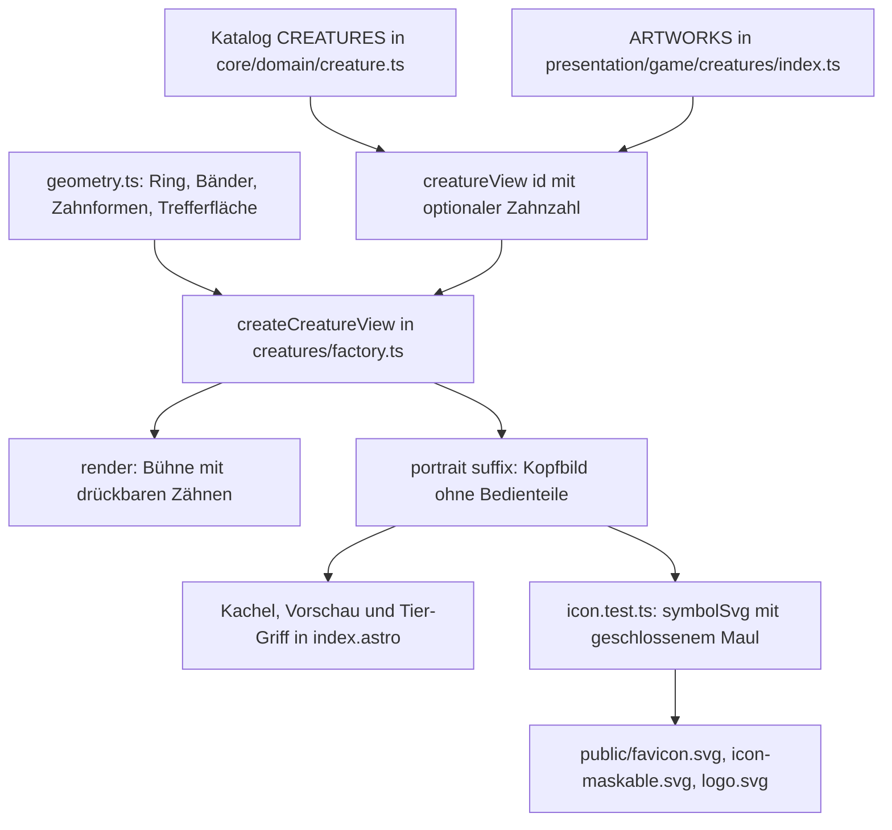

# Zeichnungssystem der Lebewesen (SVG)

Ein Lebewesen wird **nicht gemalt, sondern beschrieben**: sein Kopf ist ein Datenobjekt
(`CreatureArtwork`), aus dem eine Fabrik das fertige SVG baut. Dieselbe Zeichnung trägt die Bühne,
die Auswahl-Kachel, die Vorschau im Tier-Griff und — beim Krokodil — das App-Symbol. Wer eine Form
verschiebt, verschiebt sie deshalb überall zugleich; wer eine Ebene falsch wählt, sieht den Fehler
je nach Zahnzahl, Maulzustand oder Bildschirmgröße an einer anderen Stelle.

Alle Maße stehen in den Einheiten der Zeichnung: `VIEWBOX` ist **640 × 460**, die Ringmitte liegt
um x 320, gespiegelt wird mit `x_rechts = 640 − x_links`. Auf einem 320-px-Gerät entspricht das
etwa 285 px gezeichneter Breite (`MIN_STAGE_WIDTH_PX`) — diese Zahl entscheidet über Trefferflächen
und treibt die Grenze der Zahnzahl.

## Vom Katalog zum Bild

Der Katalog nennt Kennung, Name und Zahnzahl; die Registry nennt das Kunstwerk; die Fabrik rechnet
daraus ein `CreatureView`. Diesen einen Eingang benutzen alle Ausgabeflächen.

Katalog → Kunstwerk → Fabrik → SVG: Bühne, Kachel und App-Symbol sind Ableitungen derselben Quelle.

**Die Registry ist Zwang, nicht Angebot.** `ARTWORKS` in
`src/presentation/game/creatures/index.ts` ist ein `Record<string, CreatureArtwork>`; die Schlüssel
müssen **genau** den Katalog-Kennungen entsprechen. Fehlt ein Eintrag, wirft `creatureView(id)` beim
Aufbau der Seite `creature '<id>' has no artwork`; eine unbekannte Kennung wirft schon `getCreature`
mit `… is not known`. `creatureViews.test.ts` prüft beide Richtungen — jeder Katalogeintrag gedeckt,
kein überzähliger Eintrag — und dass `listCreatureViews()` die Katalogreihenfolge hält.

Die Zahnzahl kommt aus dem Katalog (`creature.teeth`), läßt sich aber je Aufruf überschreiben:
`creatureView(id, teeth)` zeichnet dasselbe Tier mit 1 bis 12 drückbaren Zähnen. Die Steuerung nutzt
das bei jeder neuen Runde; ein neues Tier oder eine geänderte Zahnzahl baut die Bühne neu
(`gameController.buildStage`).

## Die Ebenen: eine Reihenfolge, drei Zuständigkeiten

`mouthLayers` in `factory.ts` malt in fester Reihenfolge; das Spätere deckt das Frühere. Alles ab
der Maulöffnung liegt unter einem Beschnitt auf `silhouette` — dem Kopfumriss als **einem** Pfad.

| # | Ebene | Klasse im SVG | Was hinein gehört |
|---|---|---|---|
| 1 | Körper | `creature__body` (außerhalb des Beschnitts) | Kopf, Fell, alles was **über den Umriss hinausragt**: Hut, Kragen, Ohrspitzen, Ärmchen |
| 2 | Maulöffnung | `mouth__hole` | Fläche aus Ring und Banddicken gerechnet |
| 3 | Rachen und Zunge | `mouth__inner` | warmes Rosenrot |
| 4 | Schnauze | `jaw__shell` | `upperShell` plus `upperExtra` (Nase, Falten) — fährt beim Biss anteilig mit |
| 5 | Oberkiefer | `jaw__upper` | Zahnfleischband `jaw__band--upper` und die oberen Zähne `teeth--upper` |
| 6 | untere Zähne | `teeth` | — |
| 7 | Unterkiefer | `jaw__lower` | `lowerExtra` (Kinnkante) und `jaw__band--lower` |
| 8 | **Gesicht** | `creature__face` | Augen, Iris, Pupillen, Brauen, Wangen, Monokel — **über allem** |
| 9 | Bissmarke | `creature__biter` | nur auf der Bühne: zwei Ringe und eine Beschriftung, anfangs `opacity="0"` |

Daraus folgen drei Besitzregeln, an denen fast jeder Zeichenfehler hing:

- **Was über den Umriss hinausragt, gehört in die Körperebene.** Der Beschnitt schneidet sonst ab:
  die Ohrenspitzen des Vampirs lagen im Gesicht und fehlten im gerasterten Bild. Der Filzhut des
  Menschen steht deshalb in `body`, obwohl er über dem Kopf liegt.
- **Was sich mit dem Kiefer bewegen soll, gehört in die Ebene des Kiefers.** Der Schnurrbart des
  Menschen lag in `face` und blieb beim Zuschnappen am Hut hängen; jetzt steht er in `upperExtra`,
  der Ebene der Nase.
- **Was über der Schnauzenfläche liegen soll, gehört ins Gesicht — solange es im Umriss bleibt.**
  `upperShell` wird über die Körperebene gemalt; ein Monokel auf dem Auge gehört darüber, ein
  Stehkragen hinter dem Kopf in `body`.

Ein Test hält die Reihenfolge (nicht nur ihr Vorhandensein) für Bühne **und** Kopfbild fest, samt
`creature__biter` als letzter Gruppe der Bühne. Die Ebenen tragen außerdem die Maulzustände: beim
Zuschnappen fährt `jaw__upper` um `--close-shift`, `jaw__shell` um `--shell-shift`, danach
verschwinden Oberkieferband, Schnauzenfläche, Rachen und obere Zahnreihe (siehe
[Spielzug](../workflows/spielzug.md)).

## Der Zahnring ist Sperrgebiet für das Gesicht

Das ist die zentrale Invariante der Zeichnungen, keine Stilfrage. Die Zähne stehen mit der Wurzel
**auf** der Ringellipse (`ring.cx/cy/rx/ry`) und zeigen nach innen; welche Winkel belegt sind, hängt
an der eingestellten Zahnzahl (1 bis 12) — über alle Zahlen gesehen ist der **ganze** Ring belegt.
Das Gesicht wird als letzte Lage über die Zähne gemalt. Also gilt:

> **Keine runde Form des Gesichts ragt in die Ringellipse.** Augen, Iris, Pupillen, Wangen, Ohren
> und Zubehör liegen im Fellstreifen zwischen Ring und Kopfumriss.

Der Grund ist historisch belegt: am 12.10.2026 lagen bei allen zehn Tieren die Augen auf dem Ring;
der Augenfleck des Pandas verdeckte bei 11 Zähnen einen Zahn zu 100 %, das Auge des Hais bei 8
Zähnen zu 82 %, beim Krokodil 49 %. Die Markup-Tests sahen davon nichts, weil sie Markup prüften und
keine Deckung.

Prüfbar ist die Regel als Rechnung: `creatureViews.test.ts` nimmt **jede** `<ellipse>`- und
`<circle>`-Form in `face`, bläht sie um die halbe Strichstärke plus 2 Einheiten und tastet sie in
5°-Schritten gegen die normierte Ringgleichung ab; kein Punkt darf im Ring liegen. Der Test verlangt
zusätzlich mindestens zwei solche Formen je Tier (sonst prüfte er bei geändertem Markup still
nichts) und **kein `transform`** an ihnen — eine gedrehte Form läge woanders, als ihre Attribute
sagen. Pfade (Brauen, Schnurrhaare, Kiemen) kann er nicht rechnen; die mißt die Deckungssonde
`scripts/pruefen-zahnsicht.py` im Browser über `isPointInFill` und `elementFromPoint`.

Zwei naheliegende Auswege sind verworfen: die Zähne über das Gesicht malen (dann liegt ein Zahn auf
dem Augapfel) und die Zähne um die Augen herum verteilen (das verkleinert die Trefferflächen, die
bei 11 und 12 Zähnen ohnehin unter 44 px liegen). Stattdessen folgt die **Größe dem Platz**: ein
Auge mit Radius r paßt dorthin, wo Abstand zum Ring **und** Abstand zum Umriss größer als r plus
halbe Strichstärke sind; wer den Kopf nicht breiter macht, macht das Auge kleiner — unter etwa
24 × 21 wird es auf dem Handy zum Punkt. Das Rezept zum Messen steht in
`docs/tiermodell-anleitung.md`.

## Geometrie wird gerechnet, nicht gesetzt

`geometry.ts` hält die Zeichnung konsistent, indem es Formen aus wenigen Zahlen ableitet. Ein neues
Gebiss mit anderem Ring und anderen Banddicken schließt deshalb genauso sicher wie das Krokodil.

| Rechnung | Ergebnis |
|---|---|
| `arcLength` (Ramanujan-Näherung) | Bogenlänge des Rings, bei `fullCircle` voll, sonst als Anteil |
| `toothPlacements` | Zähne gleichmäßig auf dem Bogen, gedreht zur Maulmitte, IDs 1…count |
| `toothPath` | Zahnform lokal: Kegel mit runder Spitze, `flat` (Schneidezahn), `square` (Backenzahn) |
| `teethScale` | Breite 12/count (0,5…1,35), Länge √(12/count) (0,85…1,15) — viele Zähne werden schmaler |
| `bandPath` | Fläche zwischen zwei Ellipsenbögen: Zahnfleisch- und Lippenbänder |
| `hitRadius` | Trefferfläche je Zahn (siehe unten) |
| `closeShift` | `max(0, 2·ry − Dicke oben − Dicke unten)` |
| `shellShift` | `closeShift · shellFactor` (Vorgabe 0,55) |
| `holeInset` | `min(Dicke oben, Dicke unten)` — die Öffnung endet genau unter dem schmaleren Band |

Die Fabrik schreibt `--close-shift` und `--shell-shift` als CSS-Variablen an das Bühnen-SVG; die
Animation in `presentation/styles/stage.css` liest nur diese Variablen und braucht keine
tierabhängigen Konstanten. Weil beide Zahnfleischbänder auf demselben Ring liegen, treffen sich ihre
Innenkanten genau dann, wenn der Oberkiefer um `closeShift` gefahren ist — das ist der Grund, warum
die Schließung auch für ein künftiges Lebewesen stimmt.

Eine Feinheit mit sichtbarer Folge: `splitByJaw` teilt die Zähne an der Maulmitte mit **einem halben
Punkt Spielraum** (`y < ring.cy + 0.5` gehört zum Oberkiefer). Bei 12 Zähnen sitzt je einer genau im
Maulwinkel bei 0° und 180°, wo der Sinus keine glatte Null liefert; ohne den Spielraum blieb bei
geschlossenem Maul ein einzelner Zahn neben dem Lächeln stehen.

## Trefferfläche: 44 px auf der schmalsten Bühne

`hitRadius` ist kein Geschmackswert, sondern eine Vorgabe mit zwei Grenzen:

- **Vorgabe:** `MIN_TAP_TARGET_PX = 44` CSS-Pixel auf der schmalsten getragenen Bühne
  (`MIN_STAGE_WIDTH_PX = 285`, gemessen auf einem 320-px-Gerät). Daraus folgt der Deckel
  `44 / 2 · 640 / 285 ≈ 49,4` SVG-Einheiten.
- **Abstand:** höchstens der halbe Zahnabstand (`toothSpacing · 0.5`), damit sich zwei Trefferflächen
  nicht überdecken; Untergrenze 14 Einheiten.

Wo beide nicht zusammen gehen, **gewinnt der Abstand** — eine größere Fläche wäre ein Tippziel, das
dem Nachbarn den Druck stiehlt. `creatureViews.test.ts` rechnet die Vorgabe für jedes Lebewesen und
jede Zahnzahl nach und führt die Ausnahmen namentlich: bei 12 Zähnen reicht der Abstand auf 285 px
bei fast allen Tieren nicht (nur das Krokodil hat einen so großen Ring), bei 11 Zähnen bleiben Maus,
Vampir und Venusfliegenfalle übrig. Der engste Fall ist im Test beziffert: Maus bei 12 Zähnen
37,1 px.

Dieselbe Rechnung begründet die Obergrenze `MAX_TEETH = 12` in `core/domain/teeth.ts` (bei 16 Zähnen
wären es 38 px); `geometry.ts` führt mit `MAX_TEETH_HARD = 20` nur eine Zeichenschranke für
`maxTapFriendlyTeeth`.

Zwei Meßfallen sind festgehalten:

- **44,15 px sind gerechnet, nicht gemessen.** `getBoundingClientRect` eines `.tooth__hit` liefert
  das Achsen-Rechteck einer **gedrehten** Trefferbox (52,48 px), nicht die Trefferfläche. Die Zahl
  im README ist 2 · Trefferradius · Skala (286/640).
- **Die Trefferfläche muß gegen die Ebenen verteidigt werden.** Das untere Zahnfleischband wird
  **nach** den unteren Zähnen gezeichnet und liegt über deren Trefferkreis; `stage.css` setzt
  deshalb `pointer-events: none` auf alle dekorativen Ebenen und `all` auf `.tooth__hit`. Ohne die
  Ausnahme taten Treffer in der Ringmitte nichts.

## Blick und Anatomie

Die Pupillen sind der einzige bewegliche Teil des Gesichts. Beide tragen `class="pupil"`; die
Steuerung schreibt `--look-x` / `--look-y` an das Bühnen-SVG, `press-beat.css` verschiebt und skaliert
sie in **einer** Transformation. Der Versatz hängt nur an Augenmitte und Ziel (`gazeOffset`),
höchstens `GAZE_MAX = 4` Einheiten, voll bei `GAZE_FULL_DISTANCE = 120` — der Blick kann deshalb
nichts über scharfe Zähne verraten.

Damit das funktioniert, braucht die Zeichnung zwei Zusicherungen:

- Die **weiße Linse** (`fill="#ffffff"`) läßt rings um die Pupille mindestens 4 Einheiten Luft.
  `gaze.test.ts` sucht je Tier die kleinste weiße Form um jede Pupille und tastet den verschobenen
  Pupillenrand in acht Richtungen ab; `scripts/pruefen-blick.py` mißt dasselbe im Browser.
- Die Augenmitte ist aus dem Markup lesbar: `gameController.buildStage` mittelt `cx`/`cy` der
  `.pupil`-Elemente (`midpoint`) und setzt sie als Bezugspunkt. Ein Tier ohne zwei Pupillen hätte
  keinen Blick.

Der Anker für die Bissmarke kommt ebenfalls aus der Zeichnung: `view.toothAnchor(id)` liefert die
Spitze des Zahns (`toothTip`), ersatzweise die Ringmitte; `hudView.markBiter` setzt daraus die
`creature__biter`-Gruppe und beschriftet sie mit „Zahn n".

## Kopfbilder: dieselbe Zeichnung ohne Bedienteile

`portrait(suffix)` baut aus demselben `mouthLayers` ein SVG der Klasse `creature-portrait` —
Körperebene plus Maul, Zähne als reine Zeichnung (`rest-tooth`, `aria-hidden`), **ohne**
Trefferkreise, ohne `data-tooth`, ohne `tabindex`, ohne `creature__biter`. Das ist keine Kosmetik:
die Steuerung fragt `.creature`, `.tooth` und `.creature__biter` ab; ein bedienbares Element in der
Kachel würde den Tipp abfangen, der der Kachel gilt.

Der Parameter `suffix` ist Pflicht, weil mehrere Kopfbilder und die Bühne **gleichzeitig** im
Dokument stehen. Jedes SVG bringt eine `clipPath`-Kennung mit
(`creature-clip-<id>-<suffix>` bzw. `creature-clip` für die Bühne); doppelte Kennungen würden die
Bühne mit dem Kopfumriss der ersten Kachel zuschneiden. Der Test verlangt einen Clip je Kopfbild,
verschiedene Kennungen für Kachel, Vorschau, anderes Tier und Bühne, und daß die gezeichneten
Zahnformen bei abweichender Zahnzahl exakt denen der Bühne entsprechen.

Verwendet wird das an drei Stellen: `index.astro` mit `'leiste'` (dauerhaft offene Reihe), `'kachel'`
(Auswahlblatt) und `'wahl'` (Tier-Griff, den `quickControls` bei jedem Wechsel neu einsetzt).

## App-Symbol und Kopflogo aus der Krokodil-Zeichnung

Das Symbol ist die zweite Ableitung derselben Zeichnung und wird **erzeugt**, nicht gemalt.
`src/icon.test.ts` baut es aus `creaturePortrait('crocodile', 'symbol')`, stellt den Inhalt auf eine
512 × 512 große Kachel (`#0d1a20`) und rechnet die Maulzustände nach: `maulZu` verschiebt
`jaw__upper` um `closeShift` und `jaw__shell` um `shellShift` und blendet Rachen, obere Zahnreihe,
Oberkieferband und Schnauzenfläche aus — dieselben Regeln wie `.creature.is-snapped` in
`stage.css`. Zwei Fassungen entstehen aus derselben Quelle:

| Fassung | Zoom | Eckenradius | Datei |
|---|---|---|---|
| rund | 0,88 | 14/64 der Kachel | `public/favicon.svg`, `public/logo.svg` |
| maskierbar | 0,70 | 0 | `public/icon-maskable.svg` |

Der Test vergleicht die Dateien **byteweise** mit dem gerechneten Ergebnis; mit `ICON_NEU=1` schreibt
er sie neu. `scripts/icon-png.py` rastert daraus die PNG-Größen (180, 192, 512, maskierbar 512), und
der Test prüft, daß jede im Manifest genannte Datei existiert und die PNG-Kanten zu ihren Namen
passen. Zur Kette gehören außerdem: das Symbol zeigt keine bedienbaren Zähne, verweist auf nichts
Fremdes (nur der SVG-Namensraum darf `http` enthalten, jede `url(#…)` hat ein Ziel), und es steht in
`SHELL` des Service Workers.

**Ein zweites Krokodil im Kopfbereich ist verboten.** Beide Seiten (`index.astro`,
`statistik.astro`) müssen im `class="brand"`-Block ein `` auf `logo.svg` über
`import.meta.env.BASE_URL` zeigen; die Farben des bis 11.10.2026 von Hand gezeichneten Altsymbols
(`#2f6b4f`, `#1c4531`, `#fbf7e8`) dürfen dort nicht mehr vorkommen. Damit kann das Logo nicht
heimlich von der Zeichnung abdriftet: es ist **dieselbe Datei** wie das Tab-Symbol.

Wer das Krokodil ändert, fährt deshalb `ICON_NEU=1 pnpm test:run` (SVGs neu) und danach
`uv run --with cairosvg python scripts/icon-png.py` (PNG neu). Ändert sich nur ein anderes Tier,
bleibt das Symbol unberührt.

## Bilder ansehen und messen

Die Zeichnung wird ohne Browser sichtbar, bevor über sie geurteilt wird:
`pnpm vitest run src/render-probe.test.ts` schreibt für jedes Lebewesen ein eigenständiges SVG nach
`$TMPDIR/zahn_agent-artwork/<id>.svg` und zusätzlich **jede Zahnzahl** 1–12 nach
`…/zahnzahlen/<id>-<n>.svg` (mit `xmlns`, damit Browser und Rasterer sie lesen). Die Sonde prüft
dabei nur schlank — Markup, `--close-shift`, Abdeckung des Katalogs — und ersetzt die
Vertragsprüfung nicht.

Diese Dateien sind die gemeinsame Bildquelle der weiteren Prüfungen: `scripts/pruefen-zahnsicht.py`
mißt daran die Deckung im Browser (erwartet „0 Auffälligkeiten"), `scripts/artwork-png.py` rastert
offen und geschnappt, `scripts/galerie.py` baut daraus das README-Bild. Deshalb gilt die
Reihenfolge: erst die Sonde im **selben** `$TMPDIR`, dann die Rasterung.

Die Gegenprobe ist billig und gehört dazu: eine absichtlich falsche Lage (Auge 30 Einheiten zur
Maulmitte) muß Test **und** Sonde rot machen. Bleibt eines grün, prüft es nicht, was es soll.

## Was die Tests festhalten

| Prüfung | Zusicherung |
|---|---|
| `creatureViews.test.ts`, Registry | `ARTWORKS` deckt den Katalog genau; Reihenfolge von `listCreatureViews` |
| `creatureViews.test.ts`, Gebiß | genau `creature.teeth` Zähne mit IDs 1…n; Zahnzahl-Override zeichnet sauber; Zwillingsregel bei jeder geraden Zahl |
| `creatureViews.test.ts`, Ebenen | Ebenenreihenfolge in Bühne und Kopfbild; kein `undefined`/`NaN`; reproduzierbares Markup; `closeShift` zwischen 60 und 420 |
| `creatureViews.test.ts`, Gesicht | keine runde Gesichtsform im Zahnring, kein `transform` daran |
| `creatureViews.test.ts`, Treffer | 44 px auf 285 px, sonst halber Zahnabstand — mit namentlicher Ausnahmeliste |
| `gaze.test.ts` | Pupille bleibt bei vollem Blick in der weißen Linse; kein `NaN` |
| `icon.test.ts` | `favicon.svg`, `icon-maskable.svg`, `logo.svg` gleich der gerechneten Zeichnung; Maul zu; kein Bedienteil; Kopfbereich beider Seiten ohne Altsymbol |
| `render-probe.test.ts` | SVG je Tier und Zahnzahl für Auge und Sonden |

Ein neues Lebewesen ist ein Katalogeintrag, ein Kunstwerk-Modul und eine Zeile in `ARTWORKS`; die
Reihenfolge aller Schritte steht in [Neues Lebewesen](../workflows/neues-lebewesen.md), die
Freischaltung der Figuren in [Sterne und Freischaltung](../concepts/sterne-und-freischaltung.md),
der Gate-Lauf in [Prüfen und Gate](../testing/pruefen-und-gate.md).
