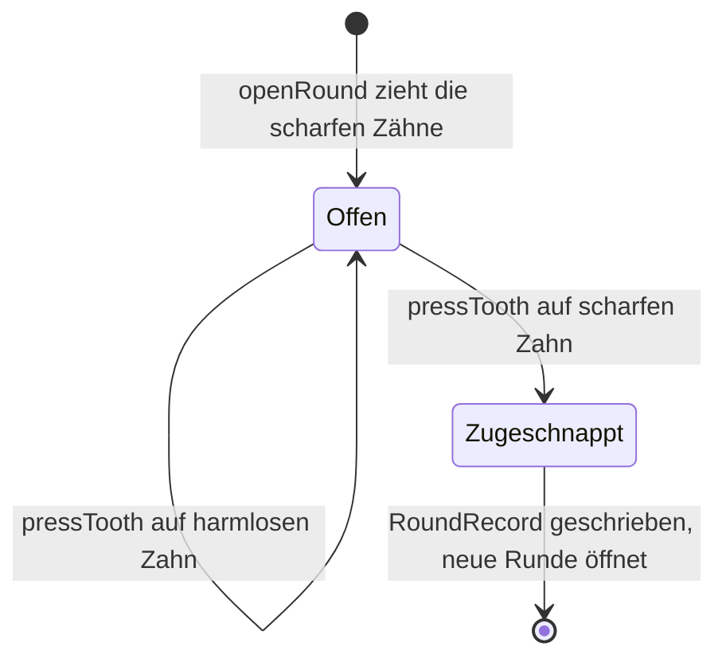
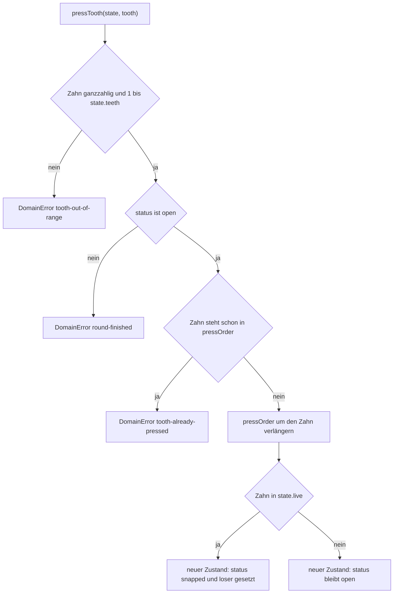
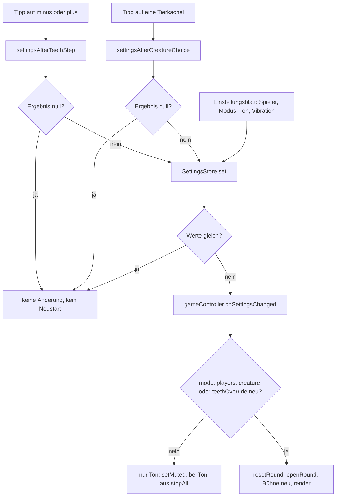

# Fachmodell: Runde, Zähne, Gebiss, Einstellungen

Fünf Dateien in `core/domain` tragen dieses Modell: `round.ts` (die Runde und der Zug), `teeth.ts`
(Grenzen, Zufallsmodus, Zahn- und Spielerzahl), `creature.ts` (der Katalog der Lebewesen),
`settings.ts` (`GameSettings`) und `errors.ts` (`DomainError`). Alle liegen in der Schicht `domain`,
also ohne DOM, ohne Uhr und ohne Ablage — Zufallsquelle und Zahnauswahl kommen als Ports herein
([Schichten, Ports und die Importregel](../architecture/schichten-und-importregel.md)). Was die
Bedienung daraus macht, entscheidet sie selbst; der Kern liefert Werte und wirft bei Regelverstößen.

Wo diese Seite und das Repository einander widersprechen, gilt `docs/domain-model.md`.

## Vokabular

| Begriff | Bedeutung | Im Code |
|---|---|---|
| **Zahn** | 1-basiert, `1..teeth`; Zahn 1 steht vorn an der Schnauze. | `ToothId = number`, `state.teeth` |
| **Druck** | Ein Zug auf einen noch nicht gedrückten Zahn. | ein Aufruf von `pressTooth` |
| **scharfer Zahn** | Zahn, der das Maul zuschnappen lässt. Anzahl je Tier 1–2 oder 1–3. | `state.live`, `loser.liveCount` |
| **Runde** | Von der offenen Maulstellung bis zum Zuschnappen; endet spätestens beim n-ten Druck. | `RoundState`, `status: 'open' \| 'snapped'` |
| **Position** | Nummer des Drucks, bei dem es schnappte (1-basiert) — die eigentlich aussagekräftige Größe; sie steht im Protokoll und in der Statistik, nicht mehr im Ergebnis-Text. | `loser.pressIndex`, `RoundRecord.pressIndex` |
| **Verlierer** | Der Spieler, der den scharfen Zahn gedrückt hat. | `loser.player` |
| **Spannung** | Biss-Wahrscheinlichkeit des **nächsten** Drucks, 0..1. | eigenes Thema, siehe [Zufall und Spannung](zufall-und-spannung.md) |

## Zwei Zufallsmodelle, ein Auswahl-Port

Die beiden Modelle heißen `RandomMode = 'original' | 'classic'`; `RANDOM_MODES` zählt genau diese
zwei Werte auf. Die Zeichenketten sind Vertrag, nicht Anzeige: sie stehen in den Einstellungen, in
`RoundState.mode`, im Protokolleintrag und in der CSV, und `loadSettings` nimmt nur diese zwei an.
Wer sie umbenennt, bricht Altdaten und den Austausch mit dem Analyse-Werkzeug.

Gezogen wird nicht in `round.ts`, sondern hinter dem Port `LiveTeethSelector`
(`core/ports/liveTeeth.ts`). `openRound(config, deps)` bekommt `RoundDeps { rng: RandomSource;
selector: LiveTeethSelector }` und reicht der Auswahl genau `{ rng, teeth, mode, min, max }` weiter —
die Zahnzahl und die Grenzen des Gebisses, nicht den Katalog. Standard ist
`UniformLiveTeethSelector` (die Steuerung baut ihn, wenn kein `selector` übergeben wird); Tests
setzen eine feste Auswahl ein (`FixedLiveTeethSelector`), damit der Verlierer vorhersagbar ist.

Was die Modelle ziehen, wie daraus Bissgefahr, Zucken und Balken werden, steht auf
[Zufall und Spannung](zufall-und-spannung.md). Hier zählt nur der Vertrag: **`openRound` legt das
Ergebnis der Auswahl in `state.live` ab und vergisst, wie es dazu kam.** `mode`, `liveTeethMin` und
`liveTeethMax` werden in den Zustand kopiert, damit spätere Leser — `hudModel`, `planPressDrama`,
`resultText` — die Spannung neu rechnen können, ohne den Katalog oder die Zufallsquelle zu kennen.

## Eine Runde ist ein Wert, kein Ablauf


Der einzige Zustandswechsel einer Runde: offen bleibt offen, bis ein scharfer Zahn gedrückt wird.

`RoundState` ist ein unveränderlicher Wert mit genau diesen Feldern:

| Feld | Inhalt |
|---|---|
| `creatureId` | Gebiss der Runde (Kennung aus dem Katalog) |
| `teeth` | Zahl der drückbaren Zähne — die eingestellte, nicht die des Katalogs |
| `mode`, `players` | Zufallsmodell und Spielerzahl dieser Runde |
| `status` | `'open'` oder `'snapped'` — mehr Zustände gibt es nicht |
| `pressOrder` | gedrückte Zähne **in der Reihenfolge des Drückens** (`readonly ToothId[]`) |
| `liveTeethMin`, `liveTeethMax` | Grenzen gleichzeitig scharfer Zähne **aus dem Katalog** — damit rechnet die Spannung, ohne den Katalog zu kennen |
| `live` | die scharfen Zähne, aufsteigend sortiert; die Bedienung darf sie nie anzeigen, solange die Runde läuft |
| `loser` | `LoserInfo` (`tooth`, `pressIndex`, `player`, `liveCount`) oder `null` |

**Invariante: `pressTooth` verändert nichts, es gibt einen neuen Zustand zurück.** Der alte Zustand
wird nur gelesen; `pressOrder` wird per Spread kopiert, im Trefferfall kommen `status` und `loser`
hinzu. Der Test „verändert den vorherigen Zustand nicht" hält das fest: nach `pressTooth(before, 1)`
ist `before.pressOrder` weiterhin leer (`src/core/domain/round.test.ts`).

Zwei Folgen, die man beim Lesen der Bedienung sonst für Zufall hält:

- Die Spielsteuerung hält die Runde als Referenz und **ersetzt** sie
  (`this.round = outcome.state`). Ein verzögertes Urteil prüft deshalb `this.round !== played` und
  läuft ins Leere, wenn in der Pause eine neue Runde begann — ein Objektvergleich, kein Flag.
- Weil `openRound` die gezogenen Zähne sortiert ablegt (`[...live].sort((a, b) => a - b)`), verrät
  die Reihenfolge in `live` nicht, in welcher Folge gezogen wurde.

## Öffnen: das Gebiss kommt aus dem Katalog

`openRound(config, deps)` löst zuerst das Gebiss auf (`resolveGebiss`) und prüft dann die Grenzen:

| Wert | Quelle | Abweichung möglich? |
|---|---|---|
| `creatureId` | `config.creatureId ?? DEFAULT_CREATURE_ID` (`'crocodile'`) | — |
| `teeth` | `config.teeth ?? creature.teeth` | ja, für Tests und Sonderfälle; frei innerhalb 1–12, muss **nicht** zur Zahnzahl des Tiers passen (Test: Wolf mit 6 Zähnen) |
| `liveTeethMin` / `liveTeethMax` | `config.liveTeethMin ?? creature.liveTeethMin` (analog max) | ja, laut Typ-Kommentar nur für Tests |

Der Katalog ist damit die einzige Quelle für Zahnzahl und Grenzen; ein zweiter Satz Zahlen in der
Bedienung existiert nicht. Eine **unbekannte** Kennung wirft `DomainError('unknown-creature')` —
`openRound` spielt nicht still etwas anderes. Die stille Ersetzung gibt es nur beim Lesen von
Altdaten: `creatureOrDefault` macht aus einer fehlenden oder unbekannten Kennung das Krokodil, und
zwar im Protokoll und in der Statistik; beim Laden der Einstellungen prüft `loadSettings` die Kennung
selbst mit `isKnownCreature` und fällt ebenfalls auf das Krokodil zurück.

### Der Katalog und seine Zahnzahlen

`CREATURES` enthält zwölf Einträge in dieser Reihenfolge; `teeth` ist die **Spielentscheidung**
(Bildschirmgröße), `realTeeth` nur eine Notiz für die Oberfläche:

| `id` | Kachelbeschriftung | `teeth` | `liveTeethMin`–`liveTeethMax` | `realTeeth` |
|---|---|---|---|---|
| `crocodile` | Krokodil | 10 | 1–3 | 32 |
| `wolf` | Wolf | 12 | 1–2 | 42 |
| `human` | Mensch | 12 | 1–3 | 32 |
| `shark` | Hai | 12 | 1–2 | 300 |
| `mouse` | Maus | 6 | 1–2 | 16 |
| `vampire` | Vampir | 12 | 1–2 | 32 |
| `panda` | Panda | 12 | 1–2 | 42 |
| `lion` | Löwe | 12 | 1–2 | 30 |
| `panther` | Panther | 12 | 1–2 | 30 |
| `sabertooth` | Säbelkatze (`shortName`) | 12 | 1–2 | 26 |
| `flytrap` | Fliegenfalle (`shortName`) | 8 | 1–2 | 0 |
| `trex` | T-Rex | 12 | 1–3 | 58 |

Drei Tiere lassen also bis zu drei Zähne gleichzeitig scharf werden (Krokodil, Mensch, T-Rex), alle
anderen nur bis zwei; die Maus ist mit sechs Zähnen die kürzeste Runde, die Venusfliegenfalle liegt
mit acht dazwischen. `realTeeth: 0` heißt „das Vorbild hat gar keine Zähne" (Borsten am Klappenrand) —
die Oberfläche sagt das dann so und schreibt keine Null.

Katalogfelder, die für die Runde zählen: `teeth`, `liveTeethMin`, `liveTeethMax`. Daneben trägt ein
Eintrag nur Anzeige- und Prüfdaten — `realTeeth` (reine Notiz), `note`, `fact` (höchstens
`MAX_FACT_LENGTH` = 110 Zeichen) und optional `shortName`/`grammar`. `validateCreature` hält jeden
Eintrag zusammen: gültige Zahnzahl, `liveTeethMin >= 1`, `liveTeethMax >= liveTeethMin`,
`liveTeethMax <= teeth`, `realTeeth` entweder 0 oder mindestens `teeth`, nicht leerer `note`/`fact`,
`fact` ≤ 110 Zeichen, Kachelbeschriftung (`tileLabel` = `shortName ?? name`) ≤
`MAX_TILE_LABEL_LENGTH` = 12 Zeichen. `creature.test.ts` prüft jeden Eintrag gegen diese Funktion und
zusätzlich, dass der `fact` nie von scharfen Zähnen spricht — die zieht allein der Zufall.

Ein neues Lebewesen ist deshalb **ein Katalogeintrag plus eine Zeichnung**: das Kunstwerk-Modul in
`presentation/game/creatures/` und eine Zeile in der Registry `ARTWORKS`; `creatureView(id, teeth?)`
ruft `getCreature` (wirft also bei unbekannter Kennung) und überschreibt die Zahnzahl nur, wenn eine
übergeben wird. `creatureViews.test.ts` verlangt, dass Katalog und Registry dieselbe Menge von
Kennungen sind und jede Zeichnung genau `creature.teeth` Zähne mit den Nummern 1..n enthält — auch
für abweichende Zahnzahlen (`MIN_TEETH`, 6, 10, `MAX_TEETH`). Für die Python-Sonden wird
`scripts/katalog.json` aus dem Katalog erzeugt (`KATALOG_NEU=1 pnpm test:run`); `katalog-json.test.ts`
wird rot, sobald Katalog und Datei auseinanderlaufen.

## Grenzen: was ein Gebiss und eine Runde sein dürfen

Alle Zahlen stehen in `src/core/domain/teeth.ts`, nicht in der Doku:

| Konstante | Wert | Begründung im Code |
|---|---|---|
| `MIN_TEETH` | 1 | Kleinstes spielbares Gebiss (Wunsch vom 11.10.2026: „wenn nur ein Zahn da ist und beim Tap das Maul schließt"). Eine untere Schranke darüber hinaus gibt es nicht — je weniger Zähne, desto größer die Trefferfläche |
| `MAX_TEETH` | 12 | **gemessen**: die Trefferfläche eines Zahns muss auf einem Handy mindestens 44 × 44 CSS-Pixel groß sein; auf dem Zahnring sind das bei 12 Zähnen 51–63 px, bei 16 nur noch 38 px |
| `MAX_LIVE_TEETH` | 3 | harte Obergrenze gleichzeitig scharfer Zähne im Originalmodell („Bumerang mit zwei Enden") |
| `MAX_PLAYERS` | 4 | Grenze des Kerns für protokollierte und importierte Runden — es gab Runden mit 3 und 4 Spielern |
| `MAX_SELECTABLE_PLAYERS` | 2 | was die Bedienung anbietet (Entscheidung vom 12.10.2026): die Knöpfe heißen „Allein" und „Zu zweit" |
| `DEFAULT_TEETH` | 10 | Rückfallwert, wenn ein Protokolleintrag die Zahnzahl nicht kennt (Kurzformat-Import) |
| `DEFAULT_PLAYERS` | 1 | — |
| `DEFAULT_MODE` | `'original'` | — |

`isValidToothCount` und `isValidPlayerCount` prüfen Ganzzahligkeit und Bereich; `assertConfig` ruft
beide beim Öffnen einer Runde auf, also **bevor** scharfe Zähne gezogen werden. Ein `teeth`-Override
läuft durch dieselbe Prüfung: 0 und 2.5 lehnt der Test ab, alles über 12 die Bereichsprüfung.

Das 44-px-Maß ist keine Behauptung im Kommentar, sondern eine Rechnung in
`presentation/game/creatures/geometry.ts`: `MIN_TAP_TARGET_PX = 44`, `MIN_STAGE_WIDTH_PX = 285` (ein
320-px-Gerät) und `hitRadius` deckeln die Trefferfläche auf den halben Zahnabstand.
`creatureViews.test.ts` rechnet für jedes Lebewesen und jede Zahnzahl 1..12 nach, wo die Vorgabe
greift und wo der Abstand gewinnt — bei 12 Zähnen reicht der Abstand auf 285 px bei fast allen
Lebewesen nicht mehr. Wer die Zahnring-Geometrie ändert, muss diese Liste neu belegen.

## Kappung: die Grenzen werden auf das Gebiss geklemmt

`liveCountRange(teeth, min, max)` ist die **eine** Stelle für Auswahl (`liveTeeth.ts`) und Modell
(`probabilities.ts`):

```
lowest  = max(1,      min(floor(min), teeth, MAX_LIVE_TEETH))
highest = max(lowest, min(floor(max), teeth, MAX_LIVE_TEETH))
```

| Gebiss | Kataloggrenzen | tatsächliche Spanne | Folge |
|---|---|---|---|
| Krokodil, 10 Zähne | 1–3 | 1..3 | Standardmodell |
| Wolf, 12 Zähne | 1–2 | 1..2 | „der Biss kommt selten, dann sitzt er" |
| Krokodil mit 2 Zähnen (Override) | 1–3 | 1..2 | ein Druck kann zuschnappen, muss aber nicht |
| **ein Zahn** (jedes Tier) | 1–3 | **1..1** | in **beiden** Modi ist genau dieser Zahn scharf — der erste Tipp schnappt zu |
| unsinnige Grenzen (`min` 5, `max` 1) | — | 3 | die untere Grenze hat Vorrang, hart auf `MAX_LIVE_TEETH` begrenzt |

Die Kappung ist nicht Kosmetik: vorher kappte das Modell erst **nach** dem Ziehen, und bei zwei
Zähnen zeigte die Anzeige 83,3 % Bissgefahr, während mit 75,0 % gezogen wurde. Aus demselben Grund
muss `modeKWeights` die Zahnzahl mitbekommen, wenn es eine konkrete Runde rechnet. Der Ein-Zahn-Fall
ist durch zwei Tests abgesichert: `liveTeeth.test.ts` („kappt die Grenzen auf die Zahnzahl") und
`round.test.ts` („spielt eine Runde mit einem einzigen Zahn").

## Der Zug: `pressTooth`


Die Prüfreihenfolge in `assertPressable` — erst der Zahn, dann der Zustand, dann die Dopplung.

Nach dem Anhängen ist `pressIndex = pressOrder.length` (1-basiert). Fiel der Druck auf einen scharfen
Zahn, entsteht `loser: { tooth, pressIndex, player, liveCount }` mit
`liveCount = state.live.length` (wie viele Zähne gleichzeitig scharf waren); sonst bleibt `status`
`'open'`. `playerFor(pressIndex, players) = ((pressIndex - 1) % players) + 1` verteilt die
Verliererposition reihum — bei zwei Spielern also Druck 1 → Spieler 1, Druck 2 → Spieler 2, Druck 3 →
wieder Spieler 1. Dieselbe Drehung nutzt die Zugzeile (`turnSentence`: `(pressIndex % players) + 1`
auf die bereits gedrückten Zähne), sodass der Verlierer immer der Spieler ist, der gerade dran war.

**Die Runde endet zwangsläufig spätestens beim n-ten Druck.** Solange `status` `'open'` ist, wurde
kein scharfer Zahn gedrückt; da mindestens einer scharf ist, ist der letzte verbliebene Zahn
garantiert scharf. `isFinalToothTension(state)` (`status === 'open' && remainingTeeth(state) === 1`)
macht daraus eine Anzeige-Aussage: die Bühne sagt den letzten Zahn ausdrücklich an, statt weiter
Wahrscheinlichkeiten zu behaupten. `remainingTeeth` ist `teeth - pressOrder.length`.

## Der Weg in die Bedienung: `playPress`

Im laufenden Spiel drückt die Bedienung **nie** direkt auf `pressTooth`, sondern über `playPress`
(`core/use-cases/playPress.ts`). Der Unterschied ist das Wissen: `playPress` liest `state.live` und
weiß damit vor dem Zug, ob dieser Zahn schnappt — dieses Wissen bleibt im Kern. Die Bedienung bekommt
nur Zeiten, Pegel und „zuckt ja/nein".

```ts
playPress({ state, tooth, rng }): PressOutcome
// PressOutcome = { state, drama, snapped, tooth }
```

Der Ablauf in drei Schritten:

1. `willSnap = state.live.includes(tooth)` — noch bevor gedrückt wird.
2. `planPressDrama({ willSnap, pressIndex: state.pressOrder.length + 1, remaining, teeth, mode,
   liveTeethMin, liveTeethMax, rng })` — die Dramaturgie rechnet mit denselben Werten, die auch die
   Anzeige benutzt (Einzelheiten auf [Zufall und Spannung](zufall-und-spannung.md)).
3. `pressTooth(state, tooth)` — der eigentliche Zustandswechsel; `snapped` und `tooth` gehen daneben
   mit, damit die Steuerung nicht selbst in `live` schauen muss.

Die Steuerung übernimmt genau das: `this.round = outcome.state`, `outcome.snapped` entscheidet
zwischen Zuschnappen und Erleichterung, `drama.beatMs` ist die Pause und `drama.tensionAfter` der
Pegel für Balken und Ton. Ein `DomainError` aus `pressTooth` wird **nicht** gefangen — `playPress`
reicht ihn unverändert weiter (Test „reicht Regelverstöße des Kerns weiter").

## Fehlercodes des Kerns

`DomainError` trägt einen von sechs stabilen, englischen Codes (`src/core/domain/errors.ts`); die
Meldung daneben ist Detailtext für Tests und Protokolle:

| Code | geworfen von | Bedingung |
|---|---|---|
| `invalid-tooth-count` | `assertConfig` in `openRound` | Zahnzahl nicht ganzzahlig oder außerhalb 1–12 (auch ein Override) |
| `invalid-player-count` | `assertConfig` in `openRound` | Spielerzahl nicht ganzzahlig oder außerhalb 1–4 |
| `unknown-creature` | `getCreature` | Kennung nicht im Katalog — auch beim Zeichnen (`creatureView` ruft `getCreature`) |
| `tooth-out-of-range` | `assertPressable` in `pressTooth` | Zahn nicht ganzzahlig oder außerhalb `1..state.teeth` |
| `round-finished` | `assertPressable` | Druck, nachdem das Maul zu ist |
| `tooth-already-pressed` | `assertPressable` | derselbe Zahn ein zweites Mal |

Die Codes sind englisch, obwohl die Oberfläche deutsch ist: sie sind Vertrag zwischen Kern und
Bedienung, kein Text für Kinder. Ein Regelverstoß wird **geworfen**, nicht als Ergebnis
zurückgegeben — er ist ein Programmierfehler, kein Spielausgang. Im normalen Spiel tritt er nicht auf,
weil die Steuerung vorher prüft (`canPress`: nicht beschäftigt, `status === 'open'`, Zahn noch nicht
gedrückt).

## Spielerzahl und Verlierer

- **1 Spieler:** `playerFor` liefert immer 1; die Texte sagen „Du", der Titel „Zugeschnappt!".
- **2 Spieler:** der Titel nennt den **Gewinner** („Spieler 2 hat gewonnen!"), der Verlierer steht im
  Ergebnistext.
- **3 und 4 Spieler:** nur im Protokoll und nach einem Import — dort bleibt es beim Verlierer-Satz
  („Spieler 3 hat verloren!"). `MAX_SELECTABLE_PLAYERS` = 2 verhindert, dass die Bedienung sie
  anbietet; `isPlausibleRecord` akzeptiert sie weiterhin.

## `GameSettings`: was eine Runde konfiguriert

| Feld | Standard | Bedeutung |
|---|---|---|
| `mode` | `'original'` | Zufallsmodell |
| `players` | 1 | Spielerzahl (Bedienung bietet 1 und 2) |
| `sound`, `vibration` | `true` | nur Ausgabe, keine Spielregel |
| `creature` | `'crocodile'` | gewähltes Lebewesen (Kennung aus dem Katalog) |
| `teethOverride` | `null` | abweichende Zahl drückbarer Zähne; `null` heißt: so viele, wie der Katalog vorsieht |

`teethOverride: null` ist die **einzige** Darstellung von „Standard". `effectiveTeeth` liefert
`teethOverride ?? getCreature(creature).teeth`; ein Tipp auf „+"/„−" klemmt auf `MIN_TEETH` bis
`MAX_TEETH` und setzt den Wert wieder auf `null`, sobald er die Katalogzahl trifft — an den Grenzen
ändert der Tipp nichts, sonst startete ein Tipp auf den abgeblendeten Rand die laufende Runde neu.

Geladen wird nicht blind vertraut (`loadSettings` in `infrastructure/storage/localStorageSettings.ts`,
Schlüssel `SETTINGS_KEY = 'zahn_agent:settings:v1'`): `mode` nur `original`/`classic`, sonst Standard;
`players` ganzzahlig und auf **1..`MAX_SELECTABLE_PLAYERS`** geklemmt (eine alte Vier-Spieler-
Einstellung wird also zu 2, obwohl der Kern 4 akzeptiert); `sound`/`vibration` nur `false`, wenn
ausdrücklich `false` gespeichert ist; unbekanntes Lebewesen → Krokodil; `teethOverride` nur bei
`isValidToothCount`, sonst `null`; ein Lesefehler oder ein fehlender Speicher liefert
`DEFAULT_SETTINGS`. Fehlt der aktuelle Schlüssel, werden einmalig die beiden alten Schlüssel
(`LEGACY_SETTINGS_KEYS`, jüngster zuerst) übernommen und unter dem neuen Namen abgelegt —
`localStorageSettings.test.ts` prüft Randwerte (1 und 12 erlaubt, 0/13/7.5/`NaN` verworfen), die
Klemmung von 3 und 4 auf 2 sowie den Krokodil-Rückfall. `saveSettings` schluckt einen Schreibfehler:
nicht speichern zu können darf das Spiel nicht aufhalten.

Der `SettingsStore` (`presentation/game/settingsStore.ts`) ist die Laufzeitform davon: `get()`, `set()`,
`subscribe()`. `set()` vergleicht **alle sechs Felder** (`areSettingsEqual`) und meldet nichts, wenn
sich inhaltlich nichts ändert — eine neue Objektreferenz mit gleichen Werten startet also keine neue
Runde. In `gamePage.ts` hört ein zweiter Zuhörer mit und schreibt jede Änderung zurück in die Ablage;
beim Start setzt `settingsWithUnlockedCreature` ein gesperrtes Tier samt `teethOverride: null` auf das
Krokodil zurück (warum, steht auf [Sterne und Freischaltung](sterne-und-freischaltung.md)).

Auf die laufende Runde wirken nur vier Felder: `mode`, `players`, `creature`, `teethOverride`. Ändert
sich eines davon, ruft die Steuerung `resetRound()` — die laufende Runde wird verworfen, ein aktives
Halten abgebrochen und die Bühne neu gebaut. `sound` und `vibration` ändern dagegen nie den
Spielzustand; beim Ausschalten des Tons stoppt die Steuerung nur, was gerade klingt. Die neue Runde
entsteht aus `creatureId: settings.creature`, `teeth: settings.teethOverride ?? undefined`,
`mode`, `players` — nur diese vier Werte reicht die Steuerung an `openRound` weiter.

## Vom Tipp zur neuen Runde

Zwei Regeln entscheiden, **ob** ein Tipp überhaupt etwas ändert; beide liegen in der
Präsentationsschicht, weil sie Bedienlogik sind, und beide geben `null` statt eines neuen Stands:


Der Weg einer Einstellung: zwei Regeln dürfen „nichts" liefern, der Store meldet nur echte Änderungen
weiter, und nur vier Felder starten eine neue Runde.

- `settingsAfterTeethStep(current, delta)` rechnet `effectiveTeeth` und klemmt; ist das Ergebnis gleich
  dem Stand, kommt `null` zurück — der abgeblendete Rand darf die laufende Runde nicht neu starten.
  Landet der Schritt auf der Katalogzahl, wird `teethOverride` wieder `null`.
- `settingsAfterCreatureChoice(current, chosen, unlocked?)` gibt `null` zurück für „kein Tier", für
  **dasselbe** Tier und für ein gesperrtes Tier. Ein anderes Tier setzt `teethOverride` auf `null`:
  ein anderes Lebewesen bringt sein eigenes Gebiss mit. (Vorher verwarf ein erneuter Tipp auf dasselbe
  Tier die eingestellte Zahnzahl und startete die Runde neu — gemessen am 12.10.2026.)
- Das Einstellungsblatt baut jeden Schreibvorgang auf `settings.get()` **von jetzt** auf, nie auf einem
  Abzug vom Seitenstart; sonst setzte ein Tipp auf „Zu zweit" Tier und Zahnzahl zurück, die die Leiste
  inzwischen gestellt hat (Test „übernimmt, was die Leiste inzwischen gestellt hat").

## Wie Runde und Einstellungen in HUD und Leiste ankommen

**HUD.** `hudModel({ round, tension, roundNumber })` ist ein reines Modell ohne DOM-Zugriff und liest
ausschließlich den `RoundState` (plus die zuletzt gemeldete Spannung). Es leitet daraus ab:
`remaining`/`remainingLabel` über `remainingTeeth` (Einzahl „Zahn übrig"), `progressText`
(„x von n gedrückt"), `finalToothWarning` über `isFinalToothTension`, `turnSentence`, `roundOpen`,
`howToVisible`, `meterPercent` aus `pressProgress` sowie Gefahr, Puls und Zoom aus
`tensionForPress({ pressIndex, teeth, mode, liveTeethMin, liveTeethMax })`. Ist das Maul zu
(`status !== 'open'`), behauptet das Modell **keine** Gefahr mehr: `tensionText` heißt dann
„Runde beendet", `danger`, `tense` und `zoom` sind falsch. Die Steuerung ruft `render()` nach jedem
Zug, in `mount()`, in `resetRound()` und in `syncLog()` auf und schreibt
`model.tension` zurück in ihr Feld — die Anzeige und der Ton hängen damit an derselben Zahl. Die
Rundennummer der Kopfzeile kommt aus `this.recorder.count() + 1` (siehe die Falle unten).

**Leiste.** `wireQuickControls` malt aus `settings.get()`: Zahnzahl (`effectiveTeeth`) und Wort
(„Zahn"/„Zähne"), Abblenden der Knöpfe an `MIN_TEETH`/`MAX_TEETH`, Tiername, Kopfbild, `aria-label`
des Tierknopfs, `aria-pressed` der Kacheln und die Kurzinfo des Tiers. Es abonniert den Store
(`settings.subscribe(() => paint())`), malt also nach jeder Änderung neu — auch nach einer, die das
Einstellungsblatt ausgelöst hat. Zwei Feinheiten: die Kacheln werden über `button[data-creature]`
gesucht, weil auch die Bühnenzeichnung `data-creature` trägt und nicht als Knopf gelten darf; und die
Kurzinfo schreibt `realTeeth: 0` als „Echtes Gebiss: keine Zähne." Sinkt die Zahnzahl unter das ganze
Gebiss, tritt an die Stelle der Anleitung die Warnung `fewTeethWarning(creature.teeth)` — sie sagt,
dass dann nur der erste Stern möglich ist ([Sterne und Freischaltung](sterne-und-freischaltung.md)).

**Einstellungsblatt.** `wireSettingsSheet` gleicht beim Aufbau Knöpfe und Kästchen mit dem Stand ab und
schreibt nur `players`, `mode`, `sound` und `vibration`; Tier und Zahnzahl gehören der Leiste. Kann der
Browser nicht vibrieren (`haptics.isSupported()`), wird das Kästchen abgeschaltet und ein Hinweis
eingeblendet, statt den Schalter wirkungslos zu lassen. `sound`/`vibration` werden **bei jeder
Handlung** frisch gelesen (`settings.get().vibration` in `feelPress`, `settle`, `snap`), nicht beim
Start zwischengespeichert.

## Die bekannte Falle: Rundenzahl in der Kopfzeile ≠ Rundennummer des Protokolls

Zwei verschiedene Zahlen tragen fast denselben Namen:

| Zahl | Herkunft | Bedeutung |
|---|---|---|
| Zahl in `#hud-round` (Kopfzeile der Spielseite) | `recorder.count() + 1` in `gameController.render()` | **Zahl der Einträge im Protokoll plus eins** — „so viele Runden liegen in diesem Browser" |
| `RoundRecord.round` (Protokoll, CSV-Spalte `runde`, Statistikseite „Runde N") | `nextRoundNumber(records)` = größte vergebene Nummer + 1 | die laufende Nummer der Aufzeichnung, für den CSV-Austausch mit dem Analyse-Werkzeug |

Beide stimmen überein, solange das Protokoll die Nummern 1..Anzahl lückenlos trägt — und fallen
auseinander, sobald es das nicht mehr tut. Der Test „hängt an das Protokoll an, wie es jetzt in der
Ablage steht" legt die Runden 7 und 8 in die Ablage; der nächste Biss schreibt Runde **9**, die
Kopfzeile zählt die zwei Einträge und zeigt **3**. Nach „Protokoll löschen" steht dort wieder 1 (Test
„zeigt nach `syncLog()` die Rundennummer des geänderten Protokolls").

Drei Details, die man beim Ändern kennen muss:

- Die Kopfzeile rechnet mit einem **Schnappschuss**: `count()` liefert die Länge von
  `currentRecords`, und das wird nur beim Anhängen (vorher neu lesen) und bei `sync()` neu geladen.
  Änderungen von außen erreichen die Steuerung als `changed-outside` über den `LogFeed` und lösen
  `syncLog()` aus — bis dahin kann die Kopfzeile veraltet sein.
- Beim Anhängen wird die Nummer aus dem **frisch gelesenen** Protokoll berechnet, nicht aus dem Stand
  vom Seitenstart: sonst schriebe ein Biss gelöschte Runden zurück und importierte weg.
- Fortgeschrieben wird an drei Stellen: der Import hängt hinter der aktuellen Höchstnummer an,
  `mergeRoundLogs` behält die Nummern der Sicherung und zählt nur die lokal neuen weiter, und die
  Identität zweier Einträge (`playedAt|creature|teeth|mode|pressOrder`) enthält die laufende Nummer
  bewusst **nicht**. Format und Mengenregeln stehen auf
  [Rundenprotokoll, CSV und Zusammenführen](rundenprotokoll-und-csv.md).

Diese Doppeldeutigkeit ist keine Nachlässigkeit, sondern eine Absage (Entscheidung E5 vom 15.10.2026):
die Zahl in der Kopfzeile ist für das Kind die verständliche („meine 47. Runde hier"), und „Deine 47.
Runde" wäre im Zweispieler-Spiel falsch, weil die Runde keinem Kind allein gehört. Wer hier etwas
umbenennt oder „vereinheitlicht", ändert eine getroffene Entscheidung — nicht einen Fehler.

## Invarianten, die eine Änderung nicht brechen darf

- **Zahnzahl:** ganzzahlig, `MIN_TEETH`..`MAX_TEETH` = 1..12 — für das Gebiss, für `teethOverride` und
  für einen `teeth`-Override an `openRound`. Die Grenzen stehen in `teeth.ts`, nicht in der Doku.
- **Ein Zahn:** `liveCountRange` kappt auf 1..1, also ist der einzige Zahn in **beiden** Modi scharf
  und der erste Druck schnappt zu. Zwei Tests halten das (Auswahl und Runde).
- **Modellnamen:** `'original'` und `'classic'` sind gespeicherte, protokollierte und exportierte
  Zeichenketten; `loadSettings` akzeptiert nur sie.
- **Kachelbeschriftung:** `tileLabel` höchstens `MAX_TILE_LABEL_LENGTH` = 12 Zeichen, sonst wächst eine
  Reihe der Tierauswahl über ihre Nachbarn; `fact` höchstens `MAX_FACT_LENGTH` = 110 Zeichen.
- **Fehlercodes:** genau die sechs englischen `DomainError`-Codes, geworfen statt zurückgegeben; die
  Reihenfolge der Prüfungen in `assertPressable` bestimmt, welcher Code bei mehreren Verstößen kommt.
- **Katalog als einzige Quelle:** Zahnzahl und Grenzen eines Tiers kommen aus `CREATURES`; eine
  unbekannte Kennung wirft im Kern, statt still auf ein anderes Tier auszuweichen.
- **Unveränderlicher Zustand:** `pressTooth` gibt einen neuen `RoundState` zurück und lässt den alten
  unberührt; die Steuerung erkennt veraltete Urteile am Objektvergleich.
- **`null` heißt Standard:** nur `teethOverride: null` bedeutet „Gebiss des Tiers"; Tierwechsel und
  Landung auf der Katalogzahl stellen `null` wieder her.
- **Vier Felder starten eine Runde:** `mode`, `players`, `creature`, `teethOverride` — `sound` und
  `vibration` nie.

## Tests, die diese Regeln halten

- `src/core/domain/round.test.ts` — Öffnen ohne gedrückte Zähne, ungültige Zahn- und Spielerzahlen,
  Ein-Zahn-Runde schnappt in beiden Modi, harmloser Zahn bleibt offen, Zuschnappen nennt Zahn,
  Druck-Nummer, Spieler und `liveCount`, Verliererrotation, Zurückweisen von Doppeldruck/fremdem
  Zahn/Druck nach dem Zuschnappen, Unveränderlichkeit, letzter Zahn, Gebiss aus dem Katalog
  (Wolf 12 Zähne), Grenzen gehen an die Auswahl, unbekanntes Tier wirft, abweichende Zahnzahl erlaubt.
- `src/core/domain/liveTeeth.test.ts` — `classic` genau ein Zahn, Kappung bei einem Zahn, 1–3 im
  Originalmodell, keine Doppelten, Reproduzierbarkeit bei gleichem Startwert, Obergrenze des Gebisses,
  unsinnige Grenzen.
- `src/core/domain/creature.test.ts`, `src/presentation/game/creatures/creatureViews.test.ts`,
  `src/katalog-json.test.ts` — Katalog, Zeichnungs-Registry, Trefferflächen-Rechnung und die erzeugte
  Katalogdatei passen zusammen; kein `fact` behauptet etwas über scharfe Zähne.
- `src/core/use-cases/playPress.test.ts` — der Kern kündigt den Biss an, ohne dass die Bedienung die
  scharfen Zähne kennt, gibt auch dem harmlosen Druck eine Pause und reicht `DomainError` weiter.
- `src/presentation/game/quickControls.test.ts` — `effectiveTeeth`, Schritte mit und ohne
  `teethOverride`, `null` an den Grenzen, Kachelwahl in Reihe und Blatt, dasselbe Tier, gesperrtes
  Tier, Einzahl „Zahn", Warnung am Gebiss des gewählten Tiers, „keine Zähne" beim Vorbild ohne Zähne.
- `src/presentation/game/settingsSheet.test.ts`, `settingsStore.test.ts`,
  `src/infrastructure/storage/localStorageSettings.test.ts` — Blatt schreibt den frischen Stand,
  `set()` mit gleichem Inhalt meldet nichts, Laden klemmt und verwirft, alte Schlüssel werden
  übernommen.
- `src/presentation/game/gameController.test.ts` — Rundenzahl der Kopfzeile, Anhängen an den
  aktuellen Ablagestand, Tierwechsel und Zahnzahl-Override in Bühne, Anzeige und Protokoll, eine neue
  Zahnzahl in der Pause lässt das alte Urteil ins Leere laufen, Stille beim Wechsel ohne Ton.

## Verwandte Seiten

- [Zufall und Spannung](zufall-und-spannung.md) — was die scharfen Zähne zieht und wie daraus
  Bissgefahr, Zucken und Balken werden.
- [Sterne und Freischaltung](sterne-und-freischaltung.md) — was eine beendete Runde im Album auslöst,
  warum ein gesperrtes Tier aufs Krokodil zurückfällt und wann die Zahnzahl-Warnung erscheint.
- [Rundenprotokoll, CSV und Zusammenführen](rundenprotokoll-und-csv.md) — die Felder des
  `RoundRecord`, die CSV-Spalten und die Mengenregeln hinter der Rundennummer.
- [Spielzug](../workflows/spielzug.md) — Geste, Halten, Dramaturgie, Ergebnis und Protokolleintrag.
- [Prüfen und Gate](../testing/pruefen-und-gate.md) — welche Befehle diese Regeln prüfen.
- [Schichten, Ports und die Importregel](../architecture/schichten-und-importregel.md) — warum dieses
  Modell ohne Browser, DOM und Uhr prüfbar bleibt.
- Im Repository: `docs/domain-model.md` (Vokabular und Ehrlichkeitsregeln), `src/core/domain/round.ts`,
  `src/core/domain/teeth.ts`, `src/core/domain/creature.ts`, `src/core/domain/settings.ts`,
  `src/core/domain/errors.ts`.
