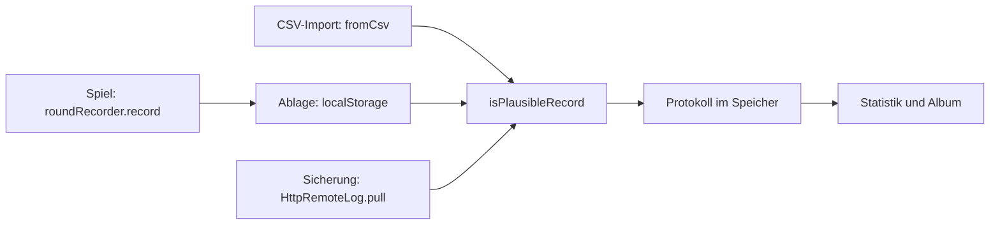
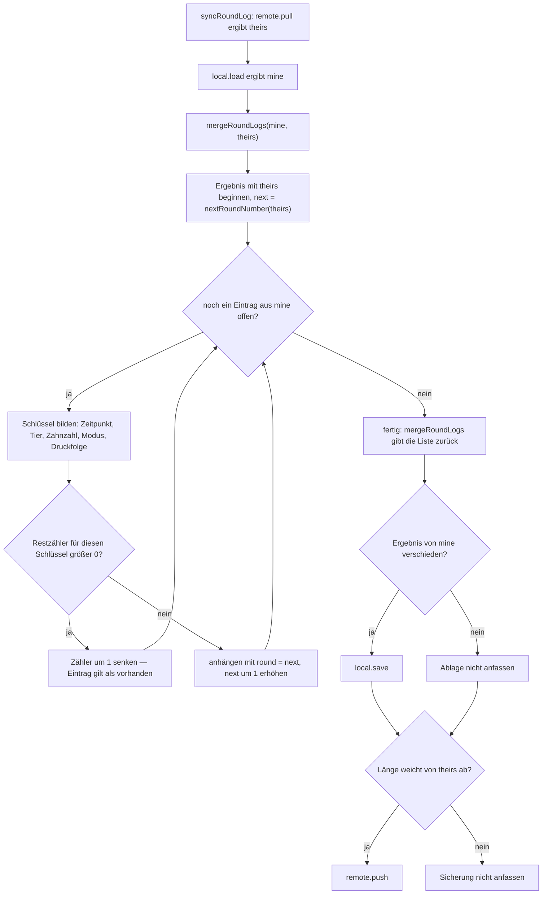

# Rundenprotokoll, CSV und Zusammenführen

Ein einziges Protokoll trägt alles, was das Spiel über gespielte Runden weiß: die Statistikseite
wertet es aus, das Tier-Album leitet seine Sterne daraus ab, der CSV-Export ist die Handsicherung,
und die Sicherung im Worker ist eine zweite Kopie derselben Liste. Es gibt keinen zweiten Speicher
für abgeleitete Zahlen. Deshalb liegen Format und Regeln an **einer** Stelle: `RoundRecord` und
`CSV_HEADER` in `src/core/domain/records.ts`, Lesen, Schreiben, Prüfen und Zusammenführen in
`src/core/domain/sessionLog.ts`. Die Bedienung sieht davon nur den Außenvertrag
(`src/contract/sessionLog.ts` reicht Typ und Kopfzeile weiter) — warum das so getrennt ist, steht
in [Schichten, Ports und die Importregel](../architecture/schichten-und-importregel.md).

## Der Datensatz: `RoundRecord`

| Feld | Typ | Bedeutung | Herkunft beim Schreiben |
|---|---|---|---|
| `round` | `number` | laufende Nummer, ganzzahlig ab 1 — nur für den Austausch, nicht die Identität einer Runde | `nextRoundNumber(records)` = größte vergebene Nummer + 1 |
| `playedAt` | `string` | Zeitpunkt der Runde, ISO 8601 | `clock().toISOString()` im Recorder |
| `creature` | `string` | Kennung des Gebisses aus dem Katalog | `round.creatureId` |
| `teeth` | `number` | Zahl der drückbaren Zähne **dieser** Runde (nicht die des Katalogs) | `round.teeth` |
| `mode` | `RandomMode` | `'original'` oder `'classic'` | `round.mode` |
| `players` | `number` | Spielerzahl der Runde | `round.players` |
| `loserTooth` | `ToothId` | Zahn, bei dem es schnappte (1-basiert, `1..teeth`) | `round.loser.tooth` |
| `pressIndex` | `number` | Druck, bei dem es schnappte (1-basiert) | `round.loser.pressIndex` |
| `liveCount` | `number` | wie viele Zähne gleichzeitig scharf waren | `round.loser.liveCount` |
| `pressOrder` | `readonly ToothId[]` | alle Drücke der Runde in ihrer Reihenfolge | `round.pressOrder` |

Zwei Eigenschaften des Typs sind Absicht und für alles Weitere entscheidend: `pressOrder` ist eine
**readonly**-Liste, die `createRoundRecord` beim Anlegen kopiert (kein Alias auf den Rundenstand),
und `creature` ist im Typ Pflicht, in der Prüfung aber optional — Altdaten aus der Zeit vor den
Gebissen kennen das Feld nicht. Was eine Runde fachlich ist (Zustände, Grenzen, Verliererrotation),
steht in [Fachmodell: Runde, Zähne, Gebiss, Einstellungen](fachmodell-runde.md).

## Das CSV-Format

`CSV_HEADER` ist eine einzige Zeile, `;`-getrennt, ohne Anführungszeichen:

```
runde;reihenfolge;verlierer_zahn;modus;zaehne;spieler;druck_nummer;scharfe_zaehne;lebewesen;zeitpunkt
```

| Spalte | interner Name (`FieldName`) | Inhalt | Anmerkung |
|---|---|---|---|
| `runde` | `round` | laufende Nummer | **identisch mit dem Analyse-Werkzeug** |
| `reihenfolge` | `order` | `pressOrder`, mit `-` verbunden (`1-2-4`) | **identisch mit dem Analyse-Werkzeug** |
| `verlierer_zahn` | `loser` | `loserTooth` | **identisch mit dem Analyse-Werkzeug** |
| `modus` | `mode` | `original` oder `classic` | |
| `zaehne` | `teeth` | Zahnzahl der Runde | |
| `spieler` | `players` | Spielerzahl | |
| `druck_nummer` | `press` | `pressIndex` | |
| `scharfe_zaehne` | `live` | `liveCount` | |
| `lebewesen` | `creature` | Kennung aus dem Katalog | fehlt in der früheren 9-Spalten-Fassung |
| `zeitpunkt` | `time` | `playedAt` | fehlt im Kurzformat des Werkzeugs |

**Die ersten drei Spalten sind der Vertrag mit dem Analyse-Werkzeug** (dem Python-Werkzeug
`../kroko-doc/kroko_analyse.py`, `~/projects/kroko-doc`): eine Datei aus diesem Projekt lässt sich
dort weiterrechnen, und eine Datei von dort lässt sich hier importieren. Die übrigen sieben Spalten
sind Zusatz; das Werkzeug kennt sie nicht und braucht sie nicht.

Die Kopfzeile ist **bewusst deutsch** — sie ist eine Schnittstelle zwischen zwei Werkzeugen, kein
Text für Kinder. `toCsv([])` schreibt nur die Kopfzeile (plus Zeilenumbruch), damit eine leere
Datei als gültige Datei erkennbar bleibt.

### Gelesen wird über die Spaltennamen, nicht über Positionen

Der Import sucht jede Spalte über ihren Namen in der Kopfzeile (`COLUMN_NAMES`) und merkt sich die
gefundene Position. Daraus folgen drei Eigenschaften, die man beim Erweitern braucht:

- **Eine neue Spalte bricht keine alte Datei.** Alte Dateien kennen sie nicht; die Zelle bleibt
  `undefined` und der Rückfallwert greift.
- **Eine unbekannte Spalte wird übergangen.** Steht in der Kopfzeile ein Name, den `COLUMN_NAMES`
  nicht kennt, wird die Spalte stillschweigend ignoriert — fremde Dateien mit Zusatzspalten sind
  lesbar.
- **Doppelte Spaltennamen:** die **erste** Fundstelle gilt, spätere werden nicht überschrieben.

Eine Einschränkung, die kein Typ erzwingt: `toCsv` schreibt die Werte **positionell** in der
Reihenfolge `round, pressOrder, loserTooth, mode, teeth, players, pressIndex, liveCount, creature,
playedAt`. Wer `CSV_HEADER` erweitert, muss dieselbe Reihenfolge in der Werteliste herstellen —
sonst passen Kopfzeile und Daten auseinander, und weil gelesen wird, was in der Kopfzeile steht,
landen die Zahlen in den falschen Feldern. Ebenso gilt: geschrieben wird ohne Maskierung, also darf
kein Feld ein `;` oder einen Zeilenumbruch enthalten. Für die heutigen Felder (Zahlen, Kennungen,
Moduskürzel, ISO-Zeitpunkt) ist das erfüllt; eine neue Freitext-Spalte bräuchte Maskierung.

## Lesen: `fromCsv`

```
Zeilen an \r?\n trennen → trimmen → leere Zeilen weg → an ';' trennen
Kopfzeile erkennen: mindestens eine Zelle ist ein bekannter Spaltenname (klein, getrimmt)
Kopfzeile: nur nach Namen lesen · ohne Kopfzeile: feste Positionen (LEGACY_POSITIONS)
je Zeile: Verlierer-Zahn muss eine ganze Zahl sein, sonst Zeile überspringen
          fehlende Maße mit Standardwerten füllen, dann isPlausibleRecord
```

Ohne Kopfzeile gelten **feste Positionen** (`LEGACY_POSITIONS`) für zwei historische Formate: das
Kurzformat des Analyse-Werkzeugs (3 Spalten) und die frühere Fassung dieses Formulars (9 Spalten).
Die ersten drei Positionen teilen beide; 4 bis 9 kennt nur die 9-Spalten-Fassung, und für das
Kurzformat bleiben sie leer:

| Position | 1 | 2 | 3 | 4 | 5 | 6 | 7 | 8 | 9 |
|---|---|---|---|---|---|---|---|---|---|
| Feld | `round` | `order` | `loser` | `mode` | `teeth` | `players` | `press` | `live` | `time` |

Ohne Kopfzeile gibt es kein Lebewesen — dort gilt das Krokodil.

**Fehlende Werte werden nicht geraten, sondern durch den Spielstandard ersetzt.** Das ist die
Stelle, an der das Kurzformat überhaupt lesbar wird:

| Feld | Rückfall | Begründung im Code |
|---|---|---|
| `teeth` | `DEFAULT_TEETH` (10) | das Kurzformat kennt die Zahnzahl nicht; das Werkzeug nur das 10-Zähne-Krokodil |
| `mode` | `DEFAULT_MODE` (`original`) | unbekannter Modustext |
| `players` | `1` | |
| `liveCount` | `0` | Kurzformat kennt die scharfen Zähne nicht |
| `round` | Zeilennummer im Rumpf + 1 | `Number.parseInt(...) \|\| index + 1`, fängt auch `0` ab |
| `pressIndex` | `max(1, indexOf(loserTooth) + 1)` | aus der Druckfolge abgeleitet, nicht behauptet |
| `creature` | Krokodil, wenn die Kennung nicht im Katalog steht | „deutet eine unbekannte Kennung nicht" |

`fromCsv` **wirft nie**. Zeilen ohne ganzzahligen Verlierer-Zahn und Zeilen, die
`isPlausibleRecord` nicht passieren, werden übersprungen; kaputte Zeilen in einer Datei kosten
also nur diese Zeilen, nicht die Datei. Leere Eingabe ergibt eine leere Liste.

## Plausibilität: `isPlausibleRecord`


Drei Eingänge, eine Prüfung: was aus dem Spiel kommt, was in der Ablage liegt und was von außen kommt.

Die Regel, Feld für Feld (`RoundRecord` in `core/domain/records.ts`, Grenzen in `teeth.ts`):

| Feld | Bedingung | Verletzung heißt |
|---|---|---|
| `round` | ganze Zahl ≥ 1 | keine laufende Nummer |
| `teeth` | `isValidToothCount` → ganze Zahl 1..`MAX_TEETH` (12) | kein spielbares Gebiss |
| `loserTooth` | ganze Zahl 1..`teeth` | Zahn außerhalb des Gebisses |
| `pressIndex` | ganze Zahl 1..`teeth` | Druck größer als die Zahnzahl |
| `mode` | in `RANDOM_MODES` | unbekanntes Zufallsmodell |
| `players` | `isValidPlayerCount` → ganze Zahl 1..`MAX_PLAYERS` (4) | mehr Spieler, als es je gab |
| `liveCount` | ganze Zahl 0..`MAX_LIVE_TEETH` (3) | mehr scharfe Zähne, als das Modell kennt |
| `pressOrder` | Array, **jeder** Eintrag 1..`teeth` | Druckfolge mit fremdem Zahn |
| `creature` | `undefined` oder `string` | — |

Drei Dinge, die man an dieser Liste leicht falsch annimmt:

- **`players` erlaubt 1–4, obwohl die Bedienung nur 1 und 2 anbietet.** `MAX_SELECTABLE_PLAYERS` = 2
  gilt für die Knöpfe, nicht für Protokolle: es gab Runden mit 3 und 4 Spielern, und die sollen
  nach einem Import nicht verschwinden.
- **`creature` wird nur auf „String" geprüft, nicht gegen den Katalog.** Eine erfundene Kennung
  passiert die Prüfung; ersetzt wird sie erst später — beim Import in `fromCsv` und in der
  Auswertung über `creatureOrDefault`. Plausibilität ist keine Katalogprüfung.
- **Die Prüfung ist nicht widerspruchsfrei gedacht, sondern nur „rechenbar".** Sie verlangt nicht,
  dass `loserTooth` in `pressOrder` steht oder dass `pressOrder[pressIndex - 1]` der Verlierer-Zahn
  ist. Solche Widersprüche fängt keine Regel ab — sie fiele erst der Auswertung auf, und die rechnet
  mit dem Verlierer-Zahn und der Druck-Position getrennt.

### Warum an *allen* Eingängen geprüft wird

Die Statistikseite baut je Gebiss einen **Zählvektor der Länge `teeth`**: `analyseSession` nimmt die
größte Zahnzahl der Gruppe und ruft `countBy(loserTeeth, teeth)` und `countBy(pressIndices, teeth)`
— dazu die Modellverteilung `pressPositionDistribution(teeth, …)`. Eine Zeile mit
`zaehne = 1000000000` in einer CSV-Datei oder ein von Hand veränderter Eintrag in der Ablage
erzeugte bei **jedem Laden** ein Array dieser Länge und legte die Seite damit lahm. Genau das ist
der Grund, warum die Prüfung nicht nur beim Import sitzt:

| Eingang | Ort | Verhalten bei Verstoß |
|---|---|---|
| CSV-Import | `fromCsv` je Zeile | Zeile überspringen, Rest der Datei lesen |
| Ablage im Browser | `LocalStorageRoundLog.load` → `parsed.filter(isPlausibleRecord)` | Eintrag fällt weg; ist die Ablage kein Array, kommt eine leere Liste; ein `JSON.parse`-Fehler ebenso |
| Sicherung | `HttpRemoteLog.pull` → `parsed.filter(isPlausibleRecord)` | Eintrag fällt weg; ist die Antwort **keine Liste**, wirft `pull` — der Abgleich scheitert sichtbar statt still |

Der Grundsatz dahinter: **was von außen kommt, ist eine Behauptung** — CSV-Datei, Ablage, Sicherung
gleichermaßen. Geprüft wird an der Grenze, nicht in der Auswertung; die Auswertung darf annehmen,
dass ihre Eingaben rechnbar sind.

## Zusammenführen: `mergeRoundLogs`

Gerät und Sicherung sind zwei Stände **desselben** Protokolls, und ein Protokoll ist eine Liste, an
die nur angehängt wird. Die Regel ist entsprechend einfach und asymmetrisch:

> **Der Stand der Sicherung bleibt, wie er ist. Was nur das Gerät kennt — die Runden seit dem
> letzten Abgleich —, wird angehängt und weitergezählt.**


Der ganze Weg vom Abruf bis zum Schreiben — die Mengenregel in der Mitte, das „nur schreiben, wo sich etwas ändert" außen.

### Die Mengenregel im Detail

- **Identität ohne laufende Nummer.** `roundIdentity` bildet
  `playedAt|creature|teeth|mode|pressOrder.join('-')`. Die Rundennummer gehört bewusst **nicht**
  dazu: nach einem geleerten Profil vergibt das Gerät wieder Nummern ab 1, obwohl die Sicherung
  dieselben Runden unter anderen Nummern kennt. Der Test „erkennt dieselbe Runde auch unter einer
  anderen laufenden Nummer" hält das fest — lokal Runde 7, Sicherung Runde 1: es bleibt **eine**
  Runde, und zwar die der Sicherung.
- **Gezählt wird je Vorkommen, nicht je Schlüssel.** `unmatched` ist ein Zähler je Schlüssel, kein
  Set. Drei lokale Einträge mit demselben Schlüssel und einer in der Sicherung ergeben drei
  Einträge: die Sicherung behält ihren, die zwei übrigen werden angehängt. Das ist der Fall
  „Kurzformat-Import ohne Zeitpunkt" — dort ist `playedAt` leer, und mehrere Runden mit gleicher
  Druckfolge sind sonst nicht unterscheidbar.
- **Angehängt wird in der Reihenfolge des Geräts, mit fortlaufenden Nummern** ab
  `nextRoundNumber(remote)`. Die Nummern der lokalen Einträge werden also **neu vergeben**, nicht
  übernommen.
- **Reine Funktion.** Beide Eingaben bleiben unverändert (Test „lässt die Eingaben unverändert"); das
  Ergebnis ist eine neue Liste, angehängte Einträge sind Kopien mit neuer `round`.

Was daraus folgt, wenn man es bedient:

| Lage | Ergebnis |
|---|---|
| beide Stände gleich | die Liste der Sicherung, unverändert |
| Gerät leer (geleertes Profil) | alles kommt aus der Sicherung zurück |
| Gerät hat vor dem ersten Abgleich gespielt | die Geräte-Runden kommen **hinten** dazu und werden umnummeriert |
| dieselbe Runde unter anderer Nummer | eine Runde, Nummer der Sicherung |
| Gerät kennt weniger als die Sicherung | nichts wird angehängt, nichts gelöscht |

### Grenzen des Verfahrens

- **Löschen gleicht sich nicht ab.** Ein Abgleich würde die gelöschten Runden aus der Sicherung
  zurückholen. Deshalb ersetzt „Protokoll löschen" die Sicherung, statt sie abzugleichen
  (`backup.replace([])`), und der Test dazu prüft ausdrücklich `replace` statt `sync`.
- **Der Abgleich gewinnt keine Konflikte aus.** Er kennt nur „in der Sicherung vorhanden" und
  „nur auf dem Gerät". Zwei Geräte mit derselben Runde — gleicher Zeitpunkt, gleiche Druckfolge —
  sehen aus wie eine Runde; zwei Geräte mit unterschiedlichen Runden sehen aus wie ein Anhang. Das
  passt für ein Protokoll, das nur wächst, und **nicht** für einen einzelnen Zustand (Punktestand,
  Einstellungen): dort bräuchte es eine andere Regel, und die ist hier nicht gebaut.
- **Ein leerer Zeitpunkt macht Runden ähnlich.** Zwei importierte Kurzformat-Runden mit gleicher
  Druckfolge, gleicher Zahnzahl und gleichem Modus sind für die Mengenregel identisch. Das ist
  gewollt (je Vorkommen), bedeutet aber: die Identität ist so gut wie `playedAt`.

## Wer schreibt, wann gelesen wird

| Vorgang | Datei | Verhalten |
|---|---|---|
| Eine Runde wird gespielt | `presentation/game/roundRecorder.ts` | **erst lesen, dann anhängen**: `log.load()`, `nextRoundNumber`, `createRoundRecord`, `log.save` — mit dem Stand vom Seitenstart überschriebe der Biss gelöschte und importierte Runden |
| CSV-Export | `presentation/stats/statsPage.ts` | `toCsv(log.load())` → `zahn-agent-runden-<datum>.csv` |
| CSV-Import | dieselbe Datei | anhängen und **fortlaufend umnummerieren** ab der größten vorhandenen Nummer, speichern, dann Sicherung abgleichen |
| Löschen | dieselbe Datei | `log.clear()` und `backup.replace([])` |
| Abgleich | `core/use-cases/syncRoundLog.ts` | **erst holen**, dann die Ablage lesen, zusammenführen, und nur schreiben, wo sich etwas ändert |
| Ablage | `infrastructure/storage/localStorageLog.ts` | Schlüssel `zahn_agent:rounds:v1`; ältere Schlüssel werden beim ersten Lesen einmalig übernommen; scheitert ein Schreiben, gilt bis zum nächsten Erfolg der Arbeitsspeicher |

Die Reihenfolgen sind keine Vorsicht, sondern gemessene Fehler: „erst holen, dann lesen" verhindert,
dass eine Runde verloren geht, die während des Abrufs zu Ende ging (Test „verliert keine Runde, die
während des Abrufs zu Ende geht"); „erst lesen, dann anhängen" verhindert, dass zwei Tabs einander
überschreiben. Die Ablage-Seite davon (Schlüssel, Rückfall, Übernahme) und der Worker stehen in
[Sicherung über den Worker](../integrations/sicherung-worker.md); die Seite als Ganzes in
[Statistikseite](../workflows/statistikseite.md).

## Was die Tests halten

`src/core/domain/sessionLog.test.ts` ist die eigentliche Formatspezifikation:

- **Schreiben:** Kopfzeile enthält `runde;reihenfolge;verlierer_zahn` und `lebewesen`, die Zeile
  lautet exakt `1;1-2-4;4;original;10;2;3;2;crocodile;2026-10-10T09:40:00.000Z`; eine leere Liste
  ergibt genau eine Zeile.
- **Lesen:** eigenes Format kommt unverändert zurück (Rundreise), `lebewesen` bleibt erhalten
  (Krokodil und Wolf mit 12 Zähnen), das Kurzformat des Werkzeugs wird gelesen (mit abgeleiteter
  Druck-Position 3 bzw. 10, Zahnzahl 10, Modus `original`), die frühere 9-Spalten-Fassung ergibt
  Krokodil, eine unbekannte Kennung ebenfalls, kaputte Zeilen werden übersprungen, leere Eingabe
  ergibt `[]`.
- **Plausibilität:** ein echter Eintrag und Altdaten ohne `creature` werden angenommen; `null`,
  `undefined`, `7`, `'x'`, `[]`, `{}` abgewiesen; `teeth: 13`, `loserTooth: 0`, `pressIndex: 2.5`,
  `mode: 'schnell'`, `pressOrder: 'eins'`, `liveCount: 4` ebenso.
- **Unmögliche Zeilen:** eine Datei mit Zahnzahl 10⁹, Zahnzahl 0, Verlierer-Zahn 11 bei 10 Zähnen,
  Druck-Nummer 12 bei 10 Zähnen und neun Spielern liefert nur die eine heile Zeile — „eine Zahnzahl
  von einer Milliarde legt nichts lahm".
- **Nummern und Zusammenführen:** `nextRoundNumber([]) === 1`, sonst größte + 1; gleicher Stand
  bleibt; leeres Gerät bekommt alles zurück; Geräte-Runden werden angehängt und weitergezählt
  (Nummern 1–5, Zeitpunkte in der Reihenfolge der Sicherung); gleiche Runde unter anderer Nummer
  ergibt eine; gleiche Einträge zählen je Vorkommen; die Eingaben bleiben unverändert.

Dazu kommen `src/presentation/stats/statsPage.test.ts` (Import hängt an und nummeriert weiter,
„Keine gültigen Zeilen gefunden.", Löschen ersetzt die Sicherung) und
`src/core/use-cases/syncRoundLog.test.ts` (nur schreiben, wo sich etwas ändert; Abruf vor dem Lesen
der Ablage; eine nicht erreichbare Sicherung lässt das Gerät unberührt). Die Statistikseite selbst
beschreibt [Statistik und Ehrlichkeit](statistik-und-ehrlichkeit.md).

## Verwandte Seiten

- [Fachmodell: Runde, Zähne, Gebiss, Einstellungen](fachmodell-runde.md) — was eine Runde ist, woher
  ihre Grenzen kommen und warum die Zahl in der Kopfzeile der Spielseite **nicht** die
  Protokollnummer ist (Abschnitt „Die bekannte Falle").
- [Statistik und Ehrlichkeit](statistik-und-ehrlichkeit.md) — was aus dem Protokoll gerechnet wird
  und wann eine Aussage unterbleibt.
- [Sterne und Freischaltung](sterne-und-freischaltung.md) — das Album als Ableitung aus denselben
  Einträgen.
- [Sicherung über den Worker](../integrations/sicherung-worker.md) — Code, Routen, D1 und der Abgleich.
- [Statistikseite](../workflows/statistikseite.md) — Export, Import, Löschen in der Bedienung.
- [Schichten, Ports und die Importregel](../architecture/schichten-und-importregel.md) — warum
  `RoundRecord` als Typ im Vertrag steht und die Regeln im Kern.
- Im Repository: `src/core/domain/records.ts`, `src/core/domain/sessionLog.ts`,
  `src/core/domain/teeth.ts`, `docs/domain-model.md`, `docs/sicherung-anleitung.md`.
