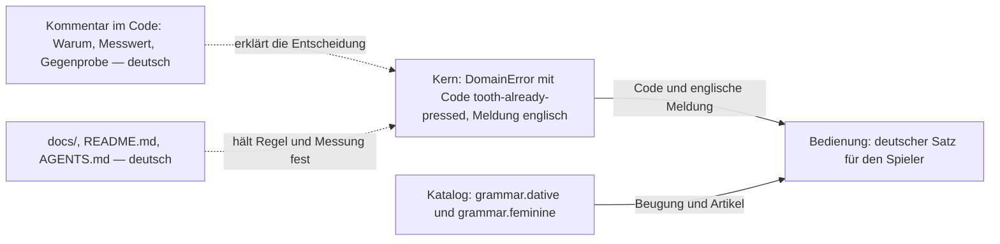
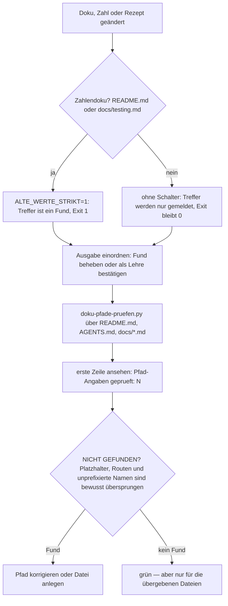

# Sprache, Doku-Regeln und Kommentarstil

Dieses Projekt hat wenig Werkzeug, das Konventionen erzwingt, und viel Prosa, die sie trägt. Das ist
Absicht: `AGENTS.md` sagt von sich selbst, es sei ein **„Einstiegspunkt, kein Regelwerk“**, und
verweist für die Regeln auf `docs/`. Verbindlich sind also [`AGENTS.md`](../../AGENTS.md), die Dateien
<!-- openwiki: broken internal link [../../docs] file "../../docs" does not exist. Fix the href or restore the target, then delete this comment. -->
unter [`docs/`](../../docs) und die Tests im Baum — nicht diese Wiki-Seite. Wo sie dem Baum
widerspricht, gilt der Baum; diese Seite erklärt nur, wie die Konventionen zusammenhängen.

## Der Index ist der Wegweiser

`AGENTS.md` trägt drei **Direktiven** und darunter eine Tabelle, die von einem Thema über eine Datei zu
einem Satz führt, der mit „Lies das, bevor du …“ beginnt — etwa „Sprache“ →
[`docs/language-guidelines.md`](../../docs/language-guidelines.md) → „bevor du Code, Kommentar oder
UI-Text schreibst“, oder „Fallen, die Zeit kosten“ → [`docs/fallen.md`](../../docs/fallen.md) →
„**bevor du irgendetwas am Code änderst**“. Diese Tabelle ist im Arbeitsalltag der Weg zu den Regeln,
und sie wird von Hand gepflegt: keine Prüfung im Baum vergleicht sie mit dem Inhalt von `docs/`. Wer eine
Regeldatei anlegt oder Regeln verschiebt, zieht die Zeile nach — `docs/workflow.md` sagt das ausdrücklich
(„Regeln in die passende Datei unter `docs/` — der Index in `AGENTS.md` sagt, welche“).

Die drei Direktiven in Kurzform:

1. **Erst lesen, dann bauen.** Die passende Datei unter `docs/` gemäß Index, und `docs/fallen.md` vor
   **jeder** Änderung am Code.
2. **Sprache trennen:** Code, Namen und Meldungen englisch; Kommentare, Doku, UI-Texte und
   Commit-Beschreibungen deutsch (nächster Abschnitt).
3. **Das Gate ist dreierlei:** `pnpm typecheck`, `pnpm lint` **und** `pnpm test:run`. Ein grüner
   Testlauf allein ist kein grünes Gate; fällt es, wird der Fund **im Code** behoben. Nur mit dem Ja
   des Auftraggebers wird stattdessen eine Regel in `biome.jsonc` abgeschaltet, eine
   `// biome-ignore`-Zeile gesetzt, ein Test gelockert oder `git push --no-verify` benutzt. Details auf
   [Prüfen und Gate](../testing/pruefen-und-gate.md).

## Sprache: englisch im Code, deutsch im Text

Die Tabelle in [`docs/language-guidelines.md`](../../docs/language-guidelines.md) ist kurz und
vollständig:

| Ort | Sprache |
|---|---|
| Bezeichner, Typen, Funktionsnamen, Meldungen im Code | **Englisch** |
| Kommentare im Code | **Deutsch** |
| Dokumentation (`docs/`, `README.md`, `AGENTS.md`) | **Deutsch** |
| Commit-Beschreibungen | **Deutsch** |
| Alles, was Spieler sehen (UI-Texte, Fehlermeldungen im Dialog) | **Deutsch** |

Begründung im Original: der Code soll mit fremden Bibliotheken und Werkzeugen zusammenpassen; die
Fachsprache des Spiels und die Doku sollen ohne Übersetzung lesbar sein.



Zwei Register, eine Grenze: alles, was eine Maschine oder ein fremdes Werkzeug liest, ist englisch;
alles, was ein Mensch als Begründung oder als Satz liest, ist deutsch. Die deutsche Form entsteht
dabei nicht durch Übersetzung im letzten Moment, sondern in eigenen Sprachmodulen der Bedienung.

**Die Grenze verläuft zwischen Kern und Bedienung.** Der Kern wirft
`DomainError` mit englischem, kebab-case-Code und englischer Meldung —
`new DomainError('tooth-already-pressed', 'tooth 3 is already pressed')`,
`'tooth count 13 is not allowed'`, `'round is already finished'`
([`src/core/domain/errors.ts`](../../src/core/domain/errors.ts),
[`src/core/domain/round.ts`](../../src/core/domain/round.ts)). `docs/architecture.md` hält dazu fest,
dass die Bedienung Verstöße abfängt, bevor sie entstehen, und deutsche Texte zeigt statt der
englischen Kernmeldungen. Selbst ein Validierer, dessen Ergebnisse in deutschen Tests gelesen werden,
liefert englische Sätze: `validateCreature` meldet „tile label is longer than 12 characters“.

**Deutsche Spielersätze entstehen in eigenen Sprachmodulen der Bedienung.** `resultText.ts` baut
„Maul zu“, „Du bist dran“, „Zahn 7 war der falsche — der einzige scharfe.“; `unlockNotice.ts` sagt von
sich selbst, hier stehe „nur die Sprache“ zur Freischaltung. Damit die deutschen Sätze grammatisch
stimmen, trägt der Katalog Sprachdaten: `grammar.dative` für „dem Löwen“, `grammar.feminine`
entscheidet über „zur“/„zum“ („zur Venusfliegenfalle“). Ein deutschsprachiges UI ist damit auch ein
Datenmodell-Thema — ein neues Tier ohne Dativform klingt falsch, nicht nur ungenau.

Drei Feinheiten, die man leicht übersieht:

- **Der CSV-Kopf ist eine dokumentierte Ausnahme.** `CSV_HEADER` heißt
  `runde;reihenfolge;verlierer_zahn;modus;zaehne;…` — bewusst deutsch, weil das Format die
  Schnittstelle zum externen Analyse-Werkzeug ist. Die Sprachregel gilt für Code, nicht für ein
  Austauschformat, das außerhalb des Baums gelesen wird.
- **Testtitel sind deutsche Behauptungen**, keine Symbolnamen: „nennt den Zug in richtiger Sprache —
  ‚Du bist dran‘, nicht ‚Du ist dran‘“, „belegt, wo die Trefferfläche auf einem 320-px-Gerät endet
  (gemessen, nicht geschätzt)“. Sie lesen sich damit wie die Doku, die sie ersetzen.
- **Der OpenWiki-Block in `AGENTS.md` ist englisch** und steht zwischen `<!-- OPENWIKI:START -->` und
  `<!-- OPENWIKI:END -->`: Er gehört dem Werkzeug, nicht dem Projekt — siehe unten.

## Das Doku-Ritual

Der Ablauf vor und nach einer Änderung ist festgelegt und wird nirgends automatisch erzwungen:

1. **Vor dem Implementieren** die passende Datei unter `docs/` lesen (Index), und **`docs/fallen.md`
   immer** — „dort steht, was schon einmal Zeit gekostet hat“. Die Liste stand bis zum 14.10.2026 in
   `AGENTS.md` selbst, wo sie in jeder Sitzung im Blick war; seither liest sie, wer dem Index folgt.
2. **Nach der Abnahme** wandert das Bleibende an seinen Ort: Regeln in die passende `docs/`-Datei,
   Fallen nach `docs/fallen.md`, Begriffe nach `docs/domain-model.md`, Nachweise nach
   `docs/e2e-nachweise.md`, Belege nach `docs/tier-quellen.md`; `docs/plan.md` ist eine
   **Arbeitsdatei, kein Archiv** und wird danach auf ihren Hinweistext zurückgesetzt. Keine andere
   Doku verweist auf den Inhalt von `plan.md` — ein solcher Verweis zeigte nach dem nächsten Feature
   ins Leere.
3. **Nach jeder Änderung an Doku, Zahlen oder Rezepten** die beiden Prüfskripte fahren (nächster
   Abschnitt).

### Fallen sind Beweise, keine Anekdoten

Der Kopf von `docs/fallen.md` setzt das Format: **jede Falle nennt ihren Anlass, den Messwert und die
Gegenprobe — sie stammt aus einem echten Lauf, nicht aus einer Vermutung.** Ein Eintrag ohne Zahl und
ohne Prüfweg wäre nicht nachprüfbar und damit wertlos; einer mit Zahl, Datum und Werkzeug lässt sich
widerlegen, und genau das macht ihn brauchbar. Dieselbe Haltung steht in `docs/testing.md` unter
„Zahlen nur aus Kommandos“: jede Zahl in der Dokumentation stammt aus einem ausgeführten Kommando,
Schätzungen sind verboten, Simulationen werden als Simulation gekennzeichnet.

Daraus folgt eine Pflicht, die oft vergessen wird: **Rezepte in der Doku sind ungeprüfter Code.** Nach
jeder Umbenennung oder Verschiebung werden die Befehle aus `README.md`, `AGENTS.md` und `docs/`
wirklich gefahren und die **Ausgabe** angesehen, nicht nur der Exit-Code — ein Befehl, der
durchläuft und dabei nichts tut, ist schlimmer als kein Befehl.

## Kommentarstil: Begründung mit Messwert

Die Regel in [`docs/language-guidelines.md`](../../docs/language-guidelines.md) ist knapp: Kommentare
erklären das **Warum**, nicht das Was. „Ein Kommentar, der eine Regel wiederholt, ist Ballast — ein
Kommentar, der eine Falle benennt, spart Zeit.“ Im Code hat sich daraus eine erkennbare Form
entwickelt, die aus drei Teilen besteht:

- **Anlass:** welcher Fehler, welche Messung, welche Entscheidung den Code so geformt hat.
- **Messwert:** konkrete Zahlen mit Datum und dem Werkzeug, das sie geliefert hat („gemessen am
  12.10.2026 mit `scripts/pruefen-freischaltung.py`“).
- **Gegenprobe:** was den Wert künftig hält — ein Test, eine Sonde, eine Konstante.

Ein Musterbeispiel ist `MAX_TILE_LABEL_LENGTH = 12` in
[`src/core/domain/creature.ts`](../../src/core/domain/creature.ts): Der Kommentar nennt den Anlass
(„Säbelzahntiger“ bricht auf der 65-px-Kachel in drei Zeilen), die gemessene Grenze (12 Zeichen passen
in zwei Zeilen, das 13. macht die Kachel 13,2 px höher als ihre Nachbarn; in der offenen Reihe passen
zehn Zeichen), die Herkunft des Maßes (`scripts/pruefen-freischaltung.py`, 14.10.2026) und die
Gegenprobe (die Konstante wacht über die Länge, `creature.test.ts` hält den Katalog daran, das Maß
selbst prüft weiterhin die Browser-Sonde). Bemerkenswert daran: Die alte, falsche Fassung dieser Regel
stand als Prosa in `AGENTS.md` („mehr als rund vierzehn Buchstaben“) — widerlegt hat sie eine Sonde, die
die Kachelhöhen verglich, nicht ein Leser.

Weitere Beispiele derselben Form:

- `MAX_TEETH = 12` in [`src/core/domain/teeth.ts`](../../src/core/domain/teeth.ts) leitet die Obergrenze
  aus einer Mindest-Trefferfläche von 44 × 44 CSS-Pixeln auf einem 358 px breiten Handy ab — „bei 12
  Zähnen sind es 51–63 px, bei 16 nur noch 38 px“ — und nennt den Test, der es für jedes Lebewesen
  nachrechnet.
- `liveCountRange` dokumentiert die **zweite** Begegnung mit derselben Falle (Kappen vor oder nach dem
  Ziehen: angezeigte 83,3 % gegen gezogene 75,0 %) und begründet damit, warum es für Modell und Auswahl
  nur **eine** Rechenstelle gibt.
- Die `touchstart`-Behandlung in [`src/presentation/game/holdGesture.ts`](../../src/presentation/game/holdGesture.ts)
  trägt den Messwert „14 px Weg auf 65 px Fläche, kein Zug“ und die Gegenmessung „`touch-action` hilft
  hier nicht, Chromium wertet es an Teilen einer SVG-Zeichnung nicht aus“ — plus die Einschränkung,
  dass nur der gehaltene Zahn das Scrollen abfängt.
- Der Kopf von [`src/presentation/game/sheets.ts`](../../src/presentation/game/sheets.ts) listet die drei
  Fehler auf, die entstanden, weil die Regel vorher als Seitenskript in `pages/index.astro` stand und
  jsdom sie nie ausführte.

Wer eine **Regel** zitieren will, zitiert ihren Namen in Anführungszeichen („wer zurückschreibt, liest
vorher“ in `roundRecorder.ts`); wer einen **Nachweis** zitieren will, nennt die Abschnittsnummer der
Nachweisakte, statt die Messung abzuschreiben — `hudView.ts` verweist auf `docs/e2e-nachweise.md` §5t,
und dort steht der Fall als `## 5t.`-Abschnitt.

> **Achtung, Zahlendoku:** Zahlen in Doku und README werden scharf geprüft (siehe unten), Zahlen in
> **Code-Kommentaren nicht** — die beiden Prüfskripte sehen nur Markdown. Ein Messwert im Kommentar
> bleibt deshalb nur ehrlich, wenn ihn ein Test oder eine Konstante im Code hält. Wer eine gemessene
> Grenze ändert, ändert die Konstante, den Kommentar **und** die Sonde, die sie gemessen hat.

Auch Konfiguration folgt dem Stil: [`biome.jsonc`](../../biome.jsonc) ist durchgehend deutsch
kommentiert, und jede abgeschaltete Regel trägt ihren Grund an der Regel („Kein Formatierer: er
schriebe beim ersten Lauf fast jede Datei um und machte `git blame` unlesbar“). `docs/testing.md`
verlangt zusätzlich, denselben Grund im Dokument zu nennen — abgeschaltet wird nur mit dem Ja des
Auftraggebers, und dann zweimal begründet.

## Doku prüfen: zwei Skripte, zwei Fragen

Nach jeder Änderung an Doku, Zahlen oder Rezepten steht das Rezept in
[`docs/workflow.md`](../../docs/workflow.md):

```bash
# Zahlendoku scharf: hier ist jeder alte Wert ein Fehler
# (ALT ist hier abgekürzt — im Rezept in docs/workflow.md steht die ganze Liste)
ALT="196|2,29 s|232 Tests|Acht Gebisse|acht Kacheln|…|10 sichtbare"
ALTE_WERTE="$ALT" ALTE_WERTE_STRIKT=1 bash scripts/doku-pruefen.sh README.md docs/testing.md
# Regeln, Rezepte und Aufzeichnungen meldend: dort stehen alte Werte absichtlich als Lehre
ALTE_WERTE="$ALT" bash scripts/doku-pruefen.sh AGENTS.md docs/tiermodell-anleitung.md docs/workflow.md docs/e2e-nachweise.md
python3 scripts/doku-pfade-pruefen.py . README.md AGENTS.md docs/*.md
```

| Skript | Frage | Wie | Exit |
|---|---|---|---|
| [`scripts/doku-pruefen.sh`](../../scripts/doku-pruefen.sh) | Steht Fließtext in einem Codeblock, ist ein Zaun offen — und steht ein alter Wert noch in lebender Doku? | Zaun-Parität; sprachbewusste Prüfung auf Fließtext im Zaun: `#`-Überschrift und `-`-Zeile gelten in Zäunen **ohne** Sprachkürzel als Fund, in `bash`/`ts`-Zäunen als Code, `**fett**` am Zeilenanfang immer als Fund; Kästchen zählen; `ALTE_WERTE` per `grep -E` suchen | 0 sauber, 1 Fund, 2 Aufruffehler |
| [`scripts/doku-pfade-pruefen.py`](../../scripts/doku-pfade-pruefen.py) | Zeigt jede in Backticks genannte Pfadangabe auf eine existierende Datei? | Zäune vorher entfernen, Backticks **je Zeile** paaren, nur Angaben mit Verzeichnis-Präfix prüfen, `{a,b}`-Listen und `*`/`...` expandieren | 0 alle vorhanden, 1 mindestens eine Angabe ins Leere, 2 Aufruffehler |



Beide Läufe sind **manuell**: `pnpm gate` ist `typecheck && lint && test:run`
([`package.json`](../../package.json)), und der Pages-Workflow fährt nur dieses Gate und den Bau — kein
Skript prüft Doku. Die Prüfung ist damit eine Konvention, keine Schranke.

### Warum „scharf“ nur über die Zahlendoku

`ALTE_WERTE_STRIKT=1` macht einen Treffer zum Fund (Exit 1) — das gehört ausschließlich über
`README.md` und `docs/testing.md`, die **Zahlendoku**. In `AGENTS.md`, `docs/tiermodell-anleitung.md`,
`docs/workflow.md` und `docs/e2e-nachweise.md` stehen alte Zahlen **absichtlich** (als Lehre, im
Aufruf-Beispiel) und würden falschen Alarm auslösen. Ohne den Schalter **meldet** der Lauf Treffer nur,
der Exit-Code bleibt 0 — genau so blieb „232 Tests“ in der Startanleitung stehen, während dieselbe
Datei zweimal 234 nannte; aufgefallen ist es erst einem unabhängigen Prüfer. Zwei Regeln folgen daraus:

- **Nie `>/dev/null`** über die Doku-Prüfung: der Exit-Code allein sagt bei gemeldeten Treffern nichts.
- **Die Zahl selbst muss aus einem Lauf stammen.** Der aktuelle Stand (587 Tests in 48 Dateien) steht in
  `README.md` und in `docs/testing.md`; die Liste `ALT` im Rezept führt die inzwischen überholten Werte
  mit, damit ein stehengebliebener alter Wert auffällt.

### Was „grün“ hier nicht heißt

- Geprüft werden nur die **übergebenen** Dateien. Code-Kommentare, Tests und generierte Wiki-Seiten
  sieht keines der beiden Skripte.
- Das Pfadskript prüft nur Backtick-Angaben mit Präfix aus seiner Liste (`src/`, `docs/`, `scripts/`,
  `public/`, `test/` …), überspringt Routen (`/plans/:id`), Platzhalter (`public/sounds/voices/<id>.mp3`)
  und reine Dateinamen. Seine Ausgabe ist eine **Kandidatenliste**, kein Beweis.
- Der erste Ausgabesatz („Pfad-Angaben geprueft: N“) gehört zum Lesen: eine Prüfung, die wenig sieht,
  meldet genauso „alles in Ordnung“ wie eine, die alles sieht — siehe die Falle unten.

### Drei Fallen aus der Doku-Arbeit

- **Ein Code-Zaun verschob die Paarung, und die Prüfung sah fast nichts.**
  `scripts/doku-pfade-pruefen.py` paarte die Backticks der Reihe nach; ein Zaun aus drei Backticks
  verschob die Paarung um eins, danach enthielt jeder „Span“ Fließtext und fiel durchs Sieb:
  `docs/testing.md` **0 / 73**, `docs/workflow.md` **0 / 50**, `README.md` **0 / 27** — bei der Ausgabe
  „Alle genannten Pfade existieren“, Exit 0. Seit dem 15.10.2026 entfernt die Prüfung die Zäune vorher
  und paart je Zeile (779 statt 179 Angaben).
- **Eine stille Freigabe unter Windows.** `bash` ist dort WSL, und eine Umgebungsvariable aus PowerShell
  kommt darin nicht an (`ALTE_WERTE` ist leer); der Lauf endet mit Exit 0, obwohl er gar nicht nach alten
  Werten gesucht hat. Deshalb den Block in eine `.sh`-Datei schreiben und mit `bash <datei>` fahren.
- **Ein sichtbarer Text, der in einer Sonde fest eingetragen ist, wird beim Umtexten mitgezogen.** Die
  Bedien-Sonde setzt den Ergebnis-Kasten auf die **längste** Fassung des Ergebnistexts (`LAENGSTES` in
  `scripts/pruefen-bedienung.py`), weil der Zufall sie nicht liefert. Wird der Text in
  `src/presentation/game/resultText.ts` umgeschrieben und die Zeile in der Sonde bleibt stehen, misst die
  Sonde weiter einen Satz, den es nicht mehr gibt — und bleibt grün. Wer einen sichtbaren Text ändert,
  sucht seine Fassung in den Sonden (`grep -rn "<Textstück>" scripts/`).

## Generierte Wiki-Seiten sind nicht von Hand zu ändern

Der OpenWiki-Block in `AGENTS.md` regelt den Umgang mit diesem Wiki:

- Die Wiki ist **optionaler Kontext zur richtigen Zeit**, keine Pflichtlektüre beim Start; sie wird
  nicht vorgeladen und nicht zu Beginn einer Aufgabe durchsucht, sondern erst, wenn die Frage es
  verlangt — und dann so weit, bis die Frage belegt ist.
- **Quellcode und Tests sind maßgeblich.** Was in einem Wiki-Text steht, ist eine Ableitung; was in
  einem Brief an offenen Punkten steht, ist eine Prüflücke, keine Anforderung.
- **Generierte Seiten werden nicht von Hand geändert.** Wer eine Aussage ändern will, ändert Quellcode
  oder `docs/` und lässt die Wiki neu erzeugen. `openwiki/` steht nicht in der `docs/`-Index-Tabelle,
  weil es kein Regelort ist: Regeln liegen in `docs/`, Nachweise in `docs/e2e-nachweise.md`.
- Die Prüfung soll **leise und schmal** sein: die schmalste Prüfung, die das geänderte Verhalten belegt,
  mit vollständiger Fehlerausgabe im Fundfall — keine breiten Läufe als Ersatz für eine gezielte Sonde.

## Was eine Änderung bindet

| Situation | Was mitgezogen wird |
|---|---|
| Neuer Code, neue Regel | Kommentar als Begründung mit Messwert; Test als Gegenprobe; Zahl in `docs/testing.md` nachziehen |
| Neuer Doku-Text, neues Rezept | Zeile im Index in `AGENTS.md`; Rezept wirklich fahren und Ausgabe ansehen |
| Neue Zahl, geänderte Zahl | `README.md` und `docs/testing.md` scharf prüfen, alten Wert in die `ALT`-Liste |
| Neuer Pfad, Umbenennung, Verschiebung | `doku-pfade-pruefen.py` über `docs/*.md`, `README.md`, `AGENTS.md`; erste Zeile ansehen |
| Gemessene Grenze geändert | Konstante, Kommentar, Test und die Sonde, die gemessen hat |
| Neues Tier | Katalog (inkl. `grammar`), Zeichnung, Freischaltung, Stimme, `QUELLEN.md`, Zahl der Tiere in der Doku |
| Neues Falsches gefunden | Eintrag in `docs/fallen.md` mit Anlass, Messwert, Gegenprobe |

Verwandte Seiten: [Architektur-Überblick](../architecture/ueberblick.md),
[Schichten, Ports und die Importregel](../architecture/schichten-und-importregel.md),
[Prüfen und Gate](../testing/pruefen-und-gate.md),
[Bauen und Veröffentlichen](../operations/bauen-und-veroeffentlichen.md),
[Zeichnungssystem](../architecture/zeichnungssystem.md), [Quickstart](../quickstart.md) und
[Fachmodell der Runde](fachmodell-runde.md).
