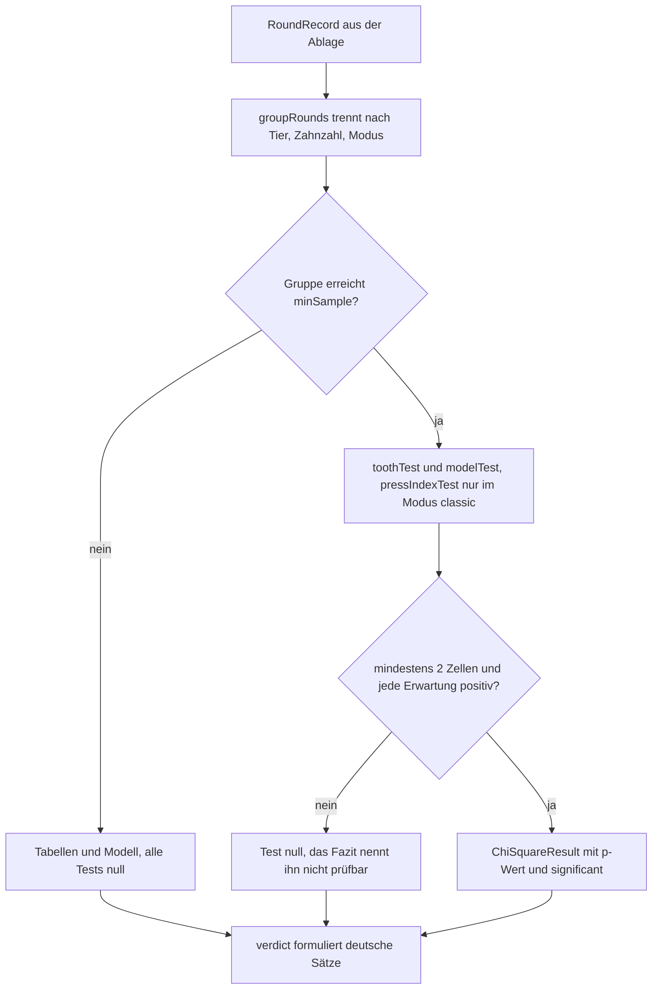

# Statistik und Ehrlichkeitsregeln

Die Auswertung besteht aus zwei klar getrennten Hälften: `src/core/domain/statistics.ts` **rechnet**,
`src/presentation/stats/statsView.ts` **formuliert und malt**. Der Kern kennt weder DOM noch Uhr noch
Zustand — jede Funktion ist eine Funktion ihrer Eingaben (so steht es als Kommentar über der Datei,
`statistics.ts` Zeile 11–14). Die einzige Eingabe sind Runden, wie sie im Protokoll liegen
(`RoundRecord` aus `src/core/domain/records.ts`, siehe
[Rundenprotokoll und CSV](rundenprotokoll-und-csv.md)); die einzige Ausgabe sind Zahlen und deutsche
Sätze. Wer eine Regel der Seite ändert, ändert sie hier — und findet die Verdrahtung auf
[Statistikseite](../workflows/statistikseite.md).

Diese Trennung ist nicht Geschmack, sondern die Voraussetzung dafür, dass die Ehrlichkeitsregeln
**prüfbar** sind: ein Fazit, das nur aus einer Zeichenkette besteht, lässt sich gegen Tabellenwerte
und gegen faire Zufallsdaten testen. Die Regeln selbst stehen in `docs/domain-model.md` unter
„Ehrlichkeitsregeln (nicht verhandelbar)", Punkt 4 und 5.

## A8: warum hier kein Browser und keine Uhr stehen darf

`core/domain` fällt unter die Schichtregel A8: kein `document`, `window`, `localStorage`, `navigator`,
`performance.now` und kein `new Date(` (siehe
[Schichten, Ports und die Importregel](../architecture/schichten-und-importregel.md)). Für die
Statistik heißt das konkret:

- **Die Datenquelle kommt von außen.** `analyseSession` bekommt die Runden als Argument; die Seite
  liest sie über `log.load()` und reicht sie hinein. Der Kern öffnet keine Ablage.
- **Zeit kommt nur als String vor.** `playedAt` wird von der Statistik überhaupt nicht gelesen — sie
  zählt Runden und Drücke. Ein Zeitverlauf ist kein Thema der Auswertung.
- **Die Regel wird erzwungen, nicht nur notiert.** `src/architecture.test.ts` sucht die sechs Muster
  als Text in allen Dateien der Schichten `domain` und `use-cases` und lässt den Lauf rot werden,
  wenn eines auftaucht.

`statistics.ts` importiert deshalb ausschließlich Nachbarn aus derselben Schicht: `creature`
(Katalog und Rückfall aufs Krokodil), `probabilities` (Zugmodell), `records` (nur der Typ), `teeth`
(Standardwerte) und `tension` (`survivedDanger` für die mutigste Runde).

## Die Bausteine und die Frage, die jeder beantwortet

Die Datei ist klein genug, um sie als Werkzeugkasten zu lesen. Jeder Baustein beantwortet genau eine
Frage und hat einen **ausgesprochenen Fall, in dem er keine Antwort gibt** (`null` oder `NaN`) —
das ist die wichtigste Eigenschaft der ganzen Datei.

| Funktion | Frage | Antwortet nicht, wenn … |
|---|---|---|
| `chiSquareSurvival(x, df)` | Wie wahrscheinlich ist ein χ²-Wert **mindestens** so groß wie `x`? (p-Wert) | `df <= 0` oder `x < 0` → `NaN`; `x = 0` → genau `1` |
| `chiSquareGoodnessOfFit(counts, expected)` | Passt eine Zählung zu einer erwarteten Verteilung? | weniger als zwei Zellen, Summe `<= 0`, falsche Länge des Erwartungsvektors oder eine Erwartung `<= 0` → `null` |
| `wilsonInterval(successes, trials, z = 1.96)` | Anteil samt Vertrauensbereich | `trials <= 0` → alles `0` |
| `autocorrelation(series, lag)` | Hängt ein Wert von seinem Vorgänger ab? | `n <= lag + 2`, kein ganzzahliger Lag `< 1`, konstante Reihe → `null` |
| `countBy(values, domain)` | Wie oft kommt 1..`domain` vor? | nie — unbekannte Werte fallen still heraus |
| `groupRounds(rounds)` | Welche Runden sind überhaupt vergleichbar? | leeres Protokoll → leere Liste |
| `analyseSession(rounds, minSample)` | Der ganze Bericht für **ein** Gebiss | nie — aber die Tests darin bleiben `null` |
| `verdict(report, minSample)` | Das Fazit in deutschen Sätzen | nie — es sagt auch „nicht prüfbar" |
| `bravestRound(records)` | Was war die mutigste Runde? | nichts überstanden → `null` |

### Der p-Wert: eine eigene Gammafunktion

`chiSquareSurvival` ist der einzige Ort, an dem die Verteilung selbst gebraucht wird: der p-Wert ist
die regularisierte obere unvollständige Gammafunktion `Q(df/2, x/2)`. Die Datei bringt dafür ihren
eigenen Unterbau mit — `logGamma` (Lanczos-Näherung mit `LANCZOS_G = 607/128`, laut Kommentar rund
1e-16 relativ genau), `gammaSeries`, `gammaContinuedFraction` und `gammaUpper`, die je nach
Größenverhältnis von `a` und `x` zwischen Reihe und Kettenbruch wählt. Der Grund ist gemessen, nicht
angenommen: `Math.lgamma` fehlt in dieser Node-Fassung (Node 26, `docs/e2e-nachweise.md`), eine
Bibliothek gibt es nicht. Die Genauigkeit wird gegen tabellierte Quantile gehalten (χ² = 3,841 bei
`df = 1` → 0,05; 19,023 bei `df = 9` → 0,025) und gegen die Monotonie über einen ganzen Wertebereich.

`chiSquareGoodnessOfFit` setzt darauf auf: Zellen zählen, Erwartungen bilden (`'uniform'` teilt die
Summe gleichmäßig auf, ein Vektor wird mit der Summe multipliziert), χ² summieren, `df = Zellen − 1`.
Zwei Eigenschaften sind Vertrag und keine Nebenwirkung:

- **Die Freiheitsgrade werden nicht korrigiert.** Das Modell gilt als fest vorgegeben; es gibt keinen
  Abzug dafür, dass Parameter aus denselben Daten geschätzt würden. Wer eine Verteilung einsetzt, die
  erst aus dem Protokoll gefittet wurde, bekommt hier einen zu kleinen p-Wert.
- **`significant` ist genau `pValue < ALPHA`,** mit `ALPHA = 0.05` als dateiinterner Konstante. Ein
  Test hat damit immer drei Zustände: nicht gelaufen (`null`), unauffällig, auffällig.

### Das Wilson-Intervall: vorhanden, aber nicht auf der Seite

`wilsonInterval` liefert Anteil und Bereich, geklemmt auf `[0, 1]`, mit `z = 1.96` als Vorgabe für
95 %. Es ist gegen ein Referenzintervall geprüft (57 von 300 → 19,0 %, Bereich 14,96 % bis 23,82 %).
Im heutigen `statsView.ts` steht dafür **kein** Markup: die Seite zeigt Häufigkeitsbalken,
Prozentwerte, χ²-Zeilen und die Mustersuche, aber kein Intervall. Der Baustein ist also Teil des
Werkzeugkastens (und wird in README und Architektur-Überblick als Bestand der Statistik genannt),
nicht Teil der aktuellen Anzeige — wer ihn sieht, will ihn erst noch verdrahten.

### Mustersuche: sechs Versätze, eine Schwelle

`autocorrelation` ist die gewöhnliche Korrelation einer Reihe mit sich selbst, um `lag` verschoben,
und liefert `null`, sobald die Reihe zu kurz, der Lag unbrauchbar oder die Reihe konstant ist (dann
wäre der Nenner `0`).

`analyseSession` prüft **sechs** Versätze gleichzeitig (`AUTOCORRELATION_LAGS = [1..6]`) und markiert
einen Wert als `remarkable`, wenn sein Betrag über `AUTOCORRELATION_Z / √n` liegt, mit
`AUTOCORRELATION_Z = 2.64`. Diese Zahl ist keine Willkür: bei sechs gleichzeitigen Prüfungen auf dem
5-%-Niveau ist 2,64 der zweiseitige Wert nach Bonferroni. Ohne diese Anpassung schlüge bei **fairen**
Daten rund jede vierte Auswertung allein durch die Mehrfachprüfung an — ein Fehlalarm, der wie ein
Fund aussieht. Auch hier gilt: `remarkable` ist eine Auffälligkeit, kein Beweis; das Fazit sagt
deshalb „ein Muster ist nicht ausgeschlossen" und im Gegenfall „kein erkennbares Muster".

## Ein Bericht pro Gebiss: `analyseSession`

`analyseSession` ist der Einstiegspunkt der Auswertung. Es erwartet Runden **eines** Gebisses und
baut daraus einen `SessionReport`. Die Herkunft der Randdaten ist festgelegt:

| Feld | Herkunft |
|---|---|
| `creature` | `creatureOrDefault(rounds[0]?.creature)` — das Tier der **ersten** Runde |
| `mode` | `rounds[0].mode` (bzw. `DEFAULT_MODE`) |
| `teeth` | **Maximum** der Zahnzahlen in der Gruppe, bei leerer Eingabe `DEFAULT_TEETH` |
| `countsByTooth` | `countBy(loserTooth, teeth)` — Index 0 ist Zahn 1 |
| `countsByPressIndex` | `countBy(pressIndex, teeth)` — dieselbe Domäne |
| `model` | `pressPositionDistribution(teeth, creatureKWeights(creature, mode, teeth))` |
| `observedPresses` | Mittel der `pressIndex` |
| `expectedPresses` | `expectedPresses(model)` aus `probabilities.ts` |

`countBy` ist dabei der stille Wächter: es zählt nur ganzzahlige Werte in `1..domain`, alles andere
fällt heraus, statt einen Index zu verschieben. `mostLikelyTooth` entsteht aus demselben Zählvektor
(erster Zahn mit dem höchsten Wert) und ist bewusst **keine** Testaussage — er steht auch dann, wenn
kein Test laufen durfte.

### Drei Tests, und wann sie überhaupt stattfinden

| Feld | Zählung gegen | Bedingung |
|---|---|---|
| `toothTest` | Gleichverteilung der Verlierer-Zähne | genug Runden; mindestens zwei Zähne |
| `pressIndexTest` | Gleichverteilung der Druck-Position | genug Runden **und** `mode === 'classic'` |
| `modelTest` | `report.model`, also das Zugmodell des Gebisses | genug Runden; mindestens zwei Druck-Positionen |

Die mittlere Zeile ist die subtilste: im Originalmodell ist die Druck-Position **absichtlich** nicht
gleichverteilt (vorn schnappt es öfter). Ein Gleichverteilungstest wäre dort bei fairen Daten immer
auffällig, also läuft er gar nicht — und die Seite zeigt die Zeile erst recht nicht. `verdict`
schweigt zu diesem Test, statt ihn zu bedauern: sein Fehlen ist Konstruktion, kein Mangel.

### Anzeige und Test müssen dieselbe Verteilung nehmen

`report.model` ist die eine Zahl, die beide Seiten bindet: `modelTest` prüft dagegen, und `bars(...)`
in `statsView.ts` schreibt „Modell x %" daneben. Vorher rechnete die Anzeige pauschal mit 1–3
scharfen Zähnen, während der Test das Gebiss benutzte — beim Wolf stand „Erwartet (Modell) 4,69",
getestet wurde gegen 5,42 (Wolf: 12 Zähne, 1–2 scharf). Der Test hält das heute fest
(`statistics.test.ts`, „nennt das Modell, gegen das geprüft wird"), und die Anzeige liest den Wert nur
noch aus dem Bericht. Dieselbe Kopplung erklärt, warum die Modellrechnung in
[Zufall und Spannung](zufall-und-spannung.md) (`probabilities.ts`) die Grenzen aus
`liveCountRange` kappt: sobald Anzeige und Ziehung zwei Rechenwege haben, zeigt die Statistik etwas
anderes, als gespielt wurde (Ein-Zahn-Gebiss: „Erwartet 0,33" bei beobachteten 1,00).

## Gleiches mit Gleichem: `groupRounds`

`groupRounds` teilt ein Protokoll nach dem Schlüssel `Tier|Zahnzahl|Modus`, gibt die **größte Gruppe
zuerst** aus und bei Gleichstand die zuerst gespielte (der Sort ist stabil). Runden ohne oder mit
unbekanntem Lebewesen zählen zum Krokodil (`creatureOrDefault`) — Altdaten aus der Zeit vor den
Gebissen bleiben so auswertbar statt zu verschwinden.

Der Grund ist ein gemessener Fehlalarm: 300 **faire** Runden aus Krokodil, Maus und Wolf
zusammengeworfen ergaben „Verlierer-Zähne auffällig ungleich verteilt" (p = 6e-13) und „Das Zugmodell
passt nicht" (p = 1e-5) — die Maus hat eben keine Zähne 7 bis 12, und die Zahnzahl der Gruppe war das
Maximum. Seit dem 12.10.2026 gilt die Regel: **Gleichverteilung und Zugmodell gelten nur innerhalb
einer Gruppe.** Der Test dazu spielt nicht ausgedachte Zahlen, sondern `fairRounds(...)` mit den
echten Spielregeln: 360 Runden aus drei Gebissen schlagen zusammengeworfen an und sind je Gruppe
unauffällig — inklusive Mustersuche.

Daraus folgt die zweite Hälfte der Ehrlichkeitsregel 5: die Mindeststichprobe gilt **je Gruppe**.
Die Statuszeile der Seite (`sampleStatus`) zählt deshalb Gruppen über der Schwelle, nicht Runden:
150 Runden aus zwei Gebissen zu 80 und 70 sind nicht „ausgewertet" — der Satz nennt ausdrücklich das
größte Gebiss mit 80 von 100 Runden.

Die Gruppierung ist Pflicht des **Aufrufers**: `analyseSession` prüft nicht, ob die Runden
zusammenpassen. Es nimmt das Maximum der Zahnzahlen und den Modus der ersten Runde; ein direkter
Aufruf mit gemischtem Protokoll liefert deshalb keinen Fehler, sondern einen still falschen Bericht.
Genau das war der Zustand vor dem 12.10.2026.

## Die Mindeststichprobe: Tabellen ja, Urteil nein

Zwei Konstanten, zwei Aufgaben:

- `DEFAULT_MIN_SAMPLE = 30` im Kern ist die Vorgabe für jeden Aufrufer von `analyseSession` und
  `verdict`.
- `MIN_SAMPLE_FOR_VERDICT = 100` in `statsView.ts` ist die Produktregel; die Seite reicht sie als
  `minSample` an beide Funktionen weiter. Die 100 aus `docs/domain-model.md` (Regel 4) stehen also
  nicht im Kern, sondern dort, wo die Seite gebaut wird.

Unterhalb der Schwelle schaltet `analyseSession` ab, was ein Urteil wäre:

- alle drei Chi²-Tests werden `null`,
- `autocorrelations` ist eine **leere Liste** (nicht sechs Einträge mit `null`), es gibt also keine
  Mustersuche und keine Marken,
- `verdict` gibt nur noch den ersten Satz aus: „Noch zu wenig Daten: erst N Runden, belastbare
  Aussagen ab M."

Bestehen bleibt alles Beschreibende: `countsByTooth`, `countsByPressIndex`, `model`,
`expectedPresses`, `observedPresses` und `mostLikelyTooth`. Genau das meint „Es gibt dann Tabellen,
aber keine Testaussage": die Kacheln und Balken stehen, die Kachel „Häufigster Zahn" ebenfalls, aber
kein χ²-Wert und kein „vereinbar" — und der Satz „Häufigster Verlierer-Zahn: …" fällt mit dem frühen
Rücklauf von `verdict` weg.

Die Schwelle wirkt an zwei Stellen: `analyseSession` schaltet die Tests ab, und `groupHtml` vergleicht
`report.rounds` mit `MIN_SAMPLE_FOR_VERDICT`, um zusätzlich den Hinweis „Für statistische Aussagen
fehlen Runden — die Tests bleiben deshalb aus." zu setzen. Beide lesen dieselbe Zahl, aber aus
verschiedenen Richtungen — die eine aus dem Bericht, die andere aus der Konstante der Seite.

## „Nicht prüfbar" ist nicht „zu wenig Daten"

Das ist die feinste Ehrlichkeitsregel, weil beide Fälle als `null` im Bericht ankommen. Die
Unterscheidung passiert in `testTag(result, enough)` in `statsView.ts`:

| Lage | Etikett | Begründung im Code |
|---|---|---|
| Ergebnis `null`, **genug** Runden | `nicht prüfbar` | es liegt am Gebiss, nicht an der Menge |
| Ergebnis `null`, **zu wenig** Runden | `zu wenig Daten` | die Menge ist die Ursache |
| Ergebnis da | `auffällig` / `unauffällig` samt χ², df und p | — |

Ein Ein-Zahn-Gebiss mit 100 Runden ist der Musterfall: die Zählung hat nur eine Zelle, also gibt
`chiSquareGoodnessOfFit` `null` zurück, obwohl die Stichprobe reicht. Die Seite schreibt dann
„nicht prüfbar" und darf „zu wenig Daten" nicht zeigen — der Test hält beides fest, im Kern
(`statistics.test.ts`, „spricht keinen Test frei, der nicht lief") und in der Anzeige
(`statsView.test.ts`).

Dieselbe Regel gilt für das Fazit, und sie ist strenger formuliert als „kein Ergebnis": Ein nicht
gelaufener Test bekommt **keinen Freispruch**. `verdict` prüft jeden Test einzeln auf `null` und hat
dafür eigene Sätze — „Die Verlierer-Zähne lassen sich bei diesem Gebiss nicht prüfen." und „Das
Zugmodell lässt sich bei diesem Gebiss nicht prüfen." Nur wenn geprüft wurde, darf „mit der
Gleichverteilung vereinbar" oder „Das Zugmodell passt zu den Daten" dastehen. Der Test mit 100
Runden und einem Zahn verlangt ausdrücklich, dass „passt zu den Daten", „vereinbar" und „kein
erkennbares Muster" **nicht** vorkommen.

## Mut: `bravestRound`

`bravestRound` ist der einzige Baustein, der keine Verteilung, sondern eine Geschichte liefert: die
Runde mit der höchsten **überstandenen** Bissgefahr. Die Zahl kommt aus `survivedDanger` in
`tension.ts`, also aus derselben Kurve, die der Balken im Spiel zeigt — sie sagt, was jemand gewagt
hat, nicht ob er Glück hatte. Drei Regeln:

- Runden, in denen schon der erste Druck schnappte, haben nichts überstanden (`pressIndex = 1` →
  Gefahr `0`) und zählen nicht; sind alle so oder ist das Protokoll leer, ist das Ergebnis `null`,
  und die Seite zeigt einen Strich.
- Bei Gleichstand gewinnt die **erste** gefundene Runde (strenges `>`, keine Neuvergabe).
- Ein unbekanntes Lebewesen wirft nicht: `creatureOrDefault` macht daraus das Krokodil.

Die Anzeige nennt die Runde mit Prozentwert, Rundennummer und Gebiss und setzt ausdrücklich den Satz
dahinter, dass ein einzelner Wert kein statistischer Befund ist. Der Wert gibt dem Gefahrenbalken
seinen Zweck: die Gefahr, die man übersteht, ist das, was man erzählt — und sie kommt aus derselben
Kurve, die der Balken zeigt (`docs/domain-model.md`, „Was der Balken zeigt").

## Der Weg von der Ablage zum Fazit

Abbildung: Zwei Tore stehen zwischen Daten und Urteil — die Mindeststichprobe je Gruppe und die
Zellprüfung des Tests. Fällt eine Antwort aus, entsteht ein benanntes „kein Urteil", kein Freispruch.

Die Seite selbst iteriert über `groupRounds(records)`, ruft je Gruppe
`analyseSession(group.rounds, MIN_SAMPLE_FOR_VERDICT)` und öffnet die erste (größte) Gruppe. Die
Gefahr-Kurve daneben („Wie gefährlich ist der nächste Druck?") kommt **nicht** aus dem Protokoll,
sondern aus `tensionForPress` für das eingestellte Gebiss — sie stimmt deshalb auch beim ersten Spiel.
Was die Seite sonst noch tut (CSV, Löschen, Sicherung, Speicher-Hinweis), steht auf
[Statistikseite](../workflows/statistikseite.md).

## Was man beim Ändern mitziehen muss

- **Eine neue Zahnzahl oder ein neues Lebewesen** braucht in `statistics.ts` nichts: der Schlüssel von
  `groupRounds` ist die Kennung, das Modell kommt aus `creatureKWeights`. Aber die Grenzen müssen in
  `probabilities.ts`/`teeth.ts` an einer Stelle liegen — sonst weicht `report.model` von dem ab, was
  `liveTeeth.ts` zieht, und der Modell-Test prüft gegen eine Verteilung, die nie gespielt wurde.
- **`ALPHA` und `AUTOCORRELATION_Z` gehören zusammen.** Wer die Zahl der geprüften Versätze ändert,
  muss die Schwelle neu begründen; wer 0,05 verschiebt, verschiebt die Bedeutung von „auffällig" in
  Etikett und Fazit gleich mit.
- **Die Mindeststichprobe hat zwei Adressen.** `DEFAULT_MIN_SAMPLE` (30) ist die Vorgabe des Kerns,
  `MIN_SAMPLE_FOR_VERDICT` (100) die der Seite. Wer die eine ändert, muss prüfen, ob die andere noch
  passt — und die Tests der Seite schreiben die 100 als Text fest („40 von 100 Runden für eine
  belastbare Aussage."), sie fallen also mit.
- **Ein neuer Test braucht drei Dinge:** einen `null`-Fall statt einer Notlösung, einen eigenen Satz
  in `verdict` für den `null`-Fall und eine Zeile in `testTag`, damit „nicht prüfbar" nicht als
  „unauffällig" gelesen wird. Ein Test ohne diese drei ist eine Behauptung.
- **Referenzwerte statt Gefühle.** `statistics.test.ts` hält χ², p-Werte, Wilson-Grenzen und
  Autokorrelationen gegen Werte aus dem Python-Analysewerkzeug (`../kroko-doc/kroko_analyse.py`).
  Wer die Numerik anfasst, muss diese Zahlen treffen, nicht bloß ungefähr richtig liegen.

## Die Fehler, die diese Datei geformt haben

Jede Vorsicht oben hat einen datierten Anlass (ausführlich in `docs/fallen.md`):

| Fehler | Folge | Regel daraus |
|---|---|---|
| Das Modell ließ jedes `k` über der Zahnzahl wegfallen | Ein-Zahn-Gebiss: „Erwartet 0,33" bei beobachteten 1,00 und einer Gefahr-Kurve von 100 % | Anzeige und Ziehung teilen **eine** Rechenstelle (`liveCountRange`) |
| Die Auswertung warf alle Gebisse zusammen | 300 faire Runden → p = 6e-13 und p = 1e-5, also zwei Alarme ohne Fehler | `groupRounds`; Mindeststichprobe je Gruppe |
| Der Gleichverteilungs-Test lief auch im Originalmodell | bei fairen Daten **immer** auffällig, weil die Position dort gewollt ungleich ist | Test nur im Modus `classic`, Zeile sonst gar nicht |
| Ein nicht gelaufener Test las sich wie ein bestandener | „passt zu den Daten" bei einem Gebiss, das nur einen Zahn hat | `null` ist ein eigener Zustand mit eigenem Satz, kein Freispruch |
