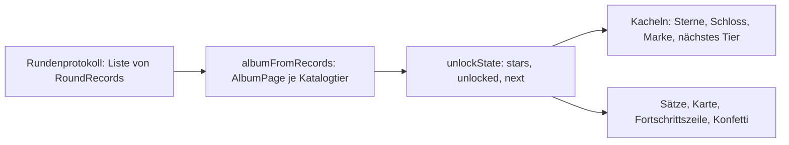
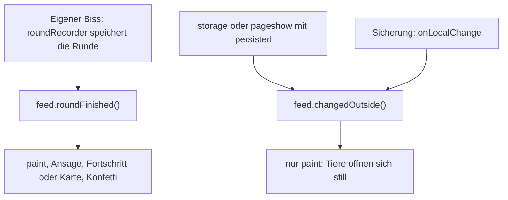

# Sterne, Album und Freischaltung

**Sterne und Freischaltung sind abgeleitet, nicht gespeichert.** Es gibt keinen Albumstand, keinen
Freischaltungs-Schalter und keine zweite Wahrheit neben dem Rundenprotokoll: `albumFromRecords`
rechnet aus den Runden die Sterne je Tier, `unlockState` rechnet aus diesen Sternen die offenen
Tiere. Daraus folgt alles Weitere von selbst — **wer das Protokoll löscht, sperrt die Tiere
wieder**, und **eine Sicherung des Protokolls bringt die Freischaltungen mit**, ohne dass dafür ein
eigenes Feld übertragen würde. Beides steht als Kommentar über den beiden Kerndateien
(`src/core/domain/album.ts`, `src/core/domain/unlocks.ts`) und in der Begriffsliste von
`docs/domain-model.md`.

Die Rechnung zerfällt in zwei Stufen mit klarer Zuständigkeit: `src/core/domain/` entscheidet
**was gilt** (Sterne, Schwellen), `src/presentation/game/` entscheidet **wie es aussieht und klingt**
(Kacheln, Marke, Satz, Karte, Konfetti). `src/presentation/game/unlockNotice.ts` sagt das selbst:
„Welche Tiere offen sind, entscheidet allein `core/domain/unlocks.ts` — hier steht nur die Sprache
dazu." Der Rundenbegriff, die Zufallsmodelle und die Ehrlichkeitsregeln stehen in
[Fachmodell: Runde, Zähne, Gebiss, Einstellungen](fachmodell-runde.md), das Protokollformat in
[Rundenprotokoll, CSV und Zusammenführen](rundenprotokoll-und-csv.md).



Vom Protokoll zu den Kacheln: zwei reine Funktionen im Kern, eine malende Schicht darüber.

## Drei Sterne je Tier: `album.ts`

`ALBUM_STARS` ist die feste Reihenfolge `['played', 'halfway', 'lastTooth']`; jede `AlbumPage`
trägt `creature`, `name`, `rounds` (alle gespielten Runden, egal mit wie vielen Zähnen) und die
verdienten Sterne in genau dieser Reihenfolge.

| Stern | Bedingung in `starsOfRound` | Bedeutung im Regeln-Blatt |
|---|---|---|
| `played` | jede Runde mit diesem Tier | ★ gespielt |
| `halfway` | `pressIndex - 1 >= Math.ceil(teeth / 2)` — mindestens die Hälfte der Drücke war harmlos | ★★ halb geschafft |
| `lastTooth` | `pressIndex === teeth` — erst der letzte Zahn schnappte | ★★★ bis zum letzten Zahn |

`halfway` und `lastTooth` setzen `earnsAllStars` voraus; sonst bleibt es bei `played` (die Funktion
kehrt früh zurück).

### Die Grenzregel: `earnsAllStars` misst an der eingestellten Zahnzahl

```ts
export function earnsAllStars(creature: string | undefined, teeth: number): boolean {
  return teeth >= creatureOrDefault(creature).teeth;
}
```

Drei Aussagen stecken darin; die erste davon war schon einmal falsch:

- **Ab dem ganzen Gebiss, nicht genau damit.** Die erste Fassung verlangte Zahnzahl *gleich*
  Katalog, damit zwei eingestellte Zähne kein kurzer Weg zu „halb geschafft" und „bis zum letzten
  Zahn" sind. Diese Sperre traf aber auch den **längeren** Weg: das Krokodil gab mit 12 Zähnen
  keinen Stern, obwohl erst der letzte schnappte (gemeldet vom Auftraggeber am 13.10.2026). Seitdem
  gilt `>=`. Leichter wird es dadurch nicht: die Hälfte ist mehr, und der letzte Zahn ist seltener
  der scharfe.
- **Gemessen wird an der eingestellten Zahl, nicht am Katalog.** Bei 12 eingestellten Krokodilzähnen
  braucht „halb geschafft" sechs harmlose Drücke, und „bis zum letzten Zahn" heißt der zwölfte, nicht
  der zehnte. `album.test.ts` hält beide Seiten fest (12/12 und 11/11 geben alle drei Sterne, 12/10
  nur zwei).
- **Ohne oder mit unbekanntem Lebewesen gilt das Krokodil** (`creatureOrDefault`) — Altdaten ohne
  `creature`-Feld zählen also für das Krokodil.

### Sammeln und Vergleichen

`albumFromRecords` legt für **jedes** Katalogtier eine Seite an (in Katalogreihenfolge, auch mit
`rounds: 0`), sammelt die Sterne in einem `Set` und gibt sie am Ende in `ALBUM_STARS`-Reihenfolge
aus. Ein Stern lässt sich also nicht doppelt verdienen, und die Reihenfolge hängt nicht davon ab, in
welcher Folge sie fielen. `newStars(before, after)` nennt genau die Differenz in Katalog- und
Sternreihenfolge — und **nichts**, wenn Sterne verschwinden (etwa nach einem gelöschten Protokoll);
das ist die Grundlage der Ansage nach dem Biss.

## Die Folge der Freischaltung: `unlocks.ts`

Am Anfang offen sind drei Tiere in der Reihenfolge der Auswahl: `STARTING_CREATURES =
['crocodile', 'mouse', 'wolf']`. Danach folgt `UNLOCK_STEPS` — fest, nicht wählbar, damit das Kind am
gesperrten Tier sieht, was als Nächstes kommt.

| Schritt | Schwelle | offen davor | 2 × offen | dritte Sterne nötig? |
|---|---|---|---|---|
| `shark` (Hai) | 3 | 3 | 6 | nein |
| `panda` | 5 | 4 | 8 | nein |
| `human` (Mensch) | 7 | 5 | 10 | nein |
| `lion` (Löwe) | 9 | 6 | 12 | nein |
| `vampire` | 11 | 7 | 14 | nein |
| `panther` | 13 | 8 | 16 | nein |
| `sabertooth` (Säbelzahntiger) | 15 | 9 | 18 | nein |
| `flytrap` (Venusfliegenfalle) | 20 | 10 | 20 | nein — genau an der Grenze |
| `trex` (T-Rex) | 28 | 11 | 22 | **ja, sechs** |

Die Spalte „2 × offen" ist der Kern der Balance: bis zur Venusfliegenfalle liegt **jede** Schwelle
höchstens bei zwei Sternen je offenem Tier — also ist sie erreichbar, ohne je Glück beim letzten Zahn
zu haben. Die Venusfliegenfalle sitzt exakt auf dieser Grenze: zehn Stammtiere mit je zwei Sternen
sind 20 Sterne. Der Test „braucht für keine Schwelle einen dritten Stern — außer für das letzte Ziel"
rechnet das für jeden Schritt nach.

### Die Währung sind Sterne insgesamt, nicht Drei-Sterne-Tiere

`unlockState` summiert schlicht `page.stars.length` über alle Seiten. Diese Entscheidung ist gegen die
naheliegende Alternative begründet — „alle auf drei Sternen":

- **Der dritte Stern ist Glück, kein Können.** Er gelingt je Runde in 2,8 % (Mensch) bis 8,3 % (Maus)
  der Fälle. Alle zehn Stammtiere auf drei Sterne kosten im Mittel 246 Runden — und das nur, wenn man
  **gezielt** die Tiere mit fehlendem Stern spielt. Ein Kind spielt seine Lieblingstiere, nicht die
  fehlenden.
- **Die gewählten Schwellen wurden simuliert, bevor sie festgeschrieben wurden** — mit einem Spieler,
  der zufällig zwischen den offenen Tieren wechselt, nicht mit einem, der rechnet: erstes neues Tier
  nach 3 Runden, alle zehn Stammtiere nach 28 Runden (Median), Venusfliegenfalle nach 49. Der erste
  Wunsch — „alle auf drei Sternen" (33 Sterne) — hätte 761 Runden gekostet (jedes zehnte Kind über
  1 300).
- **Die Sterne der Bonusfiguren zählen mit.** Es bleibt bei einer Währung; eine Sonderzählung „nur die
  zehn Stammtiere" ließe „Noch X Sterne" nach einem Stern mit der Venusfliegenfalle stehen bleiben —
  das versteht kein Kind. Der Test hält es fest: elf Wesen mit je zwei Sternen (22) plus fünf dritte
  Sterne sind 27, ein weiterer dritter (Venusfliegenfalle) öffnet den T-Rex bei 28.

### Der T-Rex ist die eine, benannte Ausnahme

`FINAL_GOAL = 'trex'` markiert den einzigen Schritt, dessen Schwelle über `2 × offene Tiere` liegt: 28
bei 11 offenen Wesen davor heißt mindestens sechs dritte Sterne (`28 − 2 × 11`). Er ist das letzte
Ziel und soll weit weg sein (vom Auftraggeber entschieden am 13.10.2026); simuliert sind 181 Runden
im Median. Der Test prüft für **jeden** Schritt beide Seiten: nicht-letzte Schritte bleiben unter
`2 × offen`, das letzte Ziel liegt echt darüber und höchstens bei `3 × offen` — sonst wäre es
unerreichbar.

Ob eine neue Figur die Progression sprengt, ist damit eine Rechenaufgabe, keine Geschmacksfrage: die
Schwelle muss streng steigen, und die Zahl der bis dahin offenen Tiere bestimmt, ob sie ohne dritten
Stern erreichbar bleibt.

### `unlockState`: drei Felder, drei Regeln

```ts
const stars = pages.reduce((sum, page) => sum + page.stars.length, 0);
const reached = UNLOCK_STEPS.filter((step) => stars >= step.stars);
const pending = UNLOCK_STEPS.find((step) => stars < step.stars);
```

- **`stars`** zählt alle Sterne, auch die von Tieren, die heute gesperrt wären. Wer vor der Sperre mit
  dem Säbelzahntiger gespielt hat, behält seine Sterne (`unlocks.test.ts` prüft genau diesen Fall: 3
  Sterne, Hai offen, Säbelzahntiger nicht).
- **`unlocked`** ist `STARTING_CREATURES` gefolgt von den erreichten Schritten in deren Reihenfolge.
  Das setzt steigende Schwellen voraus — nur dann ist `reached` ein Präfix der Folge und „offen" nie
  eine Lücke. Der Test verlangt streng steigende, paarweise verschiedene Schwellen.
- **`next`** ist der **erste** nicht erreichte Schritt, mit `name` aus dem Katalog und
  `missing: step.stars - stars` (mindestens 1, weil nur nicht erreichte Schritte gefunden werden);
  sind alle offen, ist es `null`. Der Test geht jede Schwelle an ihrem Rand ab: ein Stern weniger →
  gesperrt, genau die Schwelle → offen, und die Zahl der offenen Tiere wächst um genau eins.

`UNLOCK_ORDER` ist `STARTING_CREATURES` plus die Folge; die Spielseite baut ihre Kacheln daraus, damit
das nächste Tier immer gleich hinter den offenen steht. `newlyUnlocked(before, after)` gibt die
Differenz in dieser Reihenfolge zurück — eine Runde kann zwei Schwellen auf einmal nehmen.

## Grenzen, die nicht über das Ziel hinaus schießen

Zwei Regeln sind in `docs/freischaltung.md` als Grenzfälle benannt: **eine Regel, die still nichts
gibt, wird gesagt** — und **eine Sperre, die den Tipp verschluckt, kann nicht sagen, was fehlt**.

### Zu wenige Zähne: gesagt, nicht still verschluckt

Mit weniger Zähnen als das Gebiss gibt es nur den ersten Stern. Damit niemand Runde um Runde spielt
und sich wundert, dass kein Stern dazukommt, steht vor dem ersten Druck an der Stelle der Anleitung:

```
Nur der erste Stern: für alle drei braucht es mindestens 10 Zähne.
```

`fewTeethWarning(standardTeeth)` erzeugt den Satz, `wireQuickControls.paint()` tauscht damit den Text
von `#how-to` und setzt die Klasse `how-to--warning`. Bewusst **derselbe Platz, dieselbe Höhe**: eine
eigene Zeile hätte auf 320 × 568 keinen Raum (17 px über der Leiste). Gemessen wird am Gebiss des
**gewählten** Tiers, nicht an einer festen Zahl — sechs Zähne sind für die Maus das ganze Gebiss, für
das Krokodil zu wenig.

Die Grenze: bei einem einzigen Zahn steht dort „Nur noch ein Zahn — der ist garantiert scharf!", die
Anleitung ist dann ausgeblendet und mit ihr die Warnung.

### Eine gesperrte Kachel ist nicht `disabled`

Der Tipp muss ankommen, um sagen zu können, was fehlt. `paint()` setzt deshalb `aria-disabled="true"`
und lässt `disabled` in Ruhe; sichtbar wird die Sperre über die Klasse `is-locked`, ein
`.lock-badge` mit Schloss-Symbol (`LOCK_ICON`) und die Marke `.lock-badge__text` („Noch 2 Sterne").
Für Bildschirmleser trägt die Kachel `lockedTileLabel(name, missing)` — „Hai, gesperrt — noch 2
sterne" (die Funktion kleinschreibt den ganzen Satz). Ein Tipp auf die Kachel läuft in
`album.lockedTap`: sie setzt `is-hinting` neu (die Animation soll bei jedem Tipp von vorn laufen) und
schreibt den Satz in `#lock-hint` („Löwe ist noch gesperrt. Noch 9 Sterne.", `role="status"`,
`.sr-only`).

Konsequenz für eine neue Figur: `missingFor` gibt `0` zurück, wenn die Kennung **nicht** in
`UNLOCK_STEPS` steht — ein Tier ohne Schritt wäre also still immer offen und nie gesperrt. Der Test
„führt jedes Katalogtier genau einmal — am Start oder in der Folge" ist genau dagegen gerichtet.

## Was die Bedienung daraus macht: `albumBadges.ts`

`wireAlbum` ist der einzige Ort, der Sterne **und** Sperre an die Kacheln bringt. Das ist kein
Zufall: beide setzen die Beschriftung derselben Kachel, zwei Module überschrieben einander je nach
Reihenfolge ihrer Zuhörer.

- **Jedes Malen liest frisch aus dem Protokoll.** `paint()` ruft `albumFromRecords(log.load())` und
  `unlockState(...)` neu auf. Ein gemerkter Stand wäre eine zweite Wahrheit neben der Ablage, die die
  Statistikseite löscht und importiert.
- **Drei feste Plätze je Kachel.** `starsOf` legt einmal `.album-stars` mit drei `.album-star` an und
  färbt danach nur noch `is-earned` um — kein Anbau bei jedem Lauf. Die Sternreihe ist
  `aria-hidden`; die Aussage steht im `aria-label` der Kachel („Krokodil, 2 von 3 Sternen"). Dieselbe
  Schleife über `button[data-creature]` (nicht `[data-creature]` allein) schützt die Zeichnung auf
  der Bühne, die dasselbe Attribut trägt.
- **Genau ein Tier ist `is-next-unlock`** — das aus `state.next`.
- **Ein Satz fürs Ganze:** `albumSummary` schreibt „12 von 12 Tieren gespielt · 36 von 36 Sternen" in
  jedes `.album-summary` (heute im Regeln-Blatt); die Nenner kommen aus Kataloglänge und
  `ALBUM_STARS.length`, nicht aus abgeschriebenen Zahlen.
- **Nach dem Biss:** `announce(newStarSentence(stars))` in `#star-toast` („Neuer Stern: Maus —
  gespielt!", bei mehreren Sternen desselben Tiers „Neue Sterne: …"; genannt wird nur das **erste**
  Tier), `showUnlock(unlocked)` als Karte mit Kopfbild, `unlockTitle` („Neu dabei: Hai!", bewusst
  ohne Oberbegriff), `playLabel` und `#unlock-play`. Der Knopf meldet die Kennung über `onPlay` und
  räumt die Karte weg.
- **Die Fortschrittszeile ist die zweite Wahl:** `showProgress(stars.length > 0 && unlocked.length ===
  0)` — die Karte ist die Nachricht dieser Runde, sonst steht der Weg zum nächsten Tier über der
  Bühne (Sternzeichen `missingStarsSymbols`, Schattenriss, `progressSentence`: „Noch 2 Sterne bis zum
  Hai."). Ohne neuen Stern schweigt beides.

Die Dativ-Formen („bis zum Löwen", „zur Venusfliegenfalle", „Mit dem Menschen spielen") kommen aus
dem Katalogfeld `grammar`; `unlockNotice.ts` beugt keinen Namen selbst.

## Feiern oder still nachziehen: `round-finished` gegen `changed-outside`

Der `LogFeed` (`src/presentation/game/logFeed.ts`) kennt genau zwei Ereignisse; die Unterscheidung
ist fachlich, nicht technisch:

| Ereignis | Auslöser | Album reagiert mit |
|---|---|---|
| `round-finished` | `roundRecorder.record()` hat die Runde **gespeichert** und ruft `feed.roundFinished()` | `paint()`, Ansage, Fortschritt oder Karte, bei Freischaltung Konfetti |
| `changed-outside` | `storage`-Ereignis (anderer Tab), `pageshow` mit `persisted` (Zurück-Taste), `onLocalChange` der Sicherung (Import/Abgleich) | nur `paint()` — die Tiere öffnen sich **still** |

**Gefeiert wird nur nach einem eigenen Biss.** Sonst fiele bei jedem Start im Kinderprofil oder nach
jedem Tab-Wechsel Konfetti. Der zweite Zweck ist die Vergleichsbasis: weil auch `changed-outside`
`paint()` und damit `shown`/`state` fortschreibt, vergleicht der nächste Biss gegen den **jetzt**
gültigen Stand und nicht gegen den vom Seitenstart — `albumBadges.test.ts` prüft das eigens.



Zwei Wege in dieselbe Anzeige, zwei verschiedene Lautstärken. Das Konfetti selbst respektiert
„Bewegung reduzieren" (`prefers-reduced-motion` → gar keins, die Karte kommt trotzdem), legt keine
zweite Schicht an und entfernt sich beim `animationend` seiner eigenen Schicht — ohne Zeitgeber, der
eine abgebaute Seite träfe.

## Der Rückfall: ein gesperrtes Tier wird zum Krokodil

Zwei Stellen sichern das Wählen gegen die Sperre ab; eine dritte Sonderregel betrifft den Weg über
die Karte:

- **Beim Start** (`wireGamePage`): `settingsWithUnlockedCreature(loaded, unlockState(albumFromRecords(
  log.load())).unlocked)` — ist das gespeicherte Tier nicht offen, wird es `DEFAULT_CREATURE_ID`
  (Krokodil) und `teethOverride` fällt weg, damit das Krokodil sein eigenes Gebiss mitbringt. War eine
  Änderung nötig, wird sie sofort gespeichert; die Sonde prüft beides (Bühne **und** Ablage). Ist das
  Tier offen, kommt **dieselbe Referenz** zurück — kein unnötiges Schreiben.
- **Beim Tippen:** die Leiste fragt `album.isLocked(id)` und ruft statt eines Wechsels
  `album.lockedTap(id)`. Zusätzlich lehnt `settingsAfterCreatureChoice` ein Tier ab, das nicht in
  `unlocked` steht — die Seite reicht diese Liste heute nicht mit (der Schutz sitzt an der Kachel),
  der Parameter ist die Absicherung für andere Aufrufer. Ein Wechsel auf ein anderes Tier verwirft
  die abweichende Zahnzahl; dasselbe Tier erneut zu tippen ändert nichts (`null`).
- Auch der Knopf der Freischaltungskarte geht durch `settingsAfterCreatureChoice`, also über
  `controller.applySettings` — das neue Tier steht danach auf der Bühne und eine neue Runde läuft.

Wer das Protokoll löscht, sieht den Rückfall beim nächsten Laden; innerhalb der laufenden Seite
sperrt `paint()` die Kacheln wieder (`albumBadges.test.ts`: „sperrt wieder, wenn das Protokoll
gelöscht wird").

## Betrieb: Sonden, Protokoll, Kopplungen

Die Regel selbst prüfen Unit-Tests; was jsdom nicht kann — Anordnung, Schwärzung, Trefferflächen,
Scrollen, Konfetti — prüft `scripts/pruefen-freischaltung.py` im echten Chromium auf 320 × 568,
390 × 844, 800 × 1280 und 1180 × 820.

Der wichtigste betriebliche Punkt steckt in `scripts/freischaltung.py`: **jede Browser-Sonde bringt
ein Protokoll mit, das alle Tiere öffnet.** Ohne es fällt ein eingestelltes gesperrtes Tier still auf
das Krokodil zurück, und die Sonde misst das falsche Tier, ohne zu scheitern. Das Protokoll rechnet
sich aus `scripts/katalog.json` selbst (Tierreihenfolge, Zahnzahlen, `LETZTE_SCHWELLE`) und hängt
Drei-Sterne-Runden an, bis die letzte Schwelle erreicht ist; eine `assert`-Zeile meldet, wenn der
Katalog dafür nicht reicht. Es trug einmal 16 Sterne (acht Tiere mit je zwei) — seit dem T-Rex bei 28
sind es zehn Tiere mit je drei Sternen (30).

Kopplungen, die beim Ändern still brechen:

- **`scripts/katalog.json`** wird von `src/katalog-json.test.ts` aus Katalog und Freischaltungsfolge
  geschrieben (`KATALOG_NEU=1 pnpm test:run`). Eine neue Schwelle ohne diesen Lauf lässt die Sonden
  mit alten Zahlen rechnen.
- **Eine neue Figur bricht die Auswahl dort, wo sie nur für die alte Zahl gebaut war.** Mit zwölf
  statt zehn Wesen scrollte die Seite auf jedem Tablet hochkant, und „Venusfliegenfalle" brach auf der
  65-px-Kachel in drei Zeilen. Gefunden haben das `pruefen-bedienung.py` und
  `pruefen-freischaltung.py`, kein Unit-Test. Deshalb trägt die Kachel einen Kurznamen (`shortName`,
  `tileLabel`), Sätze und Vorleser nennen den vollen Namen.
- **Das Skript einer `.astro`-Seite prüft kein Werkzeug des Gates.** Beim Bau der Freischaltung stand
  `settings` hinter seiner ersten Verwendung: Gate grün, Bau grün, im Browser kein einziger Zahn.
  Gefunden hat es erst die Sonde — wer das Seitenskript umstellt, lädt die gebaute Seite.

Der Ablauf beim Hinzufügen eines Tiers steht in `docs/neues-tier.md` §4 (Schritt in `UNLOCK_STEPS`,
Schwellen steigen lassen, Kommentar mit den simulierten Rundenzahlen nachziehen).

## Tests, die diese Regeln halten

| Datei | Was sie festhält |
|---|---|
| `src/core/domain/unlocks.test.ts` | jedes Katalogtier genau einmal am Start oder in der Folge; Reihenfolge und Schwellen `[3, 5, 7, 9, 11, 13, 15, 20, 28]`; keine Schwelle braucht einen dritten Stern außer `FINAL_GOAL`; jede Schwelle an ihrem Rand; Sterne statt Runden (drei Sterne eines Tiers genügen); alte Runden eines gesperrten Tiers zählen mit; Bonussterne zählen auf dem Weg zum T-Rex; `newlyUnlocked` in der Folge |
| `src/core/domain/album.test.ts` | `halfway` genau an der Hälfte, `lastTooth` nur beim letzten Zahn, weniger Zähne → nur `played`, **mehr** Zähne zählen (12/12, 11/11, 12/7), `earnsAllStars` als `teeth >= Katalog` für jedes Tier und jede Zahnzahl, feste Sternreihenfolge, `newStars` nennt nichts beim Verschwinden; dazu die Chance je Stern und Tier im erlaubten Band |
| `src/presentation/game/albumBadges.test.ts` | drei feste Sternplätze, Beschriftung der Kachel, `album-summary`, Ansage mehrerer Sterne, Schweigen ohne neuen Stern, **keine Ansage bei `changed-outside`** und die neue Vergleichsbasis danach |
| `src/presentation/game/unlocks.test.ts` | drei offene Kacheln am Start, Schloss und Marke samt Vorleser-Satz, `aria-disabled` statt `disabled`, hervorgehobenes nächstes Tier, Tipp auf ein gesperrtes Tier, Sperre nach dem Löschen; Karte, Knopf, Konfetti, zwei Schwellen in einer Runde, Fortschrittszeile, kein Feiern von außen, kein Konfetti bei „Bewegung reduzieren"; jeder Name der Folge richtig gebeugt |
| `src/presentation/game/quickControls.test.ts` | Warnsatz an der Stelle der Anleitung, Klassenwechsel, Messung am Gebiss des gewählten Tiers, Rückkehr zur Anleitung bei genug und bei mehr Zähnen |
| `src/presentation/game/creatureChoice.test.ts` | Rückfall aufs Krokodil samt `teethOverride: null`, dieselbe Referenz wenn offen, Ablehnung eines gesperrten Tiers |
| `src/bedienleiste.test.ts` | Fortschritt und Freischaltung stehen über der Bühne und nicht im Ergebnis-Kasten; die Auswahl folgt `UNLOCK_ORDER`; der Rückfall beim Start liest die Ablage; das Regeln-Blatt nimmt Zahlen und Namen aus der Regel statt aus abgeschriebenem Text |

Der Grenzfall „ein Zahn" bleibt bewusst außerhalb der Warnung (Anleitung ausgeblendet) — wer dort
etwas ändert, prüft ihn im Browser, nicht in jsdom.
