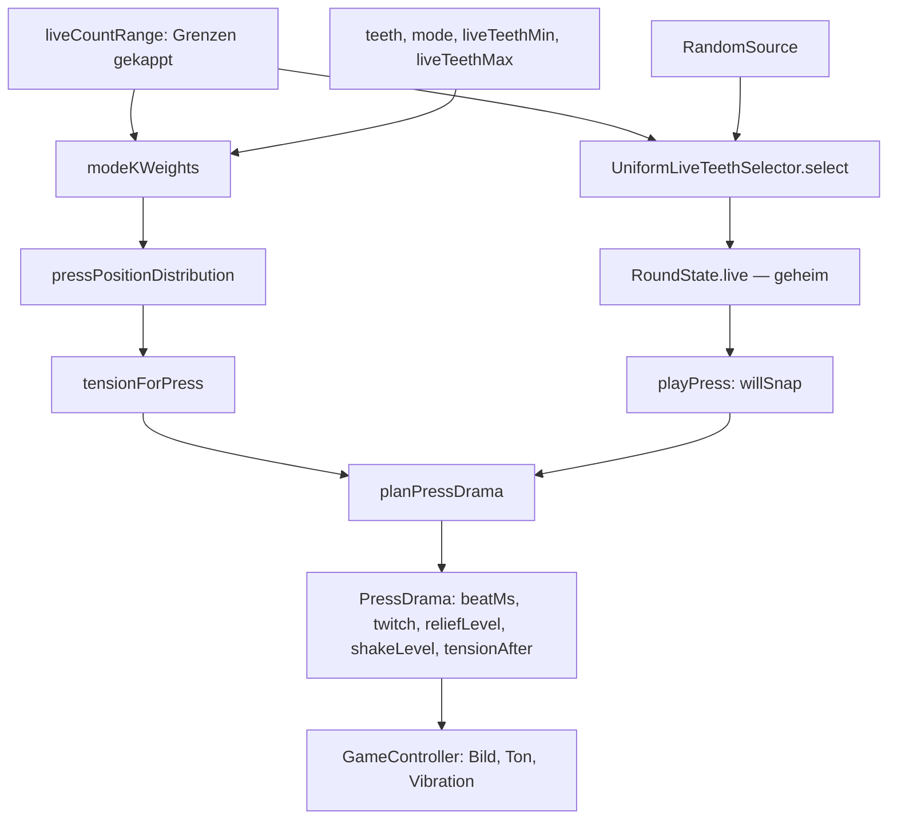
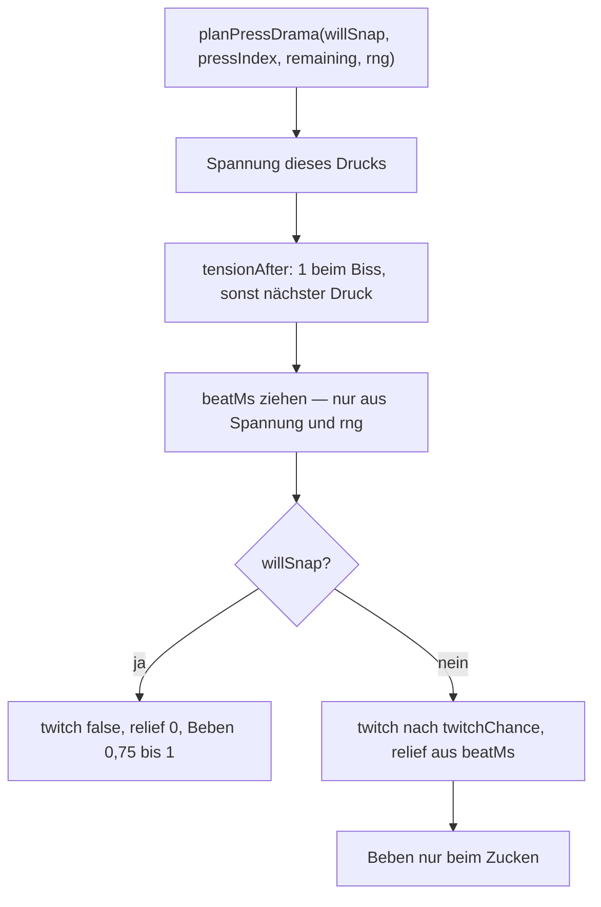
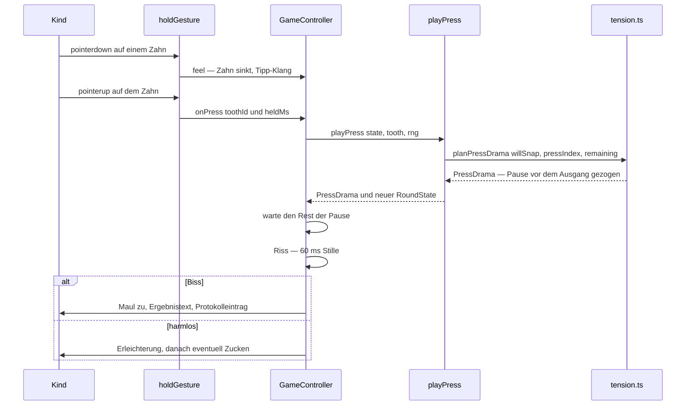

# Zufall, Wahrscheinlichkeiten und Spannungsdramaturgie

Das Spiel zieht seine Spannung nicht aus einem Pegel, sondern aus einer **Wahrscheinlichkeit**.
Drei Dateien bilden die Kette, die das leistet:

| Datei | Aufgabe | Ergebnis |
|---|---|---|
| `src/core/domain/liveTeeth.ts` | zieht, welche Zähne scharf sind | `RoundState.live` — geheim, bis es schnappt |
| `src/core/domain/probabilities.ts` | rechnet die Verteilung der Druckposition | `P(J = j)`, Erwartungswert, Überlebenskurve, Verliereranteile |
| `src/core/domain/tension.ts` | leitet daraus Dramaturgie ab | Spannung, Pause, Zucken, Erleichterung, Puls, Zoom, Schwellen |

Verbunden werden sie an **einer** Stelle für Grenzen (`liveCountRange`) und **einer** Stelle für die
Entscheidung (`playPress`). Das ist der Kern dieser Seite: nicht die Formeln allein, sondern dass
Anzeige und Ziehen aus derselben Rechnung kommen — und dass die Dramaturgie den Ausgang nicht kennt.



Eine gekappte Spanne speist sowohl die Auswahl als auch das Modell; die Spannung ist die bedingte
Biss-Wahrscheinlichkeit aus diesem Modell.

## Zwei Modelle, eine Spanne

`RandomMode` kennt genau zwei Werte (`teeth.ts`): `original` stellt je nach Gebissgrenzen **1 bis 3**
Zähne gleichzeitig scharf — so arbeitet das Original-Spielzeug —, `classic` genau einen.
`MAX_LIVE_TEETH = 3` ist die harte Obergrenze, `DEFAULT_MODE` ist `'original'`, `DEFAULT_TEETH` ist
10.

`UniformLiveTeethSelector.select` ist die Standardauswahl hinter dem Port `LiveTeethSelector`
(`src/core/ports/liveTeeth.ts`). Sie fragt zuerst `liveCountRange(teeth, min, max)` und zieht dann:

- `classic`: genau ein Zahn (`count = 1`),
- `original`: `lowest + rng.uniformInt(highest - lowest + 1)`, also gleichverteilt über die erlaubte
  Anzahl.

`sampleDistinct` zieht anschließend ohne Doppelte (Teil-Mischen einer Liste 1..n, danach aufsteigend
sortiert). Die Sortierung ist kein Zufall: `openRound` legt `live` zusätzlich sortiert ab, damit die
Reihenfolge im Zustand nicht verrät, in welcher Folge gezogen wurde.

Die Zufallsquelle kommt als Port (`src/core/ports/random.ts`) mit genau zwei Methoden: `next()` —
gleichverteilt in `[0, 1)` — und `uniformInt(maxExclusive)`. In `core/` steht weder `Math.random` noch
eine Uhr noch Browser-Zustand; `src/architecture.test.ts` erzwingt das für die Schichten `domain` und
`use-cases`. Die Umgebung liefert `CryptoRandom` (`src/infrastructure/random/cryptoRandom.ts`) — echte
Krypto-Zufallszahlen, ausdrücklich **kein** seedbarer Pseudo-Zufall, mit `Math.random` nur als
Rückfall, wenn der Browser keine Krypto-Quelle hat. Reproduzierbar wird es allein in Tests, die
`SeededRandom` oder `ScriptedRandom` hereinreichen.

### `liveCountRange`: eine Rechenstelle für Ziehen und Rechnen

```
lowest  = max(1,      min(floor(min), teeth, MAX_LIVE_TEETH))
highest = max(lowest, min(floor(max), teeth, MAX_LIVE_TEETH))
```

Die Kappung ist die eigentliche Invariante: **die Auswahl kappt die Grenzen, bevor sie zieht**, nicht
danach. Bei einem einzigen Zahn ist die Spanne `1..1` — dieser Zahn ist in beiden Modi scharf, der
erste Tipp schnappt zu. Bei zwei Zähnen und Kataloggrenzen 1–3 ist die Spanne `1..2`.

Genau hier lag ein gemessener Fehler: vorher kappte das Modell erst nach dem Ziehen, und bei zwei
Zähnen zeigte die Anzeige **83,3 %** Bissgefahr, während mit **75,0 %** gezogen wurde
(`docs/fallen.md`). Deshalb gibt es seit dem 12.10.2026 nur diese eine Funktion — und deshalb muss
`modeKWeights` die Zahnzahl mitbekommen, wenn es eine konkrete Runde rechnet. Die Details der
Gebissgrenzen und ihrer Prüfung stehen auf [Fachmodell: Runde, Zähne, Gebiss](fachmodell-runde.md).

## Die Verteilung der Druckposition

`pressPositionDistribution(teeth, kWeights)` beantwortet die Frage „bei welchem Druck schnappt es?"
mit der hypergeometrischen Formel, gemittelt über die Anzahl gleichzeitig scharfer Zähne:

```
P(J = j | k) = C(n - j, k - 1) / C(n, k)
P(J = j)     = Σ_k  w_k · P(J = j | k)
```

Dabei wird `k` auf die Zahnzahl **gekappt** (`live = min(k, teeth)`) — dieselbe Kappung wie in der
Auswahl. Vorher fiel jedes `k` über der Zahnzahl ganz weg; bei einem Ein-Zahn-Gebiss zeigte die
Statistik dadurch „Erwartet 0,33" statt 1.

Die Gewichte kommen aus `modeKWeights(mode, min, max, teeth)`:

- `classic` → `{ 1: 1 }`,
- `original` → Gleichverteilung über `lowest..highest`, also `1/span` je Anzahl; ohne `teeth` gelten
  die Vorgaben 1–3 (`DEFAULT_K_WEIGHTS = { 1: 1/3, 2: 1/3, 3: 1/3 }`).

`creatureKWeights(creature, mode, teeth)` ist der bequeme Weg aus dem Katalog; die Statistik nutzt
ihn. Wer eine konkrete Runde rechnet, **muss** `teeth` mitgeben, sonst weicht das Modell bei kleinen
Gebissen von dem ab, was wirklich gezogen wird.

Darauf bauen drei Auswertungen auf:

| Funktion | Antwort |
|---|---|
| `expectedPresses(distribution)` | erwartete Zahl der Drücke bis zum Biss |
| `survivalCurve(distribution)` | `P(Runde läuft noch)`, Eintrag 1 = vor dem ersten Druck |
| `playerLoserProbabilities(teeth, players, kWeights)` | `P(Spieler i verliert)` bei reihum je einem Druck |

An den Tests festgenagelte Werte (`probabilities.test.ts`, gegen die Referenz aus dem Python-Werkzeug
gerechnet) — nur diese Zahlen, keine geschätzten Kurven:

| Fall | Wert |
|---|---|
| 10 Zähne, 1–3 scharf | `P(J = 1) = 20,0 %`, `P(erste 3 überlebt) = 48,6 %`, `E[Drücke] = 3,972222` |
| 10 Zähne, 1–3 scharf, letzter Druck | `3,333 %` |
| 4 Spieler reihum | `33,9 % / 28,3 % / 20,7 % / 17,0 %` |
| `classic`, 10 Zähne | Gleichverteilung `10 %` je Druck, `E[Drücke] = 5,5` |
| 12 Zähne, Krokodil (1–3) vs. Wolf (1–2) | `P(J = 1) = 1/6` gegen `1/8`; `E = 4,694444` gegen `5,416667` |

Der letzte Vergleich ist die inhaltliche Aussage des Wolf-Modells: er beißt seltener früh zu, die
Runde dauert länger, dafür ist der letzte Zahn häufiger der scharfe.

## Spannung: die Biss-Wahrscheinlichkeit des nächsten Drucks

`tensionForPress` ist die einzige Spannungsquelle des Spiels:

```
Spannung(i) = P(J = i) / P(J ≥ i)
```

Bedingt darauf, dass die Runde bis hierher überlebt hat. Sie ist **kein aufaddierter Pegel**: sie
sättigt nicht, sondern steigt monoton und ist beim letzten Zahn genau `1` — dort schnappt es
zwangsläufig. `pressIndex` wird auf `1..teeth` geklemmt; `press >= teeth` gibt sofort `1` zurück.

Die Funktion verwendet **nur öffentliche Größen**: Zahnzahl, Modellgrenzen, Modus und den Zählstand
der Drücke. Die verdeckten scharfen Zähne (`state.live`) gehen nicht ein — sonst wäre die Anzeige
ein Verräter.

An den Tests festgenagelte Kurven:

| Gebiss | Spannung je Druck |
|---|---|
| Krokodil, 10 Zähne, 1–3 scharf | `20,0 · 21,3 · 22,8 · 24,6 · 26,8 · 29,7 · 33,8 · 40,7 · 55,0 · 100,0 %` |
| Maus, 6 Zähne, 1–2 scharf | `25,0 · 28,9 · 34,4 · 42,9 · 58,3 · 100 %` |
| `classic`, 10 Zähne | `1 ÷ übrige Zähne`: `10 · 11,1 · 12,5 … 50 · 100 %` |

Drei Eigenschaften, die die Tests festhalten: sie steigt bei jedem Druck **streng**, sie bleibt in
`0..1`, und sie sättigt nicht früh (beim Krokodil liegt der vierte Druck unter 30 %, der achte unter
50 %). Bei kleineren Gebissen steigt sie schneller; die Maus ist bei Druck 4 gefährlicher als der
Wolf mit 12 Zähnen.

Zwei Folgen für die Anzeige, die man sonst für einen Fehler hält:

- Der Balken **startet nicht bei null** — der erste Druck hat beim Krokodil schon 20 % Gefahr. Die
  Anzeige rechnet deshalb auch vor dem ersten Druck, nicht aus einem gespeicherten Pegel.
- Die „es wird ernst"-Marke liegt bei 30 %, damit sie nicht bei jedem Lebewesen sofort brennt. Der
  Wolf liegt beim ersten Druck bei 12,5 %, das Krokodil bei 20 %.

## Dramaturgie: reine Rechnung in `tension.ts`

Der Dateikopf sagt, was diese Datei ist: Rechenregeln, damit die Dramaturgie prüfbar bleibt. Die
Bedienung übersetzt das Ergebnis in Ton, Bild und Vibration; hier steht kein DOM, keine Uhr, kein
Zufall außer dem hereingereichten `RandomSource`.

| Größe | Fenster / Formel | Rolle |
|---|---|---|
| `TWITCH_BASE_CHANCE` | `0.12`; Chance = `0.12 · (0.6 + 0.9 · Spannung)` | Zucken ohne Zuschnappen, also 7,2 % bei Spannung 0 bis 18 % bei Spannung 1 |
| `twitchChance` | `0`, sobald `remaining <= 1` | beim letzten Zahn gibt es kein Zucken |
| `BEAT_MIN_MS` / `BEAT_MAX_MS` | `120` / `700` ms | Fenster der Pause |
| `pressBeatMs` | `120 + 580 · u^(3 - 2·Spannung)`, `u` aus `rng.next()` | früh meist kurz, spät bis ans Ende des Fensters |
| `VERDICT_GAP_MS` | `60` ms | der Riss zwischen Pause und Auflösung, für **beide** Ausgänge gleich |
| `reliefLevel` | `(beatMs - 120) / 580`, geklemmt auf `0..1` | Erleichterung, nur beim harmlosen Druck |
| `PULSE_SLOW_MS` / `PULSE_FAST_MS` | `900` / `380` ms | Puls des Balkens, linear mit der Spannung |
| `TENSE_LEVEL` | `0.3`, `isTense` strikt **größer** | Bild zieht zu, Balken glüht |
| `HIGH_DANGER` | `0.5`, `isHighDanger` **ab** der Schwelle | Balken rot, Oberkiefer zittert deutlich |
| `ZOOM_ENTRY` / `dangerZoom` | `0` unter 0,5; `0.4` an der Schwelle; linear bis `1` | Heranzoomen der Bühne (skaliert um höchstens 8 %, `--zoom` an `#stage`) |
| `pressProgress` | `pressed / teeth`, geklemmt | Füllung des Balkens = Fortschritt, nicht Gefahr |
| `survivedDanger` | Spannung von `pressIndex - 1`, `0` bei `pressIndex <= 1` | der „Mut" der Runde |

Zwei Feinheiten, die man beim Lesen der Formeln sonst übersieht:

- **`isTense` ist strikt, `isHighDanger` nicht.** Bei genau 30 % ist die Bühne noch ruhig, bei genau
  50 % ist der Balken schon rot. Deshalb ist der Krokodil-Druck 7 (33,8 %) „wary", Druck 8 (40,7 %)
  noch nicht rot und Druck 9 (55,0 %) rot — der rote Druck ist überstehbar, sonst fiele Rot immer mit
  dem Biss zusammen und `survivedDanger` könnte nie ins Rote reichen.
- **`dangerZoom` springt an der Schwelle** statt aus dem Nichts zu wachsen: eine reine Rampe wäre beim
  ersten roten Druck (55 %) unsichtbar. Unsinnige Eingaben werden geklemmt; `NaN` ergibt `0`.

### `planPressDrama`: die Reihenfolge ist die Ehrlichkeit

`planPressDrama` ist der einzige Ort, an dem der Ausgang (`willSnap`) und die Dramaturgie
zusammentreffen. Die Reihenfolge im Code ist Absicht:

1. Spannung **dieses** Drucks (`tensionForPress({ pressIndex })`) — sie steuert Zucken und
   Erschütterung vor dem Urteil.
2. `tensionAfter` — nach dem Biss `1`, sonst die Gefahr des **nächsten** Drucks.
3. `beatMs = pressBeatMs({ tension, rng })` — die Pause wird gezogen, **bevor** der Ausgang überhaupt
   betrachtet wird. Sie verbraucht immer genau eine Zufallszahl; erst danach, und nur beim harmlosen
   Druck, wird für das Zucken eine zweite gezogen.
4. Erst jetzt die Verzweigung: Biss → `twitch: false`, `reliefLevel: 0`,
   `shakeLevel = 0.75 + 0.25 · tension`; harmlos → Zucken nach `twitchChance`,
   `reliefLevel = reliefLevel(beatMs)`, `shakeLevel` nur beim Zucken (`0.35 + 0.4 · tensionAfter`),
   sonst `0`.



Der Ausgang wird erst nach der Pause gelesen; deshalb kann die Pause ihn nicht verraten.

## Warum die Entscheidung im Kern bleibt

Der Schnitt liegt bei `playPress` (`src/core/use-cases/playPress.ts`):

```ts
const willSnap = args.state.live.includes(args.tooth);
const drama = planPressDrama({ willSnap, pressIndex, remaining, teeth, mode, liveTeethMin, liveTeethMax, rng });
const state = pressTooth(args.state, args.tooth);
return { state, drama, snapped: willSnap, tooth: args.tooth };
```

Die Bedienung ruft **nie** direkt `pressTooth` und liest **nie** `state.live`. Sie bekommt einen neuen
Zustand, ein `PressDrama` (Zeiten, Pegel, „zuckt ja/nein") und die boolesche Auskunft `snapped` — die
sie erst nach der Pause auswertet. `docs/architecture.md` nennt den Grund ausdrücklich: läge das Wissen
in der Bedienung, könnte sie das Geheimnis **über die Wartezeit** verraten. Ein zusätzlicher Nebeneffekt
derselben Trennung: weil der Kern nur Zahlen liefert, ist der Nervenkitzel testbar, obwohl er sich in
Ton und Bild abspielt.

Die Bedienung prüft nach der Pause zusätzlich die Identität der Runde (`this.round !== played`), nicht
ein Flag — begann in der Pause eine neue Runde, läuft das Urteil ins Leere.

## Ehrlichkeitsregeln als nicht verhandelbare Invarianten

Diese Regeln stehen in `docs/domain-model.md` („Ehrlichkeitsregeln (nicht verhandelbar)") und sind im
Code jeweils durch einen Test festgehalten. Sie sind der Grund, warum die Anzeige nicht lügen kann.

1. **Kein Zucken bei scharfen Zähnen.** Ein Zucken darf nur ein harmloser Druck auslösen. Im
   Biss-Fall setzt `planPressDrama` `twitch` hart auf `false`, unabhängig vom Zufall; der Test prüft
   das über 200 Startwerte. Zusätzlich ist `twitchChance` beim letzten Zahn `0` (dort schnappt es
   garantiert).
2. **Die scharfen Zähne bleiben bis zum Biss geheim.** Weder `PressDrama` noch `tensionForPress` nimmt
   `live` entgegen; die Anzeige rechnet aus Zahnzahl, Grenzen, Modus und Zählstand. Erst der
   Ergebnistext nennt Zahl und Nummern der scharfen Zähne (`resultText` liest `round.live` **nach** dem
   Biss). Vorher wäre Offenheit ein Verrat, nachher ist sie ein Gewinn.
3. **Der letzte Zahn wird angesagt.** `isFinalToothTension` (`status === 'open' && remaining === 1`)
   macht aus der Zwangsläufigkeit eine Aussage: die Bühne zeigt „Nur noch ein Zahn — der ist garantiert
   scharf!". Dieselbe Aussage steht auf der Statistikseite an der letzten Balkenzeile
   („garantiert scharf").
4. **Die Anzeige ist eine Wahrscheinlichkeit und steht nie vorzeitig auf 100 %.** `tensionForPress`
   gibt beim letzten Druck genau `1` zurück; vorher erreicht sie `1` nur dann, wenn der Biss
   ohnehin feststeht — etwa bei einem Gebiss, dessen Ziehung alle übrigen Zähne scharf macht. Mit
   den Kataloggrenzen (überall `liveTeethMin = 1`, dazu `MAX_LIVE_TEETH = 3`) heißt das: sie steht
   vor dem letzten Zahn nirgends auf 100 %. Der Test prüft die strenge Monotonie über alle zehn
   Drücke. Fällt die Grundlage weg (Maul zu), verstummt die Aussage: statt eines Prozentwerts steht
   „Runde beendet", die Füllung bleibt der Fortschritt und trägt keine Gefahrfarbe, Zoom und Zittern
   gehen auf `0`. Ein stehengebliebener Wert von `1` wäre die Behauptung „der nächste Druck ist
   gefährlich" für einen Druck, den es nicht mehr gibt.
5. **Die Pause ist blind für den Ausgang.** `pressBeatMs` bekommt nur `tension` und `rng` — der
   Ausgang wird ihm gar nicht gereicht; ein Test liest sogar den Funktionsquelltext und verlangt, dass
   `willSnap`/`snap` darin nicht vorkommt. Zwei Aufrufe mit demselben Startwert ergeben dieselbe Pause,
   ob der Zahn scharf ist oder nicht. Der Riss danach ist mit `VERDICT_GAP_MS = 60` für beide Ausgänge
   gleich.
6. **Die Erleichterung kommt erst nach dem Urteil und nur beim harmlosen Druck.** Beim Biss ist
   `reliefLevel` `0`; beim harmlosen Druck wächst sie mit der **erlebten** Pause — die hat der Spieler
   selbst gehört, sie verrät also nichts. Die Bedienung rechnet dafür
   `reliefLevel(Math.max(beatMs, heldMs))`: wer lange hält, hat die Pause erlebt und atmet entsprechend
   aus.

Die Pause ist außerdem **Mindestpause beim Halten**: der Kern liefert `beatMs`, die Bedienung wartet nur
noch `max(0, beatMs - heldMs)`. Wer den Zahn 2 s hält, bekommt das Urteil sofort nach dem Loslassen;
wer kurz tippt, wartet den Rest des Fensters. Ein verlängertes Halten verlängert also die Stille nicht —
es ersetzt sie.

## Verdrahtung in der Bedienung

Die Zeitsteuerung liegt in `presentation/game`, nicht im Kern:

- **Halten** (`holdGesture.ts`): `pointerdown` lässt den Zahn sinken (`HOLD_SINK_MS = 320`) und spielt
  den Tipp-Klang — entschieden ist nichts. Erst das Loslassen **auf** dem Zahn löst den Zug aus.
  Wegschieben, `pointercancel` oder `HOLD_MAX_MS = 4000` nehmen den Druck zurück; nur der erste Finger
  beginnt einen Druck, Tastatur (`click` mit `detail === 0`, Enter, Leertaste) drückt sofort.
- **Ein Druck** (`GameController.resolvePress`): `playPress`, dann `tensionAfter` als aktuelle
  Spannung merken (für Klang und Beben), Zahn markieren, Blick richten, Anzeige neu rechnen. War der
  Finger schon aufgelegt (`felt`), läuft die Pause bereits; sonst startet `startPressBeat(beatMs)` sie
  jetzt. Danach `wait(max(0, beatMs - heldMs))`, `stopAll()` und `wait(VERDICT_GAP_MS)`, erst dann
  `snap` oder `settle`.
- **Anzeige** (`hudModel.ts`): rechnet die Gefahr des **nächsten** Drucks jedes Mal neu aus
  `round.pressOrder.length + 1`. Ist das Maul zu, fällt die Gefahr-Aussage weg — kein Prozentwert
  („Runde beendet"), keine Gefahrenfarbe, Zoom und Zittern `0` —, obwohl der von der Steuerung
  gemerkte Wert an der Bühne weiter als `--tension` steht (er tönt das Bild) und `data-tension` die
  Sonde trägt. Füllung = `pressProgress`, Farbe = `isTense`/`isHighDanger`,
  Puls = `pulseInterval`, Zoom = `dangerZoom`. Die Zustandsklassen hängen an `#hud-panel`, weil der
  Balken außerhalb der Bühne liegt — sonst erreicht keine Farbregel den Balken.
- **Statistik**: `dangerCurvePoints` in `statsView.ts` malt dieselbe `tensionForPress`-Kurve als
  Balken; `mutSentence` und `bravestRound` (`statistics.ts`) nennen die höchste überstandene Gefahr.
  Das ist derselbe Wert wie die Farbe im Spiel, keine zweite Rechnung — siehe
  [Statistik und Ehrlichkeitsregeln](statistik-und-ehrlichkeit.md).

Der Ablauf eines Drucks, von der Geste bis zum Urteil:



## Grenzen, Erweiterung und geprüfte Stellen

- **Ein neues Lebewesen bringt seine Grenzen mit.** `liveTeethMin`/`liveTeethMax` stehen im Katalog
  und werden von `openRound` in die Runde übernommen; es gibt keinen zweiten Satz Zahlen in der
  Bedienung. Wer eine neue Modellvariante will, ändert `modeKWeights`/`creatureKWeights` — nicht die
  Anzeige.
- **Schwellen sind Verträge.** `TENSE_LEVEL`, `HIGH_DANGER` und `ZOOM_ENTRY` stehen in `tension.ts`,
  nicht im Stylesheet, damit Kern und Anzeige dieselbe Regel benutzen. Wer `HIGH_DANGER` wieder auf 0,6
  hebt, bricht den Stolperdraht „wird rot, wenn noch zwei Zähne anstehen" — und verliert die Möglichkeit
  eines überstandenen roten Drucks.
- **Randfälle sind die interessanten Fälle.** Ein Zahn (beide Modi scharf, Gefahr 1 ab dem Start) und
  `MAX_TEETH = 12` werden in `tension.test.ts`, `liveTeeth.test.ts` und `probabilities.test.ts`
  durchgerechnet; der erste Druck wird für **jede** Zahnzahl 1–12 gegen die tatsächliche
  Ziehhäufigkeit geprüft (bei 2 Zähnen 75 %, nicht 83,3 %). Genau diese Gegenprobe fehlte, als der
  Kappungsfehler entstand.
- **Reproduzierbarkeit statt echter Zeit.** Tests reichen `SeededRandom`/`ScriptedRandom` und eine
  eigene Warte-Attrappe herein; `dispose()` hängt die Steuerung ab, damit kein spätes Urteil eine neue
  Runde trifft. Wie das Gate das prüft, steht unter [Prüfen und Gate](../testing/pruefen-und-gate.md);
  der Weg eines Spielzugs durch die Präsentation unter [Spielzug](../workflows/spielzug.md).

| Testdatei | hält fest |
|---|---|
| `src/core/domain/tension.test.ts` | Kurven für Krokodil/Maus/classic, Monotonie, letzter Zahn = 1, Pausenfester 120–700 ms, Unabhängigkeit vom Ausgang, Erleichterung, Zucken (0 beim letzten Zahn, < 25 %), Puls, Fortschritt, Mut, Schwellen 30 %/50 %, Zoom (0 unter der Schwelle, Sprung auf 0,4, linear bis 1) |
| `src/core/domain/probabilities.test.ts` | Referenzverteilung für 10 Zähne/1–3, Summe 1, Kappung bei kleinen Gebissen, Gleichverteilung im `classic`-Modus, Erwartungswert 3,972222, Überlebenskurve, Verliereranteile, Krokodil gegen Wolf bei 12 Zähnen |
| `src/core/domain/liveTeeth.test.ts` | `classic` stellt genau einen Zahn scharf, Kappung auf einen Zahn, 1–3 etwa gleichverteilt, keine Doppelten, Wolf höchstens zwei, unsinnige Grenzen geklemmt, gleicher Startwert ergibt dasselbe |
| `src/core/use-cases/playPress.test.ts` | Der Biss wird angekündigt, obwohl die Bedienung die scharfen Zähne nicht kennt; auch der harmlose Druck bekommt seine Pause; Regelverstöße werden weitergereicht |
| `src/presentation/game/gameController.test.ts` | Rot bei 55 % (noch zwei Zähne), Mindestpause beim Halten, Erleichterung aus der gehaltenen Pause, Zoom 0,460 bei 55 % und 1,000 beim letzten Zahn, kein Zittern nach dem Biss |
| `src/presentation/game/hudModel.test.ts` | Vor dem ersten Druck steht nicht 0 %, sondern 20 %; bei geschlossenem Maul „Runde beendet" ohne Gefahr, Zoom und Zittern |
