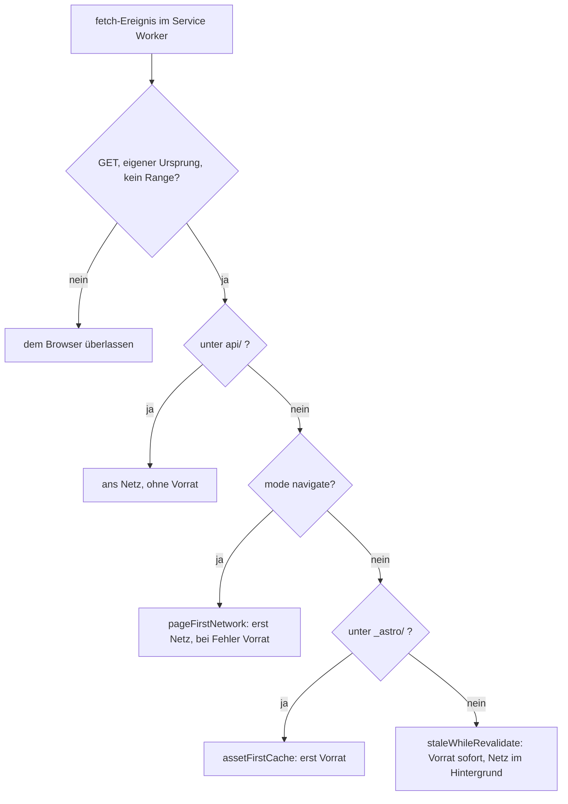

# Offline-Betrieb: Service Worker, Cache-Regeln und Manifest

Die Seite ist statisch gebaut und braucht für das Spiel keinen Server — ohne Netz startet sie
trotzdem nicht von selbst. Das erledigt ein **einziger, von Hand geschriebener Service Worker**,
`public/sw.js`: kein Paket, keine Liste der gebauten Dateien, keine Versionsnummer. Er legt bei
seiner Installation beide Seiten, ihre `_astro/`-Bausteine, die Symbole, das Manifest und die zwölf
Tierstimmen in den Cache Storage (im Code durchweg „der Vorrat") und beantwortet danach jede
Anfrage nach einer von drei Regeln.



Die Weiche im `fetch`-Zuhörer: was der Worker nicht selbst beantwortet, geht unberührt an den
Browser — fremde Ursprünge, alles außer `GET`, Teilabrufe mit `Range`-Kopfzeile und `api/`.

Die Datei liegt in `public/` und geht dadurch **unverändert** in den Bau (`dist/sw.js`); der
Deploy-Workflow schiebt nur `dist/` zu GitHub Pages. Wer sie ändert, ändert damit das ausgelieferte
Artefakt selbst — es gibt keinen Übersetzungsschritt, der einen Fehler abfängt.

## Anmeldung: nur im Bau, nur über den Basis-Pfad

Angemeldet wird der Worker an genau einer Stelle, in `src/layouts/Base.astro`:

```js
if (import.meta.env.PROD && 'serviceWorker' in navigator) {
  const base = import.meta.env.BASE_URL;
  window.addEventListener('load', () => {
    navigator.serviceWorker.register(`${base}sw.js`, { scope: base }).catch(() => undefined);
  });
}
```

Drei Dinge daran sind Absicht:

- **Nur im Bau.** Im Entwicklungsserver stünde der Vorrat jeder Änderung im Weg. Folge für die
  Prüfung: Der Offline-Betrieb lässt sich nur gegen `pnpm build` + `pnpm preview` messen, nicht
  gegen `pnpm dev` — genau so ist `scripts/pruefen-offline.py` dokumentiert.
- **Über den Basis-Pfad, nie absolut.** `scope` ist der Basis-Pfad mit Schluss-Schrägstrich;
  `astro.config.mjs` normalisiert ihn. Der Worker baut danach jede Adresse aus
  `self.registration.scope` — ein Unterpfad-Bau (`ASTRO_BASE=/pfad pnpm build`) verschiebt damit
  Vorrat und Anmeldung mit.
- **Ein Zusatz, kein Pflichtteil.** Die Anmeldung hängt am `load`-Ereignis und schluckt ihren
  Fehler (`.catch(() => undefined)`): scheitert sie, läuft die Seite wie bisher.

`src/offline.test.ts` liest `Base.astro` als Text und hält genau diese Form fest: `'serviceWorker' in
navigator`, `import.meta.env.PROD`, ``register(`${base}sw.js`, { scope: base })`` — und **kein**
`register('/…` mit absolutem Pfad.

## Die drei Strategien und ihre Begründung

| Anfrage | Strategie | Begründung im Code |
|---|---|---|
| Navigation (`request.mode === 'navigate'`) | **erst Netz, bei Fehler der Vorrat** (`pageFirstNetwork`) | „Wer Netz hat, sieht nie einen alten Stand." |
| `_astro/…` | **erst Vorrat** (`assetFirstCache`) | Der Dateiname trägt einen Hash des Inhalts: gleicher Name heißt immer gleicher Inhalt. |
| alles andere vom selben Ursprung (Symbole, Manifest, Tierstimmen) | **Vorrat sofort, im Hintergrund auffrischen** (`staleWhileRevalidate`) | Der Start soll nicht auf das Netz warten; was sich ändert, ist beim nächsten Mal da. |

**Seiten — netzfirst.** `pageFirstNetwork` holt die Antwort erst vom Server; ist sie
`storable`, wird sie **ohne Warten** abgelegt (`storePage(...).catch(() => undefined)` — „das Ablegen
darf die Antwort nicht aufhalten und nicht scheitern lassen"). Eine Fehlantwort des Netzes (etwa 404)
geht ungespeichert an den Browser; nur ein **geworfener** Netzfehler führt in den Vorrat. Dann sucht
der Worker die Adresse — mit `ignoreSearch`, damit `?quelle=startbildschirm` dieselbe Seite
trifft — und fällt sonst auf die Startseite (`cache.match(SCOPE, ANY_VARIANT)`) zurück. Deshalb öffnet
auch eine unbekannte Adresse ohne Netz das Spiel, statt eine Browser-Fehlerseite zu zeigen.

**Bausteine — cachefirst.** Ein Treffer im Vorrat beendet die Anfrage; es wird nicht einmal gefragt,
ob es etwas Neueres gibt (der Test misst genau das: nach dem Laden von `_astro/app.BBB.css` ist die
Liste der Netzabrufe leer). Erst ein Fehlschlag im Vorrat holt über das Netz und legt ab.

**Der Rest — stale-while-revalidate.** Der Vorrat antwortet sofort, der Netzabruf läuft daneben und
schreibt bei `200`/`basic` nach. Ist nichts im Vorrat, wartet der Aufrufer auf das Netz — und bekommt
dessen Fehler zu sehen, wenn es keins gibt. Über diesen Weg landen auch Dateien im Vorrat, die
niemand vorab nennt (etwa `icon-512.png` beim ersten Abruf).

### Warum keine Versionsnummer nötig ist

`const CACHE = 'zahn-agent-v1'` sieht wie eine Version aus, ist aber nur ein **Namensraum**: der
Schlüssel, unter dem dieser Worker seinen Vorrat führt. Der Inhalt braucht keine Version, weil zwei
Eigenschaften zusammenwirken:

1. **Die Seite selbst kommt immer vom Netz**, sobald es eines gibt. Sie nennt damit immer die
   Dateinamen des aktuellen Baus.
2. **Die Bausteine tragen den Hash ihres Inhalts im Namen.** Ein neuer Bau erzeugt neue Namen; ein
   alter Name unter `_astro/` ist beweisbar veraltet und wird weggeräumt (siehe
   „Der Vorrat führt ein Adressbuch je Seite"). Ein „Cache leeren" bei jeder Veröffentlichung wäre
   also nur ein zusätzlicher Vollabruf.

Ein neuer Name für `CACHE` wäre erst fällig, wenn sich die **Bedeutung** des Vorrats ändert — ein
anderes Schlüsselschema, eine andere Ablagestruktur. Dann räumt `activate` von selbst auf: es löscht
jeden Cache, der nicht `CACHE` heißt, und übernimmt danach mit `clients.claim()` die offenen Seiten.
Die `install`-Phase ruft `skipWaiting()`, damit ein neuer Worker nicht auf das Schließen aller Tabs
wartet.

## Was die Installation in den Vorrat legt

`precache()` arbeitet drei Listen ab:

| Liste | Inhalt | Behandlung |
|---|---|---|
| `PAGES` | `['', 'statistik']`, relativ zum Geltungsbereich | je Seite `fetch` → `storable`? → `storePage` samt Bausteinen |
| `SHELL` | `manifest.webmanifest`, `favicon.svg`, `logo.svg`, `icon-192.png` | `cache.add`, ein Fehlschlag wird geschluckt |
| `VOICES` + `VOICE_DIR` | die zwölf Tierstimmen unter `sounds/voices/` | wie `SHELL` |

„Ein fehlendes Symbol oder eine fehlende Stimme darf die Installation nicht verhindern" — deshalb
`catch(() => undefined)` um jedes `cache.add`. Ein Test entfernt `logo.svg` aus der nachgestellten
Website und erwartet, dass `install` trotzdem durchläuft und die Startseite im Vorrat liegt.

`storable(response)` ist die Tür zum Vorrat und bewusst streng: `status === 200` **und**
`type === 'basic'` (eigener Ursprung). Eine 404-Antwort oder eine undurchsichtige Fremdantwort
landet damit nie im Vorrat; der Test ruft eine nicht vorhandene Stimme ab und prüft, dass sie nicht
abgelegt wird.

**Warum die Stimmen schon bei der Installation mitkommen.** Die Seite lädt eine Stimme erst, wenn
sie gebraucht wird — nach der ersten Nutzergeste (`createVoiceLoader` holt sie per `fetch` über
`sounds/voices/<id>.mp3`). Wer beim ersten Tipp schon ohne Netz ist, bekäme sonst keine Stimme: die
MP3s sind die einzigen Klänge des Spiels, die nicht synthetisiert werden.

## Bausteine finden: HTML plus Skript-Importe

Der Worker kennt keine Dateiliste des Baus; er liest sie aus dem Ergebnis. Zwei Quellen:

- **`assetsIn(html, pageUrl)`** — alle `href`- und `src`-Attribute im HTML, relativ zur Seite
  aufgelöst, behalten wird nur, was mit `SCOPE + '_astro/'` beginnt. Das findet Stylesheets und
  Seitenskripte, die das HTML nennt.
- **`importsIn(script, scriptUrl)`** — relative Einbindungen in einem Skript
  (`["'](\.{1,2}\/[^"']+\.(?:js|css))["']`), also `import … from"./x.js"` und auch
  `import("./x.js")`. `storeAsset` liest jedes abgelegte `.js` und ruft sich für dessen Einbindungen
  selbst auf — rekursiv, mit `seen` als Schutz gegen Kreise.

Die Reichweite dieser Ausdrücke ist eine bewusste Grenze: gelesen werden nur **relative** Pfade
(`./`, `../`) mit der Endung `.js` oder `.css`. Eine absolute Einbindung (`import "/_astro/x.js"`)
fände der Ausdruck nicht — sie müsste über das HTML oder einen anderen relativen Pfad erreichbar
sein, sonst fehlt der Baustein offline.

`storeAsset` fragt zuerst den Vorrat (`cache.match(url, ANY_VARIANT)`), bevor es über das Netz geht:
Ein hashbenannter Baustein, der schon liegt, muss nicht erneut geholt werden.

## Der Vorrat führt ein Adressbuch je Seite

Weil der Worker keine Liste des Baus kennt, muss er wissen, **welche** Bausteine noch gebraucht
werden. Das leistet ein Eintrag je Seite:

1. `storePageNow` legt das HTML unter der Anfrage ab, sammelt die Bausteine (samt deren Importen) und
   schreibt die Adressen als JSON unter `SCOPE + '__bausteine__/' + encodeURIComponent(pathname)`.
2. `prune(cache)` liest **alle** diese Listen, vereinigt sie und löscht jeden Schlüssel unter
   `_astro/`, der in keiner Liste steht.
3. Seiten, Symbole, Manifest und Stimmen sind von `prune` nicht betroffen — gelöscht wird
   ausschließlich `_astro/`.

Das Aufräumen ist der Grund, warum der Vorrat nicht mit jeder Veröffentlichung wächst: nach einem
Bau, der `index.AAA.js` durch `index.NEU.js` ersetzt, liegt nur noch der neue Baustein da — es sei
denn, die Statistikseite nennt den alten noch.

**Nacheinander, nie nebeneinander.** `storePage` reiht jeden Auftrag in eine Kette (`storing`), damit
das Aufräumen der einen Seite nicht die Bausteine löscht, die die andere gerade ablegt, aber noch
nicht in ihrer Liste führt. Der Test fährt beide Seiten in einem Durchgang und prüft, dass die
Bausteine der Statistikseite überleben und ein Baustein verschwindet, den nur der alte Stand
einband.

## Die zwei Fallen, die die Sonde gefunden hat

Beide sind am 12.10.2026 im echten Browser aufgetreten, nicht in der nachgestellten Umgebung: die
Seite lud ohne Netz, zeichnete aber **keinen Zahn**.

- **Das HTML nennt nicht alle Bausteine.** Die Seitenskripte teilen sich Bausteine, die nur sie
  selbst kennen (`import{a}from"./geteilt.js"`, `import("./spaet.js")`). Ein Worker, der nur das HTML
  liest, hat die Seiten, aber nicht das, was sie zum Zeichnen brauchen. Deshalb folgt `storeAsset`
  den Einbindungen der Skripte, rekursiv. Der Test bildet genau diesen Fall nach: eine geteilte
  Datei, die kein HTML-Attribut nennt, und eine späte, die erst diese Datei einbindet.
- **Der Vorrat wird mit `ignoreVary` befragt.** Der Server schickt `Vary: Origin`; der Worker hatte
  das Seitenskript selbst ohne `Origin` geholt, die Seite fragt es aber als Modul mit `Origin` an —
  der Vorrat verfehlte die Datei, ohne Netz `net::ERR_FAILED`, kein Zahn auf der Bühne. Deshalb
  hängt an jedem `cache.match` `ANY_VARIANT = { ignoreVary: true }`.
  `FakeCache` im Test ist darin streng wie ein `Vary`-Server: ohne `ignoreVary` findet er nichts.

Die Lehre steht auch in `docs/fallen.md`: ein Vorrat, der gefüllt ist, ist noch kein Vorrat, der
antwortet. Wer `public/sw.js` anfasst, baut und fährt `scripts/pruefen-offline.py` — der
Entwicklungsserver meldet den Worker gar nicht erst an.

## `api/` geht immer ans Netz

Vor jeder Strategie bricht der `fetch`-Zuhörer für `SCOPE + 'api/'` ab. Die Sicherung der Runden
(`worker/backup.js`) antwortet unter dem **eigenen** Ursprung der Seite — ohne diese Ausnahme läge
`api/log/<code>` im selben Vorrat wie alles andere. Ein Stand aus dem Vorrat wäre ein alter Stand,
und der Abgleich (`syncRoundLog`) führt holend zusammen und **schriebe ihn zurück**. Deshalb: keine
Antwort aus dem Vorrat, kein `put`, immer das Netz. Der Test stellt eine solche Anfrage und erwartet,
dass der Worker sie dem Browser überlässt; `HttpRemoteLog` setzt zusätzlich `cache: 'no-store'` auf
seiner Seite. Details zum Gegenstück auf dem Server:
[Sicherungs-Worker](sicherung-worker.md).

## Manifest, Symbole und Stimmenliste

`public/manifest.webmanifest` macht die Seite installierbar. Es ist durchweg **relativ** geschrieben
(`"id": "./"`, `"start_url": "./"`, `"scope": "./"`) und funktioniert damit auch unter einem
Unterpfad; `display: "standalone"`, `lang: "de"`, Name, Kurzname, Beschreibung sowie Hintergrund- und
Themenfarbe `#080f14` sind gesetzt. Die Symbole sind `favicon.svg`, `apple-touch-icon.png`,
`icon-192.png`, `icon-512.png` und `icon-maskable-512.png`. Verlinkt wird das Manifest in
`Base.astro` (``<link rel="manifest" href={`${BASE_URL}manifest.webmanifest`}>``), vorgehalten wird es
über `SHELL` — die Installation allein hielte die Startseite sonst ohne Manifest im Vorrat.

`src/offline.test.ts` prüft die Pflichtfelder (`id`, `lang`, `start_url`, `scope`, `display`) und
dass `name`, `short_name`, `description`, `theme_color`, `background_color` gefüllt sind; dass jede
Manifestdatei existiert und die PNG-Kantenlängen stimmen, hält `src/icon.test.ts` fest.

**Die Stimmenliste ist gekoppelt.** `VOICES` in `public/sw.js` muss genau die Dateien nennen, die
das Spiel kennt: `CREATURE_VOICE_FILES` wird aus `listCreatures()` abgeleitet (je Kennung
`<id>.mp3`), und der Test liest den `const VOICES = [...]`-Block aus dem Worker-Quelltext und
vergleicht beide Listen sortiert — dazu die Zeile `const VOICE_DIR = 'sounds/voices/';`. Ein neues
Lebewesen ohne Eintrag in `VOICES` wird deshalb rot, und zwar im Gate, nicht erst offline. Umgekehrt
prüft derselbe Test, dass jede Datei aus `SHELL` in `public/` existiert: eine erfundene Datei in der
Liste fällt sofort auf.

## Grenzen

- **Der Vorrat liegt im Browserprofil.** Er teilt das Schicksal des Rundenprotokolls: verwirft ein
  Browser beim Schließen seine Daten (gemeldet für das Kinderprofil eines Fire-Tablets), sind Cache
  **und** Runden weg. Gegen Datenverlust hilft der Service Worker nicht — dafür gibt es die Sicherung
  über `api/log/<code>`.
- **Nur `PAGES` wird vorab gelegt.** Eine dritte Seite, die niemand in `PAGES` einträgt, startet
  offline nicht (sie käme erst nach einem Online-Besuch in den Vorrat).
- **Keine fremden Antworten im Vorrat.** `storable` verlangt `200` und `type === 'basic'`.
- **Teilabrufe bleiben draußen.** Anfragen mit `Range`-Kopfzeile gehen unberührt ans Netz — der
  Worker beantwortet keine Medien-Teilabrufe aus dem Vorrat.
- **`api/` ist eine Ausnahme, die bleiben muss.** Wer sie entfernt, riskiert, dass ein alter Stand
  zurückgeschrieben wird; wer ein anderes Präfix einführt, muss `API_DIR` und die Worker-Route
  zusammen ändern.
- **Der Worker ist ein Zusatz.** Er hält das Spiel nie an: Anmeldung, Ablegen und Auffrischen fangen
  ihre Fehler selbst ab.

## Prüfungen, die diese Form festhalten

| Prüfung | Was sie festhält |
|---|---|
| `src/offline.test.ts` | lädt `public/sw.js` über `new Function('self', 'caches', 'fetch', SW_SOURCE)` in eine nachgestellte Worker-Umgebung: Installation legt beide Seiten, Bausteine (auch die nur aus Skript-Importen), Symbole und Stimmen ab; ohne Netz kommen Seiten und Bausteine aus dem Vorrat; mit Netz der neue Stand, alte Bausteine werden weggeräumt; fremde Ursprünge, Schreibzugriffe, `Range` und `api/` bleiben unberührt; der Vorrat wird ohne Rücksicht auf `Vary` befragt; dazu Anmeldung nur im Bau über den Basis-Pfad, Manifest-Pflichtfelder, `VOICES` gleich `CREATURE_VOICE_FILES`, Existenz jeder `SHELL`-Datei |
| `scripts/pruefen-offline.py` | misst im echten Browser gegen `pnpm build` + `pnpm preview`: ein Service Worker steuert die Seite, beide Seiten und ihre Bausteine liegen im Vorrat, ohne Netz lädt die Spielseite samt gezeichneten Zähnen und zählt einen Druck, die Statistikseite lädt, und keine Anfrage scheitert |
| `pnpm gate`, `pnpm probes` | `typecheck`, `lint` (Biome prüft auch `public/sw.js`) und `test:run` vor dem Bau; die Sonden laufen gebündelt gegen die Vorschau |

Der Test liegt bewusst als `src/offline.test.ts` **neben** `src/pages/` und nicht darin — so steht es
als Kommentar über der Datei: ein Test unter `src/pages/` würde als Route gebaut und den Bau brechen.
`FakeCache` ist dabei so streng wie ein echter Server (siehe `Vary`), damit die Umgebung nicht grüner
ist als die Wirklichkeit — der teuerste Fall dieser Seite war genau eine grüne Umgebung bei kaputtem
Browser.

## Wo man anbaut

- **Eine neue Datei für den Start ohne Netz** gehört in `SHELL` in `public/sw.js` — und muss in
  `public/` existieren, sonst fällt der Test.
- **Eine neue Seite** braucht einen Eintrag in `PAGES` (relativ zum Geltungsbereich), damit sie vorab
  im Vorrat liegt.
- **Ein neues Lebewesen** braucht `'<id>.mp3'` in `VOICES`; die Kopplung an `CREATURE_VOICE_FILES`
  hält der Test. Der Weg mit allen Stationen steht in `docs/neues-tier.md`.
- **Ein anderes Ablageschema oder andere Strategien** sind der einzige Grund, `CACHE` umzubenennen:
  `activate` löscht dann den alten Vorrat von selbst.
- **Ein anderes `api/`-Präfix** muss in `API_DIR` und in der Route des Sicherungs-Workers zugleich
  geändert werden.

## Weiterlesen

- [Architektur-Überblick](../architecture/ueberblick.md) — wo der Service Worker im Ganzen steht
- [Sicherungs-Worker](sicherung-worker.md) — der Grund für die `api/`-Ausnahme
- [Ton und Vibration](ton-und-vibration.md) — warum die Stimmen erst nach der ersten Geste kommen
- [Bauen und Veröffentlichen](../operations/bauen-und-veroeffentlichen.md) — Bau, Vorschau und der
  Weg nach `dist/`
