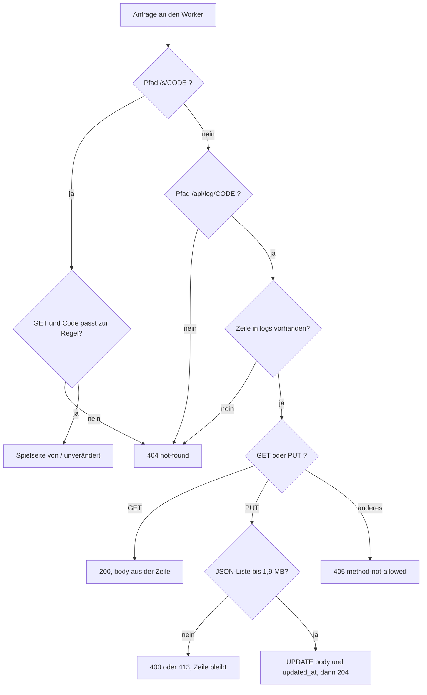
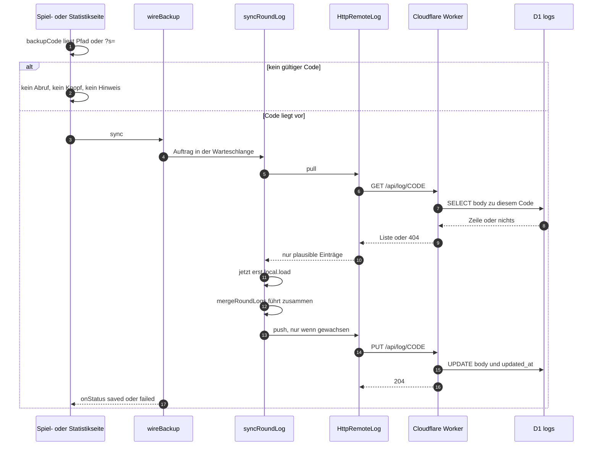

# Sicherung der Runden: Worker, Code aus der Adresse, Abgleich

Anlass ist ein Gerät, kein Fehler: das Kinderprofil eines Fire-Tablets verwirft beim Schließen des
Browsers alles, was die Seite in `localStorage` legt — und damit auch die Sterne, die aus dem
Rundenprotokoll abgeleitet werden. Was das Leeren übersteht, sind genau zwei Dinge: **die Adresse**,
über die das Gerät die Seite startet, und **ein Server**. Also trägt die Startadresse einen
Sicherungscode (`…/s/<code>`, alternativ `?s=<code>`), und das Protokoll liegt unter diesem Code bei
Cloudflare: Worker `zahn-agent-backup`, Datenbank D1 `zahn-agent-backup`, Routen
`…/api/*` und `…/s/*` unter demselben Ursprung wie die Seite.

**Ohne Code geschieht nichts.** Kein Abruf, kein Knopf, kein Hinweis: die beiden Seiten bauen den
Adapter nur, wenn `backupCode(...)` einen Code liefert, sonst gibt es keinen `RemoteLogPort` und die
Sicherung existiert für dieses Gerät nicht. Der Worker seinerseits kennt nur Codes, die der Betreiber
als Zeile in der Tabelle `logs` angelegt hat. Der Code ist das einzige Geheimnis und steht nirgends
im Baum — nicht im Code, nicht in Tests, nicht in der Doku.

Was gesichert wird und wie das Protokoll aussieht, steht in
[Rundenprotokoll und CSV](../concepts/rundenprotokoll-und-csv.md); der Weg zum Nachbauen in
[`docs/sicherung-anleitung.md`](../../docs/sicherung-anleitung.md).

## Der Vertrag des Workers

Die ganze Außenseite ist eine Datei ohne Abhängigkeiten: [`worker/backup.js`](../../worker/backup.js),
rund 70 Zeilen, ein ES-Modul mit `export default { fetch }`. Sie wird **unverändert** ausgeliefert;
was hier steht, ist der laufende Vertrag.

| Anfrage | Antwort |
|---|---|
| `GET /api/log/<code>` | `200` mit dem gespeicherten Body, einer JSON-Liste |
| `PUT /api/log/<code>` | `204` nach `UPDATE`; der gesendete Body ersetzt den alten |
| `GET /s/<code>` | die Spielseite, geholt von `/` desselben Ursprungs |
| unbekannter Code | `404 {"error":"not-found"}` — beim **Lesen und beim Schreiben** |
| kaputter Body | `400 {"error":"invalid-json"}` oder `400 {"error":"not-a-list"}` |
| zu groß | `413 {"error":"too-large"}` |
| andere Methode auf bekanntem Code | `405 {"error":"method-not-allowed"}` |
| anderer Pfad, Code außerhalb der Regel | `404 {"error":"not-found"}` |



Die Reihenfolge dieser Weiche ist Teil des Vertrags: die Zeile wird **vor** der Methode geprüft,
deshalb liefert ein `DELETE` auf einen unbekannten Code `404` statt `405`.

Was daran nicht verhandelbar ist:

- **Nur eine JSON-Liste, höchstens `MAX_BODY_BYTES` = 1 900 000 Byte.** Die Grenze wird an den Bytes
  des Textes gemessen (D1 nimmt je Zeile 2 MB). Ein Objekt, ein leerer Text und abgeschnittene
  Klammern scheitern mit `400`; die alte Zeile bleibt dabei stehen.
- **`UPDATE`, nie `INSERT`.** Ohne vorhandene Zeile gibt es `404` — der Worker legt niemals eine an.
  Sonst könnte sich jeder von außen Speicherplatz holen. Der Test hält das, indem seine
  nachgestellte Datenbank jede Anweisung ablehnt, die nicht mit `UPDATE` beginnt.
- **Der Code wird zweimal geprüft, mit derselben Regel.** `CODE_PATTERN = /^[a-z0-9-]{12,64}$/`
  steht im Worker und in `src/infrastructure/storage/httpRemoteLog.ts`; die beiden Kopien müssen
  zusammen geändert werden, ein Test vergleicht sie nicht.
- **Die Pfade sind streng.** `/api/log/<code>` verlangt genau ein Segment ohne Schluss-Schrägstrich;
  ein zusätzliches Segment (etwa `/api/log/<code>/mehr`) ist `404`, ebenso jede andere Route.
- **Keine Zwischenspeicherung.** Jede Antwort unter `/api/log/…` trägt `cache-control: no-store` —
  auch die Fehlerantworten und die `204`.
- **`/s/<code>` prüft nur das Format, nicht die Tabelle.** Ein wohlgeformter, aber unbekannter Code
  bekommt die Spielseite; erst der Abruf dahinter endet mit `404`, und die Statistikseite meldet
  „nicht erreichbar". Die Antwort ist die Seite von `/` Byte für Byte, ohne eigenen Kopfzeilen-Zusatz.
- **Kein CORS und kein zweiter Ursprung.** Der Worker antwortet unter derselben Domain wie die
  statisch ausgelieferte Seite, deshalb braucht der Adapter keine Sonderbehandlung und ein Profil,
  das nur freigegebene Domains durchlässt, sieht keine fremde Adresse.

## Die Kette auf der Seite

| Baustein | Datei | Aufgabe |
|---|---|---|
| Naht | `src/core/ports/remoteLog.ts` | `RemoteLogPort` mit `pull()` und `push()`; beide **werfen**, wer ruft entscheidet |
| Adapter | `src/infrastructure/storage/httpRemoteLog.ts` | Code lesen, Adresse bauen, `fetch` gegen den Worker |
| Ablauf | `src/core/use-cases/syncRoundLog.ts` | holen, zusammenführen, beide Seiten gleichziehen |
| Regel | `src/core/domain/sessionLog.ts` | `mergeRoundLogs` — reine Funktion, keine Uhr, kein DOM |
| Verdrahtung | `src/presentation/game/backupSync.ts` | Warteschlange, Status, „nie werfen" |
| Seiten | `src/pages/index.astro`, `src/pages/statistik.astro` | Adapter nur bei Code, Abgleich beim Start und nach Änderungen |



Der Ablauf vom Code in der Adresse bis zum Abgleich; der Zweig „ohne Code" ist der Normalfall der
öffentlichen Seite.

**Der Code kommt aus der Adresse.** `backupCode(search, storage, pathname)` liest zuerst den Pfad
(`/s/([^/]+)/?$`, auch unter einem Basis-Pfad wie `/zahn_agent/s/<code>`) und sonst `?s=`; nur was
`CODE_PATTERN` erfüllt, zählt. Ein abgelehnter Wert wird nicht abgelegt — `?s=kurz`,
`?s=../../etwas/anderes` und Großbuchstaben ergeben `null`, ebenso ein gespeicherter Unsinn wie
`<script>`. Ein gültiger Code wandert zusätzlich unter `zahn_agent:backup-code` in die Ablage,
**weil die Verweise zwischen Spiel und Statistik ihn nicht tragen**: wer ihn nur aus der Adresse
läse, verlöre ihn beim ersten Klick auf „Statistik" und würde dort eine leere Sicherung anlegen.
Eine gesperrte Ablage (werfendes `getItem`/`setItem`) wird abgefangen — dann gilt der Code nur für
diese eine Seite.

**Die Adresse hängt am Basis-Pfad.** `backupUrl(baseUrl, code)` ergibt `<Basis-Pfad>api/log/<code>`,
also `/api/log/<code>` oder `/zahn_agent/api/log/<code>`. Dieselbe Regel wie jeder andere Verweis der
Seite — sonst zeigte sie unter `/s/<code>` ins Leere.

**Der Adapter prüft, was zurückkommt.** `HttpRemoteLog.pull()` ruft mit `cache: 'no-store'`,
verlangt `response.ok`, verlangt eine Liste und schickt jeden Eintrag durch `isPlausibleRecord` —
dieselbe Prüfung wie bei CSV-Import und Ablage. `push(records)` sendet die **ganze** Liste als
`PUT` mit `content-type: application/json`. Beide werfen bei `!response.ok` (etwa `404` oder `413`)
und bei „keine Liste"; der Port verlangt genau das, damit `syncRoundLog` die Entscheidung behält.
Der `fetch`-Aufruf läuft über einen Pfeil, nicht über die Methode: der Browser verlangt
`this === window`.

## Der Abgleich: erst holen, dann die Ablage lesen

`syncRoundLog(local, remote)` ist der ganze Kern des Ablaufs:

```text
theirs  = await remote.pull()
mine    = local.load()            // erst nach dem Abruf
merged  = mergeRoundLogs(mine, theirs)
changed = JSON.stringify(merged) !== JSON.stringify(mine)
if (changed)  local.save(merged)
if (merged.length !== theirs.length)  await remote.push(merged)
return { rounds: merged.length, localChanged: changed }
```

Vier Eigenschaften, jede mit einem Test:

- **Die Ablage wird erst nach dem Abruf gelesen** und ohne weitere Wartezeit geschrieben. Läse man
  sie vorher, überschriebe der Abgleich eine Runde, die während des Wartens auf das Netz zu Ende
  ging. Der Test dazu lässt die Sicherung genau in diesem Moment antworten und prüft, dass beide
  Einträge danach auf beiden Seiten stehen.
- **Es wird nie geschrieben, ohne vorher geholt zu haben.** Ein Gerät mit leerer Ablage, das nach
  dem ersten Biss einfach „seinen Stand" hochlädt, überschriebe hunderte gesicherte Runden mit
  einer.
- **Geschrieben wird nur, wo sich etwas ändert.** Ist die Sicherung schon Obermenge, bleibt die
  Ablage unberührt (`localChanged: false`, kein `save`, kein `push`) — ein Abgleich ist dann ein
  einziger `GET`.
- **Ein Fehler beim Holen rührt das Gerät nicht an.** `pull()` wirft, `syncRoundLog` reicht das
  weiter, ohne `save` — das Abfangen ist Sache von `wireBackup`.

**Die Regel des Zusammenführens** (`mergeRoundLogs`) passt zum Gegenstand: das Protokoll ist eine
Liste, an die nur angehängt wird. Der Stand der Sicherung bleibt, wie er ist; was nur das Gerät
kennt, wird angehängt und ab `nextRoundNumber(remote)` fortlaufend numeriert. Die Identität eines
Eintrags kommt aus `playedAt | creature | teeth | mode | pressOrder` — **nicht** aus `round`, denn
die laufende Nummer ist auf beiden Seiten unabhängig vergeben. Gleiche Einträge zählen **je
Vorkommen**: zwei Runden aus einem Kurzformat-Import ohne Zeitpunkt und mit derselben Druckfolge
sind zwei Runden, nicht eine.

Für einen Stand, der **ein einzelner Zustand** ist (Punktestand, Einstellungen, Spielfeld), passt
diese Regel nicht — dort bräuchte es eine andere, etwa „der jüngere Stand gewinnt". Das ist hier
nicht gebaut.

## Warteschlange und Status: `wireBackup`

`wireBackup({ local, remote, onLocalChange, onStatus })` gibt `sync()` und `replace(records)` zurück
und hängt jeden Auftrag an eine Promise-Kette:

- **Abgleiche laufen nacheinander.** Zwei nebeneinander läsen beide den alten Stand der Sicherung,
  und der langsamere schriebe ihn über den neuen. Der Test startet zwei `sync()` mit einer
  dazwischen gespeicherten Runde und findet danach beide in der Sicherung.
- **Erst ausführen, dann melden.** Der Auftrag steht im Rumpf des `try`, das Ergebnis wird danach an
  `onStatus?.(status)` gereicht. Stünde er im Argument — `onStatus?.({ rounds: await job() })` —,
  liefe er **nur, wenn jemand zuhört**; die Spielseite hört nicht zu und hätte nie gesichert,
  während die Statistikseite mit Zuhörer alles in Ordnung gemeldet hätte. Gefunden hat das ein Test,
  der ohne `onStatus` verdrahtet und trotzdem eine gefüllte Sicherung erwartet.
- **Es wird nie geworfen.** Ein Fehler ergibt `{ state: 'failed' }`; das Spiel läuft weiter, und der
  nächste Abgleich holt nach. Ein späterer Erfolg meldet `{ state: 'saved', rounds }`.
- **`replace(records)` schreibt ohne Abgleich.** Das ist ausschließlich fürs Löschen gedacht: ein
  Abgleich nach dem Löschen holte alles wieder zurück. Ein `push` der leeren Liste ersetzt die
  Sicherung; die Testfolge `replace([])` → `sync()` endet mit leerer Ablage und leerer Sicherung.
- **`localChanged` meldet Umbau, nicht Erfolg.** Nur wenn der Abgleich die Ablage verändert hat
  (etwa nach geleertem Profil), ruft `wireBackup` `onLocalChange()` — die Seite zeichnet dann still
  neu. Wurde bloß gesichert, bleibt die Anzeige unangetastet.

`BackupStatus` ist `{ state: 'saved', rounds }` oder `{ state: 'failed' }`; `backupNote(status)` macht
daraus den Satz für die Statistikseite — „Sicherung: 512 Runden liegen auch außerhalb dieses Geräts."
bzw. „Sicherung: nicht erreichbar — die Runden liegen vorerst nur auf diesem Gerät." Singular und
Null werden mitgezählt („1 Runde", „0 Runden").

## Wo abgeglichen wird

| Auslöser | Ort | Besonderheit |
|---|---|---|
| Seitenstart | `src/pages/index.astro`, `src/pages/statistik.astro` → `wireGamePage` / `wireStatsPage` | Adapter nur, wenn `backupCode(...)` einen Code liefert |
| jede beendete Runde | `gamePage.ts`, `feed.subscribe` auf `round-finished` | `void backup.sync()`, ohne auf das Ergebnis zu warten |
| importierte Runden | `statsPage.ts`, `#import-run` | erst Ablage schreiben und neu zeichnen, dann `void backup?.sync()` |
| „Protokoll löschen" | `statsPage.ts`, `#clear-log` | `void backup?.replace([])` — ersetzen, nicht abgleichen |
| Abgleich hat das Gerät verändert | `gamePage.ts`, `onLocalChange` | `feed.changedOutside()` statt `round-finished`: stille Aktualisierung von Anzeige und Sternen |
| Statuszeile | `statsPage.ts`, `#backup-status` | wird erst mit dem ersten Status sichtbar (`hidden = false`), dann `backupNote(state)` |

Die Spielseite übergibt bewusst **kein** `onStatus`: auf dem Tablet soll keine Zeile von der
Sicherung erzählen. Sichtbar wird sie nur auf der Statistikseite — und dort auch nur, wenn ein Code
gilt. Fehlt die Zeile, kam der Code nicht an; steht „nicht erreichbar", blockt das Profil den Abruf.

**Der Service Worker hält die Sicherung nicht vor.** `public/sw.js` lässt `api/` unberührt am
Browser vorbei ans Netz (`API_DIR`), weil ein Stand aus dem Vorrat ein alter Stand wäre und der
Abgleich ihn zurückschriebe. Der Test dazu verlangt für `api/log/<code>` ausdrücklich „keine
Antwort des Workers" — Einzelheiten in [Offline-Betrieb](offline-service-worker.md).

## Betrieb: Code anlegen, sperren, Worker ausliefern

Alles bei Cloudflare liegt in der Zone `schaflabs.com`: Worker `zahn-agent-backup`, Bindung `DB` auf
die Datenbank D1 `zahn-agent-backup`, zwei Routen (`…/api/*` und `…/s/*`). Das Schema ist eine
einzige Tabelle, eine Zeile je Code:

```sql
CREATE TABLE IF NOT EXISTS logs (code TEXT PRIMARY KEY, body TEXT NOT NULL, updated_at TEXT NOT NULL);
```

Weil der Worker ausschließlich `UPDATE` kennt, ist **das Anlegen eines Codes ein `INSERT` von Hand**:

```sql
INSERT INTO logs (code, body, updated_at) VALUES ('<code>', '[]', datetime('now'));
```

- **Code anlegen** heißt Zeile einfügen; erst danach kennt der Worker ihn, und erst dann kann die
  Seite unter `…/s/<code>` etwas sichern. Ein Code wird gewürfelt, nicht ausgedacht: zwölf Zeichen
  aus einem Alphabet ohne verwechselbare Zeichen, in Vierergruppen — und er steht nirgends im Baum.
- **Sperren** heißt Zeile löschen (`DELETE FROM logs WHERE code = '<code>'`). Der Stand darin ist
  dann weg, und die Seite meldet „nicht erreichbar".
- **Der Worker wird nicht mit der Seite ausgeliefert.** Ein Push veröffentlicht nur `dist/`; wer
  `worker/backup.js` ändert, lädt die Datei selbst neu hoch und prüft danach die echte Adresse.
  `worker/` liegt außerhalb von `src/` und gehört zu keiner Schicht.
- **Nach dem Anlegen kurz warten.** Eine neue Route greift nicht sofort; der erste Abruf von
  `/s/<code>` kam hier noch von GitHub Pages, Sekunden später antwortete der Worker.
- **Prüfen ohne Code in der Doku** geht mit `scripts/pruefen-sicherung.py`: die Sonde stellt die
  Sicherung im Browser nach und rührt den echten Worker nicht an.

Ein Abgleich ist **eine Anfrage zum Holen und höchstens eine zum Schreiben**. Die Grenzen des
kostenlosen Tarifs (100 000 Worker-Anfragen je Tag, 5 Mio. gelesene und 100 000 geschriebene
D1-Zeilen je Tag, 2 MB je Zeile) erreicht ein Kind nicht. Die Grenze, die zuerst greift, ist die
eigene: eine Zeile je Code, rund 170 Byte je Runde — 1,9 MB reichen für etwa 11 000 Runden, danach
lehnt der Worker mit `413` ab und die Statistikseite meldet „nicht erreichbar".

## Sicherheit, ehrlich

- **Der Code ist das einzige Geheimnis.** Wer ihn kennt, kann den Stand lesen und überschreiben. Er
  steht in der Adresse, also im Verlauf des Browsers und in jedem Bildschirmfoto.
- **Keine Bremse gegen Ausprobieren.** Der Schutz ist die Länge: zwölf zufällige Zeichen aus 31 sind
  rund 59 Bit; die Regel lässt 12 bis 64 Zeichen zu.
- **Kein Selbstanlegen von außen.** Ohne Zeile in `logs` gibt es nur `404` — der Worker ist kein
  offener Speicherplatz, und die Sicherung ist kein Angebot der öffentlichen Seite: ohne Code kein
  Abruf, kein Knopf, kein Hinweis, keine Änderung am Verhalten.
- **Gesichert wird nur, was ohnehin im Gerät lag:** Tier, Zahnzahl, Druckfolge, Zeitpunkt einer
  Runde. Wer etwas Persönlicheres sichern will, braucht mehr als einen Code in der Adresse.
- **Sperren ist Löschen.** Es gibt keinen Schalter, nur die Zeile — und mit ihr sind die Runden weg.

## Grenzen und Erweiterungspunkte

- **Eine Zeile je Code.** Das ist der Grund, warum die Sicherung mit dem Wachstum des Protokolls
  teurer wird: bei `MAX_BODY_BYTES` ist Schluss, und der Worker liest die ganze Liste ein, um sie zu
  prüfen — die Rechenzeit kann vorher knapp werden (nicht gemessen, nur gerechnet).
- **Ein anderer Ablagezustand braucht eine andere Regel.** `mergeRoundLogs` setzt ein Protokoll
  voraus; ein einzelner Zustand bräuchte „der jüngere gewinnt" mit Zeitstempel — nicht gebaut.
- **Die Code-Regel steht zweimal.** Wer sie ändert, ändert `worker/backup.js` **und**
  `src/infrastructure/storage/httpRemoteLog.ts`; sonst nimmt die Seite einen Code an, den der Worker
  mit `404` beantwortet (oder umgekehrt).
- **Ein anderes Präfix oder eine neue Route** muss in der Worker-Route, im `API_DIR` des Service
  Workers und in `backupUrl` zusammenpassen.
- **Der Port ist die Naht.** Ein anderer Speicher (anderer Anbieter, KV, eigenes Backend) braucht nur
  eine neue `RemoteLogPort`-Umsetzung; `syncRoundLog`, `wireBackup` und die Seiten bleiben, wie sie
  sind — vorausgesetzt, der neue Dienst liefert Listen und ersetzt sie ganz.

## Prüfungen, die diese Form festhalten

| Prüfung | Was sie festhält |
|---|---|
| `src/backupWorker.test.ts` | lädt die ausgelieferte Datei (Node-Umgebung) gegen eine nachgestellte Datenbank, die nur `UPDATE` erlaubt: `/s/<code>` liefert die Seite von `/`, ein ungültiger Code dort `404` ohne Ursprungsabruf, `GET`/`PUT` auf bekannten Code, `404` für unbekannte Codes beim Lesen und Schreiben, `400` für Nicht-Listen, `413` für zu große Sendungen, `405` für andere Methoden, `cache-control: no-store` |
| `src/core/use-cases/syncRoundLog.test.ts` | holen-zusammenführen-schreiben, kein Schreibzugriff bei gleichem Stand, keine verlorene Runde während des Abrufs, keine Berührung der Ablage bei totem Dienst |
| `src/presentation/game/backupSync.test.ts` | Warteschlange, `onLocalChange` nur bei verändertem Gerät, Fehlschlag ohne Wurf mit Nachholen beim nächsten Lauf, `replace` statt Merge beim Löschen, Wortlaut von `backupNote` |
| `src/infrastructure/storage/httpRemoteLog.test.ts` | Code aus Pfad und Abfrage, gespeicherter Code, abgewiesene Codes, gesperrte Ablage, `backupUrl` über den Basis-Pfad, `no-store` beim Holen, Filtern unplausibler Einträge, Werfen bei `404`/`413` |
| `scripts/pruefen-sicherung.py` | im echten Browser gegen `pnpm build` + `pnpm preview`: ohne Code **keine** Anfrage an die Sicherung, mit Code gesichert, nach geleertem Profil Runden **und Sterne** wieder da (über `?s=` und über `s/<code>`), Code gilt auf `/statistik` weiter, Löschen leert auch die Sicherung, ohne Server sagt es die Seite und das Spiel zeichnet trotzdem |
| `pnpm gate`, `pnpm probes` | Typecheck, Biome und alle Tests vor dem Bau; die Sonden gebündelt gegen die Vorschau |

Der Worker-Test prüft bewusst **die Datei, die ausgeliefert wird**, nicht eine Nachbildung des
Vertrags. Was er nicht zeigen kann, ist der echte Cloudflare-Lauf — dafür stehen die `curl`-Zeilen in
der Anleitung, und die vierzehn Zeilen der Sonde zeigen die Seite, nicht den Server.

## Weiterlesen

- [Rundenprotokoll und CSV](../concepts/rundenprotokoll-und-csv.md) — was gesichert wird, welche
  Identität ein Eintrag hat und warum die laufende Nummer nicht dazugehört
- [Offline-Betrieb](offline-service-worker.md) — der Grund für die `api/`-Ausnahme im Service Worker
- [Schichten und Importregel](../architecture/schichten-und-importregel.md) — Port, Adapter und
  Ablauf; `worker/` steht außerhalb von `src/`
- [Spielseite verdrahten](../workflows/spielseite-verdrahtung.md) und
  [Statistikseite](../workflows/statistikseite.md) — wo `wireBackup` in den Seiten hängt
- [Bauen und Veröffentlichen](../operations/bauen-und-veroeffentlichen.md) — der Push veröffentlicht
  die Seite, nicht den Worker
- [`docs/sicherung-anleitung.md`](../../docs/sicherung-anleitung.md) und
  [`docs/workflow.md`](../../docs/workflow.md) — der Nachbauweg, die `curl`-Prüfungen und das Rezept
  für einen neuen Code
