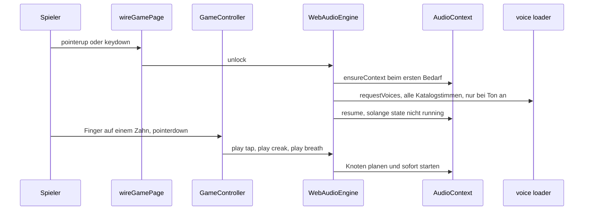
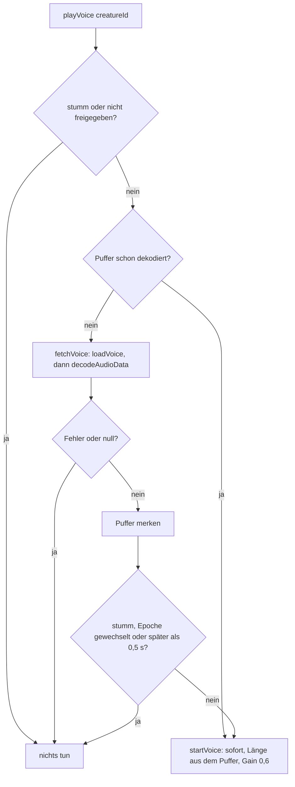

# Ton, Tierstimmen und Vibration

Was der Spieler hört und spürt, entsteht in zwei Adaptern hinter zwei Ports. Der Kern ruft keinen
davon — gespielt, stummgeschaltet und vibriert wird in der Bedienung, und die kennt weder
`AudioContext` noch `navigator` oder `fetch`. Genau diese Naht ist der Gegenstand der Seite — welche
Klänge wann erklingen, wie die Browser-Freigabe erzwungen wird, warum Tierstimmen die einzigen
Dateien sind und weshalb Vibration ein Extra bleibt, dessen Fehlen kein Fehler ist.

| Port | Datei | Umsetzung | Rufer |
|---|---|---|---|
| `SoundPort` | `src/core/ports/sound.ts` | `WebAudioEngine` (`src/infrastructure/audio/webAudioEngine.ts`), Stimmenzuordnung in `creatureVoices.ts` | `GameController` (spielen, stumm, Spannung), `wireGamePage` (nur `unlock`) |
| `HapticsPort` | `src/core/ports/haptics.ts` | `BrowserHaptics` (`src/infrastructure/haptics/browserHaptics.ts`) | `GameController` (`vibrate`), `wireSettingsSheet` (nur `isSupported`) |

Die inhaltlichen Regeln (Anzeigen werden benannt, Ergebnissatz, keine Zahl der Bissgefahr) stehen in
`docs/rueckmeldung.md`; diese Seite beschreibt die technische Naht dahinter. Die Schichtregeln, die
den Browser aus `core/` heraushalten, stehen auf
[Schichten und Importregel](../architecture/schichten-und-importregel.md).

## Die Naht: Kennungen und Pegel, sonst nichts

`SoundPort` kennt acht Klangnamen (`tap`, `creak`, `twitch`, `snap`, `breath`, `settle`, `win`,
`lose`), eine Intensität `0..1`, einen Spannungspegel, einen Stummschalter, `stopAll()`, `unlock()`
und `playVoice(creatureId)`. `HapticsPort` kennt genau zwei Methoden: `isSupported()` und
`vibrate(pattern)`. Weder Port nennt eine Datei, eine Adresse, einen Knoten oder ein
Browser-Objekt — die Bedeutung eines Klangs legt allein der Adapter fest.

Der `GameController` nimmt `sound: SoundPort` verpflichtend und `haptics?: HapticsPort` optional
(`src/presentation/game/gameController.ts`, `GameDeps`). Vibration läuft deshalb über
`this.deps.haptics?.vibrate(pattern)`; fehlt der Adapter — Tests, Vorschauen, Umgebungen ohne
Schnittstelle —, passiert schlicht nichts.

Die Freigabe ist von der eigentlichen Rückmeldung getrennt: die Seite bittet um Freigabe, die
Steuerung klingt erst danach.

### Wer wann was ruft

| Anlass | Ton | Vibration (nur bei eingeschalteter Einstellung) |
|---|---|---|
| Finger liegt auf einem Zahn (`pointerdown`, `holdGesture.feel`) | `play('tap')`, `play('creak')`, `play('breath')`, alle mit dem aktuellen Spannungspegel | `TAP_VIBRATION_MS` (25 ms), sofort |
| Zug wird aufgelöst (nach der Pause, vor dem Urteil) | `stopAll()`, dann 60 ms Stille (`VERDICT_GAP_MS`) | — |
| harmloser Ausgang | `play('settle', reliefLevel)`, bei `drama.twitch` danach `play('twitch')` | 12–25 ms, wachsend mit `reliefLevel` |
| Biss | `play('snap', 1)`, 120 ms später (`BITE_LATCH_MS`) `playVoice(creatureId)` | `BITE_VIBRATION_PATTERN` = `[120, 50, 220]` |
| Runde zu Ende (nur nach einem Biss) | `play('lose', 0.8)` bei einem Spieler, sonst `play('win', 0.8)` | — |
| anderes Tier gewählt | `stopAll()`, **dann** `playVoice(next.creature)` | — |
| Halten abgebrochen oder weggeschoben | `stopAll()` | — |
| Ton-Schalter aus | `setMuted(true)`, danach `stopAll()` | — |
| neue Runde | `setTension(0)` — ändert nur künftige Klänge, klingt selbst nicht | — |

Jeder dieser Aufrufe steht im Controller; welche Frequenz, Hüllkurve oder Wellenform daraus wird,
entscheidet allein `webAudioEngine.ts`.

## Freigabe: vor der ersten Geste plant der Ton nichts

Browser halten einen Audio-Kontext an, bis der Nutzer etwas tut — und seine Uhr steht dabei still.
Alles, was in dieser Zeit geplant wird, startet beim Freigeben **gleichzeitig**. Genau das ist
passiert: der frühere Herzschlag lief ab Seitenstart, nach 20 s Leerlauf lagen 50 Schläge
übereinander (gemessen am 12.10.2026 mit angehaltenem Kontext: Spitzenpegel 6,6 statt 0,26). Seit
dem 12.10.2026 gibt es den Herzschlag nicht mehr; seither wiederholt sich kein Klang von selbst.

Die Engine setzt das an drei Stellen durch:

- `play(name)` und `playVoice(id)` kehren sofort zurück, solange `unlocked` falsch ist — **kein
  Knoten, kein Abruf, nicht einmal ein Kontext**. Der Test zählt 51 Aufrufe vor der Geste und
  erwartet null erzeugte Knoten und null Kontext-Fabrikaufrufe.
- `unlock()` setzt das Merkmal, erzeugt den Kontext beim ersten Bedarf (`ensureContext`, Fehler der
  Fabrik werden zu `null`), fordert die Stimmen an und ruft `resume()` — aber nur, solange
  `context.state` nicht `'running'` ist. Bewusst **nicht** „höchstens einmal": die erste Geste kann
  eine sein, die der Browser nicht als Freigabe zählt, und iOS hält den Kontext nach einem Anruf
  oder der Bildschirmsperre wieder an (`'interrupted'`). Der Test prüft genau das: zwei Aufrufe →
  zwei `resume`, ein laufender Kontext → kein weiterer, `'interrupted'` → wieder einer.
- `resume()` darf nie nach außen werfen; ein abgelehntes Versprechen wird geschluckt, das Spiel
  läuft stumm weiter.

`unlocked` heißt also „es gab eine Geste", nicht „Audio läuft". Deshalb werden die Klänge eines
Tipps auch dann geplant, wenn der Kontext noch angehalten ist — der Tipp ist ja die Geste, die ihn
startet.

Auf Seitenebene hängt die Freigabe an **jeder** Geste, nicht nur an der ersten:
`wireGamePage` registriert `doc.addEventListener('pointerup', () => sound.unlock())` und dasselbe für
`keydown`. `pointerup` statt `pointerdown`, weil ein Finger, der nur scrollt, mit `pointercancel`
endet und keine Freigabe ist — die Engine hielte sich sonst für freigegeben, während der Browser
weiter sperrt. Zusätzlich ruft die Steuerung `unlock()` beim ersten Kontakt mit einem Zahn
(`holdGesture.feel`) und beim Loslassen, falls der Klang dort noch nicht kam.

## Der Adapter: synthetische Klänge

`WebAudioEngine` erzeugt **jeden Spielklang selbst** — Rauschen über `createBuffer`, Oszillatoren
und Gain-Hüllkurven. Es gibt keine Audiodatei für `tap`, `snap` oder `win`.

| Klang | Umsetzung im Adapter |
|---|---|
| `tap` | 30 ms Rauschen, steile exponentielle Hüllkurve — trockener Klick |
| `creak` | Sägezahn ~0,3 s, Tonhöhe und Pegel wachsen mit `setTension`, Tremolo aus gestaffelten Ramps |
| `twitch` | 60 ms heller Rechteck-Blip, Tonhöhe aus der Intensität |
| `snap` | Rauschburst mit abfallender `playbackRate` plus tiefer „Chomp"-Stoß (150 → 45 Hz) |
| `breath` | weiches Rauschen mit träger Ein-/Ausatem-Hüllkurve, Pegel aus der Spannung |
| `settle` | leiser Klick plus kurzer tiefer Nachklang (`thump`) |
| `win` | Dreiklang C5–E5–G5 (`chime`, Dreieck) |
| `lose` | absteigende Folge 330–262–196–147 Hz (Sinus) |

Drei Regeln gelten für alle:

- **Stumm heißt stumm.** `setMuted(true)` lässt `play()` und `playVoice()` sofort zurückkehren —
  gar kein Knoten und, bei Stimmen, nicht einmal ein Abruf. Der Schalter kommt aus den
  Einstellungen: `GameController.onSettingsChanged` ruft `sound.setMuted(!next.sound)` und, wenn nur
  der Ton abgeschaltet wurde, `stopAll()`.
- **Pegel sind geklemmt, nicht vertraut.** `intensity` wird über `clamp01` geführt (nicht endliche
  Werte werden 0), Vorgabe ist `DEFAULT_INTENSITY = 0.5`. `setTension` speichert nur den Pegel
  `0..1`; er verändert künftiges `creak` und `breath` und macht selbst keinen Ton.
- **Nichts darf werfen.** Fehlt die Audio-Unterstützung, liefert die Kontext-Fabrik `null`, und jeder
  Klangpfad liegt in `try/catch`. Der Test ruft `play`, `setTension`, `setMuted`, `stopAll` und
  `unlock` gegen `createContext: () => null` und erwartet keine Ausnahme.

Technisch bemerkenswert sind zwei Kleinigkeiten. Exponentielle Rampen dürfen nie exakt auf 0 laufen;
die Engine benutzt dafür die Konstante `SILENCE = 0.0001`. Und `createBrowserAudioContext` greift
über `globalThis` auf `AudioContext` zu und fällt auf `webkitAudioContext` zurück (altes iOS, manche
WebViews) — der einzige Cast des Moduls; ein werfender Konstruktor ergibt `null`.

`stopAll()` ist der einzige Aufräumpunkt: es erhöht `voiceEpoch`, stoppt und trennt jede Quelle in
`active` und leert die Menge. Quellen, die von selbst ausklingen, werden nicht einzeln
ausgetragen — die Menge wächst also höchstens bis zum nächsten `stopAll`, das bei jedem Urteil,
jedem Tierwechsel, jedem Abbruch und beim Ausschalten des Tons kommt.

Für Tests ist die Engine vollständig injizierbar: `createContext`, `muted`, `loadVoice` und
`voiceBaseUrl` sind Optionen (`WebAudioEngineOptions`). Im Test ersetzt `FakeAudioContext`
(`src/infrastructure/testing/fakeAudioContext.ts`) den Browser: `currentTime` steht still auf 0,
`decodeAudioData` macht aus jedem Byte einen Abtastwert, und alle geplanten
Parameteränderungen landen in `paramEvents`, alle startbaren Quellen in `startedSources`; mit
`runningSources()` fragt der Test „läuft das noch?". `RecordingSound` und `RecordingHaptics` sind die
Attrappen der Bedienungstests.

## Tierstimmen: die einzigen Dateien

Zwölf MP3 unter `public/sounds/voices/` — je Kataloglebewesen eine — sind die **einzige** Ausnahme
von „alles wird synthetisiert". Gespielt wird im **selben** Audio-Kontext über `decodeAudioData`,
nicht über ein `<audio>`-Element; so gelten Ton-Schalter, Freigabe und `stopAll()` ohne zweite Regel.

- **Zuordnung aus dem Katalog.** `CREATURE_VOICE_FILES` wird aus `listCreatures()` abgeleitet: ein
  Tier mit der Kennung `wolf` bekommt `wolf.mp3`. `voiceUrl(baseUrl, id)` baut daraus
  `${baseUrl}sounds/voices/<id>.mp3` und liefert `null` für ein unbekanntes Tier.
- **Adressen nur über den Basis-Pfad.** `index.astro` konstruiert die Engine mit
  `voiceBaseUrl: import.meta.env.BASE_URL`; ohne `voiceBaseUrl` bleibt die Engine still
  (`loadVoice` liefert dann `null`). `src/bedienleiste.test.ts` hält fest, dass die Seite den
  Basis-Pfad reicht und **keine** feste `/sounds/…`-Adresse enthält.
- **Kurz, klein, belegt.** Die Dateien sind Mono, 44,1 kHz, MP3 mit 64 kbit/s, höchstens 1,5 s,
  Spitze auf −3 dB (`scripts/stimme-schneiden.sh`). `MAX_VOICE_BYTES = 16000` ist die Größengrenze
  im Code — bei 64 kbit/s entspricht sie rund zwei Sekunden und hält die Dateien zusätzlich kurz.
  `creatureVoices.test.ts` prüft für **jede** Datei: vorhanden, MP3-Rahmen, 1000–16000 Byte, und eine
  Zeile in `public/sounds/voices/QUELLEN.md` mit Lizenz- und Quellenangabe. Fehlt die Zeile, wird
  die Datei nicht ausgeliefert.
- **Ehrliche Zeilen für stumme Vorbilder.** `QUELLEN.md` sagt, was wirklich zu hören ist: die
  Venusfliegenfalle summt wie ihre Beute, der T-Rex brüllt mit der tiefer gelegten Alligator-Stimme,
  der Hai blubbert (Haie sind stumm), der Panther faucht als Hauskatze. Wer eine Stimme tauscht,
  schneidet neu und ändert die Zeile — kein Code. Rezept: `docs/workflow.md`, „Eine Tierstimme
  ergänzen oder tauschen"; für ein neues Tier zusätzlich der Eintrag in `VOICES` (`public/sw.js`).
- **Offline verfügbar.** Weil die Stimmen erst nach der ersten Geste geladen werden, legt der
  Service Worker sie beim Installieren in den Vorrat; `VOICES` und `CREATURE_VOICE_FILES` müssen
  gleich bleiben (ein Test hält beide gleich) — siehe
  [Offline-Betrieb: Service Worker, Cache-Regeln und Manifest](offline-service-worker.md).

### Laden, Dekodieren, Verwerfen

- **Geladen wird nach der ersten Geste und nur bei eingeschaltetem Ton.** `unlock()` ruft
  `requestVoices`, das einmalig alle Katalogstimmen im Hintergrund holt (`voicesRequested`). Ist der
  Ton beim Freigeben aus, kehrt `requestVoices` **vor** dem Setzen des Merkers zurück — ein späteres
  Freigeben mit Ton holt die Dateien also nach. Laden und Dekodieren legen keinen Knoten an.
- **Ein Abruf je Tier.** `voiceLoads` merkt sich laufende Abrufe, damit dieselbe Datei nicht doppelt
  geholt wird; fertige Puffer liegen in `voices`. `decode()` bedient beide Browserformen von
  `decodeAudioData`: das Versprechen neuerer Fassungen und die Rückrufe älterer Safari-Versionen.
- **Ein Fehlschlag wird nicht gemerkt.** `fetchVoice` fängt jeden Fehler zu `null`, trägt nichts in
  `voices` ein und räumt den Eintrag aus `voiceLoads` — der nächste Anlass versucht es erneut. Eine
  Fehlantwort (`response.ok === false`) oder ein unbekanntes Tier ergibt ebenfalls `null`, ohne zu
  werfen.
- **Eine zu späte Stimme entfällt.** Kommt der Puffer erst nach `VOICE_LATE_LIMIT_S = 0.5` Sekunden
  nach dem Anlass, wird sie nicht mehr gestartet — sie wäre ein Fremdkörper. Geladen ist sie dann
  trotzdem; der nächste Anlass spielt sie sofort. Ebenso verwirft der Epochenvergleich eine Stimme,
  deren Anlass von `stopAll()` überholt wurde.
- **Leiser als der Biss.** `VOICE_GAIN = 0.6` liegt unter den 0,9 des Zuschnappens — „damit sich kein
  Kind erschreckt". Der Test hält beides fest: die geplante Dauer ist `length / sampleRate`, der
  Spitzen-Gain genau `VOICE_GAIN`, und `VOICE_GAIN < 0.9`.

### Wann die Stimme erklingt — und wann nie

- **Beim Wählen eines anderen Tiers.** `onSettingsChanged` erkennt `creatureChanged`, ruft
  `resetRound()`, dann `stopAll()` und **erst danach** `playVoice(next.creature)`. Die Reihenfolge ist
  der Punkt: ein `stopAll()` danach schnitte genau die neue Stimme ab. Beim schnellen Durchtippen der
  Tierköpfe redet so immer nur das zuletzt gewählte Tier. Der Tipp auf die Kachel ist zugleich die
  Nutzergeste, die den Ton freigibt — die Seite gibt bei `pointerup` frei, also vor dem `click`.
- **120 ms nach dem Biss** (`BITE_LATCH_MS`). Der Rückruf prüft zuerst, ob seine Runde noch gilt:
  startet in den 120 ms eine neue Runde, bleibt die Stimme aus (der Kiefer würde sonst über einer
  offenen Zeichnung zubeißen).
- **Nie vor einem Urteil, nie bei einem harmlosen Zahn.** Die Stimme ist Rückmeldung, kein Signal:
  wer sie hört, hat bereits verloren. `settle` ruft sie nicht; der Test prüft, dass nach einem Druck
  auf einen harmlosen Zahn `sound.voices` leer bleibt und erst nach dem Biss die Kennung des Tiers
  dort steht. Bei ausgeschaltetem Ton bleibt sie in beiden Fällen still.
- **Wie es klingt, prüft der Auftraggeber.** Ausschnitt, Lautstärke und Rauschen hört kein Test —
  die Ausschnitte hat ein Programm gewählt, kein Mensch hat sie vor dem Einbau angehört.

## Vibration: ein Extra hinter dem Port und hinter der Einstellung

`HapticsPort` ist absichtlich schmal: `isSupported()` beantwortet „kann dieser Browser vibrieren?",
`vibrate()` nimmt eine Zahl (Millisekunden) oder eine Liste (an/aus im Wechsel). `BrowserHaptics`
bindet `navigator.vibrate` an `navigator` (der Browser verlangt `this === navigator`), reicht
`readonly`-Muster als echte Kopie weiter (kein `readonly`-Objekt an den Browser) und schluckt jede
Ausnahme — „Rückmeldung ist ein Extra, sie darf das Spiel nie anhalten". Ohne
Vibrationsschnittstelle ist `isSupported()` falsch, und `vibrate()` ist ein No-op.

Die Muster stehen als Konstanten im Port, nicht im Adapter:

| Konstante | Wert | Anlass |
|---|---|---|
| `TAP_VIBRATION_MS` | `25` | bei **jedem** Zahndruck, direkt beim Auflegen des Fingers — die zuverlässigste Stelle für einen Stoß |
| `BITE_VIBRATION_PATTERN` | `[120, 50, 220]` | beim Zuschnappen |
| `RELIEF_VIBRATION_MIN_MS` | `12` | kürzester Stoß der Erleichterung; der Controller rechnet `12 + round((25 − 12) · reliefLevel)` |

Kurze Stöße unter ~20 ms setzen manche Geräte gar nicht um — daher 25 ms für den Tipp. Weil der
Tipp beim **Auflegen** kommt (seit es die Haltegeste gibt), kann ein anschließend weggeschobener
Finger ihn nicht zurücknehmen; entschieden ist zu diesem Zeitpunkt noch nichts.

**Die Einstellung entscheidet, nicht der Port.** Der Controller prüft vor jedem Stoß
`this.deps.settings.get().vibration` — bei `feelPress`, in `settle` und in `snap`. Ist sie aus,
kommt kein einziger Aufruf. Der Test misst die Reihenfolge: Druck 25 ms, Erleichterung 12–25 ms,
beim Biss 25 ms und dann `[120, 50, 220]`; mit `vibration: false` bleibt die Aufzeichnung leer.

**Was der Browser nicht kann, wird gesagt.** `wireSettingsSheet` fragt beim Verdrahten
`haptics.isSupported()`. Antwortet sie falsch (Safari auf iOS), wird der Schalter `#opt-vibration`
abgewählt und abgeblendet und `#vibration-hint` sichtbar gemacht: „Dieser Browser kann nicht wackeln
(z. B. Safari auf dem iPhone)." Ein Schalter, der still nichts tut, wäre ein Fehler und kostete den
Nutzer eine Fehlersuche. Die Steuerung läuft ohne Port fehlerfrei durch — der Test dazu löst mit
abgeschalteter Schnittstelle einen Biss aus und erwartet ein Ergebnis auf der Seite.

**Belegte Grenzen der Schnittstelle** (MDN, `Navigator.vibrate`, Stand 30.11.2025): sie verlangt
keine Berechtigung — Chrome hat deshalb *keine* Website-Einstellung dafür — und nur „sticky user
activation", also einen einzigen früheren Fingertipp. Zurückhalten können sie der Stumm- bzw.
Nicht-stören-Modus und eine abgeschaltete Systemvibration; Safari auf iOS kennt sie nicht. Im
Arbeitsumfeld steht kein Gerät: das Gefühl am Handy kann nur der Nutzer prüfen, und der Druck auf
einen Zahn ist dafür die beste Probe, weil er die Rückmeldung sofort gibt.

## Was die Tests festnageln

| Test | Festgehalten wird |
|---|---|
| `src/infrastructure/audio/webAudioEngine.test.ts` | Freigabe (kein Kontext vor der Geste, `resume` bei jedem Aufruf solange nicht `running`, auch nach `'interrupted'`), Klangdesign (snap lauter/kürzer als creak, Spannung macht lauter, stumm erzeugt keinen Knoten, `stopAll` beendet alles), Robustheit (kein Audio-Kontext wirft nicht, `clamp01`), Tierstimmen (einmal laden je Katalogtier, späte Stimme verfällt, `stopAll`-Epoche, Ton aus lädt nichts, Fehlschlag wird wiederholt, unbekanntes Tier bleibt still) und der Loader (Basis-Pfad, Fehlantwort) |
| `src/infrastructure/audio/creatureVoices.test.ts` | je Katalogtier eine Datei gleichen Namens, MP3-Rahmen, 1000–16000 Byte, Lizenz- und Quellenzeile in `QUELLEN.md`, Adresse aus dem Basis-Pfad, kein fremdes Tier |
| `src/infrastructure/haptics/browserHaptics.test.ts` | fehlende Schnittstelle ist kein Fehler, Zahl und Liste werden durchgereicht, `readonly` wird zur echten Liste, ein werfender Browser bleibt ruhig |
| `src/presentation/game/gameController.test.ts` | Reihenfolge der Vibrationsmuster, `vibration: false` schweigt, fehlender Port stört nicht, Stimme nur nach dem Biss und beim Tierwechsel, `stopAll` **vor** der neuen Stimme, Stimme der alten Runde verfällt, Ton aus schweigt, im Leerlauf klingt nichts von selbst |
| `src/presentation/game/gamePage.test.ts` | `pointerup` gibt den Ton frei — einmal je Geste |
| `src/presentation/game/settingsSheet.test.ts` | ohne Vibrationsschnittstelle: Schalter abgewählt, `disabled`, Hinweistext sichtbar |
| `src/offline.test.ts` | die Stimmenliste des Workers ist gleich `CREATURE_VOICE_FILES`, Stimmen liegen im Vorrat |

## Erweitern und ändern

- **Neuer Klang:** `SoundName` in `src/core/ports/sound.ts` ergänzen und im `switch` von `play()`
  einen Zweig bauen. Alles andere (Mute, Freigabe, `stopAll`, Spannung) gilt dann automatisch, weil
  der Zweig nur Knoten plant, die in `active` landen.
- **Neue Tierstimme:** Datei nach `public/sounds/voices/<id>.mp3` legen, Zeile in `QUELLEN.md`,
  Dateinamen in `VOICES` (`public/sw.js`) — die Zuordnung `CREATURE_VOICE_FILES` folgt dem Katalog
  von selbst. Der ganze Weg eines neuen Tiers:
  [Neues Lebewesen](../workflows/neues-lebewesen.md).
- **Neues Muster:** Konstante in `src/core/ports/haptics.ts` und im Controller hinter der Einstellung
  abfragen — nie `navigator` in der Bedienung.
- **Wieder ein Klang von selbst?** Dann nur planen, solange `context.state === 'running'`; der
  frühere Herzschlag ist an genau dieser Bedingung gescheitert und wurde am 12.10.2026 abgewählt.
- **Freigabe nicht „einmal reicht".** `unlock()` bleibt an jeder Geste hängen; ein
  Einmal-Aufruf bricht auf iOS nach einem Anruf und macht das Spiel stumm, ohne dass jemand etwas
  merkt.

## Verwandte Seiten

- [Zufall, Wahrscheinlichkeiten und Spannungsdramaturgie](../concepts/zufall-und-spannung.md) — woher
  Spannung, Pause, Zucken und `reliefLevel` kommen, die Ton und Vibration als Pegel bekommen.
- [Der Spielzug](../workflows/spielzug.md) — der Ablauf vom Auflegen bis zum Urteil, in dem die
  Aufrufe dieser Seite sitzen.
- [Neues Lebewesen](../workflows/neues-lebewesen.md) — Katalogeintrag, Zeichnung und Stimmdatei.
- [Offline-Betrieb: Service Worker, Cache-Regeln und Manifest](offline-service-worker.md) — warum die
  Stimmen im Vorrat liegen müssen.
