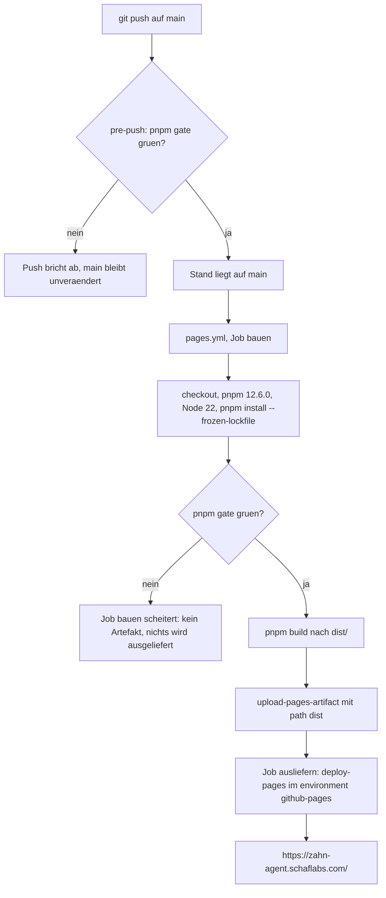

# Bauen, Basis-Pfad und Veröffentlichen

`pnpm build` macht aus zwei `.astro`-Seiten eine statische Seite; ein Push auf `main` prüft,
baut und liefert sie auf GitHub Pages aus. Diese Seite beschreibt diesen Weg: was der Bau
erzeugt, warum jeder interne Verweis über `import.meta.env.BASE_URL` läuft (und was
`ASTRO_BASE` daran ändert), in welcher Reihenfolge der Workflow prüft und ausliefert, was lokal
schon vor dem Push aufhält, welche Umgebungen es nur im Bau gibt und welche Umgebungsfallen dabei
schon zugeschlagen haben. Wie geprüft wird und was das Gate im Einzelnen umfasst, steht auf
[Prüfen und Gate](../testing/pruefen-und-gate.md); wie die Seite im Ganzen gebaut ist, auf
[Architektur-Überblick](../architecture/ueberblick.md).

## Der Bau: zwei Seiten, kein Server

| Befehl | Was er tut | Ergebnis |
|---|---|---|
| `pnpm dev` | Entwicklungsserver mit Sofort-Aktualisierung | <http://localhost:4321> (nicht `127.0.0.1`) |
| `pnpm build` | `astro build`, statisch nach `dist/` | `dist/index.html`, `dist/statistik/index.html` |
| `pnpm preview` | liefert `dist/` lokal aus | <http://localhost:4321>; die Sonden erwarten `--port 4322` |

`astro.config.mjs` setzt `output: 'static'`, die öffentliche Adresse als `site` und schaltet die
Entwicklungs-Werkzeugleiste ab (`devToolbar: { enabled: false }`). Der Bau erzeugt die zwei Seiten
und kopiert `public/` unverändert mit nach `dist/`:

```
dist/
  index.html                  # Route "/"
  statistik/index.html        # Route "/statistik"
  _astro/…                    # gehashte Bausteine: CSS, Seitenskripte
  CNAME, favicon.svg, logo.svg, icon-maskable.svg
  icon-192.png, icon-512.png, icon-maskable-512.png, apple-touch-icon.png
  manifest.webmanifest, sw.js
  sounds/voices/*.mp3
```

Nachgemessen ist der Bau billig: `pnpm build` meldet **2 Seiten** und braucht **1,7–2,9 s**; die
Messung vom 14.10.2026 ergab 1,69 · 1,74 · 1,74 · 1,78 · 1,90 s im Arbeitsbaum, kalt (ohne
`node_modules`) 2,84 s (`docs/testing.md`, Stand-Zeile). Das ist eine Maschinenstreuung, keine
Zusage: eine andere Maschine, eine andere Node-Fassung und ein voller Zwischenspeicher liegen
anders. Die Seitenzahl dagegen ist eine Eigenschaft des Baums: **jede Datei in `src/pages/` wird zu
einer Seite.**

`dist/` steht in `.gitignore`: veröffentlicht wird nur, was der Workflow selbst baut, nie ein
eingecheckter Bau. Weil keine Funktion auf einem Server liegt, genügt für alles außer der Sicherung
(`api/…`, siehe [Sicherungs-Worker](../integrations/sicherung-worker.md)) sogar
`python3 -m http.server` in `dist/`.

Weil `src/pages/` Seiten erzeugt, liegen Tests und Gehilfen der Seiten daneben und nicht darin: eine
`.test.ts` **in** `src/pages/` wird zum Seitenmodul, importiert `vitest` und lässt `pnpm build`
scheitern, während `pnpm test` grün bleibt (`docs/fallen.md`; `src/bedienleiste.test.ts` sagt das in
seinem Kopfkommentar). Eine neue Seite ist also nicht nur eine neue Datei, sondern auch ein neuer
Pfad, der im Vorrat des Service Workers auftauchen muss — `public/sw.js` führt die Seiten relativ zum
Geltungsbereich in `PAGES = ['', 'statistik']`.

## Der Basis-Pfad: eine Regel und ein Notausgang

Die Seite liegt lokal **und** veröffentlicht unter `/` — lokal `http://localhost:4321`,
veröffentlicht unter <https://zahn-agent.schaflabs.com/>. Trotzdem gilt für **jeden** internen
Verweis (Link, Icon, Manifest, Laufzeit-Abruf, Service-Worker-Anmeldung) eine harte Regel:

> Adressen entstehen immer aus `import.meta.env.BASE_URL`, nie absolut mit `"/"`.

Der Grund ist nicht die heutige Adresse, sondern die nächste: fällt die eigene Domain je weg,
läuft die Seite wieder als Projektseite unter einem Unterpfad. Ein fest eingetragenes `/statistik`
zeigt dann ins Leere, `${BASE_URL}statistik` nicht.

So sieht das im Baum aus:

| Stelle | Verwendung |
|---|---|
| `src/layouts/Base.astro` | Favicon, `icon-192.png`, `apple-touch-icon.png`, `manifest.webmanifest`; Anmeldung des Service Workers mit `${base}sw.js` und `scope: base` — und nur im Bau (`import.meta.env.PROD`) |
| `src/pages/index.astro` | `const base = import.meta.env.BASE_URL`; Kopfzeilen-Symbol `${BASE_URL}logo.svg`; Verweis auf die Statistik `${base}statistik`; `voiceBaseUrl: import.meta.env.BASE_URL` an die Ton-Engine; `backupUrl(import.meta.env.BASE_URL, code)` |
| `src/pages/statistik.astro` | Kopfzeilen-Symbol und Rückweg `href={import.meta.env.BASE_URL}`; `backupUrl(…)` für die Sicherung |
| `src/infrastructure/storage/httpRemoteLog.ts` | `backupUrl(baseUrl, code)` → `${baseUrl}api/log/${code}` |
| `public/sw.js` | Geltungsbereich (`self.registration.scope`), Seiten und Vorratsnamen relativ dazu, siehe [Offline und Service Worker](../integrations/offline-service-worker.md) |

### `ASTRO_BASE` und die Normalisierung

`ASTRO_BASE` ist der **Notausgang** für einen Unterpfad. `astro.config.mjs` prüft und normalisiert
den Wert, bevor Astro ihn übernimmt:

- fehlt die Variable, bleibt `base` unbestimmt und Astro liefert `BASE_URL = "/"` (genau so baut der
  Workflow);
- ein Wert ohne führenden `/` bricht den Bau mit `ASTRO_BASE muss mit "/" beginnen, war: …` ab;
- Schluss-Schrägstriche werden entfernt und **genau einer** angehängt.

Der letzte Punkt ist kein Schönheitsfehler: Astro gibt `BASE_URL` genau so zurück, wie `base`
konfiguriert ist. Ohne den erzwungenen Schluss-Schrägstrich ergäbe `${BASE_URL}statistik` die
Adresse `/zahn_agentstatistik`.

| Eingabe | `base` | `BASE_URL` | `${BASE_URL}statistik` |
|---|---|---|---|
| `ASTRO_BASE` nicht gesetzt | unbestimmt (Astro-Vorgabe `/`) | `/` | `/statistik` |
| `ASTRO_BASE=/zahn_agent` | `/zahn_agent/` | `/zahn_agent/` | `/zahn_agent/statistik` |
| `ASTRO_BASE=/zahn_agent/` | `/zahn_agent/` | `/zahn_agent/` | `/zahn_agent/statistik` |
| `ASTRO_BASE=/` | `/` | `/` | `/statistik` |
| `ASTRO_BASE=zahn_agent` | — Bau bricht ab | — | — |

**Nachgemessen**, nicht nur abgeleitet: `ASTRO_BASE=/zahn_agent pnpm build` schreibt
`voiceBaseUrl:"/zahn_agent/"` ins gebaute Skript, der Normalbau `voiceBaseUrl:"/"`; im
`dist/index.html` stehen dann `/zahn_agent/statistik` bzw. `/statistik`.

### Nach Verweisänderungen: im Bau nachsehen

Ein grüner Linter sagt nichts über Adressen. Deshalb gehört zu jeder Änderung an Verweisen ein
Bau und ein Blick in die Ausgabe:

```bash
pnpm build
grep -c 'Zahn Agent' dist/index.html      # die Seite ist wirklich da
grep -o 'croc-mount' dist/index.html      # die Bühne ist montiert
ls dist                                    # index.html, statistik/index.html, _astro/, Symbole, Manifest
```

Im `dist/index.html` erwartet sind `/statistik`, `/_astro/…`, `/favicon.svg`, `/logo.svg` und
`/manifest.webmanifest`; dieselbe Dateiliste hält die Bau- und Auslieferungssonde fest
(`docs/testing.md`: `ls dist` gegen `index.html`, `statistik/index.html`, `favicon.svg`, `logo.svg`,
`manifest.webmanifest`, `apple-touch-icon.png`, `icon-192.png`, `icon-512.png`,
`icon-maskable-512.png`, `_astro/`). Die Route `/statistik` liegt als **Verzeichnis** vor
(`dist/statistik/index.html`), deshalb gibt es kein `statistik.html`.

### Falle unter Windows

Git Bash schreibt einen Wert, der mit `/` beginnt, in einen Windows-Pfad um — `ASTRO_BASE=/zahn_agent
pnpm build` bricht dort ab. Abhilfe:

```bash
MSYS_NO_PATHCONV=1 MSYS2_ENV_CONV_EXCL=ASTRO_BASE ASTRO_BASE=/zahn_agent pnpm build
```

## Veröffentlichen: der Ablauf



Der Weg eines Commits bis zur veröffentlichten Seite — lokal und im Workflow hängt dieselbe
Bedingung davor.

`.github/workflows/pages.yml` läuft bei jedem Push auf `main` und zusätzlich per
`workflow_dispatch` (Actions → „Seite veroeffentlichen" → Run workflow). Zwei Jobs, einer davon
abhängig:

1. **`bauen`** — `actions/checkout`, `pnpm/action-setup` mit festgenagelter Version `12.6.0`
   (`run_install: false`), `actions/setup-node` mit `node-version: 22` und `cache: pnpm`, dann
   `pnpm install --frozen-lockfile`, `pnpm gate`, `pnpm build` und
   `actions/upload-pages-artifact` mit `path: dist`.
2. **`ausliefern`** — `needs: bauen`, `environment: github-pages` samt `page_url` und
   `actions/deploy-pages`.

**Ein rotes Gate liefert nicht aus.** Das ist keine Konvention, sondern die Job-Abhängigkeit:
`ausliefern` startet nur, wenn `bauen` durchgelaufen ist — und `bauen` bricht vor dem Bau ab, wenn
`pnpm gate` fällt. Was ein rotes Gate also zurückhält, ist das **Artefakt**: es wird nichts
hochgeladen, `ausliefern` läuft gar nicht erst an, und die zuletzt veröffentlichte Seite bleibt
stehen, auch wenn der Push auf `main` schon durch ist. Lokal grün muss also vor dem Push stehen,
nicht erst im Workflow.

Rahmenbedingungen, die man selten anfasst: `permissions` gibt `contents: read`, `pages: write` und
`id-token: write` (die Auslieferung läuft über OIDC, nicht über ein Token im Klartext), und
`concurrency: { group: pages, cancel-in-progress: true }` sorgt dafür, dass ein neuer Push einen
noch laufenden Lauf abbricht, statt zwei Stände um dieselbe Domain konkurrieren zu lassen.

### Was der Push nicht ausliefert

- **Den Worker nicht.** `pages.yml` veröffentlicht ausschließlich die Seite. Wer
  `worker/backup.js` ändert, lädt die Datei danach bei Cloudflare neu hoch und prüft die echte
  Adresse (unbekannter Code → `404`, bekannter Code → Liste).
- **Die Sonden nicht.** Sie brauchen einen Browser, eine laufende Vorschau und mehrere Minuten,
  einige messen Zeit — ein Fehlalarm hielte eine heile Seite zurück. Sie laufen von Hand vor dem
  Push, nach jeder Änderung an Stil, Bedienung, `public/sw.js` oder einer Zeichnung.
- **Die Doku-Prüfung nicht.** `doku-pruefen.sh` und `doku-pfade-pruefen.py` sind Handläufe; kein
  Skript im Workflow sieht Doku an.
- **Nichts aus dem Baum als fertigen Bau.** `dist/` ist nicht im Repo; ausgeliefert wird das
  Artefakt des Laufs.
- **Keinen zweiten Workflow.** In `.github/workflows/` liegt allein `pages.yml`. Den Workflow
  `openwiki-update.yml`, den OpenWiki selbst anlegt (täglicher PR-Bot für das Projektgedächtnis),
  haben wir bewusst nicht übernommen; `openwiki/` wird von Hand mit `openwiki --update -l de`
  aufgefrischt (`AGENTS.md`, Abschnitt „Projektgedächtnis").

## Lokal davor: der pre-push-Hook

`.githooks/pre-push` fährt vor jedem Push dasselbe `pnpm gate` wie der Workflow und bricht bei Rot
ab; die Meldungen nennen auch den Weg zurück (Fund im Code beheben, neu fahren, committen, erneut
pushen). Eingehängt wird der Ordner über `git config core.hooksPath .githooks` — das erledigt das
`prepare`-Skript bei `pnpm install`, in einem frischen Klon also von selbst. Der Hook ersetzt das
Gate nicht: `git push --no-verify` umgeht ihn und ist nur mit ausdrücklichem Ja des Auftraggebers
zulässig.

## Domain, CNAME und DNS

Die Seite gehört dem Repo über `public/CNAME` — eine Zeile, `zahn-agent.schaflabs.com`. Diese Datei
liegt in `public/` und wandert beim Bau mit nach `dist/`; sie ist der Grund, warum GitHub Pages die
Domain dem Repo zuordnet. Der DNS-Eintrag liegt bei Cloudflare in der Zone `schaflabs.com` als
CNAME auf `shaunclaw07.github.io` (proxied). Weil die Domain auf der Wurzel liegt, baut der
Workflow **ohne** `ASTRO_BASE` — Basis-Pfad `/`. Die alte Projektadresse
`https://shaunclaw07.github.io/zahn_agent/` leitet mit `301` auf die Domain um (am 11.10.2026 mit
und ohne Schluss-Schrägstrich geprüft).

Daraus folgt die eine Falle dieses Themas: Wer die Domain in der Pages-Konfiguration einträgt,
aber `public/CNAME` vergisst, bekommt einen Bau ohne Domainzuordnung; wer den Workflow mit
`ASTRO_BASE` baut, obwohl die Domain auf der Wurzel liegt, veröffentlicht `/zahn_agent/statistik`
unter einer Domain, die `/statistik` erwartet.

Über DNS, Proxy und Pages-Einstellungen hinaus steht hier nichts: was in der Zone liegt, gehört
nicht in den Baum, und der einzige Beleg im Repo ist die eine Zeile in `public/CNAME`.

## Umgebung: Node, pnpm und keine Fremdquellen

| Größe | Festlegung | Wo |
|---|---|---|
| Node | `^22.22.2`, `^24.15.0` oder `>=26.0.0` — die Schnittmenge, die Astro 7, vitest 5 und TypeScript 7 verlangen | `engines.node` in `package.json` |
| pnpm | `>=9.0.0`; der Workflow nagelt `12.6.0` fest | `engines.pnpm`, `pages.yml` |
| Installation im Workflow | `pnpm install --frozen-lockfile` — die Sperrdatei gilt, nichts wird nachgezogen | `pages.yml` |
| Bau | `astro build` mit Rolldown (Astro 7) | `pnpm build` |

Ein „Unsupported engine"-Fehler beim Start heißt: Node ist zu alt. Die Fassung im Workflow (22) ist
nicht die einzige zulässige, aber die, die ausgeliefert wird; lokal ist Node 26 im Einsatz
(`docs/workflow.md`), und `engines.node` nennt die Schnittmenge, die die drei Bauwerkzeuge
verlangen.

**Die pnpm-Version steht im Workflow, nicht als `packageManager` in `package.json`**: pnpm 12 hängt
sonst ein zweites Dokument an `pnpm-lock.yaml` (`lockfileVersion` doppelt). Die Reihenfolge der
Schritte ist ebenfalls nicht beliebig — `pnpm/action-setup` läuft vor `setup-node`, weil der
Schritt `cache: pnpm` pnpm schon vorfinden muss, um Speicherort und Schlüssel zu bestimmen.

**`allowBuilds` statt `pnpm`-Feld:** pnpm blockiert Installationsskripte von Abhängigkeiten und
liest die Erlaubnis seit Version 12 nicht mehr aus dem `pnpm`-Feld in `package.json`. Die
Zuordnung steht deshalb in `pnpm-workspace.yaml`:

```yaml
allowBuilds:
  esbuild: true
  sharp: true
```

Eine neue native Abhängigkeit gehört dort eingetragen, sonst bricht `pnpm install` mit
`ERR_PNPM_IGNORED_BUILDS` ab. Die Form nicht raten: `pnpm approve-builds --all` schreibt sie selbst.

**Keine externen Schriften, Bilder oder CDNs.** Die Zeichnung ist SVG-Markup, die Spielklänge sind
mit Web Audio synthetisiert; die einzige Ausnahme sind die Tierstimmen als kurze MP3 im eigenen
Baum (`public/sounds/voices/`, Herkunft und Lizenz in `QUELLEN.md`). Eine Seite, die auf einen
fremden Ursprung zeigt, wäre im Betrieb ein zweiter Ausfallpunkt — und im Start ohne Netz ein
Loch im Vorrat des Service Workers.

## Lint läuft im Gate, nicht im Bau

`pnpm lint` ist `biome lint --error-on-warnings .` und damit der zweite Schritt des Gates, das der
Workflow **vor** `pnpm build` fährt. Der Schalter ist Absicht: Regeln des Regelsatzes `recommended`
(etwa `noUnusedVariables`) sind Warnungen, und ohne ihn endete ein Lauf mit Funden trotzdem mit
Exit 0. Der Bereich ist bewusst schmal (`files.includes` in `biome.jsonc`): `src/**`,
`public/sw.js`, `worker/**`; kein Formatierer und keine Assists, weil beide beim ersten Lauf fast
jede Datei umschrieben und `git blame` unlesbar machten.

Für den Weg auf die veröffentlichte Seite zählt nur eins: ein Fund wird **im Code** behoben und
`pnpm gate` neu gefahren; eine Regel abzuschalten, ein `// biome-ignore` zu setzen oder
`--no-verify` zu benutzen, braucht das Ja des Auftraggebers. `biome lint --write` hilft nicht
überall — ungenutzte Importe und Variablen gelten Biome als unsichere Korrektur und bleiben stehen.
Welche Regeln abgeschaltet sind und warum, steht auf
[Prüfen und Gate](../testing/pruefen-und-gate.md).

## Umgebungen, die es nur im Bau gibt

Der Entwicklungsserver und der gebaute Stand sind nicht dasselbe. Zwei Dinge existieren
ausschließlich im Bau:

- **Der Service Worker.** `src/layouts/Base.astro` meldet ihn nur unter `import.meta.env.PROD` an
  (und über den Basis-Pfad). In `pnpm dev` gibt es ihn also nicht — und damit auch kein
  Offline-Verhalten zu sehen. Wer daran arbeitet, fährt `pnpm build` und dann `pnpm preview`.
- **Das ausgelieferte Bündel.** Was im `_astro/`-Ordner liegt und wie viele Bausteine eine Seite
  einbindet, entsteht erst beim Bau; `pruefen-tiere.py` zählt den Katalog im ausgelieferten Bündel
  und ist gegen `pnpm dev` deshalb leer.

Die Vorschau ist der Ort, an dem beides zusammenkommt: `pnpm preview` liefert `dist/` aus (Vorgabe
Port 4321), die Sonden erwarten aber `http://localhost:4322`, also
`pnpm build && pnpm preview --port 4322`. `pnpm probes` ist
`python scripts/pruefen-alle.py http://localhost:4322` und fährt alle 13 Sonden nacheinander; sie
brauchen den laufenden Server, dauern mehrere Minuten und messen teils Zeit — deshalb laufen sie
von Hand und nicht im Workflow. Welche Sonde was prüft, steht auf
[Prüfen und Gate](../testing/pruefen-und-gate.md); was der Vorrat im Browser behält, auf
[Offline und Service Worker](../integrations/offline-service-worker.md).

## Was diesen Weg prüft — und was nicht

Zwei Unit-Tests halten die Basis-Pfad-Regel an den Seiten fest, ohne zu bauen: `src/icon.test.ts`
verlangt im Kopfbereich beider Seiten ein `` mit `import.meta.env.BASE_URL` und `logo.svg`,
und `src/bedienleiste.test.ts` verlangt `voiceBaseUrl: import.meta.env.BASE_URL` sowie das Fehlen
fester Pfade wie `'/sounds/'`. Die Anmeldung des Service Workers nur im Bau und über den Basis-Pfad
prüft `src/offline.test.ts`.

Die **Ausgabe** des Baus prüft kein Test: `vitest.config.ts` sammelt nur `src/**/*.test.ts`, und
weder `pnpm gate` (typecheck, lint, test:run) noch der pre-push-Hook fahren `astro build`. Ein
falscher Verweis im gebauten `dist/index.html` fällt daher nur beim manuellen Nachsehen (siehe
oben) oder in einer Browser-Sonde auf. Wer an Verweisen, `astro.config.mjs` oder `public/CNAME`
arbeitet, sollte den Bau deshalb selbst fahren und in `dist/` nachsehen.

## Weiterlesen

- [Prüfen und Gate](../testing/pruefen-und-gate.md) — was `pnpm gate` umfasst, welche Sonden es gibt
- [Architektur-Überblick](../architecture/ueberblick.md) — zwei Seiten, statischer Bau, wo der Basis-Pfad im Ganzen sitzt
- [Sprache und Konventionen](../concepts/sprache-und-konventionen.md) — Coderegeln, Doku-Regeln, warum das Gate im Code geheilt wird
- [Offline und Service Worker](../integrations/offline-service-worker.md) — der Vorrat, der aus `dist/` entsteht
- [Sicherungs-Worker](../integrations/sicherung-worker.md) — was der Push **nicht** ausliefert
- [Quickstart](../quickstart.md) — die Befehle in der Übersicht
