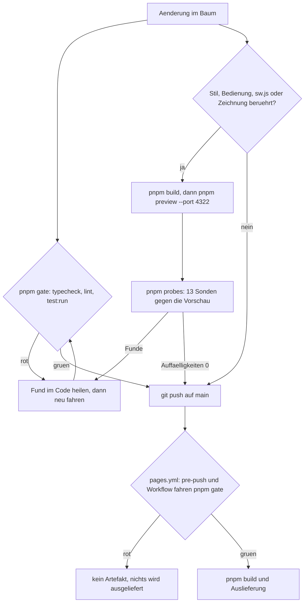

# Prüfen: Gate, Tests und Browser-Sonden

Eine Änderung ist belegt, wenn das **Gate** grün ist und — bei Stil, Bedienung, `public/sw.js`
oder einer Zeichnung — die **Browser-Sonden** gelaufen sind. Das sind zwei getrennte Wege: das Gate
läuft automatisch vor jedem Push und im Workflow, die Sonden laufen von Hand gegen eine laufende
Vorschau. Diese Seite beschreibt beide, die Testumgebungen, die tragenden Tests und die Regeln, die
verhindern, dass ein Prüflauf zufällig grün wird. Wie der Bau aussieht und was der Workflow
ausliefert, steht auf [Bauen und Veröffentlichen](../operations/bauen-und-veroeffentlichen.md); die
Regeln hinter den Architekturtests auf
[Schichten, Ports und die Importregel](../architecture/schichten-und-importregel.md).

## Das Gate: drei Läufe, eine Bedingung

```bash
pnpm gate          # pnpm typecheck && pnpm lint && pnpm test:run
```

Die drei Schritte hängen mit `&&` aneinander: `tsc --noEmit`, dann `biome lint
--error-on-warnings .`, dann `vitest run`. **Alle drei müssen grün sein — ein Testlauf allein ist
kein Nachweis.** Und weil die Kette abbricht, sagt ein rotes Gate nicht, dass die Tests grün sind;
erst `pnpm typecheck` zu reparieren und neu zu fahren zeigt, was der Linter und die Tests sagen.

Zwei Stellen vollstrecken dasselbe Gate:

| Stelle | Wann | Wirkung |
|---|---|---|
| `.githooks/pre-push` | vor jedem Push, eingehängt über `git config core.hooksPath .githooks` (das `prepare`-Skript bei `pnpm install`) | bricht den Push ab, `main` bleibt unverändert |
| `.github/workflows/pages.yml`, Job `bauen` | Push auf `main` oder `workflow_dispatch` | ohne grünes Gate entsteht kein Artefakt, der Job `ausliefern` (`needs: bauen`) startet nicht |

Am Gate führt kein Weg vorbei: `--no-verify`, ein abgeschalteter Regelblock oder ein
`// biome-ignore` sind Eingriffe am Prüfapparat selbst und brauchen das Ja des Auftraggebers.

### Was der Linter prüft — und was er bewusst nicht prüft

Biome liest genau `src/**`, `public/sw.js` und `worker/**` (`biome.jsonc`, `files.includes`).
Formatierer und Assists sind **aus**: sie schrieben beim ersten Lauf fast jede Datei um und machten
`git blame` unlesbar. Der Regelsatz ist `recommended`, und was das Projekt bewusst anders macht,
steht **abgeschaltet mit Begründung an der Regel**:

| Regel | Warum aus |
|---|---|
| `correctness/noPrecisionLoss` | Die Lanczos-Koeffizienten sind eine veröffentlichte Tabelle; Kürzen verwischte nur die Herkunft |
| `suspicious/noDuplicateProperties` | Bewusste Rückfallwerte (`82vh` vor `88dvh`) |
| `complexity/noImportantStyles` | `.hidden` muss jede andere Regel schlagen; reduzierte Bewegung braucht `!important` |
| `style/noDescendingSpecificity` | Die gewachsene CSS-Reihenfolge ist die Kaskade, nicht ein Versehen |

Zwei Overrides entschärfen Regeln für Dateitypen, die Biome nicht ganz liest: bei `**/*.astro` sind
die „unbenutzt"-Regeln aus (Biome sieht dort nur das Frontmatter, alles darunter gilt ihm als
unbenutzt), bei `**/*.test.ts` ist `style/noNonNullAssertion` aus.

### Der Rotfall: Funde werden im Code geheilt

Jede Meldung nennt Datei, Zeile, Spalte und die Regel, und `--error-on-warnings` macht auch die
Warnungen (`!`) zu einem roten Gate. Der Fund wird **im Code behoben**, dann `pnpm gate` neu
gefahren. Drei Regeln dazu:

- **`FIXABLE` heißt nicht, dass `biome lint --write` es tut.** Ungenutzte Importe und Variablen
  stuft Biome als unsichere Korrektur ein und lässt sie stehen — sie werden von Hand entfernt.
- **Eine ungenutzte Variable ist oft ein Hinweis auf einen echten Fehler** (ein Wert, der berechnet
  und dann vergessen wird): erst verstehen, dann löschen.
- **Nicht ohne das Ja des Auftraggebers:** die Regel in `biome.jsonc` abschalten, `// biome-ignore`,
  `--no-verify`. Passt eine Regel wirklich nicht zum Projekt, wird gefragt — und dann zweimal
  begründet: ein Satz an der Regel und derselbe Grund in `docs/testing.md`.

## Zwei Testumgebungen: `node` ist die Vorgabe, `jsdom` die Ausnahme

`vitest.config.ts` ist drei Zeilen lang und trifft eine Entscheidung: `environment: 'node'` und
`include: ['src/**/*.test.ts']`. Die Vorgabe ist damit die Umgebung **ohne** DOM — passend zu der
Architekturregel, dass Kern und Use Cases ohne Browser und ohne Uhr auskommen müssen. Ein
node-Test darf dafür die Dateien des Baums lesen (`node:fs`, `node:path`): genau so prüfen
`architecture.test.ts`, `offline.test.ts` und `icon.test.ts` den ausgelieferten Quelltext statt
einer Nachbildung davon.

Wer ein DOM braucht, schaltet es **pro Datei** ein — mit einem Kopfkommentar in Zeile 1:

```ts
// @vitest-environment jsdom
import { afterEach, beforeEach, describe, expect, it, vi } from 'vitest';
```

Der Kommentar muss **vor** den Importen stehen, deshalb beginnt jede Bedienungssonde damit
(`gameController.test.ts`, `gamePage.test.ts`, `sheets.test.ts`, `hudView.test.ts`,
`settingsSheet.test.ts`, `unlocks.test.ts`, `quickControls.test.ts`, `albumBadges.test.ts`,
`holdGesture.test.ts`, `statsView.test.ts`, `statsPage.test.ts`, `sessionStorageMarks.test.ts`).
Umgekehrt deklarieren `backupWorker.test.ts` und `offline.test.ts` ihr `node` ausdrücklich, obwohl
es die Vorgabe ist: die erste Zeile sagt dann, was der Test braucht, statt es den Leser raten zu
lassen. Die Wahl der Umgebung ist damit eine Zeile, die man sieht — ein Test, der `document`
anfasst und den Kommentar vergisst, scheitert an `document is not defined`, statt still etwas
anderes zu messen.

## Die vier Testarten

| Art | Umgebung | Beispiel | Was sie kann — und wo ihre Grenze liegt |
|---|---|---|---|
| Reine Kern-Tests | `node`, kein DOM | `src/core/domain/liveTeeth.test.ts` | Regeln, Verteilungen, Grenzfälle; der Zufall kommt als Port herein (`ScriptedRandom`, `SeededRandom`), die Statistik zieht Tausende Runden mit festem Startwert |
| jsdom-Bedienungstests mit Kopfkommentar | `jsdom` | `src/presentation/game/gameController.test.ts` | echte Elemente drücken, Klassen, ARIA, Texte, Protokolleinträge prüfen; **rechnet kein CSS**, deshalb keine Farben, keine Maße aus dem Layout |
| node-Sonden für Worker, Service Worker, Symbole | `node` | `src/backupWorker.test.ts`, `src/offline.test.ts`, `src/icon.test.ts` | laden die **ausgelieferte Datei** (`worker/backup.js`, `public/sw.js`, `public/favicon.svg`) in eine nachgestellte Umgebung und prüfen sie dort Zeile für Zeile |
| Render-Probe | `node` | `src/render-probe.test.ts` | erzeugt Artefakte zum Ansehen (SVG je Lebewesen und Zahnzahl); sie prüft **nicht** die Optik — das tun Auge und Sonde |

Dazu kommt der Zeichnungsvertrag `src/presentation/game/creatures/creatureViews.test.ts`: er ist
ein reiner Kern-Test, hält aber fest, was gezeichnet wird (Zahnzahl, Ebenenreihenfolge, gültiges
Markup, Trefferflächen) — siehe [Zeichnungssystem](../architecture/zeichnungssystem.md). Und
`src/katalog-json.test.ts` ist die Brücke zu den Python-Sonden (siehe unten).

## Die tragenden Tests

### `architecture.test.ts` — der Wächter, der nie rot sein darf

Drei Tests, die den Ordner zur Regel machen: jede Mappe unter `src/` steht in `FOLDER_LAYER`
(ein neuer Ordner ohne Eintrag fällt durch), jeder Import hält die Richtung aus `ALLOWED` ein, und
`core/domain` wie `core/use-cases` enthalten weder `document`, `window`, `localStorage`,
`navigator`, `performance.now` noch `new Date(`. `node:*` ist nur in `infrastructure` erlaubt;
Testdateien sind von der Prüfung ausgenommen (`SOURCE_FILES` filtert `*.test.ts` heraus). Der Test
ist keine Stilfrage, sondern der Grund, weshalb die Fachregeln überhaupt ohne Browser prüfbar
bleiben.

### `offline.test.ts` — der Service Worker als Datei

Die Sonde liest `public/sw.js` ein und führt sie mit `new Function('self', 'caches', 'fetch', …)`
in einer nachgestellten Worker-Umgebung aus — Installation, Aktivierung und `fetch`-Ereignisse
werden von Hand gefeuert. Der `FakeCache` ist **absichtlich streng**: ohne `ignoreVary` findet er
nichts, weil der echte Browser das Seitenskript sonst wegen `Vary: Origin` verfehlt (gemessen am
12.10.2026). Geprüft wird unter anderem: die Installation legt beide Seiten samt der Bausteine vor,
die nur ein anderer Baustein einbindet; ohne Netz kommen Seiten und Bausteine aus dem Vorrat; mit
Netz gewinnt der neue Stand und alte Bausteine werden weggeräumt; fremde Ursprünge, Schreibzugriffe
und Teilabrufe bleiben dem Browser überlassen; und `api/…` geht **immer** ans Netz, weil ein Stand
aus dem Vorrat ein alter wäre. Details zum Verhalten auf
[Offline und Service Worker](../integrations/offline-service-worker.md).

### `backupWorker.test.ts` — der Worker gegen eine nachgestellte Datenbank

Geladen wird `worker/backup.js` — dieselbe Datei, die bei Cloudflare läuft —, zusammen mit einem
`DB`-Attrappenobjekt, das genau die zwei Anweisungen kennt, die der Worker benutzt. Der Kopfkommentar
sagt die Grenze: ob der ausgelieferte Worker antwortet, zeigt nur ein Abruf der echten Adresse.
Geprüft wird das Verhalten an den Rändern: unter `s/<code>` kommt die Spielseite, unter etwas, das
kein Code ist, nichts; ein **unbekannter** Code legt weder beim Lesen noch beim Schreiben etwas an;
nur JSON-Listen werden angenommen; zu große Sendungen ergeben 413, fremde Methoden 405; Antworten
tragen `cache-control: no-store`.

### `icon.test.ts` — das Symbol als Golden File

Das App-Symbol wird hier **erzeugt**, nicht verglichen mit einem von Hand gemalten Bild: die Sonde
nimmt das Kopfbild des Krokodils (`creaturePortrait`), setzt die Regeln des Zustands „geschnappt"
nach (Oberkiefer und Schnauze fahren um ihre Schließwege, Rachen, obere Zahnreihe, Oberkiefer und
Schnauzenfläche verschwinden) und legt den Kopf auf eine dunkle Kachel — einmal gerundet für Tab und
Startbildschirm, einmal randlos und kleiner für Android. Mit `ICON_NEU=1` schreibt sie
`public/favicon.svg`, `public/icon-maskable.svg` und `public/logo.svg`; ohne den Schalter hält sie
die ausgelieferten Dateien Zeichen für Zeichen gegen die neu gerechnete Fassung. Dazu prüft sie den
Kopfbereich beider Seiten (kein zweites, von Hand gezeichnetes Krokodil), den Manifest-Eintrag und
die Kantenlängen der PNGs (180/192/512) — gelesen aus dem IHDR-Block, damit eine leere Datei nicht
durchkommt.

### `render-probe.test.ts` — die Zeichnung sichtbar machen

Die Probe schreibt je Lebewesen ein eigenständiges SVG nach `$TMPDIR/zahn_agent-artwork/` und unter
`zahnzahlen/` eines je Zahnzahl (1–12), damit die Zeichnung ohne Browser begutachtet und von
`scripts/pruefen-zahnsicht.py` vermessen werden kann. Sie prüft dabei schlank (Markup beginnt mit
`<svg`, der Schließweg steht als `--close-shift` darin, Katalog und Zeichnungen decken sich) und
sagt selbst, dass sie die Vertragsprüfung nicht ersetzt. Sie läuft deshalb in `pruefen-alle.py`
**vor** allen Sonden.

### `creatureViews.test.ts` — der Zeichnungsvertrag und die Trefferfläche

Jedes Katalog-Lebewesen braucht eine Zeichnung mit genau seiner Zahnzahl, die Ebenen in fester
Reihenfolge, gültiges Markup und einen Anker in der Bühne; für jede erlaubte Zahnzahl bleibt die
Trefferfläche bei 285 px Bühnenbreite ≥ 44 px. Dazu die Regel, die man nur als Geometrie prüfen
kann: **kein Zahn unter dem Gesicht** — jede Ellipse und jeder Kreis der Gesichtsebene liegt samt
halber Strichstärke und 2 Einheiten Abstand außerhalb der Ringellipse.

## Der Sondenapparat in `scripts/`

Die Browser-Sonden sind kein Testframework, sondern ein kleiner, gemeinsamer Unterbau in Python —
und der ist die eigentliche Schnittstelle:

| Baustein | Rolle |
|---|---|
| `scripts/sonde.py` | `Sonde.pruefe(gut, text)` druckt `  ok  …` oder `  FUND  …` und sammelt die Funde; `Sonde.abschluss()` druckt `Auffälligkeiten: N` und liefert den Exit-Code (1 bei jedem Fund). `seite(...)` baut Kontext und Seite: Blickgröße, `has_touch`, `reduced_motion`, dann Einstellungen und Rundenprotokoll in `localStorage`, `reload`, warten auf `.tooth`. `basis_adresse()` nimmt eine Adresse als Aufrufargument, sonst `http://localhost:4322` |
| `scripts/freischaltung.py` | `ALLE_OFFEN` — ein Rundenprotokoll, das **jedes** Tier freischaltet. Ohne das Protokoll sind auf einer frischen Seite nur Krokodil, Maus und Wolf wählbar; eine Sonde, die den Hai prüfen will, bekäme ohne Fehlermeldung das Krokodil. Eine Zusicherung im Modul stellt sicher, dass der Katalog für die letzte Schwelle reicht |
| `scripts/katalog.py` + `scripts/katalog.json` | die **einzige** Quelle für Tierdaten in den Python-Sonden. Die JSON-Datei entsteht in `src/katalog-json.test.ts` aus Katalog und Freischaltungsfolge (`KATALOG_NEU=1 pnpm test:run`); der Test vergleicht sie sonst Zeichen für Zeichen. Damit gibt es keine zweite Tierliste, die driftet |
| `scripts/pruefen-alle.py` | der Lauf über alle Sonden: erst `render-probe.test.ts` (die Zahnsicht-Sonde braucht die SVGs), dann die Liste `SONDEN` in fester Reihenfolge, je Skript eine Zeile mit Exit-Code und Dauer und der letzten Ausgabezeile, bei Fehlschlag zusätzlich STDERR; am Ende `Alle N Sonden erfolgreich.` oder Exit 1 mit den Namen der gescheiterten |

`SONDEN` führt **dreizehn** Skripte: Zahnsicht, Halten, Blick, Zoom, Offline, Sicherung,
Freischaltung, Tiere, Bedienung, Blätter, Blattbreite, Trefferfläche, Anzeige. Die Liste in
`docs/testing.md` ist länger, weil dort auch die Nachweise stehen, die kein Browser-Skript sind: ein
Vitest-Lauf in jsdom, ein Bau-Check an `dist/`, und zwei Vitest-Sonden mit Rasterer
(`artwork-png.py`, `icon-png.py`).

### Der Handlauf: bauen, Vorschau starten, Sonden fahren

```bash
pnpm build && pnpm preview --port 4322   # Vorschau im Hintergrund
pnpm probes                              # fährt alle 13 Sonden nacheinander
```

`pnpm probes` ist `python scripts/pruefen-alle.py http://localhost:4322`. **Die Vorschau muss
laufen**, und für die meisten Sonden muss es der **Bau** sein, nicht der Entwicklungsserver: der
Service Worker wird nur in `import.meta.env.PROD` angemeldet, und `pruefen-tiere.py` zählt die
Tierkennungen im ausgelieferten Bündel — gegen `pnpm dev` liefert Astro einzelne Module, die Zählung
meldet leer und die Sonde schlägt fehl, obwohl der Baum in Ordnung ist. Ausnahme:
`pruefen-trefferflaeche.py` misst nur das lebende DOM und hat `http://localhost:4321` als Vorgabe
(`pnpm dev --host`). Alle Skripte nehmen eine Adresse als Argument und lassen sich damit gegen die
veröffentlichte Seite fahren.

### Warum die Sonden nicht im Workflow laufen

Entschieden am 15.10.2026: in `.github/workflows/pages.yml` hält **nur `pnpm gate`** das Ausliefern
auf. Die Sonden brauchen einen Browser, eine laufende Vorschau und mehrere Minuten, und einige
messen Zeit — ein Fehlalarm im Workflow hielte eine heile Seite zurück. Sie laufen deshalb **vor dem
Push von Hand**, und zwar immer nach einer Änderung an Stil, Bedienung, `public/sw.js` oder einer
Zeichnung. Eine neue Sonde wird zuerst gegen die **veröffentlichte** Seite gefahren, bevor ein Befund
dem Baum zugeschrieben wird: am 14.10.2026 meldeten zwei Sonden je zwei Auffälligkeiten, die auf dem
neuen Bau und mit identischen Zahlen auf der Live-Seite standen — Altbestand, kein Regress.



Zwei Wege, ein Ziel: das Gate blockt automatisch vor Push und Auslieferung, die Sonden belegen den
laufenden Gegenstand von Hand.

## Determinismus: Sonden und Tests würfeln nicht

- **Eine Sonde stellt den Zustand her, den sie messen will — sie hofft nicht darauf.** Die
  Anzeige-Sonde drückte in ihrer Gegenprobe auf einen von zehn Zähnen und nahm an, er sei harmlos;
  1–3 davon sind aber scharf, also schnappte die Runde gelegentlich zu, und die Sonde meldete Funde,
  die keine waren. Sie zieht jetzt mit **frischer Seite** neu, bis die Runde offen bleibt (bis zu
  zehn Versuche, der Versuch steht im Titel), und meldet sonst ausdrücklich „kein verwertbarer
  Zustand". Wer einen zufälligen Zustand messen will, stellt ihn entweder deterministisch her (ein
  Zahn beim Vampir heißt: der erste Druck schnappt garantiert) oder zieht so lange neu, bis er
  steht.
- **Zufall kommt immer über einen Port herein.** In Tests sind das `ScriptedRandom` (feste Folge)
  und `SeededRandom`; statistische Prüfungen ziehen Tausende Runden mit festem Startwert, statt auf
  ein glückliches Ergebnis zu warten.
- **Den ungünstigsten Text setzt die Sonde ein, statt auf ihn zu warten.** `pruefen-bedienung.py`
  trägt den längsten möglichen Ergebnistext selbst ein, weil der Zufall ihn nicht liefert.
  Die Kehrseite: ein sichtbarer Text, der in einer Sonde abgeschrieben ist, wird beim Umtexten
  mitgezogen — wer einen Text ändert, sucht seine Fassung in `scripts/`.
- **Kein Freispruch ohne Messung.** Ein Test, der nicht laufen konnte, gilt nicht als bestanden
  (so steht es auch in der Statistik: „nicht prüfbar" statt „zu wenig Daten").

### Zeitgeber: abhängen statt hoffen

Zwei Regeln für alles, was mit Zeit zu tun hat:

1. **Jede Steuerung wird abgehängt.** `gameController.test.ts` sammelt jede gebaute Steuerung in
   `gebaut` und ruft in `afterEach` `dispose()`; `GameController` hängt seine Zeitgeber am Fenster
   des **Dokuments** (`this.doc.defaultView`) auf, nicht am globalen `window`.
2. **Eigene Uhr statt echter Millisekunden,** wenn ein Test eine Wartezeit der Steuerung selbst
   prüfen will: `vi.useFakeTimers()` plus `vi.advanceTimersByTime(...)`, oder eine hereingereichte
   `wait`-Attrappe, die die Wartezeiten mitschreibt.

Der Grund ist gemessen: ein später Zeitgeber feuerte in die schon abgebaute jsdom-Umgebung, starb
als unbehandelter `ReferenceError: window is not defined`, und das Gate endete mit Code 1, **ohne
dass ein Test fachlich rot war** (1 von 7 Läufen). Der Mechanismus ist in
`scripts/pruefen-zeitgeber.cjs` nachgestellt (`node scripts/pruefen-zeitgeber.cjs`: alte Fassung am
globalen Fenster stirbt, neue Fassung mit `dispose()` schweigt).

Dieselbe Falle hat eine zweite Gestalt: die Attrappe der Bedienung führt **kurze** Wartezeiten
(< 1000 ms) sofort aus, damit ein Test nicht auf den Drama-Takt wartet. Ein langer Hinweis (etwa die
4-Sekunden-Obergrenze des Haltens) würde dadurch im selben Moment gezeigt und wieder versteckt —
wer ihn prüfen will, reicht eine eigene Uhr herein.

## Zahlen nur aus Kommandos

**Jede Zahl in der Dokumentation stammt aus einem ausgeführten Kommando.** Schätzungen sind
verboten; Simulationen werden als Simulation gekennzeichnet (etwa die Demo-Daten des
Python-Werkzeugs). Die **Zahlendoku** sind `README.md` und `docs/testing.md`; dort stehen Testzahlen,
Bauzeiten und Grenzwerte, jeweils aus einem Lauf.

Geprüft wird das mit zwei Handläufen — **kein Skript im Gate und keins im Workflow**:

```bash
# Zahlendoku scharf: hier ist jeder alte Wert ein Fehler
ALT="<alte Werte, mit | getrennt>"
ALTE_WERTE="$ALT" ALTE_WERTE_STRIKT=1 bash scripts/doku-pruefen.sh README.md docs/testing.md
# Regeln, Rezepte und Aufzeichnungen meldend: dort stehen alte Werte absichtlich (als Lehre)
ALTE_WERTE="$ALT" bash scripts/doku-pruefen.sh AGENTS.md docs/workflow.md docs/e2e-nachweise.md
```

`scripts/doku-pruefen.sh` prüft in einem Lauf die Zaun-Parität (ein ungerader Code-Zaun heißt: ein
Zaun ist offen), Fließtext **innerhalb** eines Codeblocks (sprachbewusst: `#`-Zeilen und
`-`-Zeilen gelten in `bash`/`ts`-Zäunen als Kommentar, in Zäunen ohne Sprachkürzel als Fund,
`**fett**` am Zeilenanfang immer) und zählt Kästchen. `ALTE_WERTE_STRIKT=1` macht einen Treffer zum
Fund und gehört **nur** über die Zahlendoku; anderswo würde es die absichtlich stehengebliebenen
alten Zahlen als Fehler melden. Zwei Regeln daraus: **nie `>/dev/null`** über diesen Lauf (der
Exit-Code allein sagt bei gemeldeten Treffern nichts), und unter Windows den Block in eine `.sh`-Datei
schreiben — `bash` ist dort WSL, eine Umgebungsvariable aus PowerShell kommt nicht an, und der Lauf
endet mit Exit 0, obwohl er gar nicht gesucht hat. Das Pfad-Gegenstück
(`scripts/doku-pfade-pruefen.py`) und die Fallen der Doku-Arbeit stehen auf
[Sprache und Konventionen](../concepts/sprache-und-konventionen.md).

Was eine Änderung bindet: eine **gemessene Grenze** ändert Konstante, Kommentar, Test **und** die
Sonde, die sie gemessen hat — sonst behauptet die Doku eine Zahl, die niemand mehr prüft.

## Eine Sonde ergänzen

1. Neues Skript in `scripts/`, das `sonde.py` benutzt: Funde über `Sonde.pruefe` sammeln, mit
   `Sonde.abschluss()` enden, die Adresse über `basis_adresse()` holen.
2. Die Seite über `seite(...)` öffnen und das Protokoll `ALLE_OFFEN` mitgeben, sonst misst die Sonde
   das Krokodil statt des gewünschten Tiers.
3. Eintrag in `SONDEN` (`scripts/pruefen-alle.py`) — mit `False`, wenn die Sonde keine Adresse
   braucht (so wie die Zahnsicht-Sonde, die lokale SVGs vermisst).
4. Erwartung und Exit-Code in `docs/testing.md` beschreiben („Erwartet: N Zeilen `ok` und
   `Auffälligkeiten: 0`") — und die Sonde zuerst gegen die veröffentlichte Seite fahren.

Die Sonden sind ein **Handlauf**, keine Schranke: sie halten einen Fehler auf, den jsdom nicht
rechnen kann (CSS-Farben, echte Maße, echte Berührung, echter Service Worker), und sie laufen genau
dann, wenn ein Prüfer sie startet.

Verwandte Seiten: [Bauen und Veröffentlichen](../operations/bauen-und-veroeffentlichen.md),
[Schichten, Ports und die Importregel](../architecture/schichten-und-importregel.md),
[Zeichnungssystem](../architecture/zeichnungssystem.md),
[Sprache und Konventionen](../concepts/sprache-und-konventionen.md),
[Ein neues Lebewesen](../workflows/neues-lebewesen.md).
