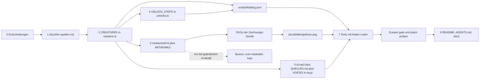

# Ein neues Lebewesen ergänzen

Ein neues Tier ist **kein Eintrag, sondern ein Weg**: Katalog, Zeichnung, Freischaltung, Stimmdatei,
abgeleitete Dateien und eine Handvoll Tests, die absichtlich feste Zahlen tragen. Die Anleitung in
[`docs/neues-tier.md`](../../docs/neues-tier.md) ist die Reihenfolge; die Fachdateien
[`docs/tiermodell-anleitung.md`](../../docs/tiermodell-anleitung.md) (Zeichnen),
[`docs/workflow.md`](../../docs/workflow.md) (Stimme, Tier-Satz) und
[`docs/freischaltung.md`](../../docs/freischaltung.md) (Sterne, Schwellen) tragen die Einzelheiten.
Durchgespielt wurde sie am 15.10.2026 mit einem Probetier („Fuchs“, eine Kopie des Wolfs) in einem
Wegwerf-Arbeitsbaum: Typen und Linter blieben grün, die Tests fielen genau an den unten genannten
Stellen. Kennungen und Code sind englisch, Namen, Sätze und Kommentare deutsch
([Sprache und Konventionen](../concepts/sprache-und-konventionen.md)); das Beispiel heißt `fox`.



Vom Katalogeintrag zu allem anderen: `scripts/katalog.json`, die SVGs der Zeichnungs-Sonde und das
Galeriebild des README sind abgeleitet; Zeichnungsmodul samt Registry-Zeile, Freischaltungsschritt,
Stimmdatei mit ihren zwei Listen und der Beleg bleiben Handarbeit.

## Was von Hand bleibt — und warum

| Was | Datei | Warum es niemand ableiten kann |
|---|---|---|
| Zeichnung | `src/presentation/game/creatures/<id>.ts` plus eine Zeile in `ARTWORKS` ([`creatures/index.ts`](../../src/presentation/game/creatures/index.ts)) | Formen sind Kunst, keine Rechnung; die Registry ist die Naht, an der Katalog und Bild zusammenfinden |
| Freischaltung | `UNLOCK_STEPS` in [`src/core/domain/unlocks.ts`](../../src/core/domain/unlocks.ts) | Ort und Schwelle sind eine Entscheidung des Auftraggebers |
| Stimme | `public/sounds/voices/<id>.mp3`, Zeile in [`QUELLEN.md`](../../public/sounds/voices/QUELLEN.md), Eintrag in `VOICES` in [`public/sw.js`](../../public/sw.js) | eine Aufnahme lässt sich nicht rechnen, ihre Lizenz nicht raten |
| Beleg | [`docs/tier-quellen.md`](../../docs/tier-quellen.md) | Quelle, Fundstelle und Abrufdatum sind eine Recherche |
| Zahlen in der Doku | `README.md`, `AGENTS.md`, `docs/*.md` | stehen als Wort im Fließtext („zwölf“) und werden von Hand nachgezogen |

Alles andere — Kachelbeschriftung, Kurzinfo, Grammatik der Sätze, Statistikseite, die Zuordnung
`CREATURE_VOICE_FILES` (`<kennung>.mp3`), die Namen mit drei scharfen Zähnen im Regeln-Blatt — leitet
sich aus dem Katalogeintrag ab. Wer eines davon von Hand einträgt, baut eine zweite Wahrheit.

## Die Checkliste in Reihenfolge

### 0. Vorher entscheiden (der Auftraggeber)

Diese Fragen sind **Entscheidungen**, keine Fakten — sie werden gefragt, nicht geraten
(„Vor der Planung“ in [`docs/workflow.md`](../../docs/workflow.md)).

- [ ] **Welches Tier, wie soll es wirken?** Erkennbar an der **Silhouette**, nicht am Fell, und
      freundlich für ein Kind: keine dunklen Rachen, keine Spaltpupillen, keine riesigen Fangzähne.
- [ ] **Stammtier oder Bonusfigur?** Stammtiere öffnen sich ohne dritten Stern; die Bonusfiguren
      (Venusfliegenfalle, T-Rex) stehen am Ende der Folge, der T-Rex ist das letzte Ziel (`FINAL_GOAL`).
- [ ] **Platz und Schwelle** (Sterne insgesamt) in `src/core/domain/unlocks.ts`. Regel: höchstens
      `2 ×` die Zahl der vorher offenen Tiere — kein dritter Stern nötig —, außer beim letzten Ziel.
      Eine Schwelle wird **simuliert**, bevor sie festgeschrieben wird (Spieler, der zufällig
      wechselt). Ein Skript dafür liegt nicht im Baum; wer keine neue Simulation fährt, schreibt die
      Zahl nicht als Messung hin.
- [ ] **Zahl der drückbaren Zähne** (`teeth`, `MIN_TEETH` 1 bis `MAX_TEETH` 12) und **gleichzeitig
      scharfe Zähne** (`liveTeethMin`/`liveTeethMax`, höchstens 3). Weniger Zähne heißt kürzere Runde;
      bei 11 und 12 Zähnen werden die Trefferflächen auf schmalen Handys knapp (Schritt 7).

### 1. Infos sammeln und belegen — `docs/tier-quellen.md`

- [ ] Die **Quelle zuerst lesen**, dann den Satz schreiben — nicht umgekehrt.
- [ ] In [`docs/tier-quellen.md`](../../docs/tier-quellen.md) eine Zeile in „Die Sätze“ **und** die
      Zahnzahl unter „Die Zahnzahlen“ eintragen, jeweils mit Fundstelle und Abrufdatum. Ohne diese
      Datei ist kein `fact` und kein `realTeeth` belegt.
- [ ] Die Grenzen des Katalogs kennen, sie werden vom Test `creature.test.ts` gehalten:

| Feld | Was | Grenze, Prüfung |
|---|---|---|
| `id` | englische Kennung, klein (`fox`) — auch Dateiname von Zeichnung und Stimme | eindeutig |
| `name` | deutscher Name („Fuchs“) | — |
| `shortName` | nur, wenn `name` mehr als **12 Zeichen** hat | `MAX_TILE_LABEL_LENGTH` |
| `grammar` | `dative` („Löwen“, „Menschen“), `feminine: true` für „zur“/„mit der“ | Tests der Freischaltung (Schritt 7) |
| `realTeeth` | Zahnzahl des echten Tiers; `0` = gar keine Zähne | `0` oder ≥ `teeth` |
| `note` | ein Satz für die Kurzinfo im Regeln-Blatt | nicht leer, kein „meist“/„häufiger“ |
| `fact` | ein belegter Satz über das echte Tier („Wusstest du?“) | höchstens **110 Zeichen**, Punkt oder Ausrufezeichen am Ende, kein Wort über scharfe Zähne |

### 2. Katalogeintrag — `src/core/domain/creature.ts`

- [ ] Eintrag in `CREATURES` anlegen. **Ein Stammtier steht vor den Bonusfiguren** (vor `flytrap`):
      die Freischaltungstests nehmen „die ersten N Tiere“ des Katalogs als Stammtiere
      (`listCreatures().slice(0, 8)`, `slice(0, 10)`, `slice(0, 11)` in
      [`src/core/domain/unlocks.test.ts`](../../src/core/domain/unlocks.test.ts)) — ein Stammtier
      hinter `flytrap` lässt sie mit einer irreführenden Meldung fallen.
- [ ] `shortName` nur bei zu langem Namen: `MAX_TILE_LABEL_LENGTH` ist **12**; ein dreizehnter
      Buchstabe bricht auf der 65-px-Kachel die dritte Zeile auf und macht die Kachel 13,2 px höher
      als ihre Nachbarn. `tileLabel()` liefert `shortName ?? name`; `validateCreature()` meldet einen
      zu langen Kachelnamen, `creature.test.ts` prüft jeden Eintrag.
- [ ] `fact` gegen die 110 Zeichen (`MAX_FACT_LENGTH`) und die Wortliste prüfen; `realTeeth` auf
      `0` oder ≥ `teeth` setzen; `liveTeethMax` ≤ `teeth`.
- [ ] Nichts von dem, was daraus folgt, doppelt eintragen: Kachel, Kurzinfo, Grammatik, Statistik,
      `CREATURE_VOICE_FILES` und `threeLiveNames()` entstehen aus dem Katalog.

### 3. Zeichnung — `<id>.ts` plus Registry

- [ ] **Vorher [`docs/tiermodell-anleitung.md`](../../docs/tiermodell-anleitung.md) ganz lesen** —
      Ebenen, Augenlage, Zwillingsregel, freundlicher Stil.
- [ ] Modul `src/presentation/game/creatures/<id>.ts` anlegen, am besten ein ähnliches Tier als
      Vorlage (Hund/Fuchs → `wolf.ts`, Katze → `panther.ts`, Nager → `mouse.ts`). Der Vertrag steht in
      `creatures/types.ts` (`CreatureArtwork`): `silhouette` als **ein** Pfad, `body` für alles über
      dem Umriss, `holeFill`/`inner`, `upper`/`lower` samt Extras, `face` über allem, `ring`, `label`
      und `teethProfile(count)` für **jede** Zahnzahl 1–12.
- [ ] Beide Pupillen tragen `class="pupil"`, liegen in einer weißen Linse und behalten mindestens
      4 Einheiten Luft ringsum — sie folgen dem Zeiger.
- [ ] In [`src/presentation/game/creatures/index.ts`](../../src/presentation/game/creatures/index.ts)
      Import **und** Zeile in `ARTWORKS` (`fox: foxArtwork,`) ergänzen. Fehlt sie, wirft der Aufbau
      der Seite `creature 'fox' has no artwork`; `creatureViews.test.ts` verlangt, dass Registry und
      Katalog **in beide Richtungen** deckungsgleich sind (Einzelheiten im
      [Zeichnungssystem](../architecture/zeichnungssystem.md)).
- [ ] Ansehen und messen:

```bash
pnpm vitest run src/render-probe.test.ts                                   # SVG je Tier und Zahnzahl
uv run --with playwright python scripts/pruefen-zahnsicht.py --freiraum fox  # wo ist Platz für die Augen?
uv run --with playwright python scripts/pruefen-zahnsicht.py               # erwartet: 0 Auffälligkeiten
uv run --with cairosvg python scripts/artwork-png.py "$TMPDIR/zahn_agent-artwork/fox.svg" fox.png offen
uv run --with cairosvg python scripts/artwork-png.py "$TMPDIR/zahn_agent-artwork/fox.svg" fox-zu.png geschnappt
```

- [ ] Das Bild **offen und geschnappt** ansehen: geschlossen verschwinden Oberkiefer und
      Schnauzenfläche — was sie verdeckt haben, liegt offen. Unter Windows fehlt `cairosvg` oft
      `libcairo-2.dll`; dann den Browser der Sonden nehmen oder `pnpm dev`.
- [ ] **Wurde dabei die Krokodil-Zeichnung berührt** (als Vorlage kopiert, umbenannt, gemeinsame
      Geometrie verschoben), gehört `ICON_NEU=1` dazu: `public/favicon.svg`, `public/icon-maskable.svg`
      und `public/logo.svg` entstehen in `src/icon.test.ts` aus `creaturePortrait('crocodile', …)` und
      werden **byteweise** verglichen. Danach `uv run --with cairosvg python scripts/icon-png.py`.

### 4. Freischaltung — `UNLOCK_STEPS`

- [ ] In [`src/core/domain/unlocks.ts`](../../src/core/domain/unlocks.ts) einen Schritt
      `{ creature: 'fox', stars: 17 }` an der entschiedenen Stelle eintragen. Die Schwellen steigen
      **streng**, der T-Rex bleibt der letzte Schritt (`FINAL_GOAL`).
- [ ] Den Kommentar über der Folge (simulierte Rundenzahlen) nachziehen oder ausdrücklich als **nicht
      neu gemessen** kennzeichnen — eine alte Zahl als Messung stehen zu lassen ist eine zweite
      Wahrheit.
- [ ] [`scripts/freischaltung.py`](../../scripts/freischaltung.py) rechnet das Protokoll der Sonden
      aus der letzten Schwelle selbst (je Katalogtier drei Sterne, bis `LETZTE_SCHWELLE` erreicht ist)
      und meldet über `assert`, wenn der Katalog dafür nicht reicht. Nach jeder neuen Figur oder
      angehobenen Schwelle nachrechnen: **reicht das Protokoll noch, um alle Tiere zu öffnen?** Sonst
      misst eine Sonde still das Krokodil statt des gewünschten Tiers.

### 5. Stimme — `public/sounds/voices/<id>.mp3`, `QUELLEN.md`, `public/sw.js`

- [ ] Suchen, nur Gemeinfreies: `python scripts/stimme-suchen.py "fox bark" "vulpes vulpes"`.
      **Die Dateiseite lesen, nicht nur den Titel** („Mouse in Antefasy“ war das gesprochene Wort
      „Maus“ in einem madagassischen Dialekt). Ist ein Tier stumm, ein ehrlicher Ersatz mit Begründung.
- [ ] Schneiden: `bash scripts/stimme-schneiden.sh <quelle> fox <start> <dauer> [ausblenden]` →
      `public/sounds/voices/fox.mp3`, höchstens 1,5 s und höchstens `MAX_VOICE_BYTES` = 16 000 Byte.
- [ ] Zeile in [`public/sounds/voices/QUELLEN.md`](../../public/sounds/voices/QUELLEN.md): Datei,
      Was, Urheber, Lizenz, Quelle als ausgeschriebene Adresse, Ausschnitt. `creatureVoices.test.ts`
      liefert keine Datei ohne diese Zeile aus.
- [ ] `'fox.mp3'` in `VOICES` in [`public/sw.js`](../../public/sw.js) eintragen — sonst fehlt die
      Stimme ohne Netz, und `offline.test.ts` vergleicht die Liste mit `CREATURE_VOICE_FILES`. Die
      Zuordnung in [`creatureVoices.ts`](../../src/infrastructure/audio/creatureVoices.ts) braucht
      keine Zeile: sie entsteht aus dem Katalog.
- [ ] **Anhören kann nur der Auftraggeber:** erkennbar, freundlich, etwa so laut wie die anderen?
      (`pnpm dev`, das Tier wählen — es meldet sich sofort.) Der Weg im Ganzen steht in
      [Ton und Vibration](../integrations/ton-und-vibration.md).

### 6. Abgeleitete Dateien neu erzeugen

- [ ] `KATALOG_NEU=1 pnpm test:run` schreibt [`scripts/katalog.json`](../../scripts/katalog.json) aus
      Katalog, `UNLOCK_ORDER` und `UNLOCK_STEPS`. Die Datei ist die **einzige** Tierdaten-Quelle der
      Python-Sonden ([`scripts/katalog.py`](../../scripts/katalog.py): `TIERE`, `FOLGE`, `ZAEHNE`,
      `LETZTE_SCHWELLE`); ohne den Lauf messen alle Sonden die alte Tierliste.
- [ ] `pnpm vitest run src/render-probe.test.ts` schreibt frische SVGs (je Tier und je Zahnzahl) nach
      `$TMPDIR/zahn_agent-artwork`.
- [ ] `uv run --with cairosvg python scripts/galerie.py docs/bilder/gebisse.png` baut daraus das
      README-Bild. `galerie.py` liest die SVGs aus demselben `$TMPDIR` und rechnet die Spaltenzahl aus
      der Zahl der Lebewesen — **erst die Sonde, dann `galerie.py` im selben `$TMPDIR`**, sonst
      entsteht das Bild aus alten Zeichnungen.

### 7. Tests, die bewusst angepasst werden

Diese Tests tragen feste Zahlen oder Listen und **sollen** beim neuen Tier fallen — sie zwingen zum
Hinsehen. Angepasst wird die Erwartung, nicht die Prüfung.

- [ ] [`src/core/domain/unlocks.test.ts`](../../src/core/domain/unlocks.test.ts): Folge
      (`['shark', …, 'trex']`), Schwellen (`[3, 5, …, 20, 28]`), „alle Stammtiere offen“ und der Weg
      zum T-Rex — die Rechnungen laufen über `listCreatures().slice(0, 8)` / `.slice(0, 10)` /
      `.slice(0, 11)`, also über die Katalogreihenfolge. Folge und Schwellen eintragen und die
      Rechnungen in Testnamen und Erwartungen nachziehen.
- [ ] [`src/presentation/game/unlocks.test.ts`](../../src/presentation/game/unlocks.test.ts): die
      Sätze je Tier der Folge („Noch 1 Stern bis zum …“, „Mit dem … spielen“) und die Liste
      `threeLiveNames()` („Krokodil, Mensch und T-Rex“). Hier zeigt sich, ob `grammar` stimmt:
      `progressSentence` und `playLabel` in `unlockNotice.ts` bauen Dativ und `zur`/`zum` daraus.
- [ ] [`src/presentation/game/albumBadges.test.ts`](../../src/presentation/game/albumBadges.test.ts):
      `albumSummary` zählt `pages.length` und `pages.length × 3` Sterne, die Erwartung lautet deshalb
      „0 von 12 Tieren gespielt · 0 von 36 Sternen“ → Tiere +1, Sterne +3 (an zwei Stellen).
- [ ] [`src/presentation/game/creatures/creatureViews.test.ts`](../../src/presentation/game/creatures/creatureViews.test.ts):
      die Liste der Zahnzahlen, bei denen ein Zahn auf 285 px unter 44 px Trefferfläche fällt
      (`'wolf/12'` … `'trex/12'`). `'fox/12'` (oder was der Test meldet) eintragen, im Kommentar
      begründen — besser: den Ring so breit zeichnen, dass die Liste nicht wächst.

Fallen außerdem und zeigen damit einen **vergessenen Schritt** (nicht anpassen, nachholen):
`creatureVoices.test.ts` (Datei oder `QUELLEN.md`-Zeile fehlt), `offline.test.ts` (`VOICES` in
`public/sw.js`), `katalog-json.test.ts` (Schritt 6), `creatureViews.test.ts`/`gaze.test.ts`
(Zahnzahl, Ebenen, Augen im Ring, Pupillen ohne Luft).

### 8. Prüfen — Gate und Sonden bleiben Pflicht

- [ ] `pnpm gate` (Typen, Linter, Tests) und danach `pnpm build && pnpm preview --port 4322` im
      Hintergrund sowie `pnpm probes`.
- [ ] `pnpm probes` fährt **13** Sonden über [`scripts/pruefen-alle.py`](../../scripts/pruefen-alle.py)
      und ruft vorher `src/render-probe.test.ts` auf, damit die SVGs für die Zahnsicht bereitliegen.
- [ ] Für ein neues Tier zählen besonders: `pruefen-tiere` (eine Kachel mehr, Reihenfolge der Folge),
      `pruefen-freischaltung` und `pruefen-bedienung` (Kacheln gleich hoch, nichts scrollt),
      `pruefen-zahnsicht`, `pruefen-blick`, `pruefen-zoom`, `pruefen-trefferflaeche`.
- [ ] Einmal selbst spielen: Tier wählen (es meldet sich), bis zum Biss, Satz unter dem Ergebnis
      lesen, am Handy.

Was die Sonden hier leisten, steht in [Prüfen und Gate](../testing/pruefen-und-gate.md).

### 9. Doku nachziehen

- [ ] Die Zahl der Tiere steht an vielen Stellen als Wort. Finden:
      `git grep -n -i -E "zwölf|\b12 (Kacheln|Wesen|Tiere|Lebewesen)|Zwölf Gebisse" -- README.md AGENTS.md docs`
- [ ] Mindestens: `README.md` (Bildunterschrift der Gebisse, Liste der Kacheln, „Zwölf Gebisse“,
      Tabelle der Schließwege, Zahl der Stimmen und ihre Gesamtgröße), der Kopf von `AGENTS.md`,
      `docs/freischaltung.md` (Folge und Schwellen), `docs/tiermodell-anleitung.md` (Liste der
      Augengrößen, Zahl der Zeichnungen der Sonde) und `docs/testing.md` (erwartete Kacheln der Sonde,
      Testzahl).
- [ ] `docs/e2e-nachweise.md` ist eine Akte: dort bleibt die alte Zahl stehen, das neue Tier bekommt
      einen Eintrag.
- [ ] `ALTE_WERTE_STRIKT=1 bash scripts/doku-pruefen.sh README.md docs/testing.md` und
      `python scripts/doku-pfade-pruefen.py . README.md AGENTS.md docs/*.md` laufen lassen.

### 10. Committen und veröffentlichen

- [ ] Explizite Pfade, **nie** `git add -A`; vor dem Commit `git status --short | grep '^ D'`.
      Neu im Baum sind mindestens `src/presentation/game/creatures/<id>.ts` und
      `public/sounds/voices/<id>.mp3`.
- [ ] `git push` fährt über [`.githooks/pre-push`](../../.githooks/pre-push) noch einmal `pnpm gate`.
      Der Push auf `main` **veröffentlicht** die Seite — nur mit dem Ja des Auftraggebers
      ([Bauen und Veröffentlichen](../operations/bauen-und-veroeffentlichen.md)).

## Die Kopplungen, die still brechen

„Still“ heißt: kein Test wird rot, kein Werkzeug meldet sich — das Ergebnis ist nur falsch. Diese
sechs Stellen sind die teuren.

| Kopplung | Was ohne sie still falsch ist | Wer es bemerkt |
|---|---|---|
| `KATALOG_NEU=1 pnpm test:run` | `scripts/katalog.json` bleibt alt; alle Python-Sonden zählen und messen die alte Tierliste, `pruefen-tiere` erwartet eine Kachel zu wenig | `katalog-json.test.ts` vergleicht Zeichen für Zeichen — aber erst nach dem Lauf stimmt der Rest |
| `ICON_NEU=1` bei geänderter Krokodil-Zeichnung | `public/favicon.svg`, `public/icon-maskable.svg`, `public/logo.svg` zeigen die alte Form | `src/icon.test.ts` (byteweise); danach rastert `scripts/icon-png.py` die PNGs |
| `galerie.py` im **selben** `$TMPDIR` wie die Zeichnungs-Sonde | das README-Bild entsteht aus alten SVGs (am 14.10.2026: 657 678 statt 657 929 Byte) | **kein Test** — nur Ansehen und Bildunterschrift |
| `MAX_TILE_LABEL_LENGTH` / `shortName` | ein Name über 12 Zeichen macht die Kachel 13,2 px höher, die Reihe bricht | `creature.test.ts` hält die Länge; das **Maß** prüft `pruefen-freischaltung.py` |
| Protokoll in `scripts/freischaltung.py` | reicht der Katalog nicht für die letzte Schwelle, misst eine Sonde still das Krokodil statt des gewünschten Tiers | der `assert` im Skript beim Laden; sonst niemand |
| `VOICES` in `public/sw.js` | die neue Stimme fehlt, sobald das Gerät ohne Netz ist | `offline.test.ts` vergleicht die Liste mit `CREATURE_VOICE_FILES` |

Zwei weitere, die nicht Datei für Datei brechen, sondern in der Fläche: `--rail-columns` in
[`src/pages/index.astro`](../../src/pages/index.astro) wird aus `creatures.length` gerechnet, eine neue
Figur ändert also die Reihe — die Auswahl ist damit schon einmal gebrochen (Scrollen auf jedem Tablet
hochkant, eine um 13 px höhere Reihe); gefunden haben das `pruefen-bedienung.py` und
`pruefen-freischaltung.py`, kein Unit-Test. Und die `QUELLEN.md`-Zeile ist keine Formsache: fehlt sie,
wirft `creatureVoices.test.ts` beim Ausliefern der Stimme.

## Verwandte Seiten

- [Zeichnungssystem der Lebewesen (SVG)](../architecture/zeichnungssystem.md) — der Vertrag hinter
  `CreatureArtwork`, die Ebenen, der Zahnring als Sperrgebiet fürs Gesicht und das App-Symbol.
- [Sterne, Album und Freischaltung](../concepts/sterne-und-freischaltung.md) — was eine Schwelle
  kosten darf, `FINAL_GOAL` und die abgeleitete Progression.
- [Ton und Vibration](../integrations/ton-und-vibration.md) — wie eine Tierstimme geladen und
  gespielt wird und was `creatureVoices.test.ts` festhält.
- [Offline und Service Worker](../integrations/offline-service-worker.md) — warum die Stimmen in
  `VOICES` stehen müssen.
- [Prüfen und Gate](../testing/pruefen-und-gate.md) — `pnpm gate`, die 13 Sonden und die Doku-Prüfer.
