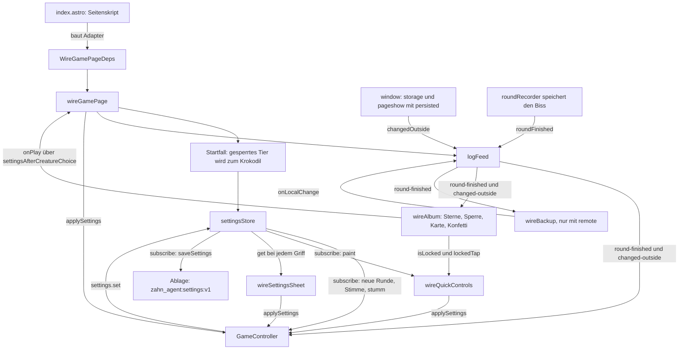

# Spielseite verdrahten (wireGamePage)

Die Spielseite hat zwei Hälften, die sich an genau einer Stelle treffen. Die eine Hälfte ist
[`src/pages/index.astro`](../../src/pages/index.astro): Markup, IDs, Klassen — und ein Seitenskript,
das nichts weiter tut, als die Adapter nach außen zu bauen. Die andere Hälfte ist
[`src/presentation/game/gamePage.ts`](../../src/presentation/game/gamePage.ts): `wireGamePage(deps)`
nimmt diese Adapter, hängt Spielsteuerung, Album, Schnellleiste, Einstellungsblatt, Dialoge,
Fenster-Ereignisse und Sicherung zusammen und gibt die Griffe für Tests zurück.

Diese Aufteilung ist keine Stilfrage. Sie ist die Antwort darauf, dass ein `.astro`-Skript von keinem
Werkzeug des Gates gelesen wird — siehe [die Falle am Ende](#die-falle-das-seitenskript-prüft-kein-gate).

## Die Naht: die Seite baut Adapter, ein Modul verdrahtet

Das Seitenskript importiert die Adapter aus `infrastructure/` (und `creaturePortrait` aus der
Bedienung) sowie genau eine Verdrahtungsfunktion, baut seine Abhängigkeiten und ruft `wireGamePage`
**einmal** auf. Wer eine Seite anfasst, baut Adapter und ruft eine Verdrahtungsfunktion — mehr nicht
([`src/architecture.test.ts`](../../src/architecture.test.ts) bewacht diese Richtung für alle
`*.ts`-Dateien, `src/pages/` steht in `FOLDER_LAYER` bewusst nicht).

| Dep-Feld | Was die Seite hineinreicht | Umschließt |
|---|---|---|
| `doc`, `win` | `document`, `window` | DOM und Fenster-Ereignisse |
| `storage` | `browserStorage()` | `localStorage`, oder `null`, wenn der Browser ihn nicht hergibt |
| `log` | `new LocalStorageRoundLog(storage)` | das Rundenprotokoll samt Arbeitsspeicher-Rückfall |
| `rng` | `new CryptoRandom()` | `crypto.getRandomValues` |
| `sound` | `new WebAudioEngine({ muted: !settings.sound, voiceBaseUrl: BASE_URL })` | Web-Audio und Tierstimmen |
| `haptics` | `new BrowserHaptics()` | `navigator.vibrate` |
| `session` | `browserSessionMarks()` | `sessionStorage` für einmalige Hinweise |
| `portrait` | `creaturePortrait` | die Zeichnung eines Tiers in drei Beschnittgrößen |
| `remote` | `code ? new HttpRemoteLog(backupUrl(BASE_URL, code)) : undefined` | den Sicherungs-Worker |

Drei Dinge tut das Skript **außerhalb** dieser Übergabe, und alle drei sind bewusst dort geblieben:
`loadSettings(storage)` liefert den gespeicherten Ton-Zustand für den Start der Ton-Engine,
`backupCode(location.search, storage, location.pathname)` entscheidet, ob es überhaupt eine Sicherung
gibt, und `void requestPersistence()` bittet den Browser um dauerhafte Ablage. Der Rückgabewert von
`wireGamePage` wird **nicht** zugewiesen: die Seite braucht ihn nicht, er ist die Naht für Tests
(`gamePage.test.ts` greift auf `page.feed` und `page.album` zu). Der einzige Ort, an dem die Seite
Einstellungen liest, ist damit die Startstummheit der Engine — die Autorität über den Zustand liegt
im Store innerhalb von `wireGamePage`, und der Controller übernimmt sie beim ersten Ändern.

## Der Ablauf in wireGamePage

Die Reihenfolge im Rumpf ist nicht beliebig: der Start-Rückfall muss **vor** dem Store passieren,
damit niemand einen bereits korrigierten Stand sieht, und die Sicherung hängt sich erst ein, wenn der
Meldungsbus steht.

Der Graph der Verdrahtung: ein Store und ein Bus in der Mitte, alle Griffe schreiben über den
Controller in den Store, alle Protokoll-Änderungen laufen über den Feed zum Album.

Im Einzelnen, in der Reihenfolge des Rumpfs
([`gamePage.ts`](../../src/presentation/game/gamePage.ts)):

1. **Einstellungen laden und entschärfen.** `loadSettings(storage)` liest die Ablage; fällt die
   Reparatur des Startfalls aus, wird sofort gespeichert. Danach entsteht der Store, und
   `settingsStore.subscribe((next) => saveSettings(storage, next))` hängt jedes künftige `set()` an
   die Ablage — es gibt keinen zweiten Schreibweg.
2. **Der Bus.** `createLogFeed()` — noch ohne Zuhörer.
3. **Die Steuerung.** `new GameController({ rng, sound, haptics, log, feed, settings, session,
   document })`, dann `controller.mount()`. Ab hier stehen Zähne auf der Bühne; das ist der Fall, den
   `gamePage.test.ts` als erstes prüft. Alles, was die Bühne und das HUD angeht — auch der Knopf
   „Neue Runde" — gehört der Steuerung, nicht der Verdrahtung.
4. **Das Album.** `wireAlbum({ doc, log, feed, portrait, onPlay })`. `onPlay` geht durch
   `settingsAfterCreatureChoice(settingsStore.get(), creatureId)` und dann durch
   `controller.applySettings` — die Karte der Freischaltung ist damit derselbe Weg wie jede Kachel.
5. **Die Leiste.** `wireQuickControls({ doc, settings, isLocked, onLockedTap, apply, portrait,
   onCreatureChosen })`. `isLocked` und `onLockedTap` kommen vom Album: die Sperre ist eine Aussage
   über das Protokoll, nicht über die Einstellungen.
6. **Fenster-Ereignisse.** `storage` und `pageshow` melden `feed.changedOutside()` (nächster
   Abschnitt).
7. **Die Sicherung**, nur wenn `remote` existiert: `wireBackup({ local: log, remote, onLocalChange })`,
   ein `void backup.sync()` beim Start und ein `feed.subscribe`, das nach jedem `round-finished`
   erneut abgleicht.
8. **Das Einstellungsblatt**, die Dialog-Knöpfe (`settings-open`, `creature-open`, `rules-open`,
   `[data-close-sheet]`), `wireOutsideTapDismissal(doc)` und zuletzt die Ton-Freigabe bei jeder
   Geste: `pointerup` und `keydown` am Dokument rufen `sound.unlock()`.

## Eine Quelle je Zustand

Die Regel, die diese Seite zusammenhält, lautet: **jeder Zustand hat genau eine Quelle, und jeder
Griff liest sie im Augenblick des Griffs.** Zwei Kopien vom Seitenstart — eine der Einstellungen, eine
des Protokolls — waren die Ursache der Fehler, die zur Auslagerung des Seitenskripts geführt haben
(`docs/e2e-nachweise.md`, „Paket 2" und „Paket 3": das DOM-Ereignis `kroko:round-finished` und
`Object.assign` auf den Einstellungen sind ersatzlos entfallen).

### Einstellungen: `settingsStore.get()` statt Kopie

`createSettingsStore` hält ein `GameSettings`, gibt bei `get()` die **aktuelle** Referenz,
benachrichtigt bei `set()` mit `(next, previous)` und meldet nichts, wenn sich inhaltlich nichts
ändert ([`settingsStore.ts`](../../src/presentation/game/settingsStore.ts)). Daraus folgen drei
Verhaltensregeln, die man beim Erweitern nicht brechen darf:

- **Wer schreibt, baut auf `get()` auf.** `wireSettingsSheet` merkt sich `settings.get()` nur, um
  Schalter und Segmente einmal zu malen; jeder Klick und jede Checkbox baut das nächste Objekt aus
  `settings.get()` — sonst setzte ein Tipp im Blatt Tier und Zahnzahl zurück, die die Leiste
  inzwischen gestellt hat (`settingsSheet.test.ts`: „übernimmt, was die Leiste inzwischen gestellt
  hat ... statt den Stand vom Start"). Deshalb steht im Dep-Kommentar ausdrücklich *der Speicher,
  nicht ein Abzug davon*.
- **Wer malt, meldet sich an.** `wireQuickControls` ruft `settings.subscribe(() => paint())` und
  zeichnet in `paint()` alles aus `settings.get()`: Zahnzahl und Einzahl/Mehrzahl, die Grenzen von
  `−`/`+`, Name und Kopfbild des Tiers, `aria-pressed` aller Kacheln und die Tier-Kurzinfo im
  Regeln-Blatt. Ein `paint()` von außerhalb des Moduls gibt es nicht mehr — der Store ist die
  Benachrichtigung.
- **Wer die Runde kennt, hört ebenfalls zu.** Der Controller hängt im Konstruktor an derselben
  Anmeldung und startet bei `mode`, `players`, `creature` oder `teethOverride` eine neue Runde; bei
  bloßem Ton-Wechsel stoppt er nur, was klingt. Ein Tierwechsel bricht zusätzlich ab, was vom alten
  Tier noch klingt, und stellt das neue vor.

Alle drei Griffe der Seite — Schnellleiste, Einstellungsblatt, Knopf der Freischaltungskarte —
schreiben über `controller.applySettings(next)`, also über `settings.set`. Es gibt keinen Pfad, der
den Store umgeht; das ist der Grund, warum eine Änderung überall gleichzeitig ankommt.

### Protokoll: `logFeed` statt DOM-Ereignis

`createLogFeed()` kennt genau zwei Meldungen
([`logFeed.ts`](../../src/presentation/game/logFeed.ts)):

| Meldung | Auslöser | Wirkung |
|---|---|---|
| `roundFinished` | `roundRecorder.record()` — **nachdem** die Runde gespeichert ist | Album malt, sagt den neuen Stern an, zeigt Fortschritt oder Freischaltkarte und lässt Konfetti regnen; die Sicherung gleicht ab |
| `changedOutside` | `storage`, `pageshow` mit `persisted`, `onLocalChange` der Sicherung | Album und Steuerung ziehen still nach: nur malen, kein Konfetti, keine Karte |

Die Unterscheidung ist die eigentliche Fachlichkeit des Busses: derselbe neue Stern ist einmal ein
Ereignis mit Feier (eigener Biss) und einmal eine stille Korrektur (anderer Tab, Import, Sicherung
nach geleertem Profil). Ohne sie fiele bei jedem Start im Kinderprofil Konfetti. Wie Sterne und
Sperre daraus folgen, steht auf
[Sterne und Freischaltung](../concepts/sterne-und-freischaltung.md).

Wer den Bus umgeht — etwa `album.paint()` direkt aufruft oder ein eigenes DOM-Ereignis feuert —
verliert diese Unterscheidung. Das Album rechnet bei **jedem** Malen Sterne und Sperre frisch aus
`log.load()`; es hält keinen zweiten Stand, weil die Statistikseite dieselbe Ablage löscht und
importiert.

## Die Start-Fälle

Der Start ist der einzige Moment, in dem die Verdrahtung korrigierend in den gespeicherten Zustand
eingreift. Vier Fälle sind zu unterscheiden:

1. **Gespeichertes Tier ist gesperrt** (etwa nach „Protokoll löschen"): `settingsWithUnlockedCreature`
   ersetzt es durch `DEFAULT_CREATURE_ID` — das Krokodil — und setzt `teethOverride` auf `null`, damit
   das Krokodil sein eigenes Gebiss mitbringt. Weil dabei eine neue Referenz entsteht, schreibt
   `wireGamePage` das Ergebnis sofort zurück. Welche Tiere offen sind, folgt allein aus
   `unlockState(albumFromRecords(log.load())).unlocked`, also aus den Sternen des Protokolls.
2. **Gespeichertes Tier ist offen**: dieselbe Referenz, kein unnötiges Schreiben. Ein unbekanntes Tier
   oder eine ungültige Zahnzahl fängt schon `loadSettings` ab und fällt auf die Vorgaben zurück.
3. **Das Protokoll ändert sich von außen**: `storage` mit `event.key === null` (Ablage geleert) oder
   `event.key === STORAGE_KEY` sowie `pageshow` mit `persisted` (Zurück-Taste aus dem
   Zwischenspeicher) melden `changedOutside`. Die Steuerung liest dann über `syncLog()` neu und malt
   die Rundennummer nach — der Fall, den `gamePage.test.ts` mit drei nachgeschobenen Runden prüft.
4. **Die Sicherung ändert die Ablage**: `onLocalChange` meldet ebenfalls `changedOutside`. Ohne
   Sicherungscode gibt es kein `remote`, damit keinen Abgleich und keinen einzigen Abruf — auch das
   hält ein Test fest.

**Einstellungen eines zweiten Tabs werden bewusst nicht übernommen.** Der `storage`-Lauscher hört nur
auf den Schlüssel des Protokolls; `zahn_agent:settings:v1` bleibt Sache dieser Seite. Zwei Tabs
könnten sonst beim Tippen die Zahnzahl des anderen zurücksetzen.

## Der DOM-Vertrag

`wireGamePage` kennt die Seite nur über IDs und Selektoren, und es verlangt sie nachsichtig: fast jeder
Zugriff ist ein `getElementById(...)` mit `?.`. Deshalb kann `gamePage.test.ts` ein ausgeschnittenes
DOM hinstellen und trotzdem die ganze Verdrahtung laufen lassen. Wer Markup ergänzt, muss die ID auch
in der Seite anlegen — fehlt sie, schweigt der Teil, statt zu scheitern.

Zwei Selektoren sind eine Falle, die im Code zweimal kommentiert ist: Album und Leiste fragen
`button[data-creature]`, nicht `[data-creature]`. Auch die gezeichnete Bühne trägt das Attribut
(`<svg class="creature" data-creature="…">` in
[`creatures/factory.ts`](../../src/presentation/game/creatures/factory.ts)) — ein Tipp auf das
Krokodil auf der Bühne wäre sonst ein Kachel-Tipp. Und die Kacheln tragen weder `.creature` noch
`.tooth`, weil die Steuerung diese Klassen abfragt.

Welche ID wem gehört, ist eine brauchbare Landkarte beim Erweitern: Bühne, Zähne, HUD, Ergebnis und
`new-round` gehören dem `GameController`; `teeth-*`, `creature-open`, `creature-name`,
`creature-icon`, `how-to` und die Tier-Kurzinfo der Leiste; `star-toast`, `unlock-progress`,
`unlock-card`, `unlock-play` und die Sterne an den Kacheln dem Album; `opt-players`, `opt-mode`,
`opt-sound`, `opt-vibration`, `vibration-hint` dem Einstellungsblatt; `settings-open`,
`creature-open`, `rules-open` und `[data-close-sheet]` der Verdrahtung selbst.

## Blätter und Ton

Die drei Dialoge sind `#settings-sheet`, `#creature-sheet` und `#rules-sheet`. Die Verdrahtung öffnet
sie über [`sheets.ts`](../../src/presentation/game/sheets.ts) und schließt sie über jeden Knopf mit
`data-close-sheet`; `wireOutsideTapDismissal(doc)` hängt einen Lauscher in der **Einfangphase** ans
Dokument. Dessen zwei Annahmen sind beim Ergänzen zu beachten: geschlossen wird nur das **oberste**
offene Blatt, und die Stapelreihenfolge ist die Reihenfolge im Dokument. Ein neues Blatt, das sich aus
einem späteren öffnet, bricht diese Annahme. Die Leiste schließt das Auswahlblatt nach einem
Kachel-Tipp selbst (`onCreatureChosen`) — auf dem Tablet ist es gar nicht offen, `closeSheet` tut dann
nichts.

Die Ton-Freigabe liegt aus zwei Gründen am Dokument und nicht am ersten Knopf: Browser geben Ton erst
nach einer Nutzergeste frei, und zwar bei **jeder** — die erste kann eine sein, die der Browser nicht
zählt, und iOS hält den Ton nach einem Anruf wieder an. Gelauscht wird auf `pointerup`, nicht auf
`pointerdown`: ein Finger, der nur scrollt, endet mit `pointercancel` und ist keine Freigabe. Details
auf [Ton und Vibration](../integrations/ton-und-vibration.md).

## Die Sicherung als Extra

`wireBackup` ist ebenfalls am Bus befestigt, aber ohne eigene Wahrheit: es liest und schreibt über
denselben `RoundLogPort` wie die Steuerung, reiht Abgleiche **hintereinander** (zwei nebeneinander
gelesene Stände überschrieben einander) und meldet einen Fehler nur über `onStatus` — die Spielseite
reicht keinen herein, das Spiel hält also nie an. Für die Spielseite zählt: beim Start einmal, nach
jedem eigenen Biss einmal, und jede lokale Änderung geht als `changedOutside` zurück in die Anzeige.
Wie Abgleich und Zusammenführung im Einzelnen funktionieren, steht auf
[Sicherungs-Worker](../integrations/sicherung-worker.md).

## Erweitern: wo eine neue Fähigkeit hinkommt

- **Neuer Zustand, der gestellt wird?** Er gehört in `GameSettings`, der Store bleibt die eine Quelle,
  der Schreibweg bleibt `controller.applySettings`.
- **Neue Protokoll-Meldung?** Nur über `logFeed` — und dann entscheiden, ob sie feiern darf
  (`roundFinished`) oder still nachziehen muss (`changedOutside`).
- **Neuer Adapter (Netz, Speicher, Gerät)?** Port in `core/ports`, Vertreter in `infrastructure/`,
  Feld in `WireGamePageDeps`, gebaut im Seitenskript. Die Attrappe für Tests liegt in
  `infrastructure/testing/`.
- **Neues Blatt?** Markup in `index.astro`, Öffnen über `openSheet`, Schließen über
  `data-close-sheet`; die Stapelannahme von `sheets.ts` prüfen.
- **Neue Logik in der Seite?** Nein: sie gehört in ein Modul unter `presentation/game/` mit eigenem
  Test. Das Skript verdrahtet nur.

## Die Falle: das Seitenskript prüft kein Gate

`pnpm typecheck` liest `src/**/*.ts` (`include` in [`tsconfig.json`](../../tsconfig.json)), und die
Tests laden `src/pages/*.astro` nie — jsdom führt das Seitenskript nicht aus. Der einzige Test, der
`index.astro` überhaupt ansieht, liest sie als **Text** und sucht IDs und Sätze
(`src/bedienleiste.test.ts`, `src/auswahl.test.ts`, `src/regeln.test.ts`). Was daraus folgt:

- **Ein grünes Gate heißt hier nichts.** Beim Bau der Freischaltung stand `settings` im Seitenskript
  hinter seiner ersten Verwendung: Gate grün, Bau grün — und im Browser kein einziger Zahn
  („Cannot access … before initialization"). Gefunden hat es erst eine Browser-Sonde.
- **Auch Typen sind dort ungeprüft.** `browserStorage()` liefert `StorageLike | null`, das Dep-Feld
  `storage` verlangt `StorageLike` — ein Widerspruch, den kein `tsc` sieht. Harmlos ist er nur, weil
  `wireGamePage` den Wert ausschließlich an `loadSettings` und `saveSettings` weiterreicht, die
  `null` ausdrücklich annehmen.
- **Die Gegenprobe ist die gebaute Seite.** Nach jeder Änderung am Seitenskript `pnpm build` und die
  gebaute Seite laden und nachsehen, ob Zähne auf der Bühne stehen; für das Verhalten kommen die
  Sonden dazu (`scripts/pruefen-bedienung.py`, `pruefen-blaetter.py`, `pruefen-tiere.py`,
  `pruefen-sicherung.py`). Siehe [Prüfen und Gate](../testing/pruefen-und-gate.md).

## Tests, die diese Verdrahtung halten

`src/presentation/game/gamePage.test.ts` ist die Prüfsonde der Verdrahtung: sie stellt ein
ausgeschnittenes DOM hin, verdrahtet mit Attrappen (`ScriptedRandom`, `RecordingSound`,
`RecordingHaptics`, `MemoryStorage`, `MemoryLog`) und misst von außen:

| Fall | Behauptung |
|---|---|
| (a) | nach `wireGamePage` stehen zehn Zähne auf der Bühne |
| (b) | ein gespeichertes gesperrtes Tier wird zum Krokodil **und so gespeichert** |
| (c) | ein `storage`-Ereignis mit dem Protokoll-Schlüssel malt Rundennummer und Sterne neu |
| (d) | der Knopf der Freischaltkarte wechselt das Tier, die Leiste zeigt es |
| (e) | mit `remote` wird beim Start und nach `roundFinished` abgeglichen, ohne `remote` nie |
| (f) | `pointerup` gibt den Ton frei |
| (g) | eine Änderung von außen öffnet ein Tier still — keine Karte, kein Fortschritt, kein Konfetti |

Die einzelnen Bausteine haben eigene Tests, und dort steht das Verhalten genauer:
`settingsStore.test.ts` (gleicher Inhalt meldet nichts, Abmelden wirkt),
`settingsSheet.test.ts` (jeder Griff baut auf dem Speicher auf, Wackeln wird bei fehlender
Unterstützung gesperrt), `quickControls.test.ts` (Grenzen, Einzahl, gesperrte Kachel sagt was fehlt),
`albumBadges.test.ts` (drei Plätze je Kachel, keine Feier von außen), `logFeed.test.ts`,
`backupSync.test.ts` und `sheets.test.ts`. Was jsdom nicht kann — Layout, Scrollen, Trefferflächen,
Konfetti — prüfen die Browser-Sonden.

## Verwandte Seiten

- [Überblick](../architecture/ueberblick.md) — Schichten, Seiten und der Weg einer Runde.
- [Schichten, Ports und die Importregel](../architecture/schichten-und-importregel.md) — warum
  `.astro`-Seiten in keiner Schicht stehen und was der Wächter nicht sieht.
- [Spielzug](spielzug.md) — Halten, Fakeout, HUD und der Ablauf innerhalb der Steuerung.
- [Sterne und Freischaltung](../concepts/sterne-und-freischaltung.md) — was `changedOutside` und
  `roundFinished` fachlich unterscheidet.
- [Sicherungs-Worker](../integrations/sicherung-worker.md) — Abgleich, Code und Worker.
- [Ton und Vibration](../integrations/ton-und-vibration.md) — warum `unlock()` bei jeder Geste kommt.
- [Sprache, Doku-Regeln und Kommentarstil](../concepts/sprache-und-konventionen.md) — Kommentare als
  Begründung mit Messwert, Prüfskripte für Doku.
- [Ein neues Lebewesen](neues-lebewesen.md) — was eine Katalogfigur über die Seite hinaus mitzieht.

Quellen der Regeln: `docs/architecture.md` („Die Bedienung im Innern"),
`docs/freischaltung.md` (Rückfall und die `.astro`-Falle), `docs/fallen.md` (Seitenskripte und
Blätter), `docs/e2e-nachweise.md` (Paket 2 und 3 vom 14.10.2026).
