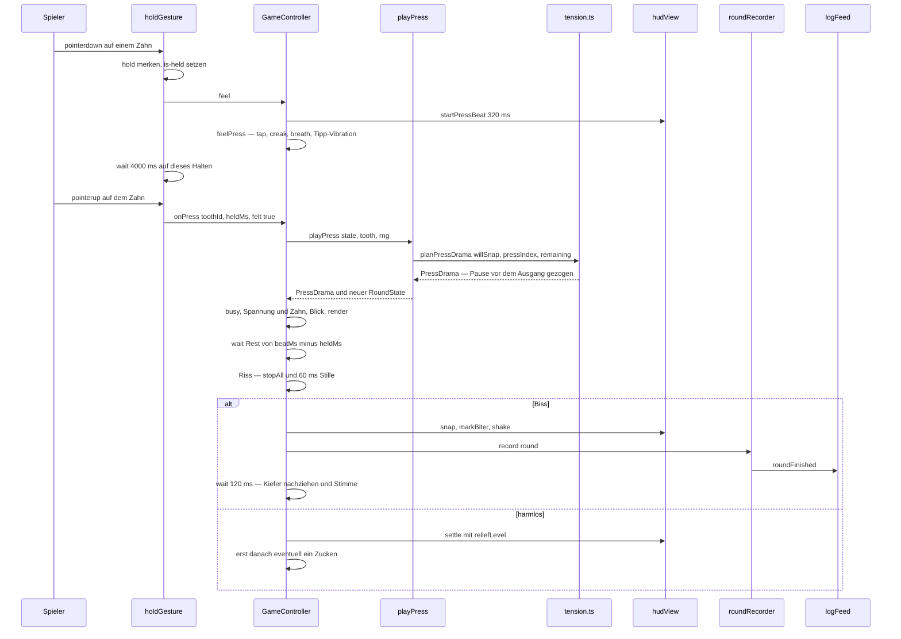
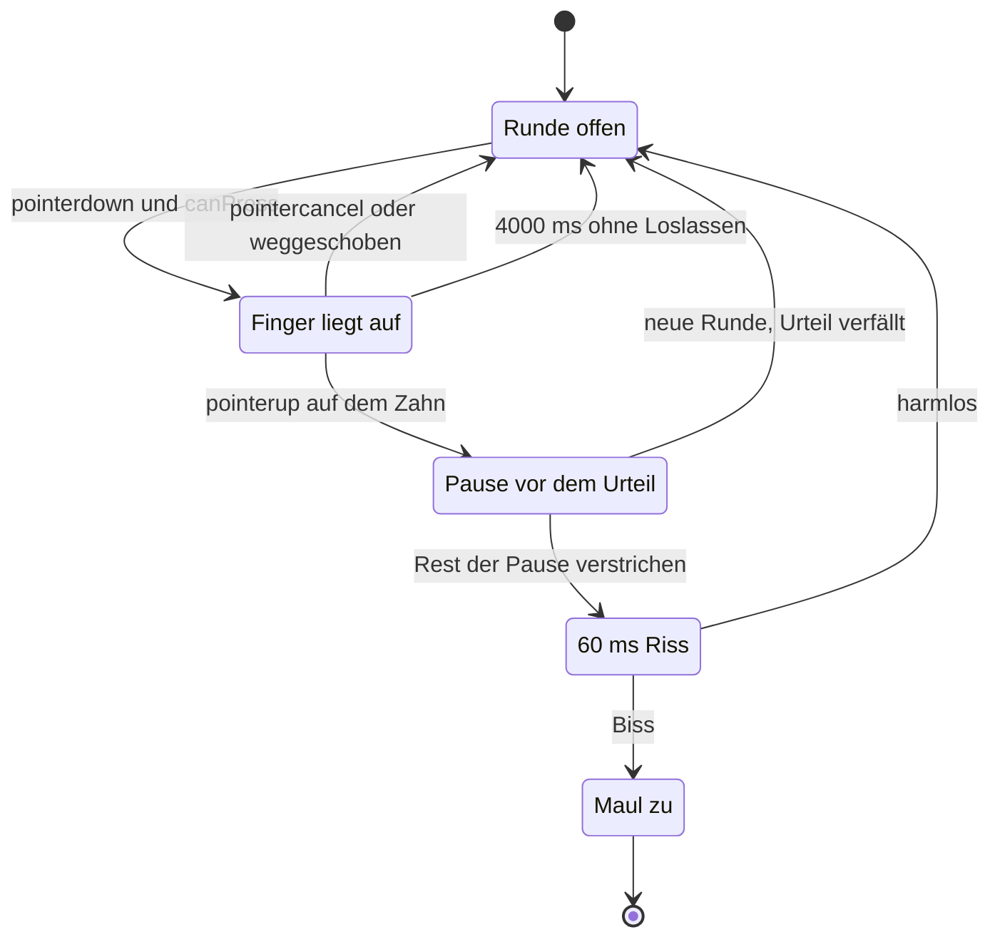

# Ein Spielzug von der Berührung bis zum Protokolleintrag

Ein Spielzug ist der Weg **eines** Drucks. Er beginnt mit einem Finger auf einem Zahn und endet
entweder mit einem Protokolleintrag oder damit, dass nichts geschehen ist. Vier Bausteine teilen
sich diese Strecke, und keiner von ihnen könnte den Teil eines anderen übernehmen:

| Baustein | Rolle im Zug | Datei |
|---|---|---|
| `createHoldGesture` | erkennt Auflegen, Halten, Wegschieben und Loslassen; liefert `toothId`, `heldMs` und `felt` | [`holdGesture.ts`](../../src/presentation/game/holdGesture.ts) |
| `GameController` | hält Runde, Spannung und `busy`, besitzt **alle** Zeitgeber und löst das Urteil auf | [`gameController.ts`](../../src/presentation/game/gameController.ts) |
| `playPress` mit `tension.ts` | entscheidet hinter verschlossener Tür und liefert die Dramaturgie als Zahlen | [`playPress.ts`](../../src/core/use-cases/playPress.ts), [`tension.ts`](../../src/core/domain/tension.ts) |
| `hudModel`/`hudView`, `roundRecorder`, `logFeed` | sagt, was die Anzeige behauptet, schreibt den Eintrag und meldet ihn | [`hudModel.ts`](../../src/presentation/game/hudModel.ts), [`hudView.ts`](../../src/presentation/game/hudView.ts), [`roundRecorder.ts`](../../src/presentation/game/roundRecorder.ts), [`logFeed.ts`](../../src/presentation/game/logFeed.ts) |

Die Arbeitsteilung ist die eigentliche Aussage dieser Seite: der **Kern** entscheidet, die
**Steuerung** taktet und prüft, die **Anzeige** behauptet nichts, was sie nicht aus öffentlichen
Zahlen ableiten kann.

Der ganze Zug in der Reihenfolge, in der die Aufrufe fallen; die Identitätsprüfungen der drei
`wait`-Stellen sind hier ausgelassen und stehen im Abschnitt zu den Invarianten.

Der Gesamtzustand, den die Steuerung dabei durchläuft:

Jeder Weg zurück nach „Runde offen“ außer dem harmlosen Ausgang ist ein **Abbruch**: kein
Zustandswechsel, kein Protokolleintrag, kein Ergebnistext.

## Auflegen: entschieden ist noch nichts

`beginHold` läuft nur, wenn drei Bedingungen gleichzeitig gelten: die Geste ist nicht abgehängt
(`disposed`), es hält noch kein Finger (`hold`), und `canPress(toothId)` sagt ja
([`holdGesture.ts#L55-L69`](../../src/presentation/game/holdGesture.ts)). `canPress` ist die
Vorbedingung des Kerns, in der Bedienung nachgebaut: `!busy && round.status === 'open' &&
!round.pressOrder.includes(toothId)` ([`gameController.ts#L162-L164`](../../src/presentation/game/gameController.ts)).
Damit entstehen die `DomainError`-Fälle aus `pressTooth` gar nicht erst — und der Abbruchpfad bleibt
der einzige Weg, auf dem ein Druck verschwindet.

Was der Finger in diesem Moment merkt, ist **Rückmeldung ohne Auskunft**:

- `classList.add('is-held')` am Zahn, dazu `feel()` — das sind `sound.unlock()`,
  `hud.startPressBeat(HOLD_SINK_MS)` und `feelPress()` mit `TAP_VIBRATION_MS = 25` (nur wenn die
  Einstellung Vibration erlaubt) sowie `tap`, `creak` und `breath` auf der **aktuellen** Spannung.
- `HOLD_SINK_MS = 320` ist reine Bildzeit: sie steuert den Sinkweg des Zahns (`--press-beat`), nicht
  das Urteil. Danach kommt die Pause des Kerns, die 120–700 ms lang sein kann.
- `this.tension` bleibt hier unangetastet; `setTension` wird beim Auflegen nicht gerufen. Der Test
  „entscheidet beim Auflegen des Fingers noch nichts“ hält genau das fest: Klänge `tap, creak,
  breath`, ein Vibrationsmuster, Fortschritt weiter `0 von 10 gedrückt`, kein `is-pressed`.

Erst das **Loslassen** löst den Zug aus. `releaseHold` rechnet `heldMs = max(0, now() - startedAt)`
und ruft `onPress(toothId, heldMs, true)`. Der letzte Parameter ist der Unterschied zwischen Maus,
Finger und Tastatur: `felt: true` heißt „Stoß, Klang und Sinkbewegung sind schon passiert“, die
Pause läuft also bereits. `felt: false` kommt von `click` mit `detail === 0` (Tastatur und
Hilfstechnik) sowie von `Enter`, `Leertaste` und `Spacebar`; dort ist `heldMs` `0`, und die
Steuerung holt Rückmeldung und volle Pause selbst nach.

Drei Grenzen der Geste sind gemessen und dürfen nicht wegfallen:

- **Nur der erste Finger und nur die Haupttaste.** `pointerdown` ohne `isPrimary` oder mit
  `button !== 0` beginnt nichts; ein zweiter Finger beendet auch nichts, weil `onPointerUp` die
  `pointerId` gegen die gespeicherte prüft („lässt einen zweiten Finger nichts beginnen und nichts
  beenden“ in [`gameController.test.ts`](../../src/presentation/game/gameController.test.ts)).
- **Das Loslassen wird am Dokument gehört, nicht am Zahn.** Mit der Maus endet es dort, wo der
  Zeiger gerade steht; `releasedOnTooth` fragt `doc.elementFromPoint` und nimmt den Druck zurück,
  wenn der Punkt nicht mehr im Zahn liegt. jsdom kennt `elementFromPoint` nicht — dort gilt jedes
  Loslassen als auf dem Zahn, sonst wäre die Geste im Test nicht prüfbar.
- **Ein wackelnder Finger ist kein Wischen.** `touchstart` auf dem **gehaltenen** Zahn wird mit
  `preventDefault()` angehalten (nicht passiv). Ohne das brach der Browser das Halten nach rund
  10 px Weg mit `pointercancel` ab — gemessen am 12.10.2026: 14 px Weg auf 65 px Trefferfläche,
  kein Zug, obwohl die Seite nicht scrollte. `touch-action: none` hilft dort nicht, weil Chromium
  es an Teilen einer SVG-Zeichnung nicht auswertet. Nur der gehaltene Zahn ist gesperrt: von einem
  bereits gedrückten Zahn aus lässt sich weiter scrollen. Der Test dazu heißt „lässt den Browser aus
  dem gehaltenen Zahn kein Wischen machen — sonst bricht ein wackelnder Finger ab“.

## Der Zug: Urteil und die Pause als Mindestpause

`resolvePress` ist die einzige Stelle, an der aus einer Geste ein Zug wird
([`gameController.ts#L181-L223`](../../src/presentation/game/gameController.ts)). Die Reihenfolge
ist Vertrag:

1. `busy = true`. Ab hier ist kein zweiter Druck möglich — `canPress` sagt nein, und ein zweiter
   Druck würde auch die Runden-Identität des laufenden Urteils zerstören.
2. `playPress({ state, tooth, rng })` — der Kern liest `state.live`, zieht die Dramaturgie und gibt
   `{ state, drama, snapped, tooth }` zurück. Die Bedienung sieht **nie** `state.live` und **nie**
   `drama.twitch` vor dem Urteil; sie merkt sich nur `drama.tensionAfter` (für `setTension`, Klang
   und Beben) und übernimmt den neuen `RoundState`.
3. `hud.markPressed(toothId)` setzt `is-pressed` und `aria-pressed="true"`.
4. `hud.lookAt(this.view?.toothAnchor(toothId), this.eyes)` — das Tier schaut auf den Zahn, der
   gedrückt wurde, auch bei Tastatur ohne Zeiger.
5. `render()` rechnet das HUD neu (`hudModel`), was die gedruckte Rundennummer
   (`recorder.count() + 1`), Füllung, Farbe, Puls und Zoom umfasst.
6. Nur bei `felt === false`: `startPressBeat(drama.beatMs)` und `feelPress()` nachholen.
7. `wait(max(0, beatMs - heldMs))` — der Rest der Pause. Wer den Zahn 2 s hielt, bekommt das Urteil
   sofort; wer kurz tippte, wartet das Fenster ab. Der Test „wartet nach einem kurzen Tipp den Rest
   der Pause ab, nach langem Halten nichts mehr“ misst die eingereihten Wartezeiten: erst `4000`
   für die Obergrenze des Haltens, dann `120…700`, und nach 2 s Halten `0`.
8. Im Rückruf: `sound.stopAll()` und dann `wait(VERDICT_GAP_MS = 60)` — der Riss. **Beide** Ausgänge
   bekommen dieselben 60 ms Stille, deshalb ist der Riss kein Verräter.
9. Erst danach `snap(toothId)` oder `settle(toothId, drama)`.

Eine Zeile darin ist leicht zu übersehen: die Erleichterung wird **vor** dem Warten neu gerechnet,
`reliefLevel(Math.max(drama.beatMs, heldMs))`. Wer lange hält, hat die Pause erlebt und atmet
entsprechend aus; beim 2-Sekunden-Halten steht die Erleichterung deshalb auf `1`
(„lässt die Erleichterung mit der erlebten Pause wachsen — auch mit der gehaltenen“). Beim Biss
wird der Wert zwar mitberechnet, aber nicht benutzt: `snap` liest ihn nicht.

## Die zwei harten Invarianten

Diese beiden Regeln sind der Grund, warum der Zug in einer Testumgebung ohne echte Zeit überhaupt
prüfbar ist. Wer sie bricht, bekommt keinen roten Kern-Test, sondern gelegentlich rotes Gate und
gelegentlich ein zugeschnappendes Maul über einer offenen Runde.

### Alle Zeitgeber laufen nur über `wait` der Steuerung

`wait` ist eine Abhängigkeit des Controllers (`GameDeps.wait`), voreingestellt auf
`this.win()?.setTimeout(...)` mit der Prüfung `if (!this.disposed)`
([`gameController.ts#L70-L78`](../../src/presentation/game/gameController.ts)). Drei Folgen:

- **Kein Teilmodul ruft `setTimeout` selbst.** `holdGesture` bekommt `wait` als Dep
  ([`holdGesture.ts#L17-L25`](../../src/presentation/game/holdGesture.ts)), `hudView` bekommt es als
  **Parameter** an `shake`, `settle`, `twitch` und `revealMeterHint`
  ([`hudView.ts#L214-L255`](../../src/presentation/game/hudView.ts)). Deshalb kann ein Test jede
  Wartezeit der Bedienung mitschreiben und selbst ausführen — die Sonde `buildHold` sammelt die
  Einträge in `waits` und führt nur kurze sofort aus.
- **Nie das globale `window`.** `win()` liefert `doc.defaultView ?? null`. Ein später Zeitgeber am
  globalen Fenster starb nach dem Abbau der Testumgebung als unbehandelter
  `ReferenceError: window is not defined` und machte das Gate gelegentlich rot — gemessen: 1 von 7
  Läufen. Der Test „hängt die Steuerung ab: nach dispose() läuft kein spätes Urteil mehr“ fährt
  genau diesen Fall mit echten Timern.
- **Lange Wartezeiten brauchen eine eigene Uhr.** Die Attrappe `compressedWait` führt nur
  `ms < 1000` sofort aus; der 4-Sekunden-Hinweis auf den Balken und `HOLD_MAX_MS` bleiben stehen und
  werden von Hand ausgeführt. Eine Attrappe, die *alles* sofort ausführt, verschluckt jeden langen
  Hinweis — diese Falle steht mit Messwert in `docs/fallen.md`.

### Jeder verzögerte Rückruf prüft, ob seine Runde noch gilt

Es gibt im Zug genau vier verzögerte Rückrufe mit einer Identitätsprüfung, und jeder vergleicht
**Referenzen**, nicht Flags:

| Rückruf | Wächter | Was ein verfallener Rückruf verhindert |
|---|---|---|
| Obergrenze des Haltens | `hold === current` | die Obergrenze eines späteren Haltens nimmt das neue nicht zurück |
| Pause vor dem Urteil | `this.round !== played` | das Urteil trifft nicht die neue Runde |
| Riss nach der Pause | `this.round !== played` | kein Zuschnappen über einer offenen Runde |
| Nachziehen nach dem Biss | `this.round !== bitten` | kein zusammengebissener Kiefer und keine Stimme der alten Runde |

Die Prüfung ist Referenzvergleich, weil jede neue Runde ein **neues** `RoundState`-Objekt ist:
`resetRound()` baut über `newRound()` einen frischen Zustand, und `onSettingsChanged` ruft
`resetRound()` bei Wechsel von `mode`, `players`, `creature` oder `teethOverride`. Damit verfällt
jedes laufende Urteil automatisch, egal ob „Neue Runde“ getippt, ein Tier gewechselt oder die
Zahnzahl gestellt wurde. Drei Tests halten das fest:

- „lässt einen Druck der alten Runde nicht in die neue Runde zuschnappen“ — „Neue Runde“ in der
  Pause, danach läuft der Rückruf: kein `is-snapped`, kein `snap`-Klang, kein Protokolleintrag, und
  die neue Runde ist bespielbar.
- „eine neue Zahnzahl in der Pause vor dem Urteil lässt das alte Urteil ins Leere laufen“ — die
  Bühne bleibt bei neun Zähnen offen, das Protokoll bleibt leer.
- „spielt die Stimme der alten Runde nicht mehr, wenn schon eine neue läuft“ — der
  `BITE_LATCH_MS`-Rückruf nach 120 ms.

Die Bild-Effekte in `hudView` (`is-shaking`, `is-settling`, `is-twitching`, das Glühen eines Zahns)
prüfen keine Runde, und das ist Absicht: sie setzen und entfernen nur eine Klasse an dem Element,
an dem sie sie gesetzt haben. Ist die Bühne inzwischen neu gebaut, hängt die Klasse an einem
abgehängten Knoten und ist unsichtbar. Ein Sonderfall steht trotzdem im Code: das Glühen eines
gezuckten Zahns wird **immer** nach 260 ms zurückgenommen — eine frühere Fassung nahm es nur bei
offener Runde zurück, und schnappte der nächste Druck binnen 260 ms zu, sah im Endbild ein harmloser
Zahn scharf aus.

## Das Urteil: `snap` oder `settle`

**`snap(toothId)`** ([`gameController.ts#L244-L269`](../../src/presentation/game/gameController.ts))
ist der Biss. Er gibt `busy` frei, spielt `snap` mit Intensität `1`, vibriert mit
`BITE_VIBRATION_PATTERN = [120, 50, 220]` (hinter der Einstellung), setzt `is-snapped` und
`is-lunging` an die Zeichnung und `is-live` an den Zahn, zeigt Ring und Beschriftung „Zahn N“ am
Anker des Zahns (`markBiter`), erschüttert die Bühne mit `shake(1, tension, wait)` (430 ms, außer bei
`prefers-reduced-motion`), rendert, **protokolliert** und zeigt das Ergebnis. Danach kommen die
120 ms zweite Stufe: `clench`, ein zweites Beben mit `0.45` und `sound.playVoice(creatureId)` — der
einzige Ort im Zug, an dem die Tierstimme erklingt.

**`settle(toothId, drama)`** ([`gameController.ts#L229-L242`](../../src/presentation/game/gameController.ts))
ist der harmlose Ausgang. Er beendet den Pressetakt, schreibt `--relief` und setzt `is-settling`
(420 ms), spielt `settle` mit `drama.reliefLevel` als Intensität und vibriert
`RELIEF_VIBRATION_MIN_MS + round((TAP_VIBRATION_MS - RELIEF_VIBRATION_MIN_MS) · reliefLevel)`, also
12–25 ms. Erst **danach** kommt das Zucken: `sound.play('twitch', tension)`, `is-twitching` für
320 ms, ein Beben mit `0.45` und das Glühen des Zahns für 260 ms. `busy` wird als letzte Zeile
freigegeben — die Erleichterung ist der Moment, in dem der nächste Druck wieder erlaubt ist, nicht
das Zucken.

Der Unterschied in einem Satz: `snap` schreibt ins Protokoll und zeigt das Ergebnis, `settle` schreibt
nichts. Beides ist der Grund, warum das Urteil nicht in der Anzeige liegen darf — die Anzeige erfährt
es erst, wenn es feststeht.

## Protokoll und Meldung

`recordRound()` wird **nur** aus `snap` gerufen, und `createRoundRecorder().record(round)` gibt
`null` zurück, wenn die Runde keinen `loser` hat
([`roundRecorder.ts#L31-L57`](../../src/presentation/game/roundRecorder.ts)). Der Eintrag selbst
entsteht in zwei Schritten, deren Reihenfolge die eigentliche Regel ist:

1. **Erst lesen, dann anhängen.** `currentRecords = log.load()` steht unmittelbar vor dem Anhängen,
   nicht am Seitenstart. Gemessen am 12.10.2026 mit zwei Tabs: drei gelöschte Runden kamen zurück,
   fünf importierte waren weg. Der Test „hängt an das Protokoll an, wie es jetzt in der Ablage steht
   — nicht wie beim Seitenstart“ schiebt zwei fremde Runden nach und erwartet die Nummern `7, 8, 9`.
2. **`createRoundRecord` mit `nextRoundNumber(currentRecords)`**, `playedAt` aus der Uhr,
   `mode`, `creature`, `teeth`, `players`, `loserTooth`, `pressIndex`, `liveCount` und der ganzen
   `pressOrder`. Danach `log.save(currentRecords)` und `feed?.roundFinished()` — die Meldung kommt
   **nach** dem Speichern, nie davor.

`roundFinished` ist die einzige Meldung, die feiern darf; `changedOutside` (anderer Tab,
Zurück-Taste, Abgleich der Sicherung) zieht still nach. Die Steuerung hört selbst auf
`changed-outside` und ruft dann `syncLog()` — `recorder.sync()` plus `render()`, damit die
Rundennummer im Kopf nicht bis zum nächsten Biss auf dem alten Stand steht. Was Album, Sterne und
Sicherung aus den beiden Meldungen machen, steht auf
[Sterne und Freischaltung](../concepts/sterne-und-freischaltung.md) und
[Spielseite verdrahten](spielseite-verdrahtung.md).

Der Ergebnistext ([`resultText.ts`](../../src/presentation/game/resultText.ts)) wird aus dem
gespeicherten `RoundState` gebaut, nicht aus dem Protokolleintrag: `resultTitle` nennt bei zwei
Spielern den **Gewinner**, `resultText` den falschen Zahn, die Zahl der scharfen Zähne und den Mut
der Runde (`mutSentence` über `survivedDanger`), `resultFact` den Merksatz des Tieres. Eine
Protokollzahl steht bewusst nicht mehr darin — die Runde steht in der Kopfzeile.

## Was ein Abbruch nicht tut

Der Abbruchpfad ist ein eigener, vollständiger Weg und in drei Varianten vorhanden:

| Auslöser | Weg | Wirkung |
|---|---|---|
| Finger weggeschoben (`pointerup` außerhalb des Zahns) | `cancelHold()` → `onCancel` | `endPressBeat`, `sound.stopAll()`, `hold = null`, `is-held` weg — kein Zustandswechsel, kein Eintrag |
| `pointercancel` (der Browser übernimmt die Geste) | derselbe Weg | derselbe |
| `HOLD_MAX_MS = 4000` ohne Loslassen | derselbe Weg, aus dem `wait` heraus | derselbe |
| neue Runde während des Haltens | `holdGesture.cancel()` | still: `hold = null`, `is-held` weg — **ohne** `onCancel`, weil die Bühne ohnehin neu gebaut wird |
| `dispose()` | `holdGesture.dispose()` | Dokument-Lauscher ab, `is-held` weg, `disposed = true` |

Drei Konsequenzen daraus, die man beim Umbauen leicht verliert:

- **Ein weggeschobener Druck bleibt folgenlos, aber der Zahn bleibt drückbar.** Der Test „nimmt den
  Druck zurück, wenn der Finger vom Zahn geschoben wird“ prüft Fortschritt `0 von 10`, kein
  `is-held`, kein `is-pressing`, genau ein zusätzliches `stopAll()` — und danach einen erfolgreichen
  Druck auf denselben Zahn.
- **Die Obergrenze erzwingt keinen Zug.** Nach `HOLD_MAX_MS` federt der Zahn zurück; ein danach
  eintreffendes `pointerup` findet kein `hold` mehr und tut nichts („federt nach der Obergrenze
  zurück, statt einen Zug zu erzwingen“). Der Kommentar im Code nennt den Grund: ein verlorenes
  Loslassen durch Tabwechsel oder Systemdialog darf nichts entscheiden.
- **`dispose()` ist eine Testnaht, keine Laufzeitfunktion.** Die Steuerung lebt so lange wie die
  Seite; aufgerufen wird `dispose()` nur von der Sonde, nach jedem Fall. Sie hängt die
  Einstellungs- und Feed-Abos ab, den `holdGesture`, die beiden Bühnen-Lauscher für den Blick und
  setzt `disposed`, das sowohl `beginHold` als auch den voreingestellten `wait` stilllegt. Die
  `pointerdown`-Lauscher an den Zähnen selbst bleiben stehen — sie laufen ins Leere, weil
  `beginHold` früh zurückkehrt.

## Gemessene Grenzen, die eine Änderung leicht bricht

Diese Werte sind keine Deko: jeder ist mit einem Messwert begründet und mit einem Test festgenagelt.
Wer einen davon verschiebt, muss den genannten Test mitlesen.

| Grenze | Wert und Verhalten | Was bricht, wenn sie verrutscht | Test |
|---|---|---|---|
| Rot-Schwelle | `HIGH_DANGER = 0.5`, `isHighDanger` gilt **ab** der Schwelle; `isTense` gilt strikt **über** 0,3 | Krokodil, 10 Zähne: Druck 8 hat 40,7 % (nicht rot), Druck 9 hat 55,0 % (rot, `--zoom` 0,460), Druck 10 hat 100 % (Zoom 1,000). Mit 0,6 würde es erst beim letzten Zahn rot — und ein **überstandener** roter Druck wäre unmöglich, womit der Mut der Runde nie ins Rote reicht | „wird rot, wenn noch zwei Zaehne anstehen — nicht erst beim allerletzten“, „rückt ab der Rot-Schwelle heran“, „steht mit einem Zahn sofort auf rot“, `tension.test.ts` |
| Zucken nur harmlos | bei `willSnap` setzt `planPressDrama` `twitch` hart auf `false`; `twitchChance` ist `0`, sobald `remaining <= 1`; sonst `0.12 · (0.6 + 0.9 · Spannung)`, also 7,2 % bis 18 % | zuckt das Maul bei einem scharfen Zahn, lügt die Anzeige genau an der Stelle, an der sie am meisten wiegt | `tension.test.ts` (über viele Startwerte), `playPress.test.ts` („dort darf nur gezuckt werden“), „nimmt das Glühen eines Zuckens zurück, auch wenn der nächste Druck sofort zuschnappt“ |
| Pupillen folgen dem Zeiger | `gazeOffset` hängt nur an Augenmitte und Ziel, `GAZE_MAX = 4` SVG-Einheiten (am engsten Auge nachgerechnet), `GAZE_FULL_DISTANCE = 120`; `onStagePointer` folgt nur bei offener Runde und nicht nach `dispose()` | der Blick darf **nichts** über scharfe Zähne verraten; wer den Versatz aus der Runde speist, macht aus dem Blick einen Verräter. Ohne gemessene Zeichnung gibt es keinen Punkt — der Blick bleibt stehen, statt zu springen | „folgt dem Zeiger über der Bühne“ (genau ±`GAZE_MAX` an den Rändern), „lässt den Blick stehen, wenn die Zeichnung keine Größe hat“, „schaut auf den Zahn, der gerade gedrückt wurde“, „folgt dem Zeiger nach dem Biss nicht mehr“, „folgt nach dispose() keinem Zeiger mehr“, `gaze.test.ts`, `scripts/pruefen-blick.py` |
| Pausenfenster | `BEAT_MIN_MS = 120`, `BEAT_MAX_MS = 700`; die Pause wird aus Spannung und **einer** Zufallszahl gezogen, bevor der Ausgang betrachtet wird | eine Pause, die den Ausgang kennt, verrät ihn über die Wartezeit — der ganze Grund, warum das Urteil im Kern bleibt | `tension.test.ts` („unabhängig vom Ausgang“, liest auch den Quelltext), `playPress.test.ts` |
| Riss | `VERDICT_GAP_MS = 60`, für beide Ausgänge gleich | ein eigener Riss für den Biss wäre ein hörbarer Hinweis vor dem Urteil | `tension.test.ts`, `gameController.test.ts` |
| Halten | `HOLD_MAX_MS = 4000` (Obergrenze, nimmt den Druck zurück), `HOLD_SINK_MS = 320` (**nur Bild**) | wer die Sinkzeit vom Ausgang abhängig macht, verrät das Urteil schon beim Auflegen; wer die Obergrenze entfernt, lässt ein verlorenes Loslassen die Bühne sperren | „federt nach der Obergrenze zurück“, „schnappt erst beim Loslassen zu, auch wenn der scharfe Zahn lange gehalten wird“, `holdGesture.test.ts` (`HOLD_MAX_MS` als eingereihte Wartezeit) |
| Zweite Stufe des Bisses | `BITE_LATCH_MS = 120` für `clench`, zweites Beben und Stimme | ohne die 120 ms wirkt das Maul wie ein Sprung statt wie eine Feder; ohne die Identitätsprüfung beißt der Kiefer über einer offenen Zeichnung zu | „spielt die Stimme der alten Runde nicht mehr“, `gameController.test.ts` |

## Tests, die diesen Weg festhalten

| Testdatei | Was sie festhält |
|---|---|
| [`gameController.test.ts`](../../src/presentation/game/gameController.test.ts) | der ganze Weg im jsdom: Auflegen entscheidet nichts, Loslassen entscheidet genau einmal, Rest der Pause gegen gehaltene Zeit, Wegschieben, `pointercancel`, zweiter Finger, `click` mit `detail`, Obergrenze, Halten über eine neue Runde hinweg, `dispose`, Protokoll-Anhang und Rundennummer, Ergebnis und Mut, Blick, Schwellen, Zoom, Zittern |
| [`holdGesture.test.ts`](../../src/presentation/game/holdGesture.test.ts) | der Gestenvertrag allein: `feel` beim `pointerdown`, `HOLD_MAX_MS` als eingereihte Wartezeit, `onPress` mit der gemessenen `heldMs`, `onCancel` bei `pointercancel`, Tastatur ohne Halten |
| [`playPress.test.ts`](../../src/core/use-cases/playPress.test.ts) | der Biss wird angekündigt, obwohl die Bedienung die scharfen Zähne nicht kennt; auch der harmlose Druck bekommt seine Pause; Regelverstöße werden weitergereicht |
| [`tension.test.ts`](../../src/core/domain/tension.test.ts) | Kurven und Schwellen, Monotonie, Pausenfester, Unabhängigkeit vom Ausgang, Zucken, Erleichterung |
| [`roundRecorder.test.ts`](../../src/presentation/game/roundRecorder.test.ts) | Lesen vor dem Anhängen, kein Eintrag ohne Verlierer, `roundFinished` erst nach dem Speichern, `sync()` |
| [`logFeed.test.ts`](../../src/presentation/game/logFeed.test.ts) | `round-finished` und `changed-outside` erreichen mehrere Zuhörer unabhängig, Abmelden wirkt |
| [`hudModel.test.ts`](../../src/presentation/game/hudModel.test.ts), [`hudView.test.ts`](../../src/presentation/game/hudView.test.ts), [`resultText.test.ts`](../../src/presentation/game/resultText.test.ts) | was die Anzeige behauptet und wie die Sätze nach dem Biss lauten |

Was jsdom nicht kann — Layout, Trefferflächen, echte Berührung, berechnete Farben — prüfen die
Browser-Sonden (`scripts/pruefen-halten.py`, `scripts/pruefen-anzeige.py`,
`scripts/pruefen-blick.py`); der Überblick steht unter [Prüfen und Gate](../testing/pruefen-und-gate.md).

## Erweitern: wo eine neue Bewegung hinkommt

- **Neue Rückmeldung beim Auflegen?** In `feel` der Steuerung, nicht in `holdGesture` — die Geste
  kennt weder Ton noch HUD.
- **Neue Bildwirkung im Urteil?** Eine Methode in `hudView` mit `wait` als Parameter, aufgerufen aus
  `snap` oder `settle`. Kein `setTimeout` im Teilmodul.
- **Neue Meldung oder neuer Schritt nach dem Biss?** An `recordRound`/`feed` hängen und die
  Reihenfolge (erst speichern, dann melden) einhalten.
- **Neue Wartezeit im Zug?** Über `wait` der Steuerung — und wenn sie eine Runde überdauern kann,
  mit derselben Identitätsprüfung wie die vier bestehenden.

## Verwandte Seiten

- [Fachmodell: Runde, Zähne, Gebiss](../concepts/fachmodell-runde.md) — was `RoundState`,
  `pressOrder` und `loser` bedeuten und warum `pressTooth` unveränderlich ist.
- [Zufall, Wahrscheinlichkeiten und Spannungsdramaturgie](../concepts/zufall-und-spannung.md) —
  woher Spannung, Pause, Riss, Zucken und Erleichterung kommen und warum die Pause den Ausgang nicht
  kennen darf.
- [Ton und Vibration](../integrations/ton-und-vibration.md) — die Ports, hinter denen die Aufrufe
  dieses Zuges sitzen, samt Freigabe und Stimmen-Zeitfenster.
- [Sterne und Freischaltung](../concepts/sterne-und-freischaltung.md) — was `roundFinished` und
  `changedOutside` fachlich unterscheiden.
- [Rundenprotokoll und CSV](../concepts/rundenprotokoll-und-csv.md) — der Eintrag, den `snap`
  schreibt, und was mit ihm weiter geschieht.
- [Spielseite verdrahten](spielseite-verdrahtung.md) — wer die Steuerung baut und mit Settings,
  Feed und Album verbindet.
