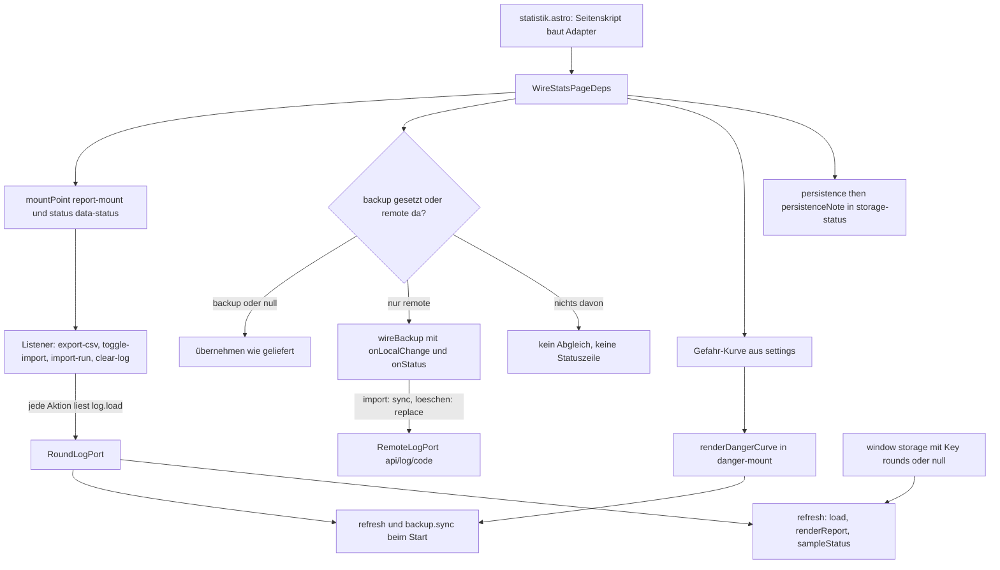
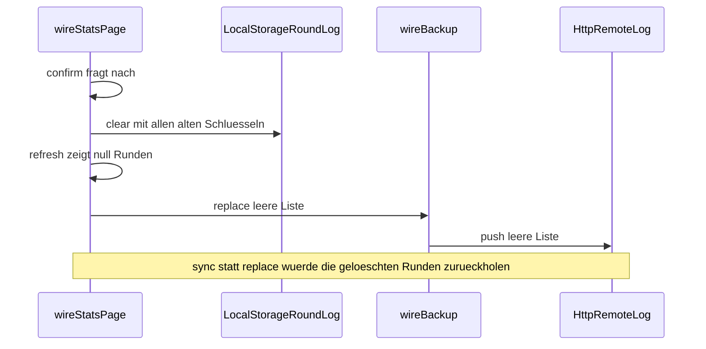

# Statistikseite: Bericht, Verlauf, Import/Export und Löschen

Die Statistikseite ist der zweite Seitenpfad der App und die einzige Stelle, an der ein Nutzer das
Rundenprotokoll **verändert**, ohne zu spielen: exportieren, importieren, löschen. Das Markup steht in
[`src/pages/statistik.astro`](../../src/pages/statistik.astro), die gesamte Verdrahtung in
[`src/presentation/stats/statsPage.ts`](../../src/presentation/stats/statsPage.ts) mit dem einen
Einstieg `wireStatsPage(deps)`. Was dabei angezeigt wird, formulieren und malen die Funktionen aus
[`statsView.ts`](../../src/presentation/stats/statsView.ts); die Mathematik dahinter (Gruppierung,
χ², Mut, Mindeststichprobe) steht auf [Statistik und Ehrlichkeit](../concepts/statistik-und-ehrlichkeit.md)
und wird hier nicht wiederholt. Das Format des Protokolls und die Regeln von `fromCsv`, `toCsv` und
`mergeRoundLogs` stehen auf [Rundenprotokoll und CSV](../concepts/rundenprotokoll-und-csv.md).

Zwei Eigenschaften bestimmen alles Weitere: die Seite **schreibt nur das Rundenprotokoll** — nie
Einstellungen, nie Sterne —, und sie hält **keinen eigenen Stand** der Runden. Jede Aktion liest
`log.load()` in dem Augenblick, in dem sie läuft.

## Die Naht: die Seite baut Adapter, ein Modul verdrahtet

`wireStatsPage` gibt `void` zurück; es gibt keine Griffe für außen. Die ganze Naht ist die
Abhängigkeitsliste.

| Dep-Feld | Was `statistik.astro` hineinreicht | Umschließt |
|---|---|---|
| `doc`, `win` | `document`, `window` | DOM und Fenster-Ereignisse |
| `log` | `new LocalStorageRoundLog(storage)` mit `storage = browserStorage()` | das Protokoll samt Arbeitsspeicher-Rückfall |
| `settings` | `loadSettings(storage)` | das **eingestellte** Gebiss (Tier, Modus, Zahnzahl), nur lesend |
| `remote` | `code ? new HttpRemoteLog(backupUrl(BASE_URL, code)) : undefined` | den Sicherungs-Worker; ohne Code gibt es ihn nicht |
| `backup` | *(nicht gesetzt)* | Testnaht: ein fertiges `Backup` überschreibt die Sicherung |
| `confirm` | `(message) => window.confirm(message)` | die Rückfrage vor dem Löschen |
| `download` | `browserDownload` | den Datei-Download (Blob + Anchor) |
| `today` | `() => new Date().toISOString().slice(0, 10)` | die Uhr für den Dateinamen |
| `persistence` | `requestPersistence()` | das Versprechen des Browsers über dauerhafte Ablage |

Drei Dinge sind daran beabsichtigt:

- **Uhr und Download kommen als Funktionen herein.** Der Dateiname lässt sich damit im Test
  festnageln (`zahn-agent-runden-2026-10-14.csv`), ohne dass die Seite eine Uhr oder einen Browser
  braucht ([`statsPage.test.ts`](../../src/presentation/stats/statsPage.test.ts)).
- **`backup` ist dreiwertig.** `undefined` heißt „nicht geliefert, baue selbst"; `null` heißt
  ausdrücklich „keine Sicherung"; ein Objekt wird übernommen. Nur der erste Fall mit vorhandenem
  `remote` erzeugt `wireBackup` (siehe unten), und nur dieser Weg füllt `#backup-status`.
- **Der Code entscheidet über die Sicherung, nicht die Seite.** `backupCode(...)` liest ihn aus der
  Adresse oder aus der Ablage; ohne Code wird `remote` gar nicht erst gebaut. Dass die Seite dann
  weder abgleicht noch eine Sicherungszeile zeigt, ist die gewollte Folge (Einzelheiten auf
  [Sicherung über den Worker](../integrations/sicherung-worker.md)).

Wie bei der Spielseite prüft kein Gate dieses Seitenskript: `pnpm typecheck` liest nur `src/**/*.ts`,
und jsdom lädt keine `.astro`-Datei. Deshalb verdrahtet das Skript nur und enthält weder
`addEventListener` noch `getElementById` — die Falle und ihre Gegenprobe stehen auf
[Spielseite verdrahten](spielseite-verdrahtung.md).

## Der Ablauf beim Verdrahten

Die Reihenfolge im Rumpf folgt den Abhängigkeiten: `refresh` muss stehen, bevor die Sicherung es als
`onLocalChange` bekommt, und der `storage`-Lauscher kommt zuletzt.



Abbildung: der Aufbau der Seite — eine Abhängigkeitsliste, zwei Entscheidungen (Sicherung, Kurve),
danach nur noch Aktionen, die bei jedem Klick frisch lesen.

1. **Mountpunkte und `refresh`.** `#report-mount` und `#data-status` werden einmal gesucht und in
   `refresh()` benutzt: `log.load()` → `renderReport(mountPoint, records)` →
   `sampleStatus(records)`.
2. **Die Sicherung.** Ist `deps.backup !== undefined`, wird der gelieferte Wert übernommen (auch
   `null`). Sonst baut `wireBackup({ local: log, remote, onLocalChange: refresh, onStatus })` die
   Sicherung, wenn ein `remote` existiert; ohne beides bleibt `backup` `null`. `onStatus` macht
   `#backup-status` sichtbar (`hidden = false`) und schreibt `backupNote(state)` hinein — die Zeile
   erscheint also erst mit dem ersten Ergebnis, nie vorher.
3. **Die Gefahr-Kurve**, sofort und einmal (nächster Abschnitt).
4. **Die vier Klick-Listener** und danach `refresh()` plus `void backup?.sync()`. Der Abgleich kann
   die Ablage verändern; `onLocalChange` ruft dann erneut `refresh()`.
5. **Der Speicher-Hinweis**, sobald `deps.persistence` aufgelöst ist.
6. **Der `storage`-Lauscher** für Änderungen aus einem anderen Tab.

## Was jede Aktion tut — im Protokoll und in der Sicherung

| Aktion | Element | Protokoll (`RoundLogPort`) | Sicherung | Anzeige |
|---|---|---|---|---|
| `refresh` | wird intern gerufen | nur `load()` | nichts | Bericht, `#data-status` |
| CSV-Export | `#export-csv` | nur `load()` | nichts | `#data-status` = „CSV exportiert." |
| Import-Blatt | `#toggle-import` | nichts | nichts | `#import-area` verliert/gewinnt `hidden` |
| Import | `#import-run` | `load()`, dann `save(merged)` | `sync()` (anhängen und zusammenführen) | `#import-status`, dann `refresh()` |
| Löschen | `#clear-log` | `clear()` | `replace([])` (ersetzen) | `refresh()` |
| anderer Tab | `window`-`storage` | nur `load()` | nichts | `refresh()` |

### `refresh` — lesen und malen

`refresh()` liest das Protokoll neu und schreibt zwei Dinge: den Bericht in `#report-mount`
(bei leerem Protokoll den Hinweis „Noch keine Runden protokolliert …", sonst `reportHtml` mit
Gruppen, Kacheln, Balken, Tests und Rohdaten) und die Statuszeile `sampleStatus(records)` in
`#data-status`. Geschrieben wird nichts — `refresh` ist der Grund, warum Import, Löschen, Sicherung
und ein fremder Tab am Ende immer dasselbe Bild ergeben.

Der Weg durch `load()` ist dabei nicht neutral: `LocalStorageRoundLog.load()` übernimmt beim ersten
Lesen einen alten Schlüssel und **filtert** alles weg, was `isPlausibleRecord` nicht besteht. Was die
Seite zeigt, ist also nie „was in der Ablage steht", sondern „was davon ein Protokolleintrag ist".

### CSV-Export — nur lesen, nichts zurückschreiben

`toCsv(log.load())` und dann `download('zahn-agent-runden-' + today() + '.csv', csv)`; danach steht
„CSV exportiert." in `#data-status`. Das ersetzt den Stichproben-Satz, bis der nächste `refresh()`
ihn wiederherstellt. Kein Schreiben, kein Abgleich, keine Rückfrage: der Export kann nichts kaputt
machen — das ist die Zusicherung, mit der die Seite bei knappem oder unzuverlässigem Speicher
empfiehlt, doch bitte zu exportieren.

Der echte Download ist `browserDownload`: ein `Blob` mit `text/csv;charset=utf-8`, ein dynamisches
`<a download>`, `click()`, `remove()` und `URL.revokeObjectURL`. Eigene Tests hat diese Funktion
nicht — der Modultest reicht eine Attrappe als `download` hinein und prüft Name und Inhalt des
Aufrufs, nicht den Browserweg.

### Import-Blatt — reine Sichtbarkeit

`#toggle-import` schaltet auf `#import-area` die Klasse `hidden` um. Kein Zustand, kein Schreiben,
keine Sicherung. Wer die Seite neu lädt, findet den Importbereich wieder zugeklappt vor — der
Ausgangszustand steht im Markup von `statistik.astro`.

### CSV-Import — anhängen und fortlaufend weiterzählen

`#import-run` liest `#import-text`, ruft `fromCsv(text)` und prüft das Ergebnis, **bevor** irgendetwas
geschrieben wird:

1. **Keine einzige gültige Zeile** → `#import-status` sagt „Keine gültigen Zeilen gefunden.", und der
   Handler kehrt zurück. Es wird nichts gespeichert, nichts neu gezeichnet, nichts abgeglichen. Ein
   Import, der nichts ergeben hat, hinterlässt keine Spur im Protokoll.
2. **Sonst** wird `log.load()` gelesen, `start` als größte vorhandene Rundennummer bestimmt (bei
   leerem Protokoll `0`), und die importierten Einträge werden mit `round = start + index + 1`
   angehängt. Die Rundennummern **aus der Datei werden verworfen** — das Protokoll bleibt lückenlos
   fortlaufend, egal ob die CSV mit `1` beginnt oder mitten in einer fremden Zählung steht.
3. `log.save(merged)` schreibt den ganzen Stand, `#import-status` meldet „`N` Runden importiert.",
   `refresh()` malt neu, und erst dann läuft `void backup?.sync()`.

Der letzte Schritt ist bewusst ein `sync`, kein `replace`: importierte Runden sind ein **Zuwachs**,
und der Abgleich holt, führt zusammen und schreibt nur, wo sich etwas ändert
([`syncRoundLog.ts`](../../src/core/use-cases/syncRoundLog.ts)). Zwischen `load()` und `save()` liegt
kein `await`, der gelesene Stand ist also derselbe, der geschrieben wird.

Drei Eigenschaften, die man kennen sollte, bevor man den Import anfasst:

- **Ungültige Zeilen werden nicht eingelagert.** `fromCsv` überspringt Zeilen ohne ganzzahligen
  Verlierer-Zahn und alles, was `isPlausibleRecord` ablehnt (Zahn außerhalb des Gebisses, Zahnzahl
  außerhalb 1–12, unbekannter Modus, zu viele Spieler). Eine Datei mit einer Milliarde Zähnen in einer
  Zeile kann die Auswertung also nicht lahmlegen.
- **Gemeldet wird die Menge, nicht die Zeile.** Bei einem teilweisen Import steht nur „`N` Runden
  importiert." — wie viele Zeilen verworfen wurden, sagt die Seite nicht. Wer eine Datei prüfen will,
  vergleicht die Zahl mit der Zeilenzahl; ein Zeilenprotokoll gibt es nicht.
- **Der Import entdoppelt nicht.** Er hängt an, ohne die Identität eines Eintrags zu prüfen. Zweimal
  dieselbe Datei ergibt doppelte Runden. Die Mengenregel „gleiche Einträge zählen je Vorkommen" gibt
  es nur im Abgleich mit der Sicherung (`mergeRoundLogs`), nicht hier.

### „Protokoll löschen" — ersetzen, nicht abgleichen

`#clear-log` fragt zuerst:
„Wirklich alle protokollierten Runden löschen? Damit verschwinden auch die Sterne im Tier-Album."
Der Satz ist Teil der Zusage — Sterne und Freischaltung sind aus dem Protokoll **abgeleitet**, es gibt
keinen zweiten Speicher, den man getrennt leeren müsste
([Sterne und Freischaltung](../concepts/sterne-und-freischaltung.md)).

Wird die Rückfrage verneint, passiert nichts: kein `clear()`, kein `replace()`. Wird sie bejaht:

1. `log.clear()` — `LocalStorageRoundLog.clear()` räumt nicht nur `zahn_agent:rounds:v1`, sondern
   auch die früheren Schlüssel (`zahn-agent:rounds:v1`, `kroko-doc-web:rounds:v1`). Ohne das würde
   `read()` beim nächsten Lesen einen Altschlüssel übernehmen und die gelöschten Runden wären wieder da.
2. `refresh()` — der Bericht zeigt den Hinweis, die Statuszeile „0 von 100 Runden …".
3. `void backup?.replace([])`.

Der dritte Schritt ist die eigentliche Regel dieser Seite: **`replace`, nicht `sync`.** Ein `sync`
würde holen, zusammenführen und die leere Ablage mit dem Stand der Sicherung auffüllen — die gerade
gelöschten Runden kämen zurück, und zwar vollständig. `replace([])` schreibt stattdessen die leere
Liste über die Sicherung (`remote.push([])`), ohne vorher zu holen.



Abbildung: der Löschpfad — die Ablage wird geleert, danach wird die Sicherung **ersetzt**.

Die Kehrseite dieser Reihenfolge ist ehrlich zu benennen: schlägt `push` fehl, ist die Ablage trotzdem
leer, und `wireBackup` meldet nur `{ state: 'failed' }` („Sicherung: nicht erreichbar …"). Beim
nächsten erfolgreichen `sync` — beim nächsten Seitenaufruf oder nach einer gespielten Runde — holt der
Abgleich den alten Stand und die gelöschten Runden sind wieder auf dem Gerät. Wer sicher löschen will,
prüft die Sicherungszeile nach dem Klick.

### Ein anderer Tab schreibt — `storage`

`window`-`storage` wird nur ausgewertet, wenn `event.key === null` (die Ablage wurde als Ganzes
geleert) oder `event.key === STORAGE_KEY` (`zahn_agent:rounds:v1`) ist; dann läuft `refresh()`. Der
Schlüssel der Einstellungen (`zahn_agent:settings:v1`) wird ausdrücklich **nicht** verfolgt — dieselbe
Entscheidung wie auf der Spielseite: zwei Tabs dürfen sich beim Tippen nicht gegenseitig
zurücksetzen. Der Bericht zieht also nach, die Gefahr-Kurve nicht (nächster Abschnitt).

Anders als `wireGamePage` hört diese Seite **nicht** auf `pageshow` mit `persisted`. Kommt die Seite
über die Zurück-Taste aus dem Zwischenspeicher, bleibt der zuletzt gemalte Bericht stehen, bis ein
`storage`-Ereignis oder ein Klick auf die Seite kommt.

## Die Gefahr-Kurve rechnet mit dem eingestellten Gebiss

Der zweite Kasten der Seite („Wie gefährlich ist der nächste Druck?") ist **keine** Auswertung der
eigenen Runden, sondern die Rechnung hinter dem Balken im Spiel — deshalb stimmt sie auch beim ersten
Spiel. Sie entsteht einmal beim Verdrahten aus drei Quellen:

```ts
const creature = getCreature(settings.creature);
const teeth = Math.min(MAX_TEETH, Math.max(MIN_TEETH, settings.teethOverride ?? creature.teeth));
renderDangerCurve(dangerMount, {
  creatureName: creature.name,
  teeth,
  mode: settings.mode,
  liveTeethMin: creature.liveTeethMin,
  liveTeethMax: creature.liveTeethMax,
});
```

- **Gebiss aus den Einstellungen.** `settings.teethOverride ?? creature.teeth` heißt: eine
  eingestellte Zahnzahl gewinnt, sonst gilt das Gebiss des Tiers (Krokodil 10, Wolf 12, Maus 6 …).
- **Geklemmt auf 1–12.** `MIN_TEETH` und `MAX_TEETH` sind die Spielgrenzen; die Klemmung schützt die
  Anzeige an der Stelle, an der sie rechnet — `dangerCurvePoints` legt `Array.from({ length: teeth })`
  an und `tensionForPress` nimmt die Zahnzahl als Domäne. `loadSettings` weist eine ungültige
  `teethOverride` zwar schon ab (`null`), aber die Seite ist auch direkt aufrufbar; ein Wert außerhalb
  1–12 käme sonst bis in die Balkenliste.
- **Ein unbekanntes Tier wirft.** `getCreature` löst `DomainError('unknown-creature')` aus. Im Betrieb
  kann das nicht passieren, weil `loadSettings` eine unbekannte Kennung auf das Krokodil abbildet — für
  einen direkten Aufruf mit selbstgebauten Einstellungen ist es die erste Stolperstelle.
- **Der Modus kommt mit**, weil er die Verteilung ändert: `classic` (genau ein Zahn scharf) beginnt
  beim Krokodil bei 10 %, `original` bei 20 %.

Gezeichnet wird über `dangerCurvePoints` → `tensionForPress` je Druck; die letzte Zeile ist
zwangsläufig 100 % („garantiert scharf"), Werte ab `HIGH_DANGER` (0,5) bekommen die heiße Füllung
(`bar__fill--hot`). Weil die Kurve aus dem **Modell** kommt und nicht aus dem Protokoll, kann sie nicht
veralten, wenn neue Runden dazukommen — sie veraltet nur, wenn sich die Einstellungen ändern. Die
Seite liest `settings` genau einmal und schreibt sie nie: für ein anderes Gebiss muss die Seite neu
geladen werden. Die Rechnung selbst und ihre geprüften Zahlen stehen auf
[Zufall und Spannung](../concepts/zufall-und-spannung.md).

## Der DOM-Vertrag

`wireStatsPage` kennt die Seite nur über IDs, und fast jeder Zugriff ist ein `?.`. Ein fehlendes
Element schaltet damit einen Teil still ab, statt die Seite scheitern zu lassen — das ist die
Voraussetzung dafür, dass `statsPage.test.ts` ein ausgeschnittenes DOM hinstellen kann. Wer Markup
ergänzt, muss die ID auch in `statistik.astro` anlegen.

| ID | Rolle | Fehlt sie … |
|---|---|---|
| `report-mount` | Ziel von `renderReport` | bleibt der statische Hinweis aus dem Markup stehen |
| `data-status` | Stichproben-Satz, Export-Meldung (`role="status"`) | keine Statuszeile, sonst alles unverändert |
| `danger-mount` | Ziel von `renderDangerCurve` | der Kurven-Kasten bleibt leer |
| `export-csv` | Knopf für den Export | Export nicht auslösbar |
| `toggle-import` | Knopf für das Importblatt | Blatt bleibt im Ausgangszustand |
| `import-area` | Behälter des Blatts (`class="hidden"`) | Umschalten läuft ins Leere |
| `import-text` | Textfeld für die CSV | `import-run` kehrt sofort zurück |
| `import-run` | Knopf „Importieren" | Import nicht auslösbar |
| `import-status` | Meldung des Imports | Import läuft, aber ohne Rückmeldung |
| `clear-log` | Knopf „Protokoll löschen" | Löschen nicht auslösbar |
| `storage-status` | Satz über die Haltbarkeit der Ablage | Speicher-Hinweis fehlt |
| `backup-status` | Satz über die Sicherung (`hidden` bis zum ersten Status) | Sicherung läuft, aber stumm |

Welche IDs die Pflicht sind, hält der Produktionsbau fest: `#report-mount`, `#export-csv` und
`#import-text` werden dort je einmal verlangt (`docs/e2e-nachweise.md`, Abschnitt 4b); das Markup
prüfen außerdem Texttests und die Browser-Sonden
([Prüfen und Gate](../testing/pruefen-und-gate.md)).

## Was diese Seite nicht hat: eigenen Zustand

- **Keine Kopie der Runden.** Jede Aktion ruft `log.load()` in ihrem eigenen Ablauf; zwischen Lesen und
  Schreiben liegt bei Import und Löschen kein `await`. Genau deshalb kann die Spielseite in einem
  zweiten Tab spielen, während hier importiert wird, ohne dass einer dem anderen den Stand
  überschreibt (der Anlass steht in `docs/fallen.md`, „Wer eine Ablage zurückschreibt, liest sie
  vorher").
- **Keine Autorität über die Einstellungen.** `settings` ist ein Abzug vom Seitenstart; die Seite
  schreibt nie hinein und hört nicht auf den Einstellungsschlüssel.
- **Keine Sterne.** Sterne und Freischaltung werden bei jedem Malen aus dem Protokoll gerechnet; die
  Seite muss sie nicht pflegen und kann sie deshalb auch nicht „vergessen".
- **Dauerhaft ist nur, was in der Ablage oder in der Sicherung liegt.** Weigert sich der Browser,
  `setItem` auszuführen (voller Speicher, privater Modus), gilt bis zum nächsten Erfolg der
  Arbeitsspeicher (`LocalStorageRoundLog.unsaved`). Import und Löschen können dann so aussehen, als
  hätten sie geklappt, und nach dem Neuladen ist der alte Stand wieder da. Die Antwort darauf ist der
  CSV-Export — und der Speicher-Hinweis, der genau das sagt.

## Grenzen und Fehlerfälle

| Lage | Was die Seite tut | Was übrig bleibt |
|---|---|---|
| CSV ohne gültige Zeile | „Keine gültigen Zeilen gefunden.", kein Schreiben | Ablage und Sicherung unberührt |
| CSV mit ein paar kaputten Zeilen | importiert die gültigen, meldet nur deren Anzahl | verworfene Zeilen sind nicht einzeln benannt |
| dieselbe Datei zweimal importiert | hängt erneut an, neue Rundennummern | doppelte Runden im Protokoll |
| Schreiben scheitert (volle Ablage) | `save` fällt auf den Arbeitsspeicher zurück | nach dem Neuladen fehlt der Import |
| `replace([])` scheitert | Statuszeile „Sicherung: nicht erreichbar …" | der nächste `sync` holt die gelöschten Runden zurück |
| Sicherung fehlt (kein Code) | kein Abgleich, keine Zeile | alles wie ohne Sicherung |
| `requestPersistence` antwortet nie | `#storage-status` bleibt leer | kein Hinweis, kein Fehler |
| Browser kennt `storage.persist` nicht | `persistenceNote('unknown')` | der Satz nennt den CSV-Export als Ausweg |

## Erweitern: wo eine neue Fähigkeit hinkommt

- **Neue Aktion auf der Seite?** Markup und ID in `statistik.astro`, Listener in `wireStatsPage`,
  und vorher entscheiden, ob sie das Protokoll verändert. Wenn ja: erst `log.load()`, dann schreiben,
  ohne `await` dazwischen — und danach `refresh()`, dann die Sicherung.
- **Zuwachs oder Ersatz?** Alles, was Runden **hinzufügt**, geht über `backup.sync()`; alles, was den
  Stand **setzt oder leert**, über `backup.replace(...)`. Ein `sync` nach dem Löschen ist der Fehler,
  den diese Seite nicht macht.
- **Neue Anzeige-Regel?** Gehört nach `statsView.ts` (Formatierung und Markup), nicht in die
  Verdrahtung — und wenn sie eine Aussage über Daten ist, in den Kern
  ([Statistik und Ehrlichkeit](../concepts/statistik-und-ehrlichkeit.md)).
- **Neuer Speicherhinweis oder eine neue Browser-Antwort?** `PersistenceState` und
  `requestPersistence` in [`browserPersistence.ts`](../../src/infrastructure/storage/browserPersistence.ts)
  ergänzen und `persistenceNote` um einen eigenen Satz — jede Antwort bekommt ihren Satz, sonst ist
  ein still verschwindender Speicher eine Fehlersuche für den Nutzer.
- **Neue Kennung im Markup?** Auch in die ID-Tabelle oben und in die Prüfliste des Produktionsbaus.

## Tests, die diese Seite halten

`src/presentation/stats/statsPage.test.ts` läuft mit `// @vitest-environment jsdom`, stellt das DOM als
String hin, benutzt `MemoryLog` (eine `RoundLogPort`-Attrappe) und ein `Backup` aus zwei `vi.fn()`.
Genau diese Injektion ist der Grund, warum die Seite überhaupt prüfbar ist — ohne echtes
`localStorage`, ohne Netz.

| Fall | Behauptung |
|---|---|
| Import | vier Einträge, die neuen Nummern 3 und 4, „2 Runden importiert.", `backup.sync()` gerufen |
| Import ohne gültige Zeile | „Keine gültigen Zeilen gefunden.", Protokoll bleibt leer |
| Löschen | Rückfrage kommt, Protokoll leer, `backup.replace([])` — und **nicht** `sync` |
| Löschen abgelehnt | Rückfrage kommt, Runde bleibt, `replace` nicht gerufen |
| `storage` mit `STORAGE_KEY` | die Statuszeile springt von „0 von 100 …" auf „1 von 100 …" |
| Export | `download('zahn-agent-runden-2026-10-14.csv', …)` mit Kopfzeile, Status „CSV exportiert." |

Dazu kommt `statsView.test.ts`, das die Texte und Grenzen der Anzeige festhält, die auch hier sichtbar
werden: der Ein-Zahn-Fall schreibt „1 Zahn" (nicht „1 Zähne"), ein unbekanntes Lebewesen wird zum
Krokodil statt zu werfen, `sampleStatus` zählt Gruppen über der Mindestzahl und `persistenceNote` gibt
jeder Browser-Antwort ihren Satz (nur `best-effort` und `unknown` nennen den CSV-Export). Beide
Testdateien schreiben die 100 als Text fest; wer `MIN_SAMPLE_FOR_VERDICT` ändert, zieht sie mit.

Was jsdom nicht kann und was deshalb die gebaute Seite und die Sonden prüfen: der echte Blob-Download,
das wirklich leere `localStorage`, die Sicherung gegen den Worker (`scripts/pruefen-sicherung.py`) und
das Laden der Statistikseite ohne Netz (`scripts/pruefen-offline.py`).

## Verwandte Seiten

- [Rundenprotokoll und CSV](../concepts/rundenprotokoll-und-csv.md) — `RoundRecord`, `toCsv`,
  `fromCsv`, `isPlausibleRecord`, `mergeRoundLogs` und wer wann liest.
- [Statistik und Ehrlichkeit](../concepts/statistik-und-ehrlichkeit.md) — was der Bericht rechnet und
  wann eine Aussage unterbleibt.
- [Sicherung über den Worker](../integrations/sicherung-worker.md) — Abgleich, Code, `replace` und
  die Statuszeile.
- [Spielseite verdrahten](spielseite-verdrahtung.md) — der andere Seitenpfad, dieselbe Aufteilung
  zwischen `.astro`-Skript und Modul.
- [Zufall und Spannung](../concepts/zufall-und-spannung.md) — die Verteilung hinter der Gefahr-Kurve.
- [Sterne und Freischaltung](../concepts/sterne-und-freischaltung.md) — warum „Protokoll löschen" die
  Sterne mitnimmt.
- [Überblick](../architecture/ueberblick.md) und
  [Schichten, Ports und die Importregel](../architecture/schichten-und-importregel.md) — wo
  `presentation/stats` steht und was der Schichtenwächter nicht sieht.
- [Prüfen und Gate](../testing/pruefen-und-gate.md) — Gate, Sonden und die Grenzen von jsdom.
